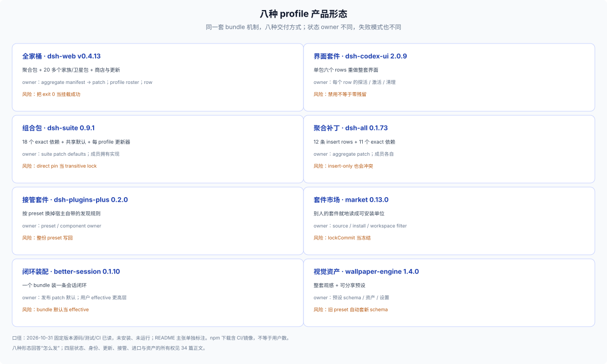
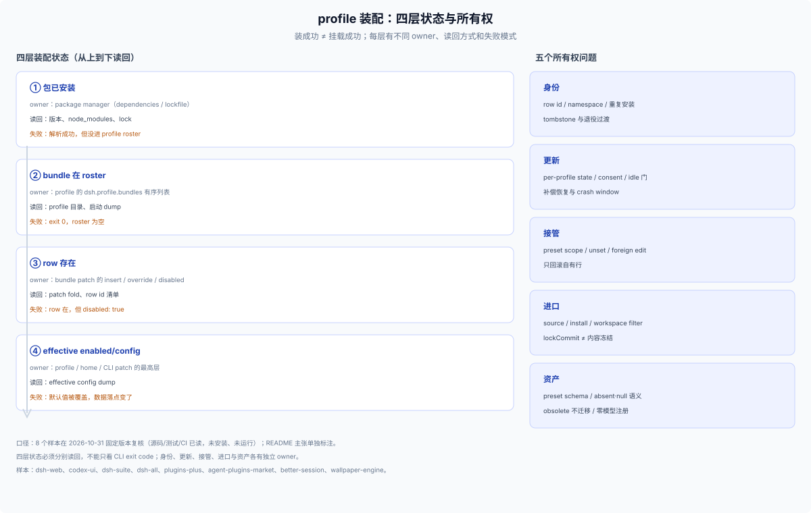

# 34 · profile 产品形态（参考）：八种把插件装成产品的方式

## 这一篇回答什么

> **角色：外部参考层（E1/E2）。** 本篇只处理 profile 级产品：一套 bundle 装进 profile，用户用 `dsh web --profile <name>` 打开。样本是 2026-10-31 固定版本复核的八个外部产品；源码、测试与 CI 记录已读，**没有安装、没有运行**。

[31](./31-external-community-patterns.md) 看单插件的数据维度，[32](./32-external-ecosystem.md) 看产品内部的数据结构，[33](./33-external-plugin-patterns.md) 是 15 个案例。本篇回答另一个问题：产品以什么单位交付，每一层各自拥有什么状态。

**口径。** 源码读的是固定 tag/commit，标 `[SRC]`；README/作者主张标 `[R]`；DSH `0.2.1-rc.3` 契约标 `[DSH]`；没有安装或启动，所以没有行为观察。npm 下载含 CI/镜像，星标不是质量。

## 八种形态

| 形态 | 代表（固定版本） | 交付物 | 主要状态 owner | 可借鉴 | 别照抄 |
|---|---|---|---|---|---|
| 全家桶 | `dsh-web` v0.4.13 | private wrapper + aggregate 包 + 20 多个家族/卫星包 | aggregate manifest 生成 patch；profile roster；row 启停 | 声明式装配事实源、row 命名空间、tombstone、家族更新 | 把 CLI `exit 0` 当挂载成功 |
| 界面套件 | `dsh-codex-ui` 2.0.9 | 单包、六个 rows | 每个 row 的探活/激活/清理 | 逐 row 定义激活与清理状态机，不共用一句“微内核” | 假设禁用等于零残留 |
| 组合包 | `dsh-suite` 0.9.1 | 18 个 exact 依赖 + 18 条 rows/defaults | Suite patch 拥有 defaults，成员拥有实现 | exact pin + 共享默认 + 每 profile 更新器 | 把 direct pin 当 transitive lock |
| 聚合补丁 | `dsh-all` 0.1.73 | 12 条 insert rows + 11 个 exact 依赖 | aggregate patch 与成员各自 | insert-only roster、共享库单例检查、安装前影响面 | 以为 insert-only 不会冲突 |
| 接管套件 | `dsh-plugins-plus` 0.2.0 | 按 preset 替换 2 个内置行 | preset/component owner | target/scope/diff、`unset` 与继承、只回滚自有行 | 整份 preset 写回 |
| 套件市场 | `dsh-agent-plugins-market` 0.13.0 | 外部 suite → 本地可安装单位 | source / install / workspace filter 三层 | 分层 owner、可逆状态转换、凭据状态机 | 把 `lockCommit` 当内容冻结 |
| 闭环装配 | `better-session` 0.1.10 | 5 个 exact 依赖 + rows + SQLite default | 发布 patch 设默认，用户 effective 在更高层 | 一条用户闭环一个 bundle；发布 patch 可审阅 | bundle 默认值当 effective config |
| 视觉资产 | `dsh-wallpaper-engine` 1.4.0 | 8 个 packages + 可分享预设 | 预设 schema、资产、设置 | full values snapshot、obsolete 不迁移、零模型注册 | 旧 preset 自动套新 schema |

八种形态回答的是“怎么发”，不是“数据放哪”。下面六组机制是它们共用的状态所有权问题。

## 四层装配状态

“装成功”至少是四层状态，必须分别验证：

| 层 | 由谁写 | 怎么读回 | 典型失败 |
|---|---|---|---|
| 包已安装 | package manager / `package.json` dependencies | lockfile、`node_modules`、版本读回 | 解析成功，但没进 profile roster |
| bundle 在 roster | profile 的 `dsh.profile.bundles` 有序列表 | profile 目录、启动 dump | CLI `exit 0`，roster 为空（`dsh-web` README 的半挂载案例，`[R]`） |
| row 存在 | bundle patch 的 insert/override/`disabled` | patch fold、row id 清单 | row 在，但 `disabled: true`（`dsh-web` 的 `inactive` 行，`[SRC]`） |
| effective enabled/config | profile/home/CLI patch 的最高层 | effective config dump | bundle 默认值被覆盖，数据落点变了（`dsh-suite`、`better-session` 的 SQLite default，`[SRC]`） |

聚合产品尤其容易把三层混成一句“安装成功”：`dsh-all` 的 insert-only roster 说明 row 存在不等于启用；`dsh-suite` 的 patch defaults 说明 bundle 写下的配置不等于用户最终值；`dsh-web` 的 `inactive` 行说明包在依赖里、row 也在 patch 里，仍可能默认不启用。

**做法**：为产品提供读回路径（package、roster、row、effective 各一条），把半挂载当可诊断状态而不是异常，并让 repair 幂等。

## 身份、冲突与退役

聚合产品的核心不是“多装几个包”，是身份管理：

- `dsh-web` 把子 row `ui-foo` 映射成 `web-ui-foo`，用独立 namespace 避免与 standalone 安装碰撞，并用测试断言 aggregate/standalone id 不冲突；`familyIds` 钉住历史发布 id。
- `dsh-all` 明确提示不要在同一个 profile 里同时装 aggregate 与成员，否则同一 Loader row id 可能重复；insert-only 并不能自动避免冲突。
- 共享库不在 row roster 里，但仍由多个成员作为普通依赖引入；`dsh-kit` 用 `kit-pins:check` 防止同一进程加载多份单例。
- `dsh-web` 用 `tombstones`/`retiredPlugins` 给旧 package identity 过渡出口；删得太快会让旧 profile 在 import 时硬失败，永久保留又会掩盖未迁移用户。
- 同一作者的同仓 sibling bundle（`better-session` 与 `mydsh-profile`）必须分开记 owner，不能把 preset 行算到另一个 npm bundle 头上。

**做法**：定义 package identity、row identity、namespace、重复安装检测和退役期限；不要把自己的 row id 命名当成 DSH 协议。

## 更新与恢复

`dsh-suite` 的更新器给出了一个完整但克制的样本：

- 偏好按 profile 存；`checkEnabled`、`autoInstall`、`deferredUntil`、`ignoredVersion` 分别有状态，默认只检查、不自动装。
- 自动更新只针对 enabled/healthy/registry 包、非 suite-managed 成员、stable patch；还要用户 consent、host agents/jobs idle、页面干净、无 pending restart。
- suite 内成员被标记为 suite-managed，抑制单独更新，避免同一包被两条流程同时处理。
- 失败恢复是**补偿**不是事务：先保存旧的 exact version/enabled，失败就 reinstall 旧版本；恢复失败标 `restore-failed`、未知状态标 `unknown`，交给用户去官方 manager 修复。remove/install/restore 之间 crash 仍会留下 partial state。
- exact direct deps 不等于 transitive lock；没有 consumer lockfile，就不能承诺完整复现。

**做法**：写清更新 owner、consent/idle 门、旧状态记录、补偿路径和 crash window；区分 direct pin、transitive lock、registry integrity、peer range 四种“兼容”。

## 接管与覆盖

`dsh-plugins-plus` 的方向相反：不新增能力，按 agent preset 停掉宿主自带的 `agent-instructions` 与 `skill-filesystem`，换成自己的发现规则。

文档描述的关键设计（`[R]`，npm 0.2.0 源码未对齐，只能当概念）：

- 接管单位是 preset 里的 component，默认 disabled；先让用户看清作用对象和当前 owner，再允许替换。
- 配置走 profile patch 与 config editor，支持继承和 `unset`；恢复默认应该是回到 inherited/default 层，而不是写一份静态默认值。
- 回退只应撤销自己拥有的行；如果一份 preset override 同时混有用户或其他插件的字段，整份删除可能丢状态。
- 旧配置导入需要字段级 precedence、一次性 marker、可重试/幂等和保留原文件；一次性 marker 在 partial failure 后必须能安全重试。
- 已有 session 用创建时的 preset snapshot，新 session 才受改动影响；这个边界要在 UI 里说清。

**做法**：接管前展示 target/scope/diff，定义 foreign-edit 策略与并发写保护；区分 `unset`、空值和显式默认，迁移要幂等。

## 进口与来源

`dsh-agent-plugins-market` 把“别人的套件”当成分发单位，也因此暴露出最多状态层：

- source checkout、suite install record、workspace surface filter 是三个 owner。source 刷新会更新受管 checkout；安装时记录的 `lockCommit` 不是内容冻结，要可复现必须另 pin 不可变 snapshot。
- suite key 用 `<sourceId>/<suiteId>`，避免同名来源碰撞；suite uninstall 只删 install entry，source removal 默认保留 checkout，物理删除要显式 `deleteCheckout`。
- 校验粒度是 artifact 级：manifest 有 fatal/ignored，MCP file 可整体 disable，单个 MCP server 可跳过；不能概括成“坏声明一律整套 fail-closed”。
- 凭据状态要分开：`${ENV}` 缺值是 `missing-credential`，OAuth 还有 pending/denied/persisted/memory-only；没有 `ctx.credentials` store 时 OAuth token 只在进程内有效。
- hook 的 dry-run 在用户 home 用 host shell 执行，`dry_run` 只是传给脚本的标志，**不是 sandbox**。
- `state.json` 损坏会退回 empty state，后续写入可能覆盖原状态；没有现成的备份/恢复。

**做法**：分开来源、安装、过滤三层；要可复现就 pin 快照；按 artifact 定义失败原子性；凭据状态机与删除所有权写进 UI。

## 闭环装配与产品资产

`better-session` 用一条用户闭环定义 bundle 边界：五个 exact 依赖、五条 rows、`session-rdb` 的 SQLite default 一起发布，patch 本身就是可审阅的装配清单。但 README 的 edit/retry/fork 仍是 `[R]`：编辑回填不重放、重试才重放、fork 派生新会话；这些是三种状态转换，truncate 事件不等于撤销外部工具副作用，session schema/事务/迁移都还没有源码证据。

`dsh-wallpaper-engine` 把外观做成可分发资产：预设是 `{schema, id, name, values, assets?}`，`values` 是 allowlisted 设置的完整快照，`assets` 可选带字体/吉祥物/头像；字段区分缺席（保持）、`null`（清除/默认）、内置 id、上传对象。schema 不匹配返回 `version-obsolete`，**不自动迁移**；预设不打包整个壁纸媒体库。它还把“不注册模型工具、不注入 prompt”写成静态守卫，作为外观产品的模型侧预算 contract。

**做法**：一条闭环定义一个 bundle，发布 patch 当装配清单；区分 bundle 默认与 effective config；预设是版本化 schema，资产与设置分开，旧 schema 显式作废而不是静默套用。

## 六条检查清单

1. **读回四层状态**：package、roster、row、effective config 各一条读回路径，不只看 exit code。
2. **定义身份与冲突**：row identity、namespace、重复安装政策、退役 tombstone 和迁移出口。
3. **更新要有 owner 和恢复**：consent/idle 门、旧版本记录、补偿路径、`restore-failed`/`unknown` 与 crash window 的 UX；exact pin ≠ lock。
4. **接管要可逆**：显示 target/scope/owner，区分 `unset` 与显式默认，只回滚自有行，foreign edit 有保护。
5. **来源/安装/过滤分层**：要复现就 pin 不可变快照；卸载区分 suite、source、checkout 三种所有权。
6. **资产与预设版本化**：full values snapshot、absent/null 语义、obsolete 不迁移；外观产品把零模型注册当 contract。

## 边界

- 八个样本是固定版本的源码/测试/CI 阅读（`[SRC]`/`[R]`），没有安装、没有启动；README 体验主张不是运行时观察。
- `dsh-plugins-plus` 的 npm 0.2.0 源码未对齐，接管/回滚/迁移只能当概念参考（`[R]`/`U`）。
- npm 下载含 CI 与镜像，星标不是质量；采用信号只说明曝光，不说明用户数或机制正确。
- 本篇不覆盖终端表层、自带运行时的独立应用、单插件增强和只支持 0.1.x 的样本。
- 来源：`awesome-dsh-plugin/_leverage/leverage-reshape-product/profile`，2026-10-31；版本与链接会变，引用时回到对应 tag/commit。
