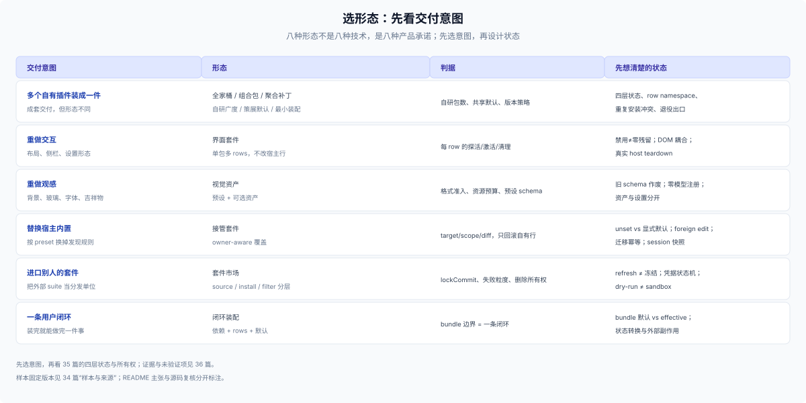

# 34 · profile 产品形态（参考）：八种把插件装成产品的方式

## 这一篇回答什么

> **角色：外部参考层（E1/E2）。** 本篇只处理 profile 级产品：一套 bundle 装进 profile，用户用 `dsh web --profile <name>` 打开。八个样本是 2026-10-31 固定版本复核；源码、测试与 CI 记录已读，**没有安装、没有运行**。

[31](./31-external-community-patterns.md) 看单插件的数据维度，[32](./32-external-ecosystem.md) 看产品内部的数据结构，[33](./33-external-plugin-patterns.md) 是 15 个案例。[35](./35-profile-assembly-ownership.md) 把八种形态共用的装配状态与所有权抽出来，[36](./36-profile-evidence-ledger.md) 记录每个样本的证据与失效边界。

**口径。** 源码读固定 tag/commit，标 `[SRC]`；README/作者主张标 `[R]`；DSH `0.2.1-rc.3` 契约标 `[DSH]`；没有安装或启动，所以没有行为观察。npm 下载含 CI/镜像，星标不是质量。

## 八种形态总表

| 形态 | 代表（固定版本） | 交付物 | 主要状态 owner | 最常抄错 |
|---|---|---|---|---|
| 全家桶 | `dsh-web` v0.4.13 | private wrapper + aggregate 包 + 20 多个家族/卫星包 | aggregate manifest → patch；roster；row | 把 CLI `exit 0` 当挂载成功 |
| 界面套件 | `dsh-codex-ui` 2.0.9 | 单包、六个 rows | 每个 row 的探活/激活/清理 | 假设禁用等于零残留 |
| 组合包 | `dsh-suite` 0.9.1 | 18 个 exact 依赖 + 18 条 rows/defaults | Suite patch defaults；成员实现 | 把 direct pin 当 transitive lock |
| 聚合补丁 | `dsh-all` 0.1.73 | 12 条 insert rows + 11 个 exact 依赖 | aggregate patch；成员各自 | 以为 insert-only 不会冲突 |
| 接管套件 | `dsh-plugins-plus` 0.2.0 | 按 preset 替换 2 个内置行 | preset/component owner | 整份 preset 写回 |
| 套件市场 | `dsh-agent-plugins-market` 0.13.0 | 外部 suite → 本地可安装单位 | source / install / filter 三层 | 把 `lockCommit` 当内容冻结 |
| 闭环装配 | `better-session` 0.1.10 | 5 个 exact 依赖 + rows + SQLite default | 发布 patch 设默认；effective 在更高层 | bundle 默认值当 effective config |
| 视觉资产 | `dsh-wallpaper-engine` 1.4.0 | 8 个 packages + 可分享预设 | 预设 schema、资产、设置 | 旧 preset 自动套新 schema |

## 先判断：插件、profile 还是独立应用

| 交付物 | 启动方式 | 负责到哪层 | 抄错的样子 |
|---|---|---|---|
| 单个插件 | 装进用户现有 profile | 3 层槽位为主 | 硬依赖不存在的服务，结果白屏 |
| 一套 bundle / profile | `dsh web --profile <name>` | 5/6/7：默认值、首启、分发 | 装上了但 bundles 没那行，用户以为装好 |
| 独立应用（换表层/自带运行时） | 双击或命令行 | 2 层起，连运行时都可能要带 | 换了表层没补 5/6/7，首启即崩 |

本篇只收中间一列；单插件的数据做法见 [31](./31-external-community-patterns.md)–[33](./33-external-plugin-patterns.md)，独立应用不在本篇。八种形态是中间一列的八种产品承诺，不是八种技术选型。

## 1. 全家桶：dsh-web

**交付与装配。** 仓库根 `dsh-web` 是 `private: true` 的 GitHub wrapper，真正进入 profile 的是 `@linxin666/dsh-web-all@0.4.13`，它声明 `dsh.bundle.patch` 与 `engines.dsh`，依赖仓内 family packages 和四个 registry satellite。`aggregate.yml` 是装配事实源：`patchFrom` 声明子 patch 来源与顺序，`deps` 是依赖，`rows` 是外部行，`familyIds` 钉历史 id，`inactive` 生成 `disabled: true`，`tombstones`/`retiredPlugins` 管旧身份。`scripts/aggregate.mjs` 从它生成 patch、exports、metadata 和 retired registry；`aggregate:check` 与测试抓 manifest/产物漂移。（`[SRC]`）

**状态与所有权。** 包依赖、row identity、profile roster、row enabled 是四层：`inactive` 行仍有依赖和 patch row，只是 `disabled: true`；子 row `ui-foo` 映射成 `web-ui-*`，`name` 仍指向真实子包；`familyIds` 固定已发布 id。更新由 `dsh-update` 以 aggregate 包为锚汇总 family 依赖，执行 profile 更新后回读版本；link/file 开发覆盖被跳过。退役由 tombstone 给旧 subpath 一个 no-op 出口，测试校验 tombstone 与 registry 一致。（`[SRC]`）

**可迁移。** 一份声明式装配源生成多个发布面，并加 drift gate；package dependency 与 row identity 分开，聚合 row 用独立 namespace；把 `disabled` 当第四种状态，不混称安装失败；改 row/package identity 时给旧身份一个有期限的过渡出口。

**失效边界。** README 报告过 `exit 0` 但 roster 为空的半挂载，本次没有复现；standalone 与 aggregate 的外部共存未实测；商店、皮肤、预设、updater 的体验仍是 `[R]`；四个 satellite 的版本是独立外部变量。（`[R]`/`U`）

## 2. 界面套件：dsh-codex-ui

**交付与装配。** 2.0.9 的 bundle patch 插入六行：`session-title`、`settings-skin`、`composer`、`sidebar`、`theme`、`main`。主入口用 Cordis effects 安装 observer 并注册 settings section；peer 声明 `>=0.2.0-rc.1 <0.3.0-0`，dev pin 在 rc.3。（`[SRC]`）

**激活与清理。** 三条路径并不一致：`theme` 的探活失败分支会恢复 tracked body tokens、surface style、root `data-ds-theme-source` 和 colorScheme，但 observer 的最终 dispose 不做同一组恢复；`composer` 在异步 probe 之前就 activate，失败后再 return cleaners；`sidebar` 探活成功才 mount React root，依赖宿主 DOM selector/CSS，dispose 时卸 root/style。settings card 只在某个 `subPluginEnabled === false` 分支 `return null`，不能扩大成所有禁用都 0 DOM。（`[SRC]`）

**可迁移。** 每个 row 写清 prerequisites、probe 时点、activate/disable/final-dispose 三条路径；对可见全局副作用登记 prior state，并在所有 teardown 路径恢复；能走公开 slot 就走 slot，必须碰宿主 DOM 时把 selector 当显式兼容点并做版本检测/失配降级。

**失效边界。** “禁用即零残留”不成立；composer portal 的清理测试 mock 了 observer，不是真实 host teardown；peer 范围没有逐版本运行；与 `ds-bot` 同装冲突只写在 README。（`[SRC]`/`[R]`/`U`）

## 3. 组合包：dsh-suite

**交付与装配。** 0.9.1 的 `package.json` exact-pin 18 个 direct dependencies，`cordis.patch.yml` 插入 18 个成员 row 并给若干行写 defaults；`ptc-minimal.patch.yml` 是独立的 preset composition，不是第 19 个成员。patch comment 允许 profile user patch 用同 id 覆盖。（`[SRC]`）

**状态与所有权。** Suite patch 拥有 bundle-layer defaults，成员拥有实现；profile/home/CLI 的更高层可以覆盖。18 个 direct pin 都是 exact 版本，但 npm metadata 没有 consumer shrinkwrap/lock，所以 direct pin 不等于完整 transitive 复现。同 profile 再装独立成员或另一个聚合包写同 id，仍可能重复或由层序决定 effective config，没有 universal checker。（`[SRC]`）

**更新与恢复。** Updater 由 profile context 注册，偏好/cache 放目标 profile 目录；每组件有 `checkEnabled`、`autoInstall`、`deferredUntil`、`ignoredVersion`，默认只检查、不自动装。自动更新只针对 enabled/healthy/registry 包、非 suite-managed 成员、stable patch，还要用户 consent、host agents/jobs idle、页面干净、无 pending restart；偏好写入是 revision-checked lock + 原子 temp/rename，坏 state fail-closed。更新优先走 host `updateBundle`；rc.3 fallback 保存原 exact version/enabled，remove→install exact new，失败/取消则 reinstall 旧版本；恢复失败标 `restore-failed`、未知标 `unknown`，进程 crash 在 remove/install 之间会留 partial state。suite-managed 成员被抑制独立更新，避免两条流程同时处理同一包。（`[SRC]`）

**可迁移。** 写清更新 owner、consent/idle 门、旧状态记录、补偿路径和 crash window；把 direct pin、transitive lock、registry integrity、peer range 四种“兼容”分开；给同 id/同包冲突一个检测或禁止政策。

**失效边界。** 这是补偿流程，不是 package manager + DSH config 的原子事务；没有自动重启，pending restart 只是 gate；同 id 冲突没有全局解决器；README 的“共同加载”未在目标 profile 复现。（`[SRC]`/`[R]`/`U`）

## 4. 聚合补丁：dsh-all

**交付与装配。** 0.1.73 的发布 patch 有 12 条 insert：自身 `all` row + 11 个成员 row，没有 disable/override；`package.json` exact-pin 11 个成员。聚合包仍带一个空 `apply()` 的 no-op runtime entry，所以准确说是“业务行为由 patch/dependencies 驱动”，不是字面零代码。共享 `dsh-kit@0.7.3` 不在 rows 或 aggregate direct deps 里，但被 10 个成员作为普通依赖引入；`kit-pins:check` 防同一进程加载多份单例。（`[SRC]`）

**状态与所有权。** insert-only roster 不自动避免冲突：同 profile 同时装 aggregate 与成员，会在同一 Loader row id 上重复。成员里的 `dsh-profile@0.2.13` 是真实 side-effect surface：创建/复制/改名/删除 profile、设置端口、执行 `pnpm install`，带 loopback/Host/Origin/body/path guards，复制失败回滚新建目录，删除会递归删目标 profile 但保留 `web`。（`[SRC]`）

**可迁移。** 明确 patch 是“新增 row”还是“覆盖/禁用 row”；对 aggregate + member 混装做检测/禁止；共享库用普通依赖而非 row，并把 singleton 版本纳入发布检查；安装前列每个成员的 tools/prompt/UI 与文件/网络/进程副作用；把 profile CRUD 当受保护的 filesystem/process 界面单独做威胁建模。

**失效边界。** 重复安装会冲突；依赖/row 由 generator 生成，source check 只证明仓库产物一致，不证明任意 profile 的 partial install 会回滚；Profile manager 的真实 OS 权限、symlink、恶意浏览器请求、磁盘故障未运行验证。（`[SRC]`/`U`）

## 5. 接管套件：dsh-plugins-plus

**交付与装配。** README 描述一个 bundle 含 core 与两个可独立启停的 component，分别替换 `agent-instructions` 与 `skill-filesystem` 的发现行为，按 agent preset 生效；组件 id 沿用 built-in id + `-plus`，默认 disabled，安装本身不触发接管。（`[R]`）

**配置与覆盖。** 配置走 profile `cordis.patch.yml` 与 DSH config editor，支持 global/component preset 继承；恢复默认用 `unset` 回到 inherited/default 层，而不是写静态默认值。回退应只撤销自己拥有的行；如果一份 preset override 同时混有用户或其他插件的字段，整份删除可能丢状态。旧配置迁移需要字段级 precedence、一次性 marker、可重试/幂等和保留原文件；已有 session 用创建时的 preset snapshot，新 session 才受改动影响。（`[R]`/`[DSH]`）

**可迁移。** 替换宿主行为时，在 UI 和命名上同时说明“替换哪个能力、在什么 scope”；先展示 target/scope/diff，再做 ownership-aware 写入；区分 `unset`、空值和显式默认；迁移要幂等，并把 session 快照边界说清。

**失效边界。** npm 0.2.0 的 `gitHead` 指向仓库 0.1.8 manifest，另一个 0.2.0 提交不是该 gitHead；目标 planner、回滚、HMR、legacy import 都没有与 tarball 对齐的源码证据，只能当概念参考。`builtin-id-plus` 是文档惯例，不是 host id 契约。（`[R]`/`U`）

## 6. 套件市场：dsh-agent-plugins-market

**交付与装配。** 0.13.0 用有序 adapter registry 解析 README 宣称的十种外部 suite 布局：候选失败写 diagnostics 后继续下一个 adapter；runtime schema 实际只接受 Agent Plugins v1 的 1.0/1.1，其他格式是兼容读取，不代表同一 validator 已核。安装以 `<sourceId>/<suiteId>` 为键，避免同名来源碰撞；runtime reconciler 再把 command/MCP/hooks/LSP 各面分别挂载。（`[SRC]`）

**状态与所有权。** source registry/checkout 在 `.sources/<sourceId>` 与 user `state.json`；install record 记录 Git HEAD/archive digest 与 enabled；workspace surface filter 是另一层，project-native 布局在 `<projectRoot>/.dsh/agent-plugins/` 单独扫描。source refresh 会更新受管 checkout，所以安装时 `lockCommit` 不能解释为内容冻结；要可复现必须另 pin 不可变 snapshot，源码里没有 refresh 后回滚。（`[SRC]`）

**卸载与删除。** suite uninstall 只删 user install record，不删 checkout；source removal 默认也保留 checkout；只有显式 `deleteCheckout` 才删受管 `.sources/<id>`，外部 local path 永不由工具删除。`state.json` 损坏会退回 empty state，后续 mutation 可能覆盖原状态，没有现成备份/恢复。（`[SRC]`）

**校验、凭据与 hook。** 失败粒度是 artifact 级：manifest 有 fatal/ignored，MCP file 可整体 disable，单个 MCP server 可跳过；不能概括成“坏声明一律整套 fail-closed”。凭据状态分开：`${ENV}` 缺值是 `missing-credential`，OAuth 还有 pending/denied/persisted/memory-only；没有 `ctx.credentials` store 时 token 只在进程内有效。hook 的 dry-run 在用户 home 用 host shell 执行并传 `dry_run:true`，这个标志不是 sandbox。（`[SRC]`）

**可迁移。** 分开来源、安装、workspace filter 三个 owner；要可复现就 pin 不可变快照；按 artifact 定义失败原子性；凭据用状态机而不是一个布尔；删除要区分 suite、source 和 checkout 三种所有权。

**失效边界。** 本次未运行真实 OAuth callback、hook 决策或跨 workspace state；十种布局的语义保真度未逐一对照；`state.json` 损坏的恢复路径是开放问题。（`[SRC]`/`U`）

## 7. 闭环装配：better-session

**交付与装配。** npm 0.1.10 的发布 patch 能确认：五个 exact 依赖（`session-branch@0.1.9`、`session-rdb@0.1.9`、`ui-conversation-manager@0.1.10`、`ui-conversation-message-actions@0.1.10`、`dsh-reference@0.0.10`），关闭四个 legacy/storage rows，设置 `storage-domain.backend=rdb`，插入 branch/rdb/message-actions/conversation-manager/reference rows，并给 `session-rdb` 声明 SQLite `$DSH_HOME/sessions/sessions.sqlite` default。发布 patch 本身就是可审阅的装配清单。（`[SRC: 发布物]`）

**状态与所有权。** bundle 默认值不等于用户 effective config；更高 profile/home/CLI patch 可以覆盖 SQLite path。README 描述 edit 回填不重放、retry 才重放、fork 派生新 session；这是三种状态转换，truncate 事件不等于撤销外部工具副作用。session schema、序号分配、事务、workspace partition、migration 都没有 pin 到 0.1.10 源码。（`[R]`/`U`）

**可迁移。** 用一条用户闭环定义一个 bundle，发布 patch 显式列出 dependency rows/default；把 bundle default 与 effective config 两级展示；edit/retry/fork 分别定义 closure、幂等、取消和 durable commit；同仓 sibling bundle（如 `mydsh-profile`）的 preset 行单独记 owner。

**失效边界。** GitHub 无 tag、npm metadata 无 `gitHead`，可见源码只匹配后续 `0.1.11-alpha.0`，不能当 0.1.10 实现；五包运行时兼容、UI slot 契约、并发 retry 与 side effect 去重都未验证。（`[R]`/`U`）

## 8. 视觉资产：dsh-wallpaper-engine

**交付与装配。** 1.4.0 由主 wallpaper host/client row 与 7 个子包组成，共 8 packages/rows；主包精确引用同版子包，按子包先发、主包最后的 `publishOrder`；主服务提供 routes/file/config，client 注入 Web runtime；子包依赖 host `wallpaperEngineHost` service，主包 teardown 会 park 依赖 fiber。`dsh-better-sidebar` 是 optional companion，不是硬依赖；该版本没有 glass 子包。（`[SRC]`）

**格式与资源。** 支持 Scene/Web/Video/custom assets；Application 需要启动第三方程序，明确不渲染、不进库/轮播。Scene 失败顺序是 live iframe → embedded MP4 → live capture cache → custom image → empty；Web iframe 用 `sandbox="allow-scripts"` 加 shim，失败可退 bare HTML但不保证 API 等价。Video 转码限帧率、优先 NVENC 再 libx264，cache key 含 source/mtime/FPS，并发上限 2、单任务 15 分钟，断连且无等待者时 abort 并清临时文件；binary 下载有 SHA256/size/magic 检查。（`[SRC]`）

**预设与资产。** 预设是 `{schema, id, name, values, assets?}`：`values` 是 allowlisted 设置的完整快照，`assets` 可选带 fonts/mascot/avatar；字段区分缺席（保持）、`null`（清除/默认）、内置 id、上传对象。GET 只返回 metadata，不携带图片 bytes；导出是 JSON attachment，导入只保存、不自动应用；未知 schema 返回 `version-obsolete`，不自动 migrate；预设不打包整个壁纸媒体库。（`[SRC]`）

**模型侧预算。** 主入口注释与静态 token contract test 指明不注册 model tool、不注入 prompt；client inject 是浏览器代码装载，不是模型能力注册。该结论只对 1.4.0 成立，不是永久承诺。（`[SRC]`）

**可迁移。** 按宿主进程能否直接渲染定义格式准入，不可执行的资产显式排除；每类资源独立 budget/fallback（占位、超时、转码队列、取消、缓存）；预设用版本化完整快照，明确 absent/null 语义，旧 schema 显式作废；多包视觉系统把 publish order、version parity、optional companion 和 host service teardown 放进 manifest/CI。

**失效边界。** 实际 GPU/WebGL/ffmpeg 表现、复杂第三方 scene、跨版本 preset 导入、与其他 skin 共存、真实 unload teardown 都未运行；Web sandbox 的威胁模型未审计。（`[SRC]`/`U`）

## 样本与来源

版本以各仓库的 tag/commit 为准；npm 包名可直接用于 `dsh plugin --profile <name> add`。

| 形态 | 固定版本 | 仓库 | npm 包 |
|---|---|---|---|
| 全家桶 | `dsh-web` v0.4.13 | <https://github.com/zhu1090093659/dsh-web> | `@linxin666/dsh-web-all` |
| 界面套件 | `dsh-codex-ui` 2.0.9 | <https://github.com/MichengAI/dsh-codex-ui> | `@michengai/dsh-codex-ui` |
| 组合包 | `dsh-suite` 0.9.1 | <https://github.com/STARDUSTLC666/dsh-suite> | `@stardustlc/dsh-suite` |
| 聚合补丁 | `dsh-all` 0.1.73 | <https://github.com/hyzyn/dsh-plugin-kit> | `@hyzyn/dsh-all` |
| 接管套件 | `dsh-plugins-plus` 0.2.0 | <https://github.com/sidleo/dsh-plugins-plus> | `@sidleo3/dsh-plugins-plus` |
| 套件市场 | `dsh-agent-plugins-market` 0.13.0 | <https://github.com/Sivan757/dsh-agent-plugins-market> | `dsh-agent-plugins-market` |
| 闭环装配 | `better-session` 0.1.10 | <https://github.com/morlay/dsh-plugin> | `@morlay/better-session` |
| 视觉资产 | `dsh-wallpaper-engine` 1.4.0 | <https://github.com/elysia395/dsh-wallpaper-engine> | `dsh-plugin-wallpaper-engine` |

## 边界

- 八个样本是固定版本复核：六个读到源码，`plugins-plus` 只到 README/tarball，`better-session` 只到发布 patch；都没有安装、启动；逐样本证据与未验证项见 [36](./36-profile-evidence-ledger.md)。
- `dsh-plugins-plus` 的 npm 0.2.0 源码未对齐，接管/回滚/迁移只能当概念参考（`[R]`/`U`）。
- npm 下载含 CI 与镜像，星标不是质量；采用信号只说明曝光，不说明用户数或机制正确。
- 本篇不覆盖终端表层、自带运行时的独立应用、单插件增强和只支持 0.1.x 的样本。
