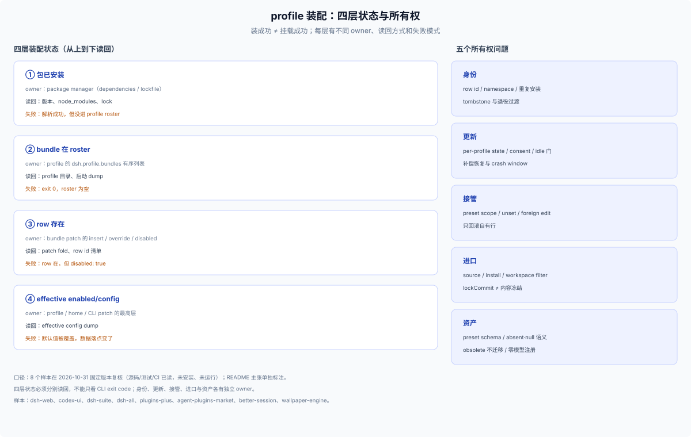
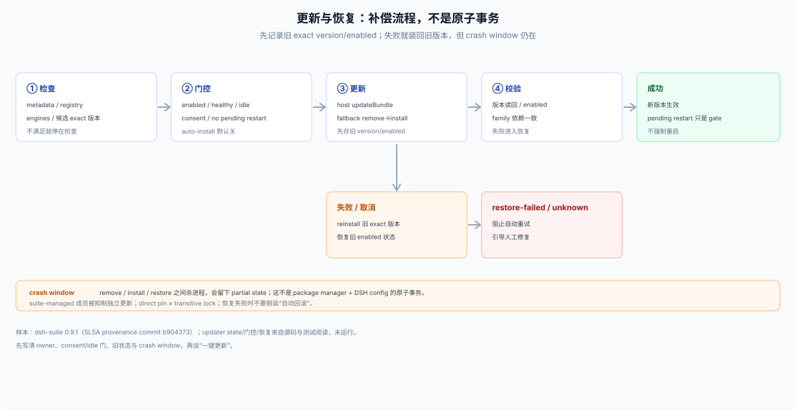
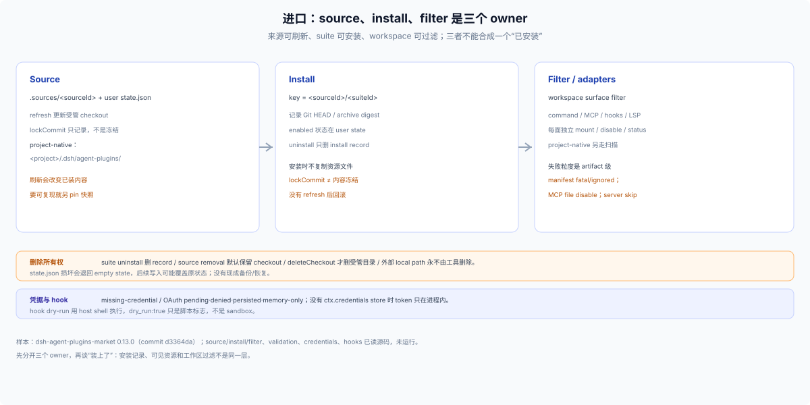

# 35 · profile 装配状态与所有权（参考）：四层状态、身份、更新、接管、进口与资产

## 这一篇回答什么

> **角色：外部参考层（E1/E2）。** 本篇把 [34](./34-profile-product-forms.md) 的八种形态拆开后共用的状态问题抽出来：同一套 bundle 机制，状态由谁写、怎么读回、失败后留下什么。证据来自 2026-10-31 固定版本复核，**没有安装、没有运行**；逐样本证据见 [36](./36-profile-evidence-ledger.md)。

八种形态回答“怎么发”，本篇回答“发出去之后，profile 里到底有几种状态、各自归谁”。四层状态是第一性问题；身份、更新、接管、进口和资产都是它的分支。

## 四层装配状态

“装成功”至少是四层状态：

| 层 | 由谁写 | 怎么读回 | 典型失败 |
|---|---|---|---|
| 包已安装 | package manager / `package.json` dependencies | lockfile、`node_modules`、版本读回 | 解析成功，但没进 profile roster |
| bundle 在 roster | profile 的 `dsh.profile.bundles` 有序列表 | profile 目录、启动 dump | CLI `exit 0`，roster 为空（`dsh-web` README 的半挂载案例，`[R]`） |
| row 存在 | bundle patch 的 insert/override/`disabled` | patch fold、row id 清单 | row 在，但 `disabled: true`（`dsh-web` 的 `inactive` 行，`[SRC]`） |
| effective enabled/config | profile/home/CLI patch 的最高层 | effective config dump | bundle 默认值被覆盖，数据落点变了（`dsh-suite` 的 defaults、`better-session` 的 SQLite default，`[SRC]`） |

四层各有独立的失败模式：`dsh-all` 的 insert-only roster 说明 row 存在不等于启用；`dsh-suite` 的 patch defaults 说明 bundle 写下的配置不等于用户最终值；`dsh-web` 的 `inactive` 行说明包在依赖里、row 也在 patch 里，仍可能默认不启用；`dsh-agent-plugins-market` 的 install record 说明“安装了 suite”也不等于每个资源面都在当前 workspace 启用。

**读回纪律。** 每个产品至少提供四条读回：package 版本、profile roster、patch 里的 row 与 `disabled`、effective config。把半挂载当可诊断状态而不是异常；repair 要幂等。`dsh --dump-default-config` 只看 bundle 层，`--dump-config` 只看合成文件配置，两者都不能证明 plugin 已挂载或 row 已启用。（`[DSH]`/`[SRC]`）

## 身份、冲突与退役

聚合产品的核心不是“多装几个包”，是身份管理：

- **row identity 与 package identity 分开。** `dsh-web` 把子 row `ui-foo` 映射成 `web-ui-foo`，`name` 仍指向真实子包；`familyIds` 钉住历史发布 id；测试断言 aggregate/standalone id 不冲突。（`[SRC]`）
- **重复装配要有政策。** `dsh-all` 明确提示不要在同一个 profile 里同时装 aggregate 与成员，否则同一 Loader row id 可能重复；insert-only 不能自动避免冲突，也没有 universal checker。（`[SRC]`）
- **共享库不进 row，但仍进依赖图。** `dsh-kit` 不在 aggregate rows/direct deps 里，却被 10 个成员作为普通依赖引入；`kit-pins:check` 防同一进程加载多份单例。（`[SRC]`）
- **退役要有出口。** `dsh-web` 用 `tombstones`/`retiredPlugins` 给旧 package identity 一个 no-op 过渡；删得太快会让旧 profile 在 import 时硬失败，永久保留又会掩盖未迁移用户。（`[SRC]`）
- **sibling bundle 的 owner 要分开。** 同仓的 `better-session` 与 `mydsh-profile` 是两个 npm artifact；`mydsh-profile` 的 preset 行不能算到 `better-session` 头上。（`[SRC]`）

**做法**：定义 package identity、row identity、namespace、重复安装检测和退役期限；不要把自己的 row id 命名当成 DSH 协议；发布前跑 standalone/aggregate 碰撞测试。

## 更新与恢复

`dsh-suite` 的更新器是一个完整但克制的样本：

- **状态按 profile 存。** 每组件有 `checkEnabled`、`autoInstall`、`deferredUntil`、`ignoredVersion` 等字段；默认 check enabled、auto-install disabled；偏好写入用 revision-checked lock + 原子 temp/rename，坏 state fail-closed 并保留供 repair。（`[SRC]`）
- **自动更新有门。** 只针对 enabled/healthy/registry 包、非 suite-managed 成员、stable patch；还要用户 consent、host agents/jobs idle、页面干净、busy checks、quiet window、无 pending restart；manual install 需明确确认。（`[SRC]`）
- **单一更新 owner。** suite 内成员标为 suite-managed，从独立 update target 中抑制，避免两条流程同时处理同一包；代价是 suite 更新器故障会挡住成员单独更新。（`[SRC]`）
- **恢复是补偿，不是事务。** 先走 host `updateBundle`；rc.3 fallback 保存原 exact version/enabled，remove→install exact new，失败/取消则 reinstall 旧版本；恢复失败标 `restore-failed`、未知标 `unknown`，交给用户去官方 manager 修复。remove/install/restore 之间 crash 仍会留下 partial state，不会自动重启，pending restart 只是 gate。（`[SRC]`）
- **四种“兼容”分开。** exact direct deps、完整 transitive lock、registry integrity、Node/DSH peer range 是不同保证；`dsh-suite` 的 exact pin 没有 consumer lockfile，不能承诺完整复现。（`[SRC]`）

**做法**：写清更新 owner、consent/idle 门、旧状态记录、补偿路径和 crash window；失败的每一步都要有 durable 状态和人工修复入口；在 UI 里区分“新包已装”与“旧加载态仍在运行”。

## 接管与覆盖

`dsh-plugins-plus` 展示的是另一种产品动作：不新增能力，替换宿主自带的 `agent-instructions` 与 `skill-filesystem` 发现规则，按 agent preset 生效。（`[R]`）

- **接管单位是 preset 里的 component。** 两个 component 默认 disabled，安装本身不触发接管；先让用户看清作用对象和当前 owner，再允许替换。（`[R]`）
- **配置有继承和 `unset`。** 恢复默认应回到 inherited/default 层，而不是写一份静态默认值；覆盖值、继承态和显式值需要不同表示。（`[R]`/`[DSH]`）
- **回退只撤销自有行。** 如果一份 preset override 同时混有用户或其他插件的字段，整份删除可能丢状态；需要 foreign-edit 策略和并发写保护。（`[R]`）
- **旧配置迁移要幂等。** 字段级 precedence、一次性 marker、partial failure 后安全重试、保留原文件，缺一不可；同一 home 多 profile 还要定 marker 的 owner。（`[R]`）
- **session 快照边界。** 已有 session 用创建时的 preset snapshot，新 session 才受改动影响；这个边界要在 UI 里说清，否则用户会以为旧 session 已更新。（`[R]`）

**做法**：接管前展示 target/scope/diff，定义 ownership-aware 写入和“只回滚自己”的语义；区分 `unset`、空值和显式默认；迁移失败要能重试。

**证据边界**：npm 0.2.0 的 `gitHead` 指向仓库 0.1.8 manifest，目标 planner/回滚/HMR/legacy import 都没有与 tarball 对齐的源码证据；以上是设计问题清单，不是该发布包已核机制。（`[R]`/`U`）

## 进口、来源与过滤

`dsh-agent-plugins-market` 把“别人的套件”当成分发单位，暴露出最多状态层：

- **source、install、filter 是三个 owner。** source registry/checkout 在 `.sources/<sourceId>` 与 user `state.json`；install record 以 `<sourceId>/<suiteId>` 为键，记录 Git HEAD/archive digest 与 enabled；workspace surface filter 由 runtime workspace service 管理；project-native 布局在 `<projectRoot>/.dsh/agent-plugins/` 单独扫描。（`[SRC]`）
- **刷新不等于冻结。** source refresh 会更新受管 checkout；安装时 `lockCommit` 只是记录，不是内容冻结，也没有 refresh 后的回滚；要可复现必须另 pin 不可变 snapshot。（`[SRC]`）
- **失败粒度是 artifact 级。** manifest 有 fatal/ignored，MCP file 可整体 disable，单个 MCP server 可跳过；不能概括成“坏声明一律整套 fail-closed”。（`[SRC]`）
- **凭据是状态机。** `${ENV}` 缺值是 `missing-credential`；OAuth 有 pending/denied/persisted/memory-only；没有 `ctx.credentials` store 时 token 只在进程内有效，重启后丢失。（`[SRC]`）
- **dry-run 不是 sandbox。** hook 的 dry-run 在用户 home 用 host shell 执行，只把 `dry_run:true` 传给脚本，没有隔离文件/进程权限。（`[SRC]`）
- **删除有三种所有权。** suite uninstall 只删 install record，source removal 默认保留 checkout，物理删除要显式 `deleteCheckout`；外部 local path 永不由工具删除。`state.json` 损坏会退回 empty state，后续写入可能覆盖原状态。（`[SRC]`）

**做法**：分开来源、安装、过滤三层；要可复现就 pin 快照；按 artifact 定义失败原子性；凭据用状态机；删除要明示删的是记录、受管 checkout 还是用户路径。

## 闭环与产品资产

`better-session` 用一条用户闭环定义 bundle 边界：五个 exact 依赖、五条 rows、`session-rdb` 的 SQLite default 一起发布，发布 patch 就是可审阅的装配清单。但 README 的 edit/retry/fork 仍是 `[R]`：编辑回填不重放、重试才重放、fork 派生新 session；truncate 事件不等于撤销外部工具副作用，session schema/事务/迁移都没有源码证据。（`[SRC: 发布物]`/`[R]`）

`dsh-wallpaper-engine` 把外观做成可分发资产：预设是 `{schema, id, name, values, assets?}`，`values` 是 allowlisted 设置的完整快照，`assets` 可选带字体/吉祥物/头像；字段区分缺席（保持）、`null`（清除/默认）、内置 id、上传对象。schema 不匹配返回 `version-obsolete`，**不自动迁移**；预设不打包整个壁纸媒体库；主入口用静态 token contract test 保证不注册 model tool、不注入 prompt，这是 release-specific 的零模型预算。（`[SRC]`）

**做法**：一条闭环定义一个 bundle，发布 patch 当装配清单；区分 bundle 默认与 effective config；预设是版本化 schema，资产与设置分开，旧 schema 显式作废；外观产品把零模型注册当可测试 contract。

## 九条 profile 检查清单

来自八个样本的复核（其中 plugins-plus/better-session 只到 README/发布物），不是无条件通用规则；每条都依赖对应机制，证据在 [36](./36-profile-evidence-ledger.md)。

1. **分清四层状态**：bundle package、dependency rows、profile roster、effective enabled/config 不是一回事；分别提供读回路径。
2. **声明式生成要验证产物一致**：依赖清单、Loader rows、package exports 来自同一聚合定义时，用 generator/check 维持 parity；生成通过不等于任意 profile 安装原子成功。
3. **重复装配有冲突政策**：aggregate rows 与 standalone rows 同 id 时可能冲突；明确禁止组合、提供检测，或设计不同 namespace。
4. **安装前展示影响面**：按成员列 model tools、system prompt、UI、filesystem、network、process 副作用；不要只列功能名。
5. **区分默认值和用户最终值**：bundle/package row config 是一层 defaults，profile/home/CLI patch 可覆盖；提供 effective config 读回。
6. **更新声明 owner、consent 和恢复级别**：direct pin 不等于 transitive lock；更新失败是补偿恢复，不是原子回滚；标明 crash window、restart-required 和人工修复状态。
7. **来源、安装、启用、过滤分层**：导入外部 suite 时，source refresh、suite installation、workspace filters 各有 owner；不要把 `lockCommit` 宣称为内容冻结。
8. **替换宿主实现前验证可逆范围**：ownership-aware diff、foreign edit 保护、只撤销自有行；对整份 override 删除做失败测试。
9. **视觉资产分三层**：呈现能力（能否渲染）、模型侧预算（是否注册工具/提示）、资产格式（预设 schema/媒体文件）；旧 schema 显式作废，不静默迁移。

## 边界

- 四层状态与所有权来自固定版本源码/测试/CI 阅读（`[SRC]`），其中 `plugins-plus`/`better-session` 只到 README/发布物；没有安装、没有启动。
- `dsh-plugins-plus` 的 npm 0.2.0 源码未对齐，接管/回滚/迁移只能当概念参考（`[R]`/`U`）。
- `better-session` 目标源码未 pin，发布 patch 之外的会话状态机都是 `[R]`/`[U]`。
- 九条检查清单只在目标形态需要时采用；不是所有产品都必须有聚合、接管或进口形态。
- 证据分级与逐样本未验证项见 [36](./36-profile-evidence-ledger.md)。
