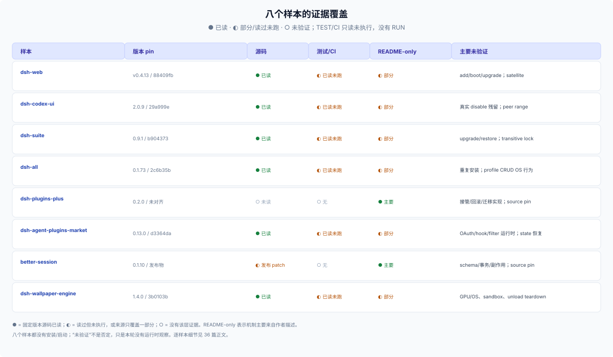

# 36 · profile 样本证据台账（参考）：每个形态读到了什么、没验证什么

## 这一篇回答什么

> **角色：外部参考层（E1/E2）。** [34](./34-profile-product-forms.md) 写八种形态，[35](./35-profile-assembly-ownership.md) 写共用机制；本篇只记证据：每个样本 pin 在哪个版本、读了什么、哪些只是 README 主张、哪些根本没有验证。

**口径。** `[SRC]` = 读过固定 tag/commit 的目标源码；`[R]` = README/作者声明；`[DSH]` = DSH `0.2.1-rc.3` 契约；`[TEST]`/`[CI]` = 读过测试与同 SHA CI 记录，但本轮没有执行；**没有 `[RUN]`**。npm 下载含 CI/镜像，星标不是质量。

## 逐样本台账

| 样本 | 版本 pin | 已读 | 测试/CI | 仅 README | 未验证 |
|---|---|---|---|---|---|
| `dsh-web` | v0.4.13 / `88409fb` | root/aggregate manifest、`aggregate.yml`、generator、`dsh-update`、retirement tests | 固定 SHA 的 aggregate/retirement 测试读过，未运行 | 半挂载、商店/皮肤/updater、standalone 共存、restart UX | 真实 profile add/boot/upgrade；pnpm resolution；四个 satellite 的版本与行为 |
| `dsh-codex-ui` | 2.0.9 / `29a999e` | 六个 rows、theme/composer/sidebar 激活路径、settings card、slot 测试 | same-SHA Node 22/24 CI 读过，未运行 | 禁用即零残留、整套 settings 0 DOM、`ds-bot` 冲突 | 真实 disable/unmount/reload 后的 token/DOM 残留；全部 peer range；portal 清理 |
| `dsh-suite` | 0.9.1 / `b904373`（SLSA） | 18 deps/rows/defaults、updater state/门控/恢复、冲突边界 | same-SHA Node 22/24 与 restore 测试读过，未运行 | README 的“共同加载”、组件面板、restart UX | 真实 upgrade/partial failure/restore；transitive lock；同 id 与其它聚合包冲突 |
| `dsh-all` | 0.1.73 / `2c6b35b` | 12 insert rows、11 exact deps、no-op entry、`kit-pins`、profile manager routes/guards | same-SHA aggregate check、mount/headless 读过，未运行 | README 的 11 个基线、按需安装、影响面表 | aggregate+member 重复安装；partial install 回滚；profile CRUD 的真实 OS 权限/symlink/恶意请求 |
| `dsh-plugins-plus` | 0.2.0（npm tarball） | registry tarball、README；`gitHead` 指向 0.1.8 manifest，无对齐源码 | 无匹配 source/test/CI | 接管 planner、`unset`/继承、legacy import、HMR、session 快照 | 目标实现全部未核；`builtin-id-plus` 是否稳定；桌面 log overlay |
| `dsh-agent-plugins-market` | 0.13.0 / `d3364da` | layouts adapter、source/install/filter、validation、credentials/OAuth、hooks、uninstall | same-SHA tests 与 CI run `40302671805` 读过，未运行 | 十种布局的语义保真度、八 tab UX、真实 OAuth callback | hook 决策与权限效果；workspace filter 运行时；`state.json` 损坏恢复；跨 peer range |
| `better-session` | 0.1.10（npm tarball） | 发布 patch：5 exact deps、5 rows、SQLite default；README 闭环 | 无匹配 source/test/CI（无 tag、无 `gitHead`） | edit/retry/fork、UI slots、确认弹窗 | session schema/事务/迁移；并发 retry；外部 tool side effect；UI slot 契约 |
| `dsh-wallpaper-engine` | 1.4.0 / `3b0103b` | 8 packages/rows、host/client、格式 fallback、video limits、preset schema、token contract | same-SHA Windows/Ubuntu CI 读过，未运行 | WebGL/ffmpeg 真实表现、preset obsolete UX、跨 skin 共存 | 真实 GPU/OS、Web sandbox 威胁模型、unload teardown、预设跨版本导入 |

## 采用信号与样本边界

npm last-month（2026-09-30 ~ 10-29，含 CI/镜像）：`dsh-codex-ui` 119,610、`dsh-wallpaper-engine` 109,268、`dsh-web` 99,694、`better-session` 8,561、`dsh-suite` 8,230、`dsh-plugins-plus` 6,094、`dsh-agent-plugins-market` 4,752、`dsh-all` 3,558。GitHub 星标（2026-10-31）从 `dsh-web` 9,865、`dsh-wallpaper-engine` 4,189 到 `dsh-plugins-plus` 0 不等；下载与星标不可互证，也不代表用户数或机制质量。

这一桶本身很薄：profile 级产品的作者通常有三条去路——DIY 一个桌面壳、发单个插件、或被上游收编；留下来的多是 npm 下载高、星标低的“打包型”产品。2026-10-31 的普查用 `keywords:dsh-bundle` 找到 322 个包，按月下载排前 20 后人工判形态，过门槛成卡 3 个、进候选池 4 个；另用 2026-10-31 的 7,924 条注册表描述做正则召回，补了接管、进口、闭环三种形态。（`[OBS]`）

## 怎么复核

- **隔离 profile**：`dsh --profile <scratch> --from-default-profile web`，只动 disposable home；不碰用户 profile、Session DB 和壁纸库。
- **四层读回**：安装后分别读 package 版本、`dsh.profile.bundles`、patch row/`disabled`、effective config；不要只看 `dsh plugin add` 的 exit code。
- **逐样本重点**：`dsh-web` 看 roster/row disabled/升级/tombstone；`dsh-codex-ui` 看 disable/unmount 后的 token/DOM 残留；`dsh-suite` 在 update 各阶段注入失败；`dsh-all` 测 aggregate+member 重复；`dsh-plugins-plus` 先解决 source pin 再谈接管；`dsh-agent-plugins-market` 测 refresh/OAuth/hook/删除所有权；`better-session` dump effective SQLite path 并测 edit/retry/fork 的副作用；`dsh-wallpaper-engine` 在目标 GPU/OS 测 fallback、预设导入和卸载。
- **失败注入**：remove/install 之间杀进程、坏 registry、磁盘满、凭据缺失、OAuth deny、坏 `state.json`；记录 partial state 与 repair 命令。

## 边界

- 八个样本都没有安装或启动；`[SRC]`/`[TEST]`/`[CI]` 不等于本轮行为观察，README 体验主张单独标注。
- `dsh-plugins-plus` 与 `better-session` 的目标源码未 pin，机制结论只到发布物或 README；不能把邻近 commit 当目标实现。
- 版本、下载、星标和默认值会变；引用时回到对应 tag/commit 与 npm 版本。
- 台账不评价 package 是否适合作为依赖；采用前另核 license、兼容范围、供应链和数据生命周期。
