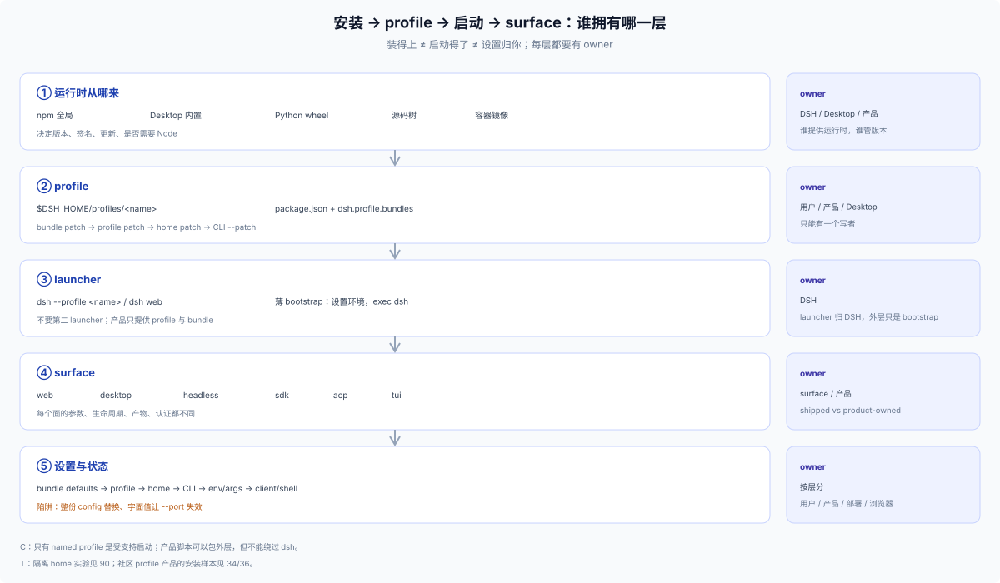

# 50 · 安装、启动与设置：产品怎么把 DSH 交到用户手里

## 这一篇回答什么

> **角色：产品交付层（C/T/S/R）。** 本目录研究一个 DSH 产品从“用户拿到它”到“它跑起来”之间的全部选择：代码和 profile 怎么安装、谁启动进程、用户看到哪个 surface、默认值和用户覆盖归谁、更新和卸载谁负责。**不是**再写一遍 `dsh web --profile`，而是把安装/启动/设置当成产品设计空间拆开。

三条轴：

1. **安装**：dsh 运行时从哪来（npm、官方 Desktop、Python wheel、源码），profile 怎么创建，bundle 怎么进入 profile。
2. **启动**：named profile 怎么组合（模板、bundle 顺序、patch），用哪个 shipped surface（Web、headless、SDK、ACP、TUI）。
3. **所有权**：profile、home、端口/token、构建产物、设置、更新、签名、单实例、卸载分别归谁。

三条轴之外，[60](./60-packaging.md) 讲分发/打包/签名/离线，[70](./70-install-docs.md) 讲安装与使用说明怎么写。

**范围。** 只采用 DSH 约定内的分发/安装/启动/配置。不研究、不对比、不教程化：新 bin、自建 Tauri/Electron/托盘、替换 web 启动器、发布 profile、wildcard bind。

[18](../10-foundations/18-install-upgrade.md) 讲 DSH 的安装/升级/卸载语义，[23](../../23_standalone-vs-web-release-forms/answer.md) 讲官方只有 Desktop 与 CLI/Web 两份发布物，[34](../30-external/34-profile-product-forms.md)/[35](../30-external/35-profile-assembly-ownership.md) 讲 profile 产品形态与装配状态，[90](../90-advisor/00-index.md) 是从 profile 到产品工作流。本目录补的是“交付与启动”这一段。

## 先给结论

- **受支持的 Node 应用启动方式只有一种：named `dsh` profile。** `web`、`headless`、`sdk`、`sdk-minimal`、`acp` 是 shipped profiles；自定义组合是 profile + 有序 patch，不是另一个可执行文件。外层最多是一个薄 bootstrap，最终 `exec dsh --profile <name>`。
- **安装的自由度主要在“谁提供 dsh 运行时”和“profile 怎么初始化”**：npm 全局、Desktop 自带运行时、Python wheel、源码树、容器镜像，五种 runtime 来源对应不同的更新/签名/隔离责任。
- **设置的灵活性在层级，不在开关数量**：bundle patch → profile patch → home patch → CLI `--patch` → app args/env → 客户端状态/Desktop shell 设置。最容易踩的两个坑是“整份 config 被替换”和“字面值让 app 参数失效”。
- **产品拥有 bundle、默认值、安装器和文档；不拥有 launcher、profile 写者或第二套更新。** 同一 profile 的并发写、两个更新器是主要故障源。
- **分发单位决定签名/校验/更新责任**：bundle、安装器、Desktop、容器、wheel、离线 tarball 各有 owner；安装文档要与发布物同版本。

## 章节地图

| 文件 | 回答什么 |
|---|---|
| [10 模型](./10-model.md) | 三轴模型、所有权表、受支持/可能/禁止的边界 |
| [20 安装路径](./20-install-paths.md) | npm/官方 Desktop/Python/源码；profile 初始化、bundle 安装、模板重置 |
| [30 启动面](./30-launch-surfaces.md) | CLI 语法、组合顺序、Web/headless/SDK/ACP/TUI、官方 Desktop 特例 |
| [40 profile 安排](./40-profile-integration.md) | 选模板、选 bundle、默认值、安装器、设置、更新、反模式 |
| [50 设置层](./50-settings.md) | 默认值/覆盖/Settings UI/env/客户端/Desktop shell 设置；两个实验陷阱 |
| [60 分发打包](./60-packaging.md) | bundle/安装器/官方 Desktop/容器/wheel/离线 tarball；版本、签名、校验 |
| [70 安装文档](./70-install-docs.md) | 十段安装/使用说明骨架、边界、错误写法 |
| [80 决策](./80-decision.md) | 模板 × bundle × 设置矩阵、检查清单、失败模式 |
| [90 证据](./90-evidence.md) | DSH 源码/docs、隔离 profile 实验与证据等级 |

## 证据口径

- **C**：当前 DSH docs/types/implementation（CLI reference、Desktop README、app-boot、web bundle、SDK/ACP、architecture）。
- **T**：在 `DSH_HOME=$(mktemp -d)` 的隔离 home 里执行的启动/配置实验，不碰用户 profile 与 Session。
- **S/R**：只用于 DSH 约定内的 profile 产品（见 [34](../30-external/34-profile-product-forms.md)/[36](../30-external/36-profile-evidence-ledger.md)）；非约定启动不列。

