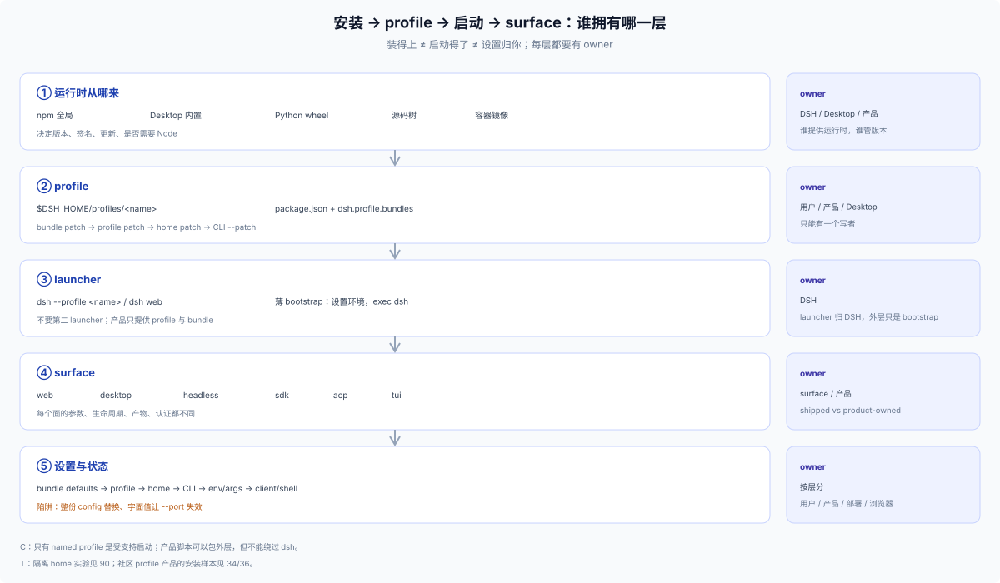

# 10 · 模型：named profile 是唯一入口

## 结论

DSH 支持的 Node 应用启动只有一种：**named `dsh` profile**。产品由三样东西组成：

1. **bundle**：带 `dsh.bundle.patch` 的包，贡献 Loader rows/defaults；
2. **profile**：`$DSH_HOME/profiles/<name>` 里的有序 bundle 列表 + 用户 patch；
3. **安装/升级说明**：怎么创建 profile、装哪些 bundle、默认值是什么、怎么更新。

产品**不**发布新可执行文件、不自建 launcher、不把 profile 当发布物。外层最多是一个薄 bootstrap：设置环境、确保 profile 存在、`exec dsh --profile <name>`。

## 三轴

| 轴 | 问题 | 选项 |
|---|---|---|
| 运行时 | dsh 从哪来？ | npm 全局、Desktop 内置、Python wheel、源码树 |
| profile 内容 | 组合哪些 bundle、顺序如何？ | shipped 模板 + 产品 bundle；base/app/product 三层 |
| 设置 | 默认值和覆盖放哪？ | bundle patch → profile patch → home patch → CLI → env/args → client |

## 受支持 / 不在这条路上

| 类别 | 例子 | 状态 |
|---|---|---|
| 受支持 | `dsh <name>` / `dsh --profile <name>`；`web`/`headless`/`sdk`/`sdk-minimal`/`acp`；自定义 profile + 有序 patch | C：唯一受支持的 Node 应用启动 |
| 不在主路径 | 新 bin、`node dist/server.js`、package bin、demo、SDK argv escape | 禁止/绕过 launcher |
| 特殊 | 官方 Desktop（`desktop` profile，Electron 独占） | C：官方发布物，不是产品模板 |

## 所有权

| 对象 | 归谁 | 产品要做什么 |
|---|---|---|
| dsh 运行时 | 用户/Desktop/Python/源码 | 声明版本 floor，检测版本 |
| profile | 用户/安装器 | 首次创建、幂等修复；不覆盖已有 patch/依赖 |
| bundle | 产品 | 自包含、声明 `dsh.bundle.patch`、engines/peer、版本 |
| 默认值 | 产品 bundle patch | 随 bundle 发布；可被 profile/home/CLI 覆盖 |
| 用户设置 | profile patch / Settings UI | 提供设置页或文档；不要两套真值 |
| home patch | 用户/机器 | 产品不要静默写 |
| 端口/token | dsh web | 文档写默认/参数；远程用反代/TLS |
| 更新 | 用户/产品安装器 | 走 `dsh plugin`；重启；旧版本恢复 |
| 卸载/数据 | 用户/产品 | `dsh plugin remove` 不清数据；产品自建数据单独说明 |

## 组合顺序

```
bundle patch（按 dsh.profile.bundles 顺序）
  → profile cordis.patch.yml
  → home $DSH_HOME/cordis.patch.yml
  → CLI --patch（按 argv 顺序）
```

- 后层覆盖前层；patch 对目标 row 的 `config` 是整份替换。
- bundle 名先从 dsh 安装解析，再从 profile `node_modules`；in-box bundle 永远和当前 dsh 同源。
- 缺 profile 的 shipped 模板会自动初始化；自定义名字 `dsh plugin` 只装 base。
- 启动失败会报告 required plugin/缺失服务；bundle 加载失败会 skip 并报告，profile/user patch 错误直接失败。

## 设置层

```
Config schema 默认值 → bundle patch → profile patch → home patch → CLI --patch → app args/env → client/shell
```

产品默认值放 bundle patch；首启/用户设置写 profile patch；机器级偏好留 home patch；app 参数只有 row 保留 `!!js` 表达式时才压过 config。详见 [50](./50-settings.md)。


