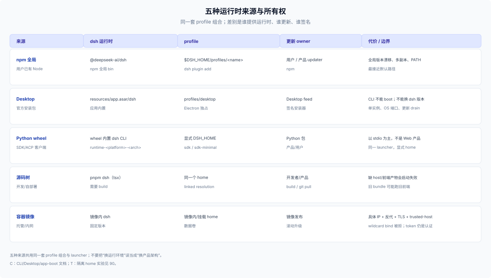

# 20 · 安装路径：运行时从哪来，profile 怎么初始化

## 运行时来源

| 来源 | dsh 从哪来 | profile 在哪 | 更新归谁 | 代价 |
|---|---|---|---|---|
| npm 全局 | `@deepseek-ai/dsh` | `$DSH_HOME/profiles/<name>` | 用户/产品 updater 跑 npm | 需要 Node；全局版本漂移；多副本 |
| 官方 Desktop | 应用内置 `resources/app.asar/dsh` | `profiles/desktop`（Electron 独占） | Desktop Nightly feed + 签名安装器 | 不能换 dsh 版本；CLI 不能 boot |
| Python wheel | wheel 内置 `dsh` CLI | 显式 `DSH_HOME` 的 profile | Python 包/产品 | SDK/ACP 为主；不是 Web 产品 |
| 源码树 | `pnpm dsh`（tsx） | 同一个 home | 开发者/产品 | 需要 build；缺前端会启动失败 |

这四种来源共用同一套 profile 组合和同一个 `dsh` launcher；差别是**谁提供运行时、谁负责版本与签名**。容器/镜像属于部署包装，见 [60](./60-packaging.md)。



## Profile 初始化

| 入口 | 行为 |
|---|---|
| 首次 boot/dump shipped profile | 从模板自动初始化：`web`=base+web-app（live patches），`headless`=base+headless，`sdk`=base+sdk-app，`sdk-minimal`=standalone，`acp`=base+acp-app（后四者 startup-only） |
| 自定义 profile 缺失 | 失败并提示 `dsh plugin --profile <name> add <package>` |
| `dsh plugin --profile <name> …` | 缺失时初始化 base-backed profile，再转发 pnpm |
| `--from-default-profile <template>` | 用 shipped 模板替换自定义 profile；删除原依赖与用户 patch；staging + previous 恢复；shipped 名字不能当目标 |
| `--dump-*` | 初始化缺失的 profile 文件，再打印组合 |

`--from-default-profile` 是**破坏性重置**，不是升级：新 manifest 的 dependencies 为空、用户 patch 为空，模板后续变化不会回写。

注意：`dsh plugin` 对自定义名字只初始化 **base**；Web/SDK/ACP 产品要么首次用 `--from-default-profile <template>` 建 profile，要么显式把对应 app bundle 加进去。不要用 base-only profile 期待 Web 界面。

## Bundle 安装

```sh
dsh plugin --profile <name> add <package-or-git-spec>
dsh plugin --profile <name> list
dsh plugin --profile <name> remove <package>
```

- 命令把参数转发给 profile 目录里的 pnpm；`add`/`remove`/`update`/`why` 等 pnpm verb 都可用，pnpm 必须在 PATH。
- 相对路径 spec 以调用目录为锚；`add .` 装的是当前 checkout。
- 每次成功后按已安装依赖 reconcile `dsh.profile.bundles`：声明 `dsh.bundle.patch` 的包进入层栈，无声明的只是普通依赖，移除依赖则退出层栈。
- **bundle membership 变化要重启 profile**；普通 profile/home patch 的改动可被 HMR 应用。本地 bundle 同样走 `dsh plugin add /path`，声明了 `dsh.bundle.patch` 就会进入 bundles 列表（实验见 [90](./90-evidence.md)）。
- git 源安装会跑 `prepare`，pnpm ≥10 需要 `allowBuilds` 允许；built tarball/local checkout 不需要。
- 安装和启动都校验 `engines.dsh` 或 DSH peer range；不兼容要显式 exact-version exemption。

## 各来源的特殊点

**npm**：全局安装最接近 `dsh web --profile` 的默认路径；产品 updater 通常是 npm 全局更新（社区 `dsh-updater-npm` 做多副本保护、源码树 git pull）。多副本、PATH、Node 版本是主要故障源。

**Desktop**：安装器拥有应用、运行时和 `profiles/desktop`；内置 CLI 在应用关闭时可用，npm 安装的 dsh 不能改 Desktop profile，Desktop 安装的命令可以。Desktop 首次启动用 Web 模板初始化 profile；核心包从 asar 解析，不复制进 profile。

**Python wheel**：把同一 `dsh` CLI 打包成 `deepseek-harness-sdk-runtime-<platform>-<arch>`；客户端默认用显式 home 启动 `dsh --profile sdk`，minimal 示例用 `sdk-minimal`。

**源码树**：`pnpm run build` 后 `pnpm dsh`；缺 Typert host artifacts 会在 boot 时模块解析失败，缺前端/client bundles 会提示 build；launcher 不检查新鲜度，旧 bundle 可能继续跑旧浏览器代码。

**容器**：本质是 Web surface 的包装；绑定一个具体本地 IP（wildcard 被拒），用 `--public-url` 广告外部根，再用 `--trusted-host` 放行代理 authority，TLS 由 listener 或前置代理负责。

## 实验（T）

| 实验 | 结果 |
|---|---|
| `DSH_HOME=$(mktemp -d) dsh --profile web --dump-default-config` | 初始化 `profiles/web/{package.json,cordis.patch.yml,cordis.yml,pnpm-workspace.yaml}`，bundles 为 base+web-app |
| `dsh plugin --profile test list` | 初始化 base-backed `profiles/test` 并创建 patch/package/pnpm-workspace |
| `dsh --profile rescue --from-default-profile web` 后加 marker，再用 `headless` 替换 | marker 被删除，bundles 变为 base+headless，patch 重置 |
| `dsh --profile plugin --dump-config` | 报 profile 不存在，提示用 `dsh plugin --profile plugin add …` |
| `dsh --profile web --from-default-profile headless` | 拒绝，shipped 名字不能作为自定义目标 |

## 失败模式

- 把 `--from-default-profile` 当升级：用户依赖、patch、本地数据链接被删。
- 安装成功但没重启：bundle 已写入磁盘，运行中的 profile 仍是旧 membership。
- git 源没有 build 允许：第一次 `add` 失败，需要把 key 写进 profile 的 `pnpm-workspace.yaml`。
- 引擎/peer 不匹配：安装/启动失败；exemption 是显式风险，不是推荐路径。
- Desktop profile 被 CLI 写入：`desktop` 是保留名，CLI 不能 boot；npm CLI 也不能管理它的插件。
- 源码树没 build：缺 host/front-end artifacts，启动失败或跑旧前端。
