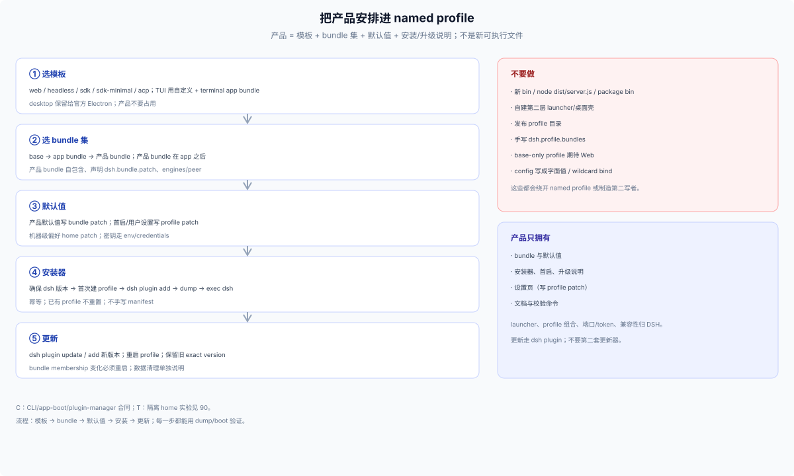

# 40 · 把产品安排进 named profile

## 一句话

产品不是另一个可执行文件，是“一套 bundle + 一份 profile 组合 + 一组默认值 + 安装/升级说明”。用户启动的永远是一个 named profile。

## 选模板

| Surface | 首次建 profile | 说明 |
|---|---|---|
| Web | `dsh --profile <name> --from-default-profile web` | base + web-app；之后 `dsh --profile <name> --port …` |
| headless | `--from-default-profile headless` | base + headless；一次性任务 |
| SDK | `--from-default-profile sdk` / `sdk-minimal` | base + sdk-app，或 standalone minimal |
| ACP | `--from-default-profile acp` | base + acp-app |
| TUI/自定义 | 自定义 profile + terminal app bundle | 不是 shipped surface；参数由 app bundle 解析 |
| Desktop | 不能用 | `desktop` 保留给官方 Electron；产品不要占用 |

`dsh plugin` 对自定义名字只初始化 base；Web/SDK/ACP 产品必须先选模板或显式加入对应 app bundle。

## 选 bundle

- **base**：公共核心（模型、工具、Session、设置、凭据等）。
- **app bundle**：`web-app`、`headless`、`sdk-app`、`sdk-minimal`、`acp-app`。
- **产品 bundle**：你自己的 `dsh.bundle.patch`，通常只插产品行、preset、默认值；不要复制 app bundle。
- **顺序**：base → app bundle → 产品 bundle；产品 bundle 的 patch 在 app 之后，默认值才压得住。
- **解析**：in-box bundle 先从 dsh 安装解析，再找 profile 的 `node_modules`；产品 bundle 要自包含、声明 `engines.dsh`/peer。
- **pin**：dsh floor、产品 bundle 精确版本、lock/digest；升级窗口写清。

## 用 bundle 里的 startup 插件做启动体验

不靠外部 launcher，也可以把“首启、选项目、开新 session、恢复上次、换模式”做成产品体验——把逻辑放进产品 bundle 的一个 startup 插件，让 named profile 仍是唯一入口。

**模式**：产品 bundle 插入一行 `acme/startup`，`inject` 需要启动的服务（如 `cmdline`、`webStartup`、session/workspace 相关服务）；它解析 app 参数、选择/创建 workspace 与 session、注册客户端面板/命令；产品 preset 决定这组 session 可见的工具。bundle patch 决定默认值；profile patch 存用户选择。

**多个启动体验 = 多个 named profile**：`acme-chat`、`acme-board`、`acme-headless` 各用不同 preset/startup 默认值；用户仍用 `dsh --profile acme-board` 启动。不要为每个模式造一个 launcher。

| 体验 | 可行性 | 机制 | 关键限制 |
|---|---|---|---|
| 首启/onboarding | 高 | startup 插件 + 客户端 slot + Config/profile patch | 不能阻塞 Loader；失败要能回到可用状态 |
| 选/换 workspace | 高 | workspace controller；`cwd` 或 `workspaceId` | 换 workspace 要**新建 session**；`header.cwd` 不可变 |
| 新建/恢复 session | 高 | Session controller / core registry；preset | 会话必须走持久化；模型可见内容要进 Session log |
| 子命令/启动参数 | 高 | `ctx.cmdlineArgs` | launcher 只把第一个未识别 token 之后交给 app |
| 多模式产品 | 高 | 多个 named profiles | 共享同一 `$DSH_HOME`；数据 owner 要写清 |
| 自定义 Web 页面/面板 | 中 | 客户端 slots/primitives | 不要另起 HTTP server；受 slot 契约限制 |
| 自定义端口/TLS | 中 | config/`--port`/`--tls-*` | 一个 Web listener；不要自己再监听 |
| 多窗口 | 低 | Web 单页；Desktop 才有多窗口 | 插件不创建 OS 窗口 |
| 托盘/开机自启/单实例 | 不可 | OS 层/Desktop | 不属于 profile/plugin |
| 自动更新/签名 | 不可 | 安装器/Desktop | 插件不能替代发布工程 |
| 登录门/多用户 | 中高风险 | 自己的 auth 层/反代 | 不是核心能力；token/cookie 边界要另设计 |

**关键约束**

- startup 插件在 Loader 启动后才激活；它可以让 row 等服务，但不能改 profile 组合或 launcher 语法。
- “换 workspace” 不是改当前 session：新建 session，传新的 `cwd`/`workspaceId`；旧 session 保留。
- Web 只有一个 listener；多端口/多页面不是插件该做的事。
- 客户端 UI 走 slot/primitives；不要假设能任意注入 DOM。
- 任何进入模型请求的启动体验都要能从 Session log 重建。
- Host 插件代码不受 Session sandbox 约束；路径/权限要自己校验。

**结论**：应用内的启动体验（首启、项目选择、建/恢复 session、模式切换、参数子命令）用 bundle 里的 startup 插件完全可行，而且比自建 launcher 更符合 DSH 的结构；进程/OS 级体验（托盘、自启、单实例、签名、自动更新）不要硬塞进插件，官方 Desktop 之外不承诺。

## 默认值与设置

| 层 | 产品怎么用 |
|---|---|
| bundle patch | 产品默认值（端口、主题、preset、开关）；随 bundle 版本发布 |
| profile patch | 首次运行/设置页写这里；用户可改 |
| home patch | 机器级偏好（同 home 所有 profile）；产品不要静默写 |
| CLI `--patch` | 本次启动/诊断；不持久化 |
| env/`.env`/credentials | 部署、代理、密钥；不要写进 profile patch |
| 客户端 localStorage | UI 状态；换 origin 会丢 |
| Desktop shell 设置 | 只在官方 Desktop；`userData`，不受 `DSH_HOME` 重定位 |

Settings UI（`Config.volatile()`）写当前 profile patch；产品的设置页应复用这一层，或明确自己的 store 与迁移，不要两套真值。

## 安装器

```sh
# 1) 确保 dsh 版本
dsh --version
# 2) 首次建 profile（破坏性：只对全新 profile）
dsh --profile acme --from-default-profile web --dump-default-config
# 3) 装产品 bundle（走 dsh plugin，不手写 manifest）
dsh plugin --profile acme add @acme/dsh-product@1.2.3
# 4) 校验组合
dsh --profile acme --dump-config
# 5) 启动
exec dsh --profile acme "$@"
```

安装器要幂等：已有 profile 不重置；已有数据不覆盖；失败能重跑；`--from-default-profile` 只在“全新 profile”或显式救援时用。

## 启动器

外层最多是一个薄 bootstrap：

- 设置 `DSH_HOME`、PATH、代理、凭据环境；
- 确保 profile 存在（不存在才建）；
- 检查 dsh/bundle 版本；
- `exec dsh --profile <name> "$@"`，把 app 参数原样传下去。

不要再包第二层 launcher/桌面壳；桌面体验用官方 Desktop，Web 用 named profile。

## 更新与卸载

- bundle 更新：`dsh plugin --profile <name> update` / `add` 新版本；**重启 profile** 才生效。
- profile 锁：安装/更新走 `dsh plugin` 或 Plugin Manager；不要并发写。
- 回滚：保留旧 exact version/enabled；写清 crash window。
- 卸载：`dsh plugin remove` 只移除 bundle/dependency；用户数据、Session、Workspace registration 不清；产品自建数据要单独说明。

## 反模式

| 反模式 | 问题 |
|---|---|
| 新 bin/`node dist/server.js`/package bin | 绕过 dsh launcher，不是受支持启动 |
| 自建第二层 launcher/桌面壳 | 第二个 launcher、第二套更新/签名/profile 写者 |
| 发布 profile 目录 | 覆盖用户 patch/依赖；profile 是用户侧组合 |
| 手写 `dsh.profile.bundles` | 与 `dsh plugin` 状态漂移 |
| base-only profile 期待 Web | 没有 web-app row/端口/页面 |
| 把 config 写成字面值 | 丢必填字段；`--port` 等 app 参数失效 |
| 0.0.0.0 绑定 | Web 拒绝 wildcard；远程要反代/TLS/trusted-host |
| 两套设置真值 | 设置页/产品 store/profile patch 漂移 |


