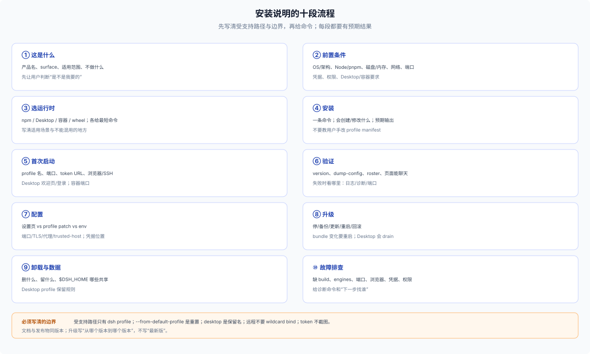

# 70 · 安装与使用说明：文档该写什么

## 文档骨架

一份能用的安装/使用说明至少覆盖十段：

1. **这是什么**：产品名、surface（Web/Desktop/CLI/SDK）、适用范围、不做什么。
2. **前置条件**：OS/架构、Node/pnpm 版本、磁盘/内存、网络、端口、凭据、是否需要管理员权限。
3. **选运行时**：npm 全局 / Desktop / 容器 / wheel；每种给一条最短命令和适用场景。
4. **安装**：一条命令；说明会创建/修改什么（profile、home、依赖）；给出预期输出。
5. **首次启动**：profile 名、端口、token URL、浏览器/SSH、`--no-open`；Desktop 的欢迎页/登录。
6. **验证**：`dsh --version`、`--dump-config`、profile roster、页面能聊天；失败时看哪里。
7. **配置**：设置页 vs profile patch vs env；端口/TLS/代理/trusted-host；凭据放哪。
8. **升级**：停/备份/更新/重启/回滚；bundle membership 变化要重启；Desktop 更新会 drain。
9. **卸载与数据**：删什么、留什么、`$DSH_HOME` 哪些共享；Desktop profile 的保留规则。
10. **故障排查**：缺 build、engines 不匹配、端口占用、浏览器打不开、凭据缺失、权限被拒。

## 必须写清的边界

- **受支持路径**：`dsh --profile <name>` / `dsh web`；不要暗示 package bin、demo 或自建 launcher 是支持的。
- **profile 名字**：用户装到哪个 profile；`desktop` 是保留名，CLI 不能 boot；`plugin` 要用 `--profile plugin`。
- **安装命令**：`dsh plugin --profile <name> add <spec>`；不要教用户手改 `dsh.profile.bundles`。
- **`--from-default-profile` 是重置**：只用于首次/救援；会删除依赖和用户 patch；升级不要用。
- **数据位置**：`$DSH_HOME`、profile、Session、附件、凭据、客户端 localStorage；哪些跨 profile 共享。
- **安全**：token URL 不截图/不进日志；远程用反代 + TLS + `--trusted-host`，不要 wildcard bind；凭据不要写进 profile patch。
- **平台**：Desktop 有 macOS/Windows；Linux 走 npm/容器；TUI 需要 terminal app bundle。

## 三条最短路径模板

**npm + Web**

```sh
# 前置：Node ^22.19 || >=24，pnpm
npm install -g @deepseek-ai/dsh
# 首次：用 web 模板建自定义 profile（破坏性，只在全新 profile 上用）
dsh --profile acme --from-default-profile web --dump-default-config
dsh plugin --profile acme add @acme/dsh-product
dsh --profile acme --port 8080
# 打开打印的 dsh web: URL
```

`dsh plugin` 对自定义名字只初始化 base；Web 产品必须先用 web 模板，或显式加入 web-app bundle。

**Desktop**

```text
1. 下载并安装对应平台安装包
2. 首次打开：欢迎页登录/填 API Key
3. Plugins 页安装产品 bundle；或用 Desktop 安装的命令管理 profile
4. 完全退出 Desktop 后，用 Desktop 安装的命令（不是 npm 全局 dsh）管理 desktop profile 插件
```

**容器**

```sh
docker run --rm -p 8080:3080 \
  -e DEEPSEEK_API_KEY \
  -v acme-home:/home/dsh/.dsh \
  ghcr.io/acme/dsh-product:1.2.3 \
  --profile acme --no-open \
  --host <container-ip> \
  --public-url https://app.example/ --trusted-host app.example
# <container-ip> 由镜像 entrypoint 解析；dsh web 拒绝 0.0.0.0
```

## 验证清单

- 全新机器/干净 `DSH_HOME`：按文档能装、能启动、能聊天。
- 已有 profile：安装不覆盖用户 patch/数据；升级后 roster/row 正确。
- 端口被占/浏览器打不开/凭据缺失：文档给出的诊断能定位。
- 卸载后：用户数据按文档保留或删除；没有“以为删了其实还在”。

## 常见错误写法

| 写法 | 问题 |
|---|---|
| “运行 `node dist/server.js`” | 绕过 `dsh` launcher，不是受支持启动 |
| “先起一个第二层 launcher/桌面壳” | 第二个 launcher/profile 写者；产品只用 named profile |
| “编辑 `~/.dsh/profiles/x/package.json` 加 bundle” | 手写 profile，容易和 `dsh plugin` 状态漂移 |
| “升级时用 `--from-default-profile` 重置” | 会删依赖/用户 patch，是破坏性重置 |
| “绑定 0.0.0.0 就能远程访问” | Web 拒绝 wildcard；要具体 IP + 反代 + TLS + trusted-host |
| “把 API Key 写进 profile patch” | 凭据应走 credentials/env，不是配置层 |
| “装完立即生效” | bundle membership 变化要重启 profile |

## 文档与发布一起版本化

安装说明要跟发布物同版本：bundle 版本、dsh 版本 floor、profile 模板、端口/参数、已知问题。升级文档要写“从哪个版本到哪个版本”，不要只写“最新版”。


