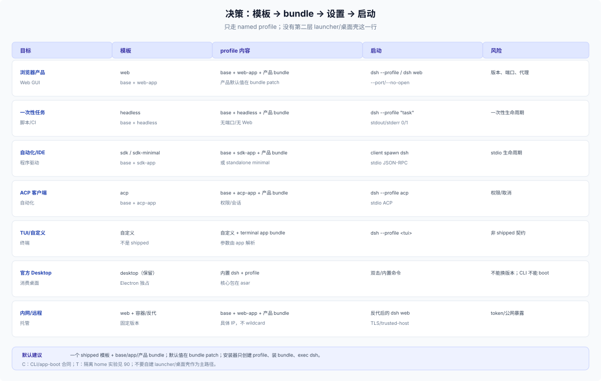

# 80 · 决策：选模板、bundle 和设置层

## 四个问题

1. **运行时从哪来？** 用户已装 npm、官方 Desktop、Python wheel、源码树。
2. **用哪个模板/surface？** `web`、`headless`、`sdk`/`sdk-minimal`、`acp`，或自定义 TUI profile。
3. **产品 bundle 放哪、顺序如何？** base → app bundle → 产品 bundle；默认值放 bundle patch。
4. **设置/更新/卸载谁负责？** 产品安装器、用户设置、`dsh plugin`、文档。

## 目标 × 模板

| 目标 | 模板 | profile 内容 | 启动 |
|---|---|---|---|
| 浏览器产品 | `web` | base + web-app + 产品 bundle | `dsh --profile <name>` / `dsh web` |
| 一次性任务/脚本 | `headless` | base + headless + 产品 bundle | `dsh --profile <name> "task"` |
| 自动化/IDE | `sdk` / `sdk-minimal` | base + sdk-app，或 standalone | client spawn `dsh --profile sdk` |
| ACP 客户端 | `acp` | base + acp-app | `dsh --profile acp` |
| TUI/自定义 | 自定义 | 自定义 + terminal app bundle | `dsh --profile <tui>` |
| 官方 Desktop | `desktop`（保留） | Electron 独占 | 双击应用 / 内置命令 |
| 内网/远程 | `web` + 容器/反代 | base + web-app + 产品 bundle | 反代后的 `dsh web` |

**没有“自建第二层 launcher/桌面壳”这一行。** 产品要桌面体验就用官方 Desktop；要做 Web 就用 web profile + 安装器/容器。

## Profile 安排清单

1. **名字**：产品 profile 用稳定、非 shipped 的名字；不要占用 `desktop`；`plugin` 需 `--profile plugin`。
2. **模板**：Web/headless/SDK/ACP 先选 shipped 模板；自定义 TUI 才从 base/自定义开始。
3. **bundle 集**：base + app bundle + 产品 bundle；顺序固定；产品 bundle 在 app 之后。
4. **默认值**：产品端口/主题/preset/开关写 bundle patch；不要写进 app bundle。
5. **用户设置**：profile patch / Settings UI；不要另建第二套真值。
6. **首启**：只在全新 profile 用 `--from-default-profile`；已有 profile 不重置。
7. **安装**：`dsh plugin --profile <name> add <bundle>`；不手写 manifest。
8. **校验**：`--dump-config`、启动日志、profile roster、页面/任务。
9. **更新**：`dsh plugin update`/新版本；重启；旧版本恢复。
10. **文档**：安装/启动/设置/升级/卸载/排障与发布物同版本。

## 设置安排清单

1. 产品默认值 → bundle patch。
2. 首启/用户设置 → profile patch（Settings UI 同层）。
3. 机器级偏好 → home patch；产品不要静默写。
4. 本次诊断/覆盖 → `--patch`。
5. 密钥/部署 → env/.env/credentials，不进 profile patch。
6. UI 状态 → 客户端 localStorage；换 origin 会丢。
7. patch 不要只写一项：`config` 是整份替换，缺必填字段会启动失败。
8. 需要 app 参数生效时，保留 row 的 `!!js` 表达式；字面值会让 `--port` 失效。

## 反模式

| 反模式 | 问题 |
|---|---|
| 新 bin/`node dist/server.js` | 绕过 launcher，不受支持 |
| 自建第二层 launcher/桌面壳 | 第二个 launcher/profile 写者/更新器 |
| 发布 profile 目录 | 覆盖用户 patch/依赖 |
| 手写 `dsh.profile.bundles` | 与 `dsh plugin` 漂移 |
| base-only profile 期待 Web | 没有 web-app/端口/页面 |
| config 字面值 | 缺必填字段；app 参数失效 |
| wildcard bind | Web 拒绝；远程要反代/TLS/trusted-host |
| 两套设置真值 | 设置页/产品 store/profile patch 漂移 |

## 默认建议

- **能用一个 bundle + 一个 shipped 模板解决，就不要造第二层。**
- **产品安装器只做四件事**：确保 dsh 版本、创建 profile（首次）、装 bundle、`exec dsh --profile`。
- **设置从 bundle 默认值开始**，用户覆盖留 profile/home；不要把所有设置塞进产品自有文件。
- **更新走 `dsh plugin`**，保留旧 exact version/enabled；文档写清重启与回滚。

