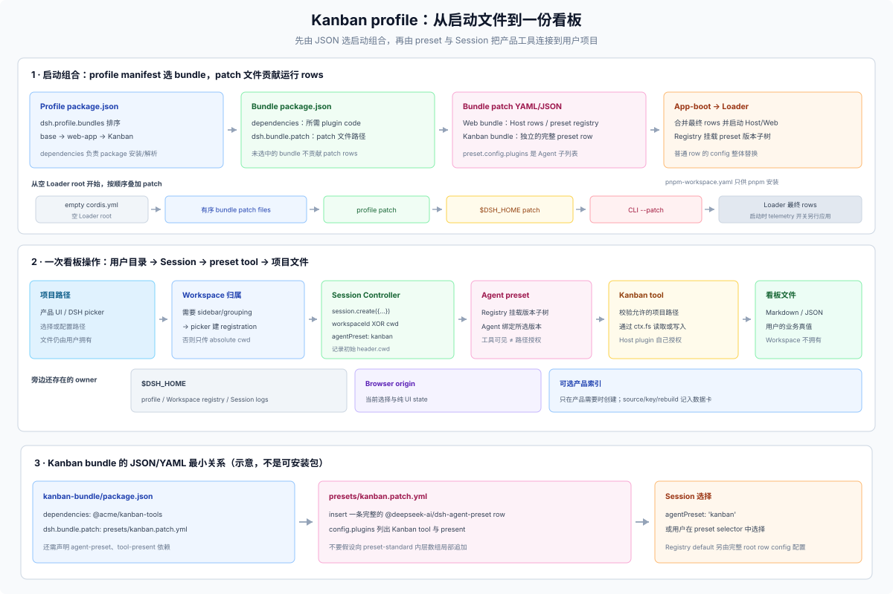

# 90 · 从 profile 配置到产品工作流

## 这一篇回答什么

用户仍由 `dsh` 启动应用。产品 profile 用有序 bundle 组合 Web 界面、产品 plugin 和 Agent preset；一个 Session 通过 Workspace 或显式目录进入产品工具，工具再访问用户项目文件。以 Kanban Studio 为例，本篇从启动文件、patch 顺序和 preset 一路追到目录身份与数据归属。

若还没决定发插件、发 profile 还是独立应用，或要选一种 profile 发行形态，先看 [34 profile 产品形态](../30-external/34-profile-product-forms.md)；四层装配状态与所有权见 [35](../30-external/35-profile-assembly-ownership.md)。本篇从已经选定的 profile 开始。



## 1. 先认清启动文件

Profile 是启动组合，不是项目目录，也不是隔离边界。`dsh --profile kanban` 由 CLI 读取 `$DSH_HOME/profiles/kanban/package.json`，选中其中有序的 bundles；app-boot 随后读取每个 bundle 声明的 patch 文件，Loader 最后挂载组合后的 rows。

| 文件 | 谁读取 | 作用 |
|---|---|---|
| Profile `package.json` | CLI/app-boot、pnpm | `dsh.profile.bundles` 选择并排序 bundle；profile `dependencies` 安装可直接解析的 packages |
| Bundle `package.json` | pnpm、app-boot | `dependencies` 解析代码；`dsh.bundle.patch` 指定单个或有序的 patch 文件列表 |
| Bundle patch (`.yml`/`.json`) | app-boot、Loader | `insert` Host/Web rows 或 Agent preset；按 id 覆盖 row |
| Profile `cordis.patch.yml` | app-boot | 该 profile 的用户 patch layer，应用在 bundles 之后 |
| `$DSH_HOME/cordis.patch.yml` | app-boot | 同一 home 的 profiles 共用，优先级高于 profile patch |
| CLI `--patch <path>` | app-boot | 仅本次启动的最后一层文件 overlay |
| Profile `pnpm-workspace.yaml` | pnpm | profile package 安装策略；不是 DSH runtime rows |
| Profile `cordis.yml` | Loader | CLI 生成的空 root Include 和路径锚点，不放产品配置 |

在 JSON 中，`{}` 是字段对象，`[]` 是有序列表，字符串用双引号，不能写注释。Profile 的 `dependencies` 是“包名 → 版本或本地安装规格”的对象，`dsh.profile.bundles` 是 bundle 名称的有序数组；bundle 的 `dsh.bundle.patch` 则是 patch 文件路径或有序路径数组。[93](./93-app-plugin-walkthrough.md) 把这几个字段放在一起展示。

`dependencies` 让 package 可解析；只有选中的 bundle 才会自动应用它自身声明的 patch。其他 patch 也可以显式插入可解析的普通 plugin row。Patch 文件通常写 YAML，也可用 JSON 表示同一顶层 patch list；两种语法没有不同的优先级。Patch 按 row id 操作，给出的 `config` 会整体替换原 `config`，不做递归合并。启动时，若 `DSH_TELEMETRY_DISABLED` 非空且组合中存在 `session-telemetry-otel` row，Launcher 还会在文件 overlays 之后追加该 row 的禁用 patch。

Web template 的 bundle 顺序是 `dsh-base` → `dsh-web-app`。Web bundle 自己再按 `package.json` 中的顺序应用主 patch 与 `presets/*.patch.yml`。Kanban bundle 可在后面加入一个独立 preset row；不要把产品工具写成 Host 的全局权限，也不要对 `preset-standard.config.plugins` 做局部追加。

## 2. 创建 profile 并检查运行组合

以下命令使用已安装的 `dsh`。若从源码检出目录运行，先安装依赖并在缺少 Web Client 构建产物时执行 `pnpm run build`，再将命令开头的 `dsh` 换成 `pnpm dsh`，以使用该检出目录的 CLI。`--from-default-profile` 会替换同名自定义 profile 的依赖和用户 patch，操作前请使用新名称或备份原 profile：

```sh
dsh --profile kanban --from-default-profile web --dump-default-config
dsh plugin --profile kanban add <kanban-bundle-spec>
dsh --profile kanban --dump-config
```

`<kanban-bundle-spec>` 是尚未提供的产品包占位符，需替换为实际安装规格。`--dump-default-config` 只查看所选 bundle 层；`--dump-config` 显示合成的文件配置，但不挂载 plugin、验证产品行为或反映启动时的 telemetry 环境开关。Bundle 加载或兼容性检查失败时会被跳过并报告；plugin row 的运行时准入与激活仍需启动后核查。

dump 只覆盖文件配置层；包已安装、bundle 在 roster、row 存在、row 当前 enabled/config 生效是四层状态，聚合/接管/进口形态还要检查身份冲突、更新恢复和来源所有权，见 [35 装配状态与所有权](../30-external/35-profile-assembly-ownership.md)。

检查 dump 中是否有 Web rows、Kanban preset row 和该 preset 的完整子插件列表。`dsh plugin add` 更新磁盘上的 bundle selection，返回 package-manager 结果，不返回 Plugin Manager 的 `ChangeResult.application`；CLI 改变 bundle membership 后要重启 profile。Web Plugin Manager/HMR 是另一条应用路径。

实际产品 bundle 准备好后，可用 `dsh --profile kanban --no-open` 启动；打开启动时输出的 `dsh web:` 带令牌 URL。源码启动须先构建 Web Client；监听地址、浏览器及故障说明见 [Web bundle README](../../../packages/bundle/web-app/README.md#starting-the-web-gui)。

已执行的 profile 初始化、fixture bundle 安装、配置 dump 和 Web listener HTTP 检查见[实验 05](../40-evidence/experiments/05-profile-bundle-install.md)；它不验证假想 Kanban 产品的 UI 或工具。

## 3. 把 Kanban 接到一个 Session

复用 DSH Web Workspace picker 时，用户选择已有看板目录，Host 建立 Workspace registration 供侧栏导航和 Session 分组。若产品已有自己的项目选择 UI，且不需要 DSH 分组，可跳过 registration。Session Controller 的位置参数二选一：

```json
{ "workspaceId": "<registered-workspace-id>", "agentPreset": "kanban" }
```

```json
{ "cwd": "/absolute/path/to/board", "agentPreset": "kanban" }
```

`workspaceId` 让 Host 从 registration 取规范化路径，设置初始 `header.cwd` 并 attach Session；`cwd` 只指定起始目录。它们互斥。`header.cwd` 是不可变的 Session 起点；之后 `working_directory` 可以变化，但不改 header 或 sandbox roots。

Preset row 在 `config.plugins` 子列表中声明 Kanban tool package。Registry 为每个 preset 版本挂载插件子树，选择该版本的 Agent 绑定到它；安装 package 本身不会让其他 preset 的 Agent 获得该工具。Preset 决定工具可见性，不授予路径权限。

在这个设计中，Kanban tool 把调用 Session 的初始 `header.cwd` 作为项目根。直接调用 `ctx.fs.resolve()` 时，应显式传入 `{ cwd: projectRoot }`；省略时由 filesystem provider 使用自己的默认目录。内置文件工具则会显式传入 Session 的当前 `working_directory`，它可以变化。将项目根和目标都解析为同一 provider 的 `FsTarget` 后，可用 `ctx.fs.contains(root, target)` 检查当前解析结果。这个检查不是针对不可信代码的内核隔离；产品还须处理授权、符号链接变化和并发修改。Host plugin code 不自动受 Session sandbox 约束。

### 哪个 preset 会被新 Session 选中

Preset Registry 使用部署配置的 `default`；Web Settings 保存的 `selectedDefault` 覆盖它；Session 请求显式给出的 `agentPreset` 只选择当前 Session。新 Kanban preset 加入 roster 后，不会自动成为 Web 默认值。用户可在 Web preset selector 中选择 Kanban；Kanban 产品 UI 也可在创建目标 Session 时显式传 `agentPreset: 'kanban'`。

## 4. 看板文件先做 authority

Kanban 第一版可让项目目录中的 Markdown/JSON board files 作为业务 authority，不另建 product database。若需要搜索索引，将它记录为派生事实：Owner 是产品 plugin，Authority 是“无（derived）”，Source 是 board files，Scope/key 是产品 project ID，Writers 是 indexer，Rebuildability 是重新扫描。

需要持久保存的额外事实、readers/writers、迁移、备份和删除方式，按 [91 数据卡](./91-checklist.md)逐行记录。数据机制选择见 [92 参考矩阵](./92-native-reference-architectures.md)；每份业务事实不需要被塞进第二套分类表。

如果 Agent 要通过 `present` 提交文件，产品 preset 必须包含该工具；调用时需要已打开的 turn、可用的 Session 工作目录，以及 Session filesystem 可访问的普通文件，不要求 DSH Workspace registration。产品先将文件写到用户可访问的位置，再调用 `present`。它记录绝对路径，不复制文件；Session export 也不打包项目目录。删除 Workspace 只移除 registration，不删除看板文件或 Session history。

## 下一步

- 先定形态：用 [34 profile 产品形态](../30-external/34-profile-product-forms.md) 选八种交付形态之一，再用 [35 装配状态与所有权](../30-external/35-profile-assembly-ownership.md) 做四层读回。
- 用 [93 Kanban 文件走查](./93-app-plugin-walkthrough.md) 对照 profile JSON、bundle JSON、preset YAML 和 Session 请求。
- 用 [91 数据卡与验收](./91-checklist.md) 核对事实的 Authority、Source、读写者和生命周期。
- 只有当产品有存储、归档、同步或隔离取舍时，才查 [92 参考矩阵](./92-native-reference-architectures.md)。安装、升级和卸载语义见 [18](../10-foundations/18-install-upgrade.md)。
