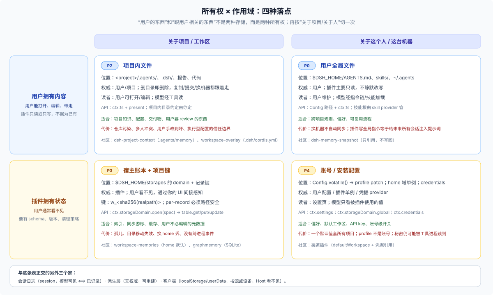

# Answer 26 · 插件数据的归属：先定“谁拥有、关于谁、活多久”，再找 DSH 的家

## 一分钟结论

“插件的数据放哪”之所以难，是因为它把四个独立问题压成了一句：

1. **谁拥有它？** 用户、会话、插件、没人（可重建），还是浏览器/设备？
2. **它是关于谁的？** 这一次调用、这次会话、这个项目、这个人/这台机器，还是这个安装？
3. **它必须活多久？** 一轮、一会话、一个项目、一个账号，还是永久/可重建？
4. **谁必须看见它？** 模型、用户、插件、浏览器，还是没人？

这四个坐标定了，DSH 的家、作用域和键基本就定了。反过来先挑 API，最后一定会出现“放哪都不对”的感觉。

先给一条能覆盖大多数情况的规则：

> **用户拥有的字节留在用户能看见、能带走的地方；插件只拥有“关于这次工作”的索引、游标、偏好、学到的事实和缓存，并且必须说清楚它跟谁走、什么时候删。** 同一份事实只有一个权威；其他位置只放引用、哈希或可重建的副本。

第二轮（原生历史 + 外部市场）补了三件事，后面各篇会展开：

1. **没有“插件数据根”**：`$DSH_HOME/plugins/<id>/` 只是惯例；插件要么用 domain，要么自造目录，并自己承担清理/迁移。**C/U**
2. **删除/保留是系统性空白**：session 没有删除 API、附件没有 GC、插件没有卸载契约；外部插件（E1）已经在用“物理删日志/改日志 header”补。**C/H/R**
3. **profile 不是账号**：settings 只对当前 profile 生效；跨 profile 共享偏好要 home 域，不能靠 `Config`。**C/H**

**原生优先。** 长期只用 DSH 原生能力；外部插件只借模式，不作依赖：

| 级别 | 含义 | 长期策略 |
|---|---|---|
| **N0 核心合同** | docs + 核心包 + 测试定义的 Service/事件/格式 | 首选 |
| **N1 官方随包插件** | workspace、projcache、settings、credentials-local、session-query-sqlite、spill-local 等 | 首选 |
| **N2 experimental** | agent-team、claude-code-mods `$.store` 等 | 可参考，不承诺稳定 |
| **E1 外部社区插件** | 第三方仓库/包 | 只借模式；短期用要写清依赖/迁移/卸载 |
| **E2 外部服务** | MCP/HTTP/DB/对象存储 | 没有原生替代时短期用 |

## 一张图：所有权 × 作用域

插件数据最常见的四种落点，正好是“谁拥有”与“关于谁”的 2×2：

| | 关于项目 / 工作区 | 关于这个人 / 这台机器 |
|---|---|---|
| **用户拥有内容** | 项目内文件：`.agents/`、`.dsh/`、报告、代码（P2） | 用户全局文件：`$DSH_HOME/AGENTS.md`、`skills/`、`~/.agents`（P0/P2） |
| **插件拥有状态** | home 域 + 项目键；或项目内元数据文件（P3/P2） | home 域单例、profile 配置、凭据（P4） |

会话日志和派生物不在这张表里：日志是“这次对话”的追加事实，派生层没有权威。它们与上表正交。



## 五种“数据承诺”

“承诺”是作者对用户说的话，不是存储 API。选定承诺，家和键自动收敛；同一插件可以组合多种承诺，但**每一块数据只能有一个主承诺**。

| 承诺 | 一句话 | 数据在哪 | 外部样本（参考，非依赖） | 主要代价 |
|---|---|---|---|---|
| **P0 纯引用** | 我不存，只读你已有的文件 | 用户的文件原地 | `dsh-memory-snapshot`：路径清单注入，无数据库 | 无法保证存在/格式；不能“学习” |
| **P1 会话派生** | 我不存聊天，只算统计/索引 | 会话日志 + 可重建检查点 | `harness-insights`：只折叠结构化元数据 | 依赖日志/投影 API；回填有成本 |
| **P2 用户可见文件** | 数据跟项目或用户目录走，用户可见 | `<workspace>/…` 或用户全局文件 | `dsh-project-context`：项目内 journal + 渲染 | 仓库污染、手改、多人冲突 |
| **P3 宿主账本** | 我按项目记，但东西在我这 | `$DSH_HOME` + 项目键 | `dsh-workspace-memories`：按 workspace 存 Markdown | 孤儿、换机器丢、用户看不见 |
| **P4 账号/安装配置** | 配一次，所有项目生效 | profile 配置 / home 域 / 凭据 | 渠道插件：`defaultWorkspace` + 凭据引用 | profile 不是账号；一个默认值套所有项目；秘密风险 |

（P2 有两个根：项目内文件删项目就没；用户全局文件（`$DSH_HOME/AGENTS.md`、`skills/`、`~/.agents`）跟 home 或共享根走，主要供用户维护、插件只读。P5“每项目一套运行时”不是数据承诺，是运行时缺口；外部插件（E1）用 `workspaceCordis` 自己补，见 33 篇。）

## 同一份数据，四种都成立的解法

以“项目记忆”为例。它没有唯一正确答案；四条路都有人用，选哪条取决于你对用户的承诺和维护成本。

| 方案 | 权威 | 位置 | 优点 | 代价 | 什么时候选 |
|---|---|---|---|---|---|
| **A 项目内 Markdown** | 用户/项目 | `<project>/.agents/memory.md` | 可见、可 diff、可提交、可带走 | 污染仓库；多人/多分支冲突；要处理手改 | 团队共享、需要 review |
| **B home 账本 + 项目键** | 插件 | `$DSH_HOME` domain，键 = 路径哈希 | 干净、结构化、可查询；不碰仓库 | 孤儿；换机器丢；用户看不见 | 个人使用、纯索引/游标 |
| **C 会话派生** | 无 | 会话日志 + 可重建检查点 | 零额外状态；删会话就跟着变，诚实 | 不能存新事实；回填成本 | 统计、用量、只读索引 |
| **D 外部记忆服务** | 外部服务 | MCP / HTTP / 本地 SQLite 服务 | 跨设备、强检索、可集中治理 | 运维、隐私、网络、账号 | 多机、团队、大知识库 |

组合也合法，而且往往更好：**A 作为权威 + B 作为派生索引**（项目文件可读，home 只存索引和游标）；**C 作为主视图 + B 作为加速**（日志权威，检查点可丢）。非法的是让两层都声称自己是权威。

## 承诺 → 家 → 作用域 → API

| 承诺 | 主家 | 作用域 | 主要 API | 用户能看见 | 卸载后 |
|---|---|---|---|---|---|
| P0 纯引用 | 内容（只读） | 用户给的路径 | `Config` + `ctx.fs` | 原文件 | 原文件不动 |
| P1 会话派生 | 派生 + 历史 | session（可聚合到 workspace） | `ctx.sessionProjections`（live）、`ctx.sessionQuery`（跨会话） | 间接 | 检查点可丢 |
| P2 用户可见文件 | 内容 | workspace / 用户全局 | `ctx.fs` + `present` | 是 | 跟项目/仓库 |
| P3 宿主账本 | 状态 | workspace 键（存 home） | `ctx.storageDomain` | 否 | 留孤儿，需清理 |
| P4 账号配置 | 状态 + 凭据 | profile / home | `Config.volatile()` / `credentials` | 设置页 | 随 profile 或 home |

## 先站到作者的位置：作者六问

按作者真实的设计顺序问，而不是按 DSH 的架构问：

1. **用户第一次装我，要配置什么？** 能不能零配置？数据从哪来？
2. **我承诺记住什么？** 什么都不记 / 记路径 / 记统计 / 记项目文件 / 记账号设置。
3. **用户在哪里看见、编辑、带走、删掉它？** 在项目里？在设置里？根本看不见？
4. **他有 30 个项目时，我怎么知道是哪个？** 键是什么？项目移动了怎么办？
5. **升级、卸载、数据坏了怎么办？** 迁移谁写？失败是静默还是报错？
6. **他凭什么信任我？** 我会不会偷偷复制他的文件、上传内容、把密钥写进日志？

这六问的答案，就是你的“数据承诺”。DSH 的五个家是**实现承诺的材料**，不是承诺本身。

## 外部社区给的三条硬经验（参考）

这些样本都是外部作者声明（E1，参考）；这里标“已验证”的只代表**读过源码**，不代表装过、跑过。样本版本也普遍落后于当前 RC，抄模式不抄 API。

1. **能不存就不存。** 最轻的记忆插件卖点是“没有数据库、没有写入通道、文档原地不动”。少一个存储面，就少一套迁移、清理、备份、隐私问题。
2. **存就存成“可重建”。** 用量面板只折叠元数据，检查点坏了从日志重建；用户删了会话，统计跟着变，这是诚实的行为。
3. **项目级的东西要么进项目，要么带稳定键。** 核心没有“每项目一套实例”，外部插件（E1）用 `.dsh/cordis.yml`、canonical path lease 或路径键自己补；代价是孤儿、信任边界和版本兼容，必须自己承担。

另外三条来自外部插件源码、值得单独看（E1，参考）：

- **位置做成配置**：同一插件，`storage: home`（敏感、机内）或 `storage: workspace`（团队、随代码）。但别像某些样本那样硬编码 `~/.dsh`，要尊重 `DSH_HOME`。
- **journal 权威 + 渲染派生**：`memory.jsonl` 追加写是权威，`MEMORY.md` 只是渲染；锁内备份、崩溃只落后不丢。
- **用 git 做同步**：记忆推到代码仓库的专属分支或独立记忆仓库；写路径仍然本地即时，同步是显式批处理。

完整的九个维度、十八种手法和已核出的坑，见 [31 篇](./30-external/31-external-community-patterns.md)（外部参考）。DSH 原生历史见 [22 篇](./20-native/22-native-data-history.md)，外部插件模式见 [33 篇](./30-external/33-external-plugin-patterns.md)（只作参考），原生优先的骨架见 [42 篇](./40-advisor/42-native-reference-architectures.md)。其他插件生态（VS Code、Obsidian、Claude Code、Codex、MCP、Chrome、Figma）怎么切同样的题，见 [32 篇](./30-external/32-external-adjacent-ecosystems.md)。

## 你应该怎么选：选型七问

```text
1. 用户已经有这份数据了吗？            是 → P0（引用它）
2. 能从会话/文件重新算吗？              是 → P1（派生）
3. 必须跟项目一起走/被用户看见吗？      是 → P2（项目内文件）
4. 要跨会话记住、但用户不必编辑吗？     是 → P3（home + 稳定键）
5. 是关于这个人/账号/安装的吗？         是 → P4（配置/凭据/home 单例）
6. 只在浏览器里用、模型不必知道吗？     是 → 客户端本地（localStorage/userData）
7. 需要每个项目一套进程/连接吗？        是 → 看 31 篇的 workspace scope（P5）
```

注意顺序：**先问“用户有没有/能不能重算”，再问“存哪”。** 大多数“数据放哪”的痛苦，来自跳过前两问直接建表。

## 反模式（作者视角）

- **承诺过度**：说“帮你记住一切”，结果存了聊天正文、换机器丢、删项目留孤儿。用户不会区分“内容”和“状态”，只会觉得“不可靠”。
- **把用户文件复制进 home**：用户在原文件里改了，你还在推荐旧内容；这是 P0 装成 P3。
- **把项目数据塞进账号配置**：30 个项目共用一份设置，或者把项目路径写死进 profile。
- **用 `workspaceId` 当长期键**：删一次工作区，账本全失联。
- **把 `realpath` 直接当 `per-record` 键**：JSON per-record 的键必须是 `[a-zA-Z0-9_-]+`，路径里的 `/` 会被拒绝；用哈希。
- **把 settings 当数据库**：每次保存重写 profile patch；累积记录、索引、大块内容都不该放这里。
- **硬编码 `~/.dsh`**：忽略 `DSH_HOME`，多环境会分裂成两套数据。
- **把客户端 localStorage 当共享状态**：它只属于当前浏览器/源，Host 看不到，换端口或换浏览器就没了。
- **升级时静默重建**：用户的数据看起来“还在”，其实语义已经变了；宁可 fail loud + 迁移。
- **卸载留垃圾**：没有清理说明；至少要在 README 写清楚数据在哪、怎么删。

## 快问快答

| 问题 | 短答 |
|---|---|
| 我的插件一定要有数据吗？ | 不一定。P0/P1 往往是最好的第一版。 |
| 用户的东西能不能存进我的域？ | 只能存引用/哈希/索引，不能存副本当真相。 |
| 项目级数据放 home 还是项目里？ | 用户要看见/带走 → 项目；纯账本 → home + 路径键。 |
| 能不能按 workspace 建 domain？ | 不能；domain 名静态，一个 Host 里一个名字只能打开一次；项目级靠记录键。每 workspace 的插件实例/状态没有核心家。 |
| `workspaceId` 能当长期键吗？ | 进程内引用可以；删除重加会换新 uuid，长期键不行。 |
| `per-record` 的键能放路径吗？ | 不能；必须匹配 `[a-zA-Z0-9_-]+`，用 `sha256` 十六进制。 |
| 换 `DSH_HOME` 会带走什么？ | 新 home 没有旧 home 的域/配置/凭据/会话；项目文件还在，`~/.agents` 独立。 |
| 卸载后留下什么？ | 取决于你写哪：domain/settings/credentials/localStorage/自造目录都可能留；README 要写清。 |
| 外部插件能直接抄吗？ | 只借模式，不抄 API；它们各自钉在不同 RC 版本，未独立验证。长期优先 N0/N1 原生能力。 |
| 原生还是外部？ | N0 核心 / N1 随包插件首选；N2 只参考；E1/E2 只借模式，短期用要写清依赖、迁移、卸载。 |
| 升级 schema 怎么办？ | 自己迁移；domain 不自动迁移，`single` 版本不符直接拒绝。 |
| 删除/保留谁负责？ | 没有统一 GC；session 无删除 API、附件无 GC、插件无卸载契约；作者必须自己设计并写 README。 |
| 客户端状态放哪？ | 纯 UI 用 localStorage/userData；session-derived 事实（标题/模型/preset）走 projection，不要复制到 localStorage。 |
| 怎么让用户信任？ | 少存、说清楚存哪、提供删除/导出、秘密不进数据、召回内容标不可信。 |
| 能不能新增 session event 类型存插件状态？ | 第三方不要。未知事件只有在 `ignorable: true` 时才被接受，而 live `Session.append()` 不能设置该标记；`plugin:` 记录只限 DSH 实验包。 |

## 证据与边界

- DSH 机制：`docs/subsystems/storage.md`、`session-projection.md`、`session-query.md`、`filesystem.md`、`settings.md`、`credentials.md`、`attachment.md`、`deliverables.md`、`spill.md`、`workspace.md`、`persistence.md`；历史见 [22](./20-native/22-native-data-history.md) 与 [research-native](./50-evidence/research-native.md)。
- 社区样本：[dsh-memory-snapshot](https://github.com/yzx4036/dsh-memory-snapshot)、[dsh-workspace-memories](https://github.com/lengfengng-tech/dsh-workspace-memories)、[dsh-memory-evolve](https://github.com/csyangwen/dsh-memory-evolve)、[dsh-graphmemory](https://github.com/meyaomiao/dsh-graphmemory)、[dsh-project-context](https://github.com/P02-1010751281/dsh-project-context)、[dsh-workspace-overlay](https://github.com/TTTPOB/dsh-workspace-overlay)、[dsh-custom-workspace](https://github.com/JeremyGuo/dsh-custom-workspace)、[harness-insights](https://github.com/mapan0424/deepseek-harness-plugins/tree/main/packages/harness-insights)。
- 社区材料是**外部、未独立验证**的作者声明；2026-10-27 对其中九个仓库做过 README/源码阅读，发现三处与当前 DSH 不符的说法（详见 31 篇）。它们钉在 `0.1.x`/`0.2.x` 的不同 RC 上，不能当 DSH 的 API 合同。
- “哪种承诺更好”是产品判断，不是 DSH 强制；同一插件可以组合 P0+P2（引用 + 项目内缓存）、P2+P1（项目文件 + 派生索引）。
- 单 Host、单 `$DSH_HOME` 账户；多租户、跨机器同步、对象存储不在本篇范围。
