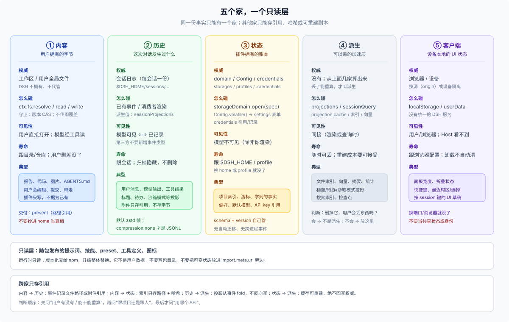

# 01 · 五个家与一个只读层：内容、历史、状态、派生、客户端

## 这一篇回答什么

为什么“数据放哪”在 DSH 里必须拆成几个互不替代的家？每个家的权威是什么、边界在哪、混用会出什么错？

这一篇是**实现词汇**；本目录统一用“家”（也可叫“平面”）。如果你还没决定“对用户承诺记住什么”，先读 [answer](../00-answer.md) 的五种承诺；承诺定了，这一篇才用得上。

## 一个事实只能有一个家

DSH 的持久化不是“一个数据库”，而是几条互不替代的通道：

```text
内容    → 工作区文件系统            （用户拥有字节）
历史    → 会话日志                  （模型可见的事实）
状态    → 宿主域 / 配置 / 凭据       （插件拥有的账本）
派生    → 投影缓存 / 索引 / 缓存目录  （可重建的加速层）
客户端  → 浏览器 localStorage / 桌面 userData（设备本地，Host 不可见）
```

外加一个**只读层**：随包发布、升级即替换的提示词、技能、preset、工具定义。它不是用户数据，但作者经常把它和“数据”混在一起。

**“一个事实一个家”** 是贯穿整套设计的规则：同一份事实只能有一个权威。其他家如果要提到它，只能存**引用**（路径、id、哈希、附件引用、事件 seq），不能存副本。否则用户改一处、你抄一处，两边必然漂移。



| 家 | 权威 | 典型位置 | 作用域 | 寿命 | 谁看得见 |
|---|---|---|---|---|---|
| **内容** | 用户 | 工作区目录、项目内约定目录（如 `.agents/`，E1 约定）、用户 `AGENTS.md`/`skills/` | workspace / 用户全局 | 跟目录/仓库 | 用户；模型经工具读 |
| **历史** | 会话 | `$DSH_HOME/sessions/…` | session | 跟会话；日志不删 | 模型（surface）、Host（log-only） |
| **状态** | 插件 / 用户配置 / 凭据 provider | `$DSH_HOME/storages`、`profiles/`、`.credentials.yaml` | workspace 键 / profile / home | 跟 home 或 profile | 插件；用户经设置页 |
| **派生** | 无 | 投影缓存、`session_projcache`、索引 | 跟源 | 可重建 | 间接 |
| **客户端** | 浏览器 / 设备 | `localStorage`、`userData/` | 源（origin）/ 设备 | 跟浏览器配置 | 用户/浏览器；Host 看不到 |
| **只读层** | npm 包 | profile 的 `node_modules` | 安装 | 升级替换 | 运行时读取；不写 |

**原生优先。** 这些家里，N0 核心合同（session log、projections、fs、remote access）和 N1 随包插件（workspace、projcache、settings、credentials-local、session-query-sqlite、spill-local）是长期依赖；N2 experimental 只参考；E1 外部插件/E2 外部服务只借模式（见 [09](../03-external/09-external-plugin-patterns.md)）。

三个边界不是平等的家，但作者必须知道：

- **外部服务**：MCP/HTTP/DB/对象存储；权威在外部，DSH 只存引用/配置。
- **OS 临时**：spill、workspace-changes 快照、上传暂存；进程/会话级，可能被系统清理。
- **无主插件目录**：`$DSH_HOME/plugins/<id>/` 或根下自造目录；没有 DSH 契约，卸载/迁移/清理全靠作者。**C/U**

## 内容家：用户拥有的字节

**权威**：工作区目录里的文件。DSH 不拥有它们，也不替用户保管。

- 会话的 `header.cwd` 是这次工作的根；工具在这个根下执行，沙箱 `workspace-write` 也以它为可写边界。
- 插件读写文件走 `ctx.fs`：`resolve` 得到不透明目标，`readText` / `readBytes` / `writeText` / `stat` / `watch`；`writeText` 可以带 `createIfAbsent` 或 `replaceIfVersion` 守卫，省略守卫就是无条件覆盖。
- `FsTarget.targetKey` 与 `FsVersion` 都是不透明品牌类型，**不要解析**；要显示用 `displayPath`，要比较用 `contains`。
- 用户可以在 DSH 之外改文件，所以任何从内容派生的状态都必须带版本或哈希，并且**可重建**。
- 需要信任边界时，先 `lstat` 拒绝最终符号链接，再 `resolve`；`resolve` 本身会跟随符号链接。

一个容易踩的坑：**插件代码直接调用 `ctx.fs` 时，不要假设自己受模型工具那套沙箱约束**。沙箱策略是能力调用（bash、文件工具、终端）在调用点解析并传给文件系统的；插件自己拿着 `ctx.fs` 写哪里，取决于它传不传 `sandboxPolicy`、以及部署是否挂了 `dsh-fs-sandbox`。边界要靠插件自己遵守：只写当前会话的工作区，不要写用户的 home 或系统目录。

## 历史家：会话日志

**权威**：`$DSH_HOME/sessions/--<normalized-cwd>--/<escaped-id>/` 里的会话日志，一个会话一份，追加写。

- 默认物理格式是**校验和 Zstandard 帧**；只有 `compression: 'none'` 时才是可直接按行读的 JSONL。不要把默认文件当纯文本解析。
- **模型可见 ⟺ 已记录**：任何进入模型请求的输入，都必须能从日志重建；插件想“让模型记住”，就得落事件，不能只放内存。
- 日志是会话级事实，不是项目级事实：同一个项目有很多会话，每个会话有自己的历史。
- 归档只是从导航里隐藏，日志保留；compaction 遮蔽旧内容但不删除已提交事件（见 FAQ 22）。
- 会话日志**没有删除 API**：它会一直累积在 root 下，直到外部手动清理。插件不要把“归档会话”实现成删日志。**C** 外部插件（E1）有直接物理删目录（archive-retention/archive-manager）或改首帧 header（session-workspace-organizer）的做法，这是核心缺口的补丁，不是推荐 API。
- 客户端/模型看到的是**投影**：从日志折叠出来的当前值（标题、统计、todo、沙箱模式等）。投影是可重建的，不是权威。

插件什么时候用历史家？当事实**必须被模型看见**，或者**必须能回放/审计**时。这里有两个精确边界：

1. **模型可见的事实** → 用已有事件类型，或由消费者显式渲染；第三方插件**不要新增 `SessionEventMap` 类型**。未知事件只有在 `ignorable: true` 时才被接受，而 live `Session.append()` 不能设置该标记，缺少声明插件的读取方会拒绝重开会话。
2. **会话级、模型不可见、需随 resume/fork 保留的插件状态** → `appendPluginRecord()` 是唯一的 `plugin:` 通道，但它只允许 `packages/experimental/` 下的包调用；**第三方插件不应调用**。第三方没有受支持的“会话私有存储”：要么从已有事件重算，要么把状态放 home 域并按 session id 建键，并自己清理。

插件私有的宿主账本不要塞进日志：那会让模型上下文变脏，也把内部 schema 绑到了会话格式上。

## 状态家：宿主域、配置、凭据

**权威**：插件自己声明的持久记录，或用户可编辑的配置，或外部凭据源。

- `ctx.storageDomain`：schema 校验的 KV 域，宿主侧、模型不可见、写入先落盘再改内存；有版本、有 `domain/changed` 进程内事件。没有自动迁移、没有二级索引、没有跨表事务。
- Config / settings：插件 `Config` 里标了 `.volatile()` 的字段，由 settings 服务投影成表单，写回**当前 profile 的 `cordis.patch.yml`**；它是配置，不是数据表。
- 凭据：`CredentialRef`（环境变量名）只存引用，值由 provider 管；`CredentialKey` 记录（`<owner>/<id>`）用于 API key / grant 这类多字段凭据。每次操作重新 `resolve`，所以轮换不需要重启。

细节、失败方式与迁移责任在 [02](./02-state-homes.md)。

## 派生家：可以丢的东西

**权威**：没有。它从上面几个家算出来，丢了能重算。

- 会话投影（`ctx.sessionProjections`）：纯同步 fold，从日志推导，带 `stateSchema`；持久缓存（`session_projcache`）只是为了加速。
- 跨会话读取（`ctx.sessionQuery`）：live-preferred 的列表、精确读、过滤、关系追踪；挂 SQLite provider 时还有全文检索。它的索引是派生，不是权威。
- 文件索引、向量、摘要缓存：从工作区内容算出来，必须能用内容哈希/版本失效。
- 域存储的 `layout: 'per-record'` + `invalidRecords: 'backup-and-skip'` 是给“可丢弃的派生数据”准备的：坏一条就挪走跳过，不拖垮整个域。注意它**只对能 `backupRecord` 的后端有效**（JSON per-record）；`single` 和 SQLite 没有可挪走的单条文档，会回退到拒绝打开。

判断方法：**删掉它，用户会丢东西吗？** 会 → 它不是派生；不会 → 放派生层，并写清楚重建路径。

## 客户端家：浏览器/设备本地状态

这是五个家里最容易漏掉的一个。Web 客户端插件可以把 UI 状态写进 `localStorage`，桌面端则可能写 `userData/` 下的文件。

- 客户端家要拆两层：**纯 UI 状态**（布局、快捷键、折叠、最近选择）→ `localStorage`/`userData`，可丢弃；**session-derived 客户端事实**（标题、模型、preset、subagent）→ `SessionProjectionMap`，必须能从日志重建。把后者存 localStorage 会造第二个权威。**C/H**
- Web 的 `localStorage` 按**源**（origin）隔离：`127.0.0.1:3080` 和 `127.0.0.1:3081` 是两份；换端口、换浏览器、清站点数据就没了。
- 它**不在 `$DSH_HOME` 里**，Host 进程看不到，模型更看不到；多开浏览器/多设备不会共享。
- 仓库里的真实例子：`dsh.keybindings.v1`（快捷键）、会话滚动/折叠状态按 session 键、日程的最近时区、右侧栏宽度。桌面端快捷键则写 `userData/keybindings.json`。
- 卸载插件不会自动清 `localStorage`；升级时也没有自动迁移。键名、版本、清理逻辑都得你自己负责。
- 同一个源上跑两个不同的 `DSH_HOME`/Host，会共用同一份 `localStorage`；不要把“用户身份”或“项目身份”只存在这里。

适合：纯展示偏好、面板宽度、折叠状态、最近选择。不适合：任何需要跨设备、跨浏览器、模型可见或卸载后可回收的数据。

## 只读层：随包发布的东西不是数据

提示词、技能、preset、工具定义、图标、模板，都是包的一部分：运行时只读，版本化交给 npm，升级时整体替换。

- 不要写进包目录（包括 `import.meta.url` 旁边的 `data/`）：安装/升级会替换，`files` 会裁剪，link 安装又直接指向 checkout。
- 需要用户可编辑的“知识”，发布成技能或让用户写 `AGENTS.md`；需要插件可写的状态，走状态家。
- 包目录里的 `node_modules` 是安装位置，不是用户数据目录。

## 为什么工作区不是“存储引擎”

`Workspace` 是一条登记记录（id + 路径 + 标题 + 账户），它不提供任何读写数据的 API。它回答的是“这个目录在侧栏里叫什么、哪些会话属于它”，不回答“数据存在哪”。

所以：

- 想要“项目级数据库”？没有。你要么写项目里的文件，要么在 home 域里用路径作键。
- 想要“每 workspace 一套插件状态/运行时”？核心没有：`DomainSpec` 没有 scope 字段，插件实例是宿主级；外部插件（E1）用 `workspaceCordis` 或路径键自己补。**C/H**
- 想要“删工作区就删数据”？也没有。删工作区只删注册与账户；项目里的文件还在，home 里的记录也还在。
- 想要“工作区搬家，数据跟着走”？只有项目内文件会跟着走；home 里的路径键会变成孤儿。

这不是缺陷，而是“注册不拥有目录”的必然结果（见 FAQ 25 的删除语义）。

## 混用会怎样：四个真实失败

1. **把用户内容抄进 home 域**：用户在编辑器里改了文件，你的域里还是旧副本；模型基于旧副本回答，用户看到“插件在胡说”。
2. **把索引当权威**：用户删了一个文件，索引还在；插件推荐一个不存在的路径，工具报 ENOENT。
3. **把插件状态塞进会话 surface**：模型上下文里出现内部 JSON；换一个会话就丢；schema 一改，历史日志全变成负担。
4. **把浏览器本地状态当共享状态**：换端口/换浏览器后设置“消失”，或者两个 Host 共用一份设置互相覆盖。

这四个失败都来自同一个错误：**让副本、派生或设备本地状态承担了权威的角色**。

## 一张判断图

```text
是用户要打开/编辑/带走的东西吗？
├── 是 → 内容家：写工作区文件；交付用 present
└── 否 → 模型必须看见吗？
    ├── 是 → 历史家：落会话事件；需要展示再加投影
    └── 否 → 只在当前浏览器里用吗？
        ├── 是 → 客户端家：localStorage / userData（自己管清理）
        └── 否 → 重启后还要在吗？
            ├── 否 → 内存或派生层
            └── 是 → 能从别的事实重算吗？
                ├── 能 → 派生层（索引/缓存，可丢弃）
                └── 不能 → 状态家：domain / settings / credentials
```

## 没有“插件数据根”

DSH 没有 `$DSH_HOME/plugins/<id>/` 的契约；`plugins/` 只是本机出现的惯例，根下还有 `auto-approval-llm/`、`clutch-dsh-worktree/`、`company-workspace/` 等无主目录。**C/U**

插件可用的通用状态面只有 `ctx.storageDomain`（schema/版本/写链）与 `ctx.fs`（项目/用户文件）；二者都不提供“按插件 id 的目录、配额、卸载清理、跨进程锁”。所以：

- 要么用 domain（推荐），自己声明 domain 名、版本、记录键；
- 要么自造目录，并在 README 写清路径、清理、迁移、卸载残留；
- 不要指望平台替你删——删除/保留是系统性空白（见 06/11）。

## 边界

- 本篇把“内容”限定为工作区文件；附件库里的二进制也是内容，但它服务模型输入，归属与生命周期不同（见 04）。
- 会话日志的格式、迁移与 compaction 细节不在本篇展开；这里只关心“它是不是权威”。
- `ctx.fs` 的远端后端（SSH 等）可能让 `processPath` 与本地路径不同；不要把 `displayPath` 当成本地绝对路径。
- 客户端家只讨论 Web/Desktop 的浏览器侧；Electron 主进程、原生扩展的存储不在本篇范围。
- 完整 landscape、历史与参考架构见 [05](../02-native/05-native-data-landscape.md)、[06](../02-native/06-native-data-history.md)、[11](../04-advisor/11-native-reference-architectures.md)。
