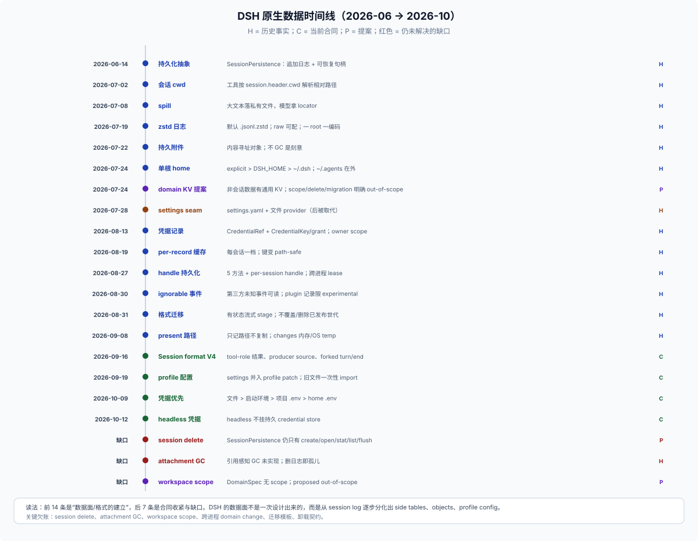

# 09 · DSH 原生数据历史：这些家是怎么长出来的

## 这一篇回答什么

> 只讲 DSH 原生核心/随包插件/experimental 的演进；外部插件只作反例参考，不是原生历史的一部分。

不是“DSH 现在有哪些家”，而是：**这些家为什么是现在这样？哪些是刻意、哪些是欠账、哪些被否决过？**

证据标签：**C** 当前合同（docs/源码/测试）、**H** 历史事实（当时的 Agent Note/旧文档）、**P** 提案（未实现）、**U** 未确认。本仓库是浅克隆，2026-06 之前的 git 历史不可用；早期事实以 Agent Note 与 docs 为准。

## 一条时间线（22 个事件）

| 日期 | 变化 | 之前 | 之后 | 证据 |
|---|---|---|---|---|
| 2026-06-14 | 会话持久化抽成 `SessionPersistence` | 会话状态与文件耦合 | 追加日志 + 可恢复句柄 | H |
| 2026-06-18 | 共享写协调器 | 多个消费者各自持有写路径 | 单写者、按 id 路由 | H |
| 2026-07-02 | 文件路径按会话 cwd 解析 | 进程 cwd 决定相对路径 | 工具把 `session.header.cwd` 传给 `ctx.fs` | H |
| 2026-07-08 | spill 落盘 | 大结果只能内联/截断 | 文本落私有文件，模型拿 locator | H |
| 2026-07-17 | spill 启动清扫 | 临时根无限增长 | `cleanupPeriodDays` 一次性 sweep | H |
| 2026-07-19 | 会话日志 zstd | 原始 JSONL 体积/IO 大 | 默认 `.jsonl.zstd`，`compression:'none'` 保留可读 | H |
| 2026-07-22 | 持久附件 | 浏览器 object URL/临时路径 | 内容寻址对象 + `ImageAttachmentRef` | H |
| 2026-07-24 | 会话按项目分目录 | 平铺/<hash> 桶 | `--<cwd>--/<session-id>/`，每会话一目录 | H |
| 2026-07-24 | 单一 home 解析器 | 两个 `resolveDshHome` 漂移 | `explicit > $DSH_HOME > ~/.dsh`；不拆 XDG | H |
| 2026-07-24 | domain KV + workspace 提案 | 非会话数据无处可放 | `ctx.storage` + json/sqlite + domain + workspace | P（部分已实现） |
| 2026-07-28 | settings seam（`settings.yaml`） | cwd 锚定的 profile json，无写路径 | 三包 settings + 文件 provider | H（后被取代） |
| 2026-07-28 | storage root / 派生介质恢复提案 | `./.storages` 随启动目录分裂 | 锚到 `$DSH_HOME/storages`；恢复语义仍开放 | P/C |
| 2026-08-13 | 凭据记录与授权流 | 只有 `CredentialRef` | `CredentialKey` + grant 记录 | H |
| 2026-08-19 | 投影缓存 per-record | 单个全局 `session_projcache.json` | 每会话一档，写隔离 | H |
| 2026-08-27 | handle-based 持久化 | 服务方法 + 协调器/adoption | 5 方法 + per-session handle；跨进程 lease 后续已落地 | H |
| 2026-08-30 | 保留 `ignorable` 外部事件 | 移除字段导致第三方会话不可读 | `ignorable` 保留；`plugin:` 记录只限 experimental | H |
| 2026-08-31 | 已发布格式流式迁移 | 整包迁移内存爆炸 | 有状态 stage，逐代迁移，不覆盖旧代 | H |
| 2026-09-08 | present 只记路径 | 独立交付副本 | 声明源文件，不复制 | H |
| 2026-09-16 | Session format V4 | V3 | tool-role 结果、producer-owned source 等 | C/H |
| 2026-09-19 | 设置并入 profile patch | 全局 `settings.yaml` | profile 专属；旧文件一次性 import 后改名 | C/H |
| 2026-10-09 | 存储凭据优先 | 环境变量可能盖过已存值 | 文件 > 启动环境 > 项目 `.env` > home `.env` | C/H |
| 2026-10-12 | headless 不挂凭据 store | 所有 profile 共享 store | headless 无持久凭据，per-run 覆盖 | C/H |

## 12 个数据簇

### 1. home 与 profile：一个根，两个例外

**决定**：一个 `$DSH_HOME`（`explicit > $DSH_HOME > ~/.dsh`），不拆 XDG；`~/.agents`（`$DSH_AGENTS_HOME`）故意在 home 之外，供多个 agent 工具共享；空 `$DSH_HOME` 视为未设，避免 `resolve('')` 把 home 放到 cwd。**C/H**

**为什么**：之前有两个 `resolveDshHome` 实现已经漂移（一个展开 `~`，一个不展开）；XDG 会把“一个家”拆成 config/data/cache 三类，需要给每个 `~/.dsh` 消费者重新分类。单根是刻意选择。

**代价**：同一台机器多个 profile 共享同一个 home，包括 `.credentials.yaml`；profile 只是组合/设置边界，不是数据隔离边界。**C**

### 2. settings：从全局文件到 profile patch

**决定**：`Config` + `.volatile()` 字段 → settings 表单 → 活跃 profile 的 `cordis.patch.yml`；`$DSH_HOME/settings.yaml` 只在 Loader 安定后 import 一次，然后改名 `settings.yaml.imported`。**C/H**

**为什么**：旧的 `ctx.settings` 三包 seam（namespace 注册、文件 provider、跨进程 writer lock）与 Loader 配置重复了 schema/defaults/persistence/notification；写入还会把用户设置放在部署 overlay 之上，丢失“哪个组合层提供了值”。**H**

**代价**：持久表单值**按 profile**，不是按账号；跨 profile 共享偏好被刻意拒绝，要重新引入就得有显式的共享 Cordis 层和写目标。patch 写入会 pin 整条 entry config（含未编辑的 volatile 字段），后续 bundle 改动不再下发。**C**

### 3. 凭据：引用与记录分开

**决定**：`CredentialRef`（环境变量名）每次操作解析；`CredentialKey`（`<owner>/<id>`）保存 api-key/grant 记录；`.credentials.yaml` 分 `refs` 与 `records`，有 version 与一次性 flat 布局升级；不 hoist 进 `process.env`。**C/H**

**为什么**：OAuth grant 不是“部署能告诉你的值”，需要读-改-写和刷新；`<provider>` 作 key 会让两个插件读同一记录，所以 owner 是插件注册名。**H**

**代价**：`0600` 只挡其他 OS 用户；模型工具以同一 uid 运行，文档明说“没有对模型的边界”。`.bak-*` 副本会留下历史 secret，且没有清理。OS keychain provider 被记录为真正的答案，但仍是 deferred。**C/H**

### 4. 会话持久化：日志是唯一真源

**决定**：`SessionPersistence` 只有 `create/open/stat/list/flush`，返回 per-session handle；handle 的 `read/append/flush/close` 是唯一门；单写者由进程内 registry + 跨进程 kernel lease（POSIX `flock` / Win32 semaphore）保证；崩溃修复在 resume 里做，不在 persistence 里做。**C/H**

**为什么**：旧的 coordinator 会“adopt”已发布会话、HMR 重新接管、用 revision 循环模拟所有权；这些把 storage 和 Session 生命周期混在一起。handle 化让所有权显式。**H**

**代价**：没有 `delete`；旧世代永久累积；多进程共享 home 仍不是产品场景；日志格式迁移只增不删。**C/H**

### 5. 会话格式：已发布格式是合同

**决定**：`SESSION_FORMAT_VERSION` 是 writer 权威；v0→v1→v2→v3→v4 相邻流式 stage；迁移只发布当前目标，不移动/覆盖/删除已提交世代；未来最高代即使旧代可读也拒绝；未知事件只有 `ignorable: true` 才接受，历史 v0/v1/v2 连 ignorable 也拒绝。**C/H**

**为什么**：v0 已随 alpha 发布，不能把用户日志当可丢弃的 pre-release 数据；整包迁移在 116 MB 会话上耗尽 16 GB 内存，所以改成流式 stage。**H**

**代价**：读旧会话有迁移成本；插件不能新增事件类型；投影缓存必须绑定 Session 格式/生命周期身份，否则会用错行。**C**

### 6. 投影、查询、缓存：派生没有权威

**决定**：`ctx.sessionProjections` 是 live session 的纯同步 fold，客户端可见值（标题、模型选择、preset、subagent 身份）属于 `SessionProjectionMap`；`session_projcache` 是 per-record 持久检查点；`ctx.sessionQuery` 是跨会话 live-preferred 读取，SQLite FTS5 是可选 provider。**C**

**为什么**：三个前端各自造标题/统计/轮子；query 索引和统计是派生，不能成为恢复权威。**H/C**

**代价**：投影缓存与权威 `workspace.json` 同目录同后端，没有统一的“权威/可重建”声明；legacy 单文件 `session_projcache.json` 仍在磁盘；query 索引默认 `:memory:`，启用搜索的部署要自己给 path。**C**

### 7. storage domain 与 workspace：通用 KV，但没有 scope

**决定**：`ctx.storage` 是 hub，backend 管介质，`domain` 管 schema/写链/事件；`defineDomain` 静态声明 name/version/layout/tables；`workspace` 用 domain 存记录，path 是唯一 canon（`fs.realpath` 字符串相等），`WorkspaceId` 是随机 uuid。**C**

**为什么**：会话日志不能承载 workspace 这种“不属于任何单会话”的事实；path 作为 key 被否决，因为规范化/符号链接会重写路径，引用锚点必须稳定；ownership 不能从 cwd 派生，否则两个真相。**H**

**代价（proposed 明确 out-of-scope）**：session delete、`log` facet、多进程写保护、跨进程 change、data migration、多段键、**scope dimension**（每 workspace 一个 domain）、跨表事务、二级索引、跨 workspace 移动。**P** 这是理解“为什么没有 per-workspace 数据家”的关键。

### 8. 附件：不可变对象，故意不 GC

**决定**：附件是内容寻址、不可变对象，`$DSH_HOME/attachments/v1`；事件只带 `ImageAttachmentRef`/`FileAttachmentRef`；先持久化再写事件；本地 store 在 version one **不做自动删除**。**C/H**

**为什么**：浏览器 object URL、临时路径、provider URL、base64 都不能作为 canonical session content；引用感知 GC 需要单独的引用模型（resume/fork 共享对象，按年龄删会删掉仍被引用的数据）。**H**

**代价**：删日志不会删对象；对象无引用计数；请求图派生缓存在 `cache/attachments`，无清理策略。**C**

### 9. spill：上下文管理，不是归档

**决定**：`ctx.spillStore.saveText` 原样保存文本，返回不透明 locator；本地默认在 OS temp 的私有 root，启动时按 `cleanupPeriodDays`（默认 30）清扫。**C**

**为什么**：大结果放上下文不划算；spill 只需要“模型能按 locator 读回”，不需要长期归档。**H/C**

**代价**：不在 `$DSH_HOME`，跨进程不可见；长跑进程不会再次 sweep；session 删除不存在，所以只能靠 TTL。**C**

### 10. 交付物：present 是引用，changes 是内存

**决定**：`present` 只记录可访问的普通文件路径 + 描述，不复制内容；`deliverables/presented` 是 required-on-read 的 log-only 事件；`workspace/changes` 只发 `{turn}`，摘要留 Host 内存，整文件副本在 OS temp。**C/H**

**为什么**：独立交付副本会引入内容存储、复制校验、临时文件保留和第二个编辑目的地；用户要的是“打开当前源文件”，不是“打开一份快照”。**H**

**代价**：源文件改了/删了，交付就变/失效；会话 ZIP 只含声明，不含工作区文件；changes 会话销毁即止。**C**

### 11. 客户端状态：localStorage + 投影

**决定**：Web 客户端 UI 状态（布局、快捷键、session 草稿）在 `localStorage`，按 origin/会话键；桌面用 `userData`。Session-derived 的客户端可见事实（标题、模型、preset、subagent）走 projection，不进 localStorage。**C/H**

**为什么**：浏览器对象（File、object URL）不能进持久 JSON；session-derived 事实必须能从日志重建，不能变成第二个权威。**H**

**代价**：localStorage 换端口/换浏览器就丢；没有统一服务、迁移或卸载清理；同一 origin 上两个 `DSH_HOME` 会共用。**C**

### 12. 插件记录与实验存储：没有通用插件数据根

**决定**：`SessionEventMap` 第三方不要新增；未知事件只有 `ignorable: true` 才能读；`appendPluginRecord()` 的 `plugin:` 记录只允许 `packages/experimental/` 调用；`claude-code-mods` 的 `$.store` 是 experimental bridge 里的 per-plugin 4 MiB domain。**C/H**

**为什么**：第三方事件类型会变成 required-on-read 的发布合同；`plugin:` 记录在格式迁移里只尽力保留，发布包不能把状态放进去；通用插件数据根没有被设计，因为 storage domain 已经能承载，但缺 scope/quota/cleanup 契约。**H/C**

**代价**：第三方没有受支持的“会话私有存储”；只能从事件重算、放 home 域按 session 建键，或自造目录。**C**

## 反复出现的七个张力

1. **权威 vs 方便**：复制一份最方便，但会漂移；present 与 attachment 都选择了引用/不可变对象。
2. **作用域身份**：path vs `workspaceId`；profile vs account；workspace vs project root（git 顶层）。没有一套名字同时满足“稳定、可读、可移植”。
3. **删除与保留**：session、attachment、`.bak`、legacy cache 都没有统一回收；作者要自己写清理，而平台没有“卸载契约”。
4. **追加 vs 编辑**：日志只追加；用户要可编辑的 Markdown；journal+render、present 引用都是折中。
5. **进程边界**：session 有 kernel lease；domain JSON 没有跨进程锁；spill 在 OS temp；多 Host 共享 home 不是支持场景。
6. **秘密边界**：`0600` 挡其他用户，不挡同 uid 的模型；备份副本绕过“不 hoist”。
7. **派生 vs 权威**：projcache 可重建却与 workspace 同目录同后端；没有统一的 authority 声明。

## 仍然是欠账的（P/U）

- session 删除、保留期、级联（proposed 明确 future work）。
- 附件引用感知 GC（proposed 明确 blocker）。
- 每 workspace 一个 domain/scope（proposed out-of-scope）。
- 跨进程 change 通知 / 多 Host 写保护（proposed out-of-scope；session 有 lease，domain 没有）。
- 通用插件数据根（无提案；只有 convention 与 experimental `$.store`）。
- 跨 profile 共享偏好（当前设计刻意拒绝）。
- 客户端状态服务/迁移/卸载清理（无核心服务）。
- storage domain 的权威/派生声明（`recovery` 提案未落地，只有 `invalidRecords`）。
- 卸载契约（插件、数据、备份、localStorage 都没有统一生命周期）。

## 对插件作者的含义

1. **不要从“当前文件布局”推断合同**：`sessions/`、`storages/`、`attachments/` 是实现，不是插件写入 API。
2. **session 日志不是插件存储**：第三方不能新增事件类型；`plugin:` 只限 experimental；会话私有状态要从事件重算或放 home 域。
3. **workspace 级状态没有核心家**：要么项目内文件，要么 home 域 + 稳定路径键；`workspaceId` 会随删除重加变化。
4. **profile 不是账号**：settings 只对 profile 生效；跨 profile 用 home 域。
5. **删除/卸载要自己设计**：平台没有统一的 GC/卸载清理；README 必须写清数据在哪、怎么删。
6. **秘密是约定不是边界**：不要把 `.credentials.yaml` 的内容写进日志/提示词；也不要以为文件权限能挡住模型。
7. **不要直接改 session 日志**：已有插件这么做（surgical header rewrite），但它是高风险反模式；用 `sessionQuery`/`sessionPersistence` 的受支持面。

## 边界

- 本篇是历史解释，不是当前合同清单；C 结论以 `docs/` 与源码为准。
- 浅克隆导致 2026-06 之前的事件只能靠 Note 复述；标 H 不等于“可 git 复核”。
- 外部插件（E1）的“直接改日志”“物理删日志”是观察到的反模式，不是推荐做法。
