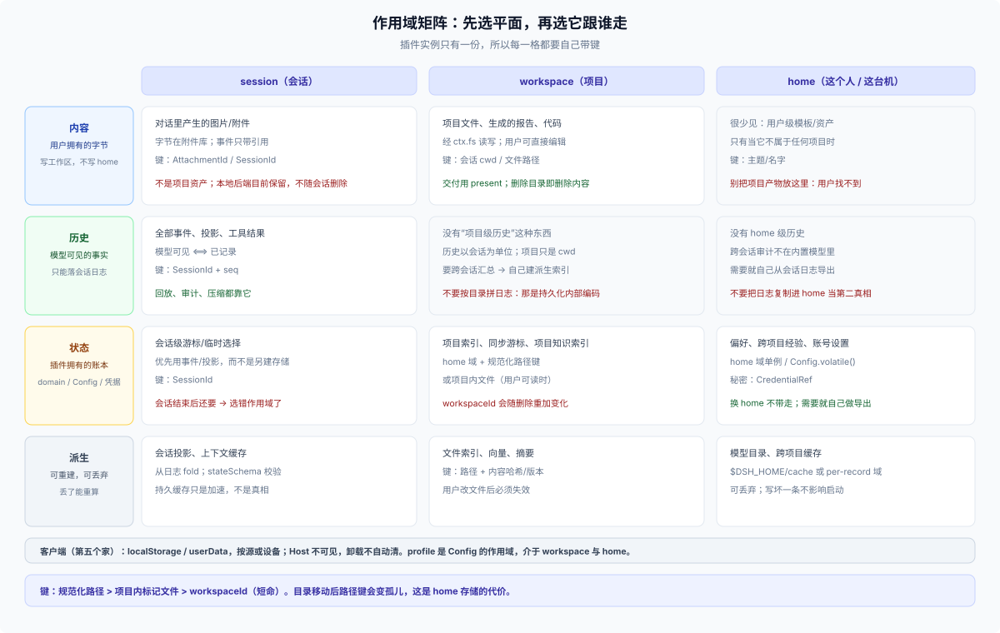

# 03 · 作用域与键：一个插件，多个工作区

## 这一篇回答什么

插件实例只有一份，但要服务多个 workspace、多个会话、多个项目。数据怎么切？项目级状态用什么键？`workspaceId` 行不行？目录被删了、被移了、工作区被重新添加了，会发生什么？



## 六个作用域

| 作用域 | 谁的生命周期 | 典型数据 | 键 |
|---|---|---|---|
| session | 会话 | 这次对话的中间结果、模型可见事实、附件引用 | `SessionId` |
| workspace | 项目目录 | 项目索引、上次同步位置、项目知识 | 规范化路径 / `workspaceId` / 项目内标记 |
| profile | 一个组合（profile） | 插件开关、默认模型、输出目录 | profile entry id |
| home | 这个 Host 账户 | 偏好、跨项目经验、账号级缓存 | 单例或人级键 |
| client/device | 浏览器或设备 | 面板宽度、折叠状态、最近选择 | origin + 本地键 |
| shared / external | 跨工具或外部服务 | 技能、`AGENTS.md`、MCP 服务 | 文件名 / 服务地址 |

你的“两块”在这里落位：**用户的内容**几乎总是 workspace 级或用户全局；**跟用户相关的状态**要再问一句“跟项目走还是跟人走”——前者 workspace 键，后者 home/profile。

## 插件是宿主级的，没有“每个项目一份实例”

这是与很多 IDE 插件最大的不同：

- 插件在 Host 启动时挂载一次，`apply(ctx)` 每加载一次跑一次；它服务所有工作区、所有会话。
- 没有“打开项目时重新初始化插件”的钩子；也没有“关闭项目时销毁插件”的钩子。
- 要感知项目，只能从**会话头**、**工作区注册表**或**当前会话**取，不能从 `process.cwd()` 猜。

```text
会话头：session.header.cwd（不可变，创建时写入，可能缺失）
注册表：ctx.workspaceRegistry.list() / get(id)（可选能力）
当前会话：ctx.workingDirectory.get(session)（会话级，可能被工具改过）
```

shipped Web 组合挂载 `workspaceRegistry`；headless/SDK 组合可能没有它。插件要用就先 `inject` 并处理缺失，不要把“没有注册表”当成“没有项目”。

社区补“每项目一套运行时”的做法是另一个服务：`dsh-workspace-overlay` 注册 `ctx.workspaceCordis`，用 canonical path 做 lease，最后一个租约释放时 dispose scope。它不是核心 API，不能当 DSH 的合同（见 06 篇）。

## 工作区的身份：id 短命，路径长命，但都不完美

| 标识 | 稳定吗 | 适合当键吗 |
|---|---|---|
| `WorkspaceId`（uuid） | 删除再添加同一目录会换新的 | **不适合**长期键；适合进程内引用 |
| `workspace.path`（realpath） | 目录不改名/不移动就稳定；符号链接已解开 | **较适合**，但要处理移动/删除 |
| `session.header.cwd` | 会话创建后不可变 | 不能当项目键：目录移动后它仍指旧路径 |
| 会话目录名 `--<cwd>--` | 持久化层的内部编码，有损、可能截断 | **不能**反解成路径 |
| 目录里的一个标记文件（如 `.your-plugin/id`） | 跟目录走、可复制 | **最稳**，但会污染仓库、要用户同意 |
| 内容哈希（如 git remote + 相对路径） | 跨机器可认，但依赖内容 | 适合同步/去重，不适合单独当主键 |

所以项目级状态通常只有三条正路：

### 路 A：写在项目里

```text
<workspace>/.your-plugin/
├── config.json      # 用户可编辑
├── memory.md        # 用户可读
└── index.json       # 你的索引（可重建）
```

优点：删除目录即删除数据；复制/提交/换机器都跟着走；用户看得见、能救。
代价：污染仓库（要 `.gitignore` 或明确目录约定）；用户可能手改到坏；要尊重沙箱与权限；多人协作时会冲突。

### 路 B：写在 home，用稳定键

```text
domain: your_plugin
table: projects
key:   w_<sha256(realpath)>       # per-record 必须是路径安全字符
value: { path, index, cursor, updatedAt }
```

优点：干净、结构化、模型不可见；不污染项目；查询方便。
代价：目录移动/删除会留孤儿；换机器不带走；要做清理与重建；路径大小写/分隔符/符号链接要统一规范。

### 路 C：项目内标记 + home 账本

项目里放一个很小的、用户可见的 id 文件（或使用仓库已有的稳定标识，如 git remote + 仓库相对路径），home 账本用这个 id 作键。它同时解决“目录移动”和“换机器”的一半问题，代价是项目里多一个文件，以及用户可能复制/删除它。

## 键的代数

**第一原则：键必须来自规范化标识，不是用户输入的原始字符串。**

- 路径规范用 `fs.realpath` 的口径：尾斜杠、`..`、符号链接都解开；DSH 自己的工作区唯一性就是 canonical path 字符串相等。
- Windows 的大小写、分隔符、短路径要单独测试；不要把 POSIX 的写法当成跨平台。
- 不要把 `displayPath` 当键：它可能是相对路径、远端 URI 或 `~` 形式。

**第二原则：per-record 键是路径段，不是任意字符串。**

- JSON `per-record` 后端的键必须匹配 `[a-zA-Z0-9_-]+`；`realpath`、`session:<id>`、`a/b` 都会被拒绝。
- 用带前缀的哈希：`w_` + `sha256(realpath)` 十六进制；`s_` + session id（如果 id 本身安全）；`v1_` 做 schema 版本前缀。
- `single` 布局没有这个限制，但把路径直接当键会让 unit 文件变成“路径数据库”，迁移时更难拆。

**第三原则：复合键要有明确的分段和转义。**

```text
per-record:  w_<hash>_s_<sessionId>       # 每段都安全
single:      workspace/<realpath>/session/<id>  # 可读，但要自己处理分隔符
```

不要把用户输入直接拼进键；不要用 `:`、`/`、空格、Unicode 作为 per-record 分隔符。

**第四原则：多实例要带实例键。**

域名单个 Host 只能打开一次；同一个插件的两个实例（不同 profile 条目、不同配置）不能各开一个域。把实例 id 放进记录键，例如 `inst_<profileEntryId>_w_<hash>`，或者用一张 `instances` 表。

## 目录移动/删除时到底发生什么

| 事件 | 项目内数据 | home 域（路径键） | 工作区记录 | 会话 |
|---|---|---|---|---|
| 目录改名/移动 | 跟着走 | 变成孤儿（旧键失效） | 保留旧路径，`status()` 报 `missing-dir` | `header.cwd` 仍指旧路径 |
| 删除目录 | 一起没了 | 孤儿 | 保留（路径不重写） | 日志还在，工具会失败 |
| 删除工作区记录 | 不动 | 不动 | 没了 | 立即 Ungrouped |
| 重新添加同一目录 | 还在 | 旧键可复用（路径没变） | 新 uuid、空账户 | 旧会话不会自动回来 |
| 换 `$DSH_HOME` | 还在（跟目录走） | 没了 | 没了 | 没了 |
| 换机器 | 跟仓库走 | 没了 | 没了 | 没了（除非导出） |

这张表决定了你的清理策略：

- 路径键的记录要带 `lastSeenAt`，并在读到已不存在的路径时标记/清理；
- 不要把 `workspaceId` 存进长期记录，除非你接受“删一次工作区就失联”；
- 目录移动后，想找回旧数据只能靠用户手动指定、项目内标记或内容哈希，路径键帮不了你；
- 删除工作区记录不会触发任何“数据删除”回调；你的清理只能靠下次启动扫描或用户显式操作。

## 跨工作区聚合：不要扫盘，扫注册表/会话

一个“跨项目”的插件（例如全局搜索、项目总览）需要枚举项目。按可靠性排序：

1. `ctx.workspaceRegistry.list()`（如果有）：拿到用户真正登记过的项目（已过滤失效成员）；
2. `ctx.sessionQuery.listSessions()` / `filterSessions({ kind: 'cwd', values: [...] })`：能覆盖没有登记过工作区的目录，但包含历史噪音；
3. 自己维护的项目表：只包含你见过的项目，需要清理。

不要遍历 `$DSH_HOME/sessions/--*--` 目录名反解路径：那是持久化层的内部编码（slug 化、可能截断），不是给你做项目发现的 API。要读会话内容，走 `ctx.sessionQuery.readSession` / `readSurface`，不要自己解压日志文件。

## 人的数据：home 的单例与可移植性

“跟人走”的状态（偏好、跨项目经验、学习到的画像）放 home：

- 结构化 → home 域的单例记录（`global` 槽或固定键）；
- 用户可读的知识 → `$DSH_HOME/skills`、`$DSH_HOME/AGENTS.md`，或跨工具共享的 `~/.agents`（`DSH_AGENTS_HOME` 可覆盖）；
- 参数 → Config 的 volatile 字段（按 profile 生效，不是按人）；
- 秘密 → credentials。

但要接受：**home 是机器/账户本地的**。换机器、换 `DSH_HOME`、换 Host，数据不跟着走。如果用户期望“我的偏好在任何机器都一样”，那不是 DSH 内置能力，需要你自己做导入/导出（或像社区那样用 git 做同步）。

另一个容易混的点：**profile 不是人**。同一个 `$DSH_HOME` 下可以有多个 profile（standard、creator、自定义），每个 profile 有自己的配置 patch；`Config` 的作用域是 profile，不是“这个用户”。要跨 profile 共享，用 home 域。

## 多用户与远程：home 是 Host 账户的，不是浏览器的

- 远程 Web 客户端连的是同一个 Host，读到的是同一个 `$DSH_HOME`；没有“每个浏览器用户一份 home”。
- 远程访问（`remoteAccess`）是**授权策略**：非 owner 调用要按资源/动作通过 policy；它不提供按用户分区的数据存储。
- 如果插件需要“每个终端用户自己的数据”，DSH 当前没有内建的租户模型；要么由部署层注入不同的 Host/home，要么在插件里自己带主体键（并自己解决隔离与授权）。
- 浏览器 `localStorage` 是设备/源级的，不是用户级的；同一台机器的同一浏览器只算一个“客户端身份”。

## 作用域选择表

| 事实 | 作用域 | 平面 | 键 |
|---|---|---|---|
| 生成的报告/代码 | workspace | 内容 | 文件路径 |
| 这次对话的中间结果 | session | 历史/内存 | `SessionId` |
| 项目索引 | workspace | 派生 | 路径哈希 + 内容哈希 |
| 项目知识（用户可读） | workspace | 内容 | 项目内文件 |
| 项目同步游标 | workspace | 状态 | 路径哈希 |
| 个人偏好 | profile/home | 状态/配置 | 单例 |
| 跨项目经验 | home | 状态/内容 | 单例或主题键 |
| 密钥 | home | 凭据 | `CredentialRef` / `CredentialKey` |
| 用户上传的图片 | session | 内容（附件库） | `AttachmentId` |
| 面板宽度/折叠状态 | device | 客户端 | origin + 本地键 |

## 边界

- 路径规范化用 `fs.realpath` 的口径；Windows 的大小写与分隔符要单独测试。
- 工作区路径可能是仓库的子目录，不等于 git 根；技能发现用的是“最近的 `.git` 祖先”，不要混用这两个概念。
- 会话 cwd 不可变，所以“把会话搬到另一个项目”不是支持的操作；跨项目迁移只能新建会话（社区有直接改日志 header 的做法，风险自负）。
- `ctx.workspaceRegistry` 是可选能力；不要假设每个组合都有。
