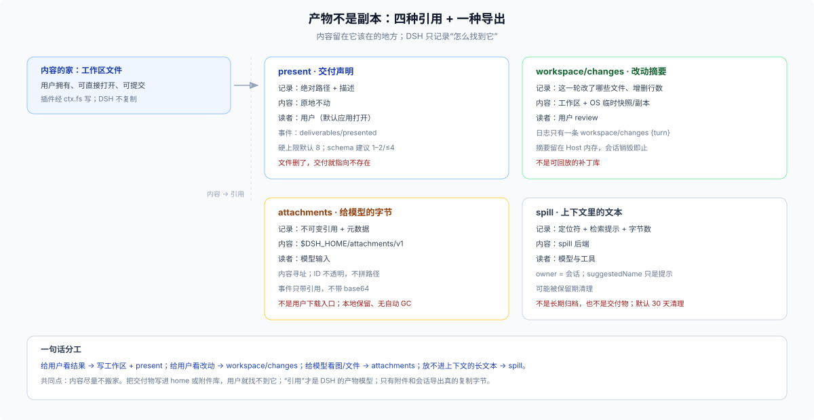

# 04 · 产物不是副本：present、changes、附件、spill

## 这一篇回答什么

用户口中的“artifact / 产物”在 DSH 里对应什么？为什么 `present` 只记路径？附件库和 `present` 有什么区别？什么时候该用 spill？把文件写到哪里，用户才能找得到？



## 先给结论

**DSH 没有通用 artifact store。** 它把“产物”拆成四种引用机制，每种服务不同的读者：

| 机制 | 记录什么 | 内容在哪 | 寿命 | 读者 |
|---|---|---|---|---|
| `present` | 文件路径 + 描述 | 原文件不动 | 一条 `deliverables/presented` 事件 | 用户 |
| `workspace/changes` | 这一轮改了哪些文件 | 工作区（git 快照/整文件捕获） | Host 内存，会话销毁即止 | 用户 review |
| 附件（attachments） | 不可变二进制的引用 + 元数据 | `$DSH_HOME/attachments/v1` | 与会话事件同寿 | 模型输入 |
| spill | 大段文本 + 定位符 | spill 后端 | 可过期/清理 | 模型与工具 |

共同点：**内容留在它原本该在的地方，DSH 只记录“怎么找到它”。**

## `present`：把文件声明为交付物

`present` 是模型-facing 的工具，插件也可以调用同一套语义：

- 输入是 `files: [{ path, description? }]`；相对路径按会话 cwd 解析，绝对路径可以指向 cwd 之外（例如 `/tmp` 或 Downloads）；
- 只接受**可读的普通文件**；目录、最终符号链接、缺失文件、provider 拒绝的路径都会失败；
- 通过后把**绝对路径**写进 `deliverables/presented` 事件（`{ turn, callId, files }`），**不复制内容**；
- 默认每次最多 8 个文件；交付属于调用它的会话，父会话要让子会话自己 `present`。

这意味着：**文件必须已经在工作区（或用户可访问的位置）**。如果你把一个报告写进 `$DSH_HOME` 的私有目录再 present，用户打开的是那个路径——能找到，但它不在项目里，也不会跟着项目走。

## `workspace/changes`：这一轮改了什么

它解决的是 review，不是交付：

- 每轮开始/结束对 git 工作树做快照，diff 出改动；git 覆盖不到的文件，在文件工具编辑前后做整文件捕获；
- 会话日志里只写一条 `workspace/changes { turn }`；摘要与逐文件对比留在 Host 内存，**会话销毁即止**；
- 能报告新增/删除行数、二进制、超大文件；受 `maxFiles` 限制。

所以它是“这次改动的说明”，不是“改动本身”。真正的改动在文件系统里，别把它当成可回放的补丁库。

## 附件：给模型看的不可变字节

- 附件是**内容寻址、不可变**的；本地后端把对象放在 `$DSH_HOME/attachments/v1`，ID 形如 `sha256:…`，但消费者不得解析这个表示或据此拼路径；
- 图片会验证类型/尺寸并归一化；也有通用文件入口；
- 会话事件只携带附件引用与元数据，不携带 base64、临时路径或 provider URL；
- 它的职责是**让模型能读到二进制**，不是让用户下载交付物。

如果你要交付一张图，正确顺序是：把图写到工作区文件 → 用 `present` 声明它。把图塞进附件库再告诉用户“去看附件”，不是 DSH 的交付模型。

## spill：上下文管理的产物

- `ctx.spillStore.saveText` 把调用方给的文本**原样**持久化，返回不透明定位符、检索提示与字节数；
- `owner` 是会话；`source` 说明是哪个工具/哪个会话引用产生的；`suggestedName` 只是命名提示，不是路径；
- 它服务“结果太大，放进上下文不划算”的场景；保留期清理可能让旧定位符过期，它不是长期归档。

spill 的读者是模型与工具，不是用户。别把用户要的最终文件放进 spill。

## 什么时候用哪个

| 你想做的事 | 用什么 | 不要用 |
|---|---|---|
| 给用户一份报告/图片/代码 | 写工作区文件 + `present` | 写 home 私有目录、附件库 |
| 让用户看这轮改了哪些文件 | `workspace/changes`（已自动） | 自己再存一份 diff |
| 让模型读用户上传的图片 | 附件服务 | 把图片塞进提示词 base64 |
| 工具输出太大，放不进上下文 | spill | 截断后丢掉、写进 domain |
| 跨会话保留一份用户产物 | 工作区文件（项目内） | spill、附件、会话日志 |

## 三个容易被忽略的边界

1. **`present` 不是复制**：文件后来被改了，用户打开看到的是新内容；文件被删了，交付就指向不存在。这是“引用”的代价，也是用户仍然拥有自己文件的好处。
2. **附件是会话的，不是项目的**：会话归档/清理策略变化时，附件的可用性跟着变；不要把项目级资产放进去。
3. **`workspace/changes` 不是持久证据**：它的摘要只在 Host 内存里活到会话销毁；要长期保留改动记录，靠 git 或你自己的状态。

## 一个正确的交付流程

```text
1. 在会话 cwd 下生成文件（ctx.fs.writeText / 工具）
2. 需要的话做校验、格式化、写配套说明
3. 调用 present（路径 + 描述）
4. 用户在对话末尾看到文件卡片，打开的是原文件
5. 需要 review 时，workspace/changes 已经记录了这轮改动
```

这条流程里，DSH 没有复制任何东西：文件属于用户，记录属于会话，引用把两者连起来。

## 边界

- 本篇不展开 `present` 的 UI 渲染与 `workspace/changes` 的 git 细节；只讲数据归属与引用语义。
- 附件库的清理/保留策略由部署与后端决定；没有“永久归档”的承诺。
- spill 的保留期与清理策略由后端决定；不要把 locator 当长期 URL。
