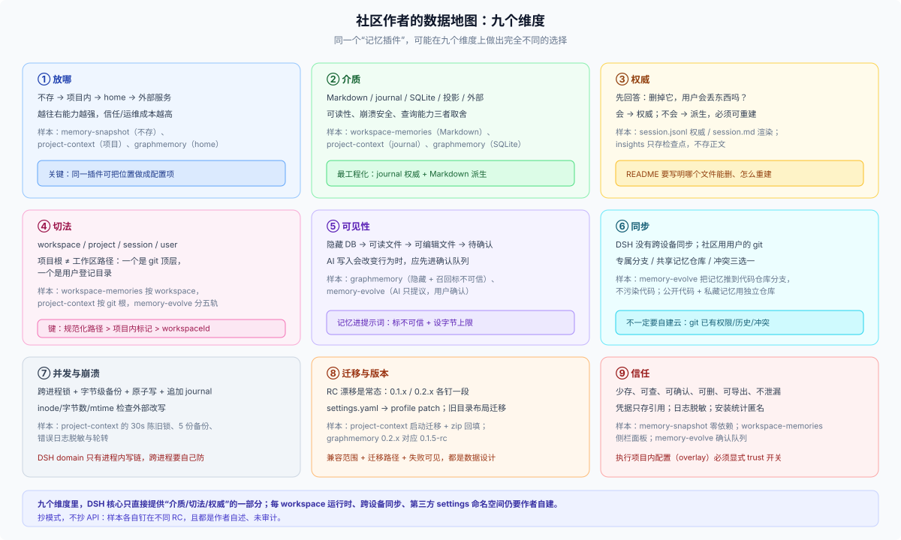

# 06 · 社区作者的多维数据地图：九个维度与十二种手法

## 这一篇回答什么

上一版把社区做法压成“五种承诺”，够用但太粗。这一篇换九个维度重新看同一批插件：**放哪、用什么介质、谁是权威、按什么切、给谁看、怎么同步、怎么防并发、怎么迁移、怎么取得信任**。最后给一份作者策略库和按插件类型的选型矩阵。

**所有社区材料都是外部作者声明，未独立验证**；它们钉在 `0.1.x` / `0.2.x` 的不同 RC 上，不能当 API 合同。

## 观察样本

| 插件 | 类型 | 数据位置 | 关键手法 |
|---|---|---|---|
| `dsh-memory-snapshot` | 只读记忆注入 | 用户已有 markdown，原地 | 零依赖、无数据库、无写入通道 |
| `dsh-workspace-memories` | 工作区记忆 | 默认 `~/.dsh/workspace-memory/<workspace>/`，可选 `<workspace>/.dsh/memory/` | 存储位置做成用户可选项；工具写 + 侧栏面板 |
| `dsh-memory-evolve` | 长期记忆/待办/技能 | 本地文件 + git 分支同步 | 五轨记忆、确认队列、用用户自己的 git 做同步 |
| `dsh-graphmemory` | 知识图谱记忆 | `~/.dsh/graph-memory/graph-memory.db` | SQLite + 向量/FTS5 + LLM 抽取 + 后台队列 |
| `dsh-project-context` | 项目上下文/交接 | 项目内 `.agents/memory/` 与 `session-logs/` | journal 权威 + Markdown 派生、跨进程锁、备份、回填 |
| `dsh-workspace-overlay` | 每项目运行时 | `<workspace>/.dsh/cordis.yml` | workspace scope + lease + 热重载 |
| `dsh-custom-workspace` | 每项目外观 | `$DSH_HOME/settings.yaml` + 自定义 RPC | 按 workspace 持久化；第三方 settings namespace 缺口 |
| `harness-insights` | 用量面板 | 只存派生检查点 | 只折叠元数据，不存正文，可重建 |
| 渠道插件（Feishu/DingTalk/WeCom/iMessage） | 消息接入 | profile/env + `defaultWorkspace` | 账号级配置、凭据只存引用 |

这九个样本覆盖了“记忆、上下文、面板、渠道、运行时、外观”六类插件，足够看出模式，但不足以代表全部两万个目录条目。

## 维度一：放哪——从“不存”到“外部服务”的光谱

| 位置 | 谁拥有 | 典型 | 代价 |
|---|---|---|---|
| 不存（只引用） | 用户 | memory-snapshot | 无法写、无法保证存在 |
| 项目内 | 用户 + 团队 | project-context、overlay、workspace-memories 的 opt-in | 仓库污染、信任边界、多人冲突 |
| 宿主 home | 插件/本机 | workspace-memories 默认、graphmemory、custom-workspace | 孤儿、不可移植、换机丢 |
| 外部服务/DB | 第三方或用户自建 | Honcho、OpenViking 一类记忆引擎 | 运维、隐私、网络依赖、账号 |

社区里最值得注意的不是“选哪个”，而是 **workspace-memories 把位置做成了配置项**：`storage: home` 默认（服务器地址、环境怪癖、个人约定不适合进仓库），`storage: workspace` 可选（团队想随代码提交的记忆）。同一个插件，两种承诺，用户按内容敏感度选。

## 维度二：介质——Markdown、Journal、SQLite、外部服务

| 介质 | 优点 | 缺点 | 样本 |
|---|---|---|---|
| Markdown 文件 | 人可读、可 diff、可 git、可手改 | 解析脆弱、并发写麻烦、无查询 | workspace-memories、memory-snapshot |
| Journal + 渲染视图 | 追加写、崩溃安全、权威明确 | 要自己写折叠/备份/锁 | project-context（`memory.jsonl` → `MEMORY.md`） |
| SQLite | 查询、索引、向量、事务 | 需要 schema/迁移；不可读 | graphmemory |
| 会话投影 | 零存储、天然派生 | 只能算已有事件，不能存额外事实 | insights |
| 外部服务 | 能力强、跨设备 | 运维/隐私/网络/账号 | Honcho、OpenViking |

**journal → 渲染视图**是这批样本里最工程化的一招：`memory.jsonl` 是唯一权威，`MEMORY.md` 是给人看和注入的派生渲染；写入顺序固定为“锁内备份 → 追加 journal → 渲染”，崩溃只会让渲染落后，不会让权威丢；用户手改 `MEMORY.md` 且比 journal 新时，下一次整理会把它收进 journal。这套做法把“用户可编辑”和“机器可追加”这两个矛盾需求同时满足了。

## 维度三：权威与派生——先回答“删了会不会丢”

同一个插件里往往有多个层次，必须点名谁是权威：

- project-context：`session.jsonl` 是会话存档权威，`session.md` 是渲染；`memory.jsonl` 是记忆权威，`MEMORY.md` / `CONTEXT.md` 是渲染；`INDEX.md` 是机械索引。
- graphmemory：会话事件是源，图谱是抽取派生；源还在，图谱可重建（但抽取调用有成本）。
- insights：只存投影检查点，源是会话日志。
- workspace-memories：Markdown 文件本身就是权威，没有第二层。

判断方法没变：**删掉它，用户会丢东西吗？** 会 → 权威；不会 → 派生。社区里做得好的插件，README 都会写清楚“哪个文件是权威、哪个可以删、怎么重建”。

## 维度四：按什么切——workspace、project、session、user

| 切法 | 样本 | 键/位置 | 注意 |
|---|---|---|---|
| 每 workspace 一份 | workspace-memories | `~/.dsh/workspace-memory/<workspace-key>/` | 键要稳定；目录移动会孤儿 |
| 每项目一份（项目内） | project-context、overlay | `<project>/.agents/…`、`<workspace>/.dsh/…` | 项目根 = git 顶层，不是任意 cwd |
| 每会话一份 | project-context 的 `session-logs/<id>/` | SessionId | 会话归档/删除策略要跟上 |
| 每用户/全局 | memory-evolve 的用户档案/全局事实 | 本地文件 | 跨项目共享；同步另做 |
| 每账号 | 渠道插件 | profile/env | 一个默认 workspace 套所有项目 |

project-context 的项目根取 `git rev-parse --show-toplevel`，非 git 目录回退 cwd——这与 DSH 的“工作区路径”不是同一个概念。**工作区可以是仓库子目录，项目根是 git 顶层**；作者要明确自己用哪个。

## 维度五：给谁看——隐藏、可读、可编辑、可确认

| 可见性 | 样本 | 用户能做什么 |
|---|---|---|
| 完全隐藏 | graphmemory 的 DB、insights 的检查点 | 只能通过面板/统计间接感知 |
| 可读文件 | workspace-memories、project-context | 直接打开、diff、备份 |
| 可编辑文件 | workspace-memories、project-context 的 MEMORY.md | 手改；下一次整理收编 |
| 待确认队列 | memory-evolve | AI 提议，用户采纳/拒绝后才生效 |
| 注入内容标记不可信 | graphmemory | 召回材料标成“不可信参考”，不得压过当前指令 |

这里有两个值得抄的设计：

1. **AI 只提议，用户确认**（memory-evolve 的三条原则之一）。记忆写入会改变 AI 行为，属于“有后果的写”，不该静默。
2. **把召回内容标成不可信**（graphmemory）。记忆库可能被污染，召回文本不能获得比当前用户指令更高的优先级。

## 维度六：怎么同步——用用户自己的 git，而不是再建一个服务

- memory-evolve 的记忆同步：默认把记忆推到代码仓库的专属分支（不污染代码）；代码公开但记忆想私藏时，填一个**共享记忆仓库**，每项目一条分支；两台机器 clone 后按仓库地址“认亲”，冲突时选本机/远端/两者都要。
- workspace-memories：`storage: workspace` 模式下，记忆随项目 git 走；默认 home 模式不同步。
- project-context：会话存档在项目内，`.gitignore` 默认忽略整个 `session-logs/`；要不要提交由用户决定。
- DSH 本身没有跨设备同步；home 数据不跟着走。

**启示**：跨设备不一定要自建云；把 git 当传输层，用户已经有仓库、权限、历史和冲突解决。代价是冲突语义要自己设计（memory-evolve 就做了三选一）。

## 维度七：并发与崩溃——作者真正花时间的地方

project-context 的 README 几乎是这份地图里最细的工程说明：

- **跨进程文件锁**：`MEMORY.md.lock` / `session-index.lock`，30s 陈旧、35s 等待，`claim` 防双抢；旧构建不遵守锁的宿主重启后才受约束。
- **原子写 + 字节级备份**：覆写前备份最新 5 份，1 小时内不删。
- **journal 追加**：崩溃只会让渲染落后；读取以 journal 折叠为准。
- **inode + 字节数 + mtime 三件套**：外部改写（回填、手截断）后下一次写入整份重建，不把新事件接到别人内容后面。
- **错误日志脱敏 + 截断 + 轮转**：单条 8000 字符，>1MB 保留最新 64k。
- **回填幂等**：zip/jsonl/目录导入，已归档默认跳过，`--replace` 才覆盖，全程不调模型。

对照 DSH 的 domain：每域一条写链、写先落盘再改内存、`domain/changed` 只在进程内；**跨进程没有锁**。所以需要跨进程的作者只能自己像 project-context 这样做文件锁，或者接受“单 Host”假设。

## 维度八：迁移与版本——RC 漂移是常态

样本的兼容声明能说明问题：

- memory-snapshot 要求 DSH **0.2.x**（实测 0.2.0-rc.2）；
- graphmemory 0.2.x 对应 **0.1.5-rc**，0.1.x 对应 **0.1.2**；
- custom-workspace 目标 **0.1.0-rc.6**；
- project-context 按 **0.1.7-rc.2** 写，明确不兼容 0.1.5–0.1.7-alpha；
- workspace-overlay 基线 **0.2.1-rc.1**。

同时，settings 从 `~/.dsh/settings.yaml` 迁到 profile patch，旧插件要处理导入与重命名；project-context 在启动时迁移旧目录布局，类型冲突时两侧都保留并记日志。

**启示**：DSH 是 pre-stable，插件作者必须把“兼容范围 + 迁移路径 + 失败可见”当成数据设计的一部分，而不是发布后再补。

## 维度九：怎么取得信任——少存、可查、可删、可导出

社区里有效的信任手法：

- **少存**：memory-snapshot 的零依赖、无写入；
- **可查**：workspace-memories 的侧栏面板、project-context 的 Markdown；
- **可确认**：memory-evolve 的待确认队列；
- **可删**：明确的卸载/清理说明；project-context 的 `.gitignore` 托管；
- **不泄漏**：graphmemory 的密钥只存引用、召回标不可信；渠道插件“never commit secrets”；
- **可审计**：日志脱敏、错误日志轮转、安装统计匿名化（dshbase 的实例 ID）。

## 作者策略库：十二种可抄的手法

| # | 手法 | 适用 | 样本 |
|---|---|---|---|
| 1 | 不存，只引用 | 已有文件、只读知识 | memory-snapshot |
| 2 | 存储位置做成配置 | 同一数据有敏感/共享两种用法 | workspace-memories |
| 3 | journal 权威 + 渲染派生 | 需要追加、崩溃安全、用户可读 | project-context |
| 4 | 项目内 + `.gitignore` 托管 | 项目级数据、怕污染仓库 | project-context |
| 5 | home + 稳定项目键 | 纯账本、用户不必编辑 | workspace-memories、custom-workspace |
| 6 | SQLite + 索引/向量 | 需要查询、召回、图谱 | graphmemory |
| 7 | 用 git 做同步 | 跨设备、已有仓库 | memory-evolve |
| 8 | 确认队列 | AI 写入会改变行为 | memory-evolve |
| 9 | 跨进程锁 + 备份 + 原子写 | 多 Host/多进程写同一项目 | project-context |
| 10 | 注入上限 + 文件名校验 | 记忆进提示词 | workspace-memories |
| 11 | 召回标不可信 | 记忆/检索进入上下文 | graphmemory |
| 12 | 版本钉住 + 迁移 + 回填 | pre-stable API | project-context、graphmemory |

## 按插件类型的选型矩阵

| 插件类型 | 推荐承诺 | 介质 | 位置 | 必做防护 |
|---|---|---|---|---|
| 只读知识注入 | P0 | 用户文件 | 原地 | 路径绝对化、字节预算 |
| 项目记忆/上下文 | P2 + P1 | Markdown + journal | 项目内（可 opt-in home） | `.gitignore`、锁、备份 |
| 个人长期记忆 | P3 + P4 | Markdown/SQLite | home | 项目键、确认队列、同步 |
| 图谱/向量记忆 | P1 + P3 | SQLite | home | 抽取成本、不可信标记 |
| 用量/统计面板 | P1 | 检查点 | home/项目 | 不存正文、可重建 |
| 渠道/账号集成 | P4 | profile/env | home | 凭据引用、去重状态 |
| 每项目运行时 | P5 | 项目配置 | 项目内 | trust 开关、lease/dispose |
| UI/主题 | 无持久或 P4 | 配置/localStorage | 浏览器/home | 卸载清理、跨设备预期 |

## 一个核心缺口，三种补法

**核心没有“每 workspace 一套插件实例”**。社区的三种补法：

1. **项目内配置 + 自己建 scope**（workspace-overlay）：canonical path 做 lease，scope 隔离贡献，热重载整树；
2. **home + 自定义 RPC**（custom-workspace）：按 workspace 存设置，自己开 loopback RPC；
3. **项目内文件 + 自己解析**（project-context）：不依赖运行时隔离，只把项目当数据根。

三种补法都绕不开：键要稳定、并发要自己防、卸载要自己清、版本要自己钉。**这是 DSH 目前最值得补的一等能力**。

## 五个反直觉的结论

1. **最受欢迎的记忆插件可能根本不存数据。** memory-snapshot 的全部卖点是“文档原地不动”；它把“记忆”做成了引用，而不是数据库。对用户，这比多一个需要备份的库更有吸引力。
2. **可编辑的 Markdown 比数据库更难做。** 一旦允许用户手改，你就要处理“用户改的比 journal 新”“外部截断”“并发写”“崩溃后渲染落后”这些情况；project-context 用 journal + 锁 + 备份 + 三件套校验才把这条路走通。
3. **跨设备同步最省的办法可能是用户的 git。** memory-evolve 没有自建云，而是把记忆推到代码仓库的专属分支；用户已经有权限、历史、冲突解决。你只需要设计冲突语义。
4. **“每项目一套运行时”的缺口，最后会变成数据键的问题。** overlay 用 canonical path 做 lease，本质上是在没有 per-workspace 实例时，自己造一个稳定键；数据放哪、跟谁走，仍然是同一个问题。
5. **版本兼容不是发布问题，是数据问题。** 旧 settings 文件、旧目录布局、旧事件格式都会变成迁移与回填；project-context 的 `/session-log import` 和启动迁移，和它的记忆功能一样重要。

## 对 DSH 的五条产品启示

1. **默认教“不存”。** 文档、脚手架、示例先给 P0/P1，再给 domain；少一个存储面就少一套迁移、清理、备份、隐私问题。
2. **给 per-workspace 数据一个一等写法。** 现在作者要么写项目文件，要么在 home 里手搓路径键；一个“workspace 键 + 清理钩子”的约定能省掉大量重复。
3. **给第三方 settings 一个受控命名空间。** custom-workspace 已经因此造了自定义 RPC；核心提供只读/可写的命名空间，会少很多私有协议。
4. **把“数据位置”做成发布检查项。** 插件 README 应有固定一节：数据在哪、怎么删、卸载留什么、是否可移植。
5. **给迁移一个模板。** domain 不自动迁移是对的，但作者需要“备份 → 迁移 → 校验 → 保留旧版”的剧本；当前每家都在重写。

## 三个可验证的实验（作者自查）

1. **删除实验**：删掉工作区记录、再删掉项目目录，分别看你的数据是否还在、是否变成孤儿、README 说的和实际是否一致。
2. **换 home 实验**：用 `DSH_HOME=$(mktemp -d)` 启动，确认哪些数据消失、哪些跟着项目走；把结果写进 README。
3. **双写实验**：两个 Host/两个进程同时写同一份数据，看是丢更新、报错，还是靠锁串行；如果没有保护，就在文档里写明“单 Host”。

## 边界

- 样本是作者自述 + README，没有代码审计、没有安装实测；`dshbase` 的“已验证”只代表能装能启动。
- 目录规模（约 2 万条）来自站点自述，不等于质量或安全性。
- 部分插件体量很大（project-context 的 README 本身有数百行工程细节），本篇只摘与数据归属有关的部分。
- 版本兼容声明会随 RC 漂移，引用时按各仓库当前 README 为准；本篇不承诺它们在你安装的版本上仍成立。
