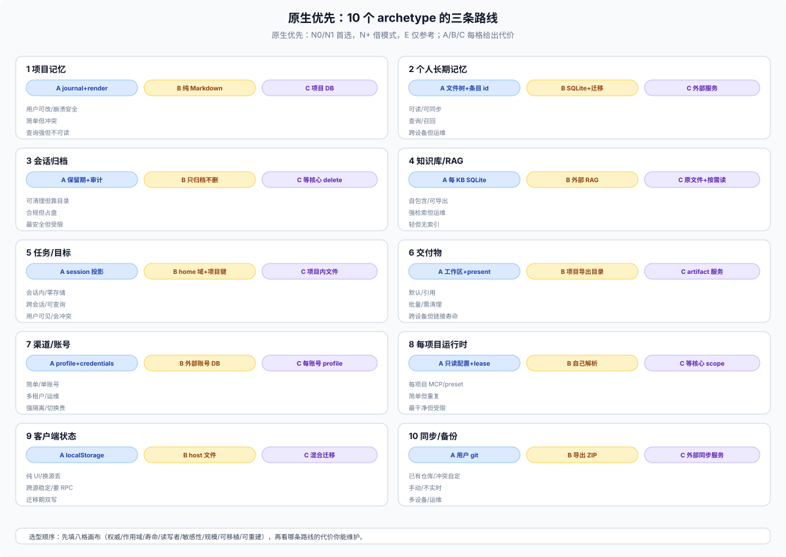

# 42 · 原生优先的参考架构：10 个 archetype 的数据卡与路线

## 这一篇回答什么

前四篇是地图；这一篇是**可照抄的骨架**。每个 archetype 给：数据卡、布局/键、生命周期、失败模式、2–3 条都成立的路线、测试清单、DSH API 映射。

原则：**没有唯一答案**；每条路线都标出代价与适用条件。一个插件可以组合多个 archetype，但每块数据只能有一个主权威。

**原生优先（本轮新增）**：路线标记 **N0** 核心合同、**N1** 官方随包插件、**N+** 原生 API + 借用模式（无外部依赖）、**E** 外部插件/服务。长期优先 N0/N1/N+；E 只作参考或短期过渡。下面的 A/B/C 路线不再逐个重复徽标，级别以上面的“原生优先路线表”为准。



## 0. 八格决策画布

先填这张画布，再选路线：

| 格 | 问题 |
|---|---|
| 权威 | 用户、会话、插件、provider、没人（派生）、外部？ |
| 对象/作用域 | 这次会话、这个项目、这个人、这台机器、这个安装？ |
| 寿命 | turn、session、project、account、forever、rebuildable？ |
| 读写者 | 模型、用户、插件、浏览器、没人？ |
| 敏感性 | 是否秘密？是否可上传？ |
| 规模/频率 | 一次多大、多频繁、是否点更新？ |
| 可移植/同步 | 换机器/多设备/团队要带走吗？ |
| 可重建/清理 | 删了会不会丢？卸载留什么？ |

## 原生优先路线表

| Archetype | 原生首选 | 可借模式（N+） | 外部（E，仅参考） |
|---|---|---|---|
| 项目记忆 | 项目文件 + `ctx.fs`（N0） | journal+render、锁内备份 | 外部笔记/DB |
| 个人长期记忆 | `ctx.storageDomain`（N1）或项目文件（N0） | 条目 id、确认队列 | 外部记忆服务 |
| 会话归档/删除 | **GAP**（无 delete） | 宽限+审计（E1 模式） | archive-retention 等 |
| KB/RAG | `ctx.storageDomain` + sqlite backend（N1） | 每 KB SQLite、软删/compact | 外部 RAG/向量 |
| 任务/目标 | session 事件/投影（N0）、home 域（N1） | 状态机、跨标签同步 | 外部任务库 |
| 交付物 | 工作区文件 + `present`（N1） | 项目导出目录 | artifact 服务 |
| 渠道/账号 | profile patch + `ctx.credentials`（N1） | 去重/路由表 | 外部账号 DB |
| 每项目运行时 | **GAP**（无 per-workspace scope） | read-only 配置 + lease（E1 模式） | workspace-overlay |
| 客户端状态 | localStorage / `SessionProjectionMap`（N0） | host 文件迁移、版本键 | 外部同步 |
| 同步/备份 | `/export` ZIP（N1） | 用户 git、冲突三选一 | 外部同步服务 |

## 1. 项目记忆（journal + render）

**适用**：项目约定、决策、术语、交接；用户要能读/改/提交。

**数据卡**

| 项 | 值 |
|---|---|
| 权威 | 用户/项目（journal 是机器权威，Markdown 是用户入口） |
| 作用域 | workspace / project root |
| 寿命 | 跟仓库；可提交/复制 |
| 读写者 | 用户可编辑；模型经注入/工具读 |
| 介质 | 追加 journal + 渲染 Markdown + 索引 |
| 秘密 | 不放；敏感内容提示用户不要提交 |

**布局**

```text
<project>/.agents/memory/
├── memory.jsonl          # 权威，追加
├── MEMORY.md             # 渲染，用户可改
├── MEMORY.md.lock        # 跨进程锁
├── MEMORY.md.bak-*       # 写前备份
├── INDEX.md              # 机械索引
├── CONTEXT.md            # 工作态摘要
└── .gitignore            # 忽略 session-logs/等本地件
```

**注**：`.agents/` 是社区约定（E1），核心不规定目录名；可换成 `.your-plugin/`。

**键/规则**：journal 追加顺序；`MEMORY.md` 手改且比 journal 新时收编为一条 record；读以 journal 折叠为准；崩溃只让渲染落后。

**路线**

| 路线 | 做法 | 代价 | 选它当 |
|---|---|---|---|
| A journal+render | 如上 | 要实现锁/备份/折叠 | 用户会手改、要崩溃安全 |
| B 纯 Markdown | 只读写 `MEMORY.md` | 并发/手改冲突；无历史 | 单用户、低写入 |
| C 项目 DB | SQLite/JSON | 用户看不见、不能 diff | 结构化查询为主 |

**失败模式**：锁竞争、外部截断、手改与 journal 冲突、索引丢行、`.gitignore` 误伤。

**测试**：并发写、崩溃后渲染落后、手改收编、外部截断、重命名/移动、`.gitignore` 只忽略自己的目录。

**DSH 映射**：`ctx.fs` 写项目；`present` 不必要；per-workspace 无核心家，项目内文件是首选。

## 2. 个人长期记忆（home ledger / SQLite / 向量）

**适用**：跨项目偏好、用户画像、学到的 facts、可检索知识。

**数据卡**

| 项 | 值 |
|---|---|
| 权威 | 插件/用户（看是否可编辑） |
| 作用域 | home / 可选 per-project track |
| 寿命 | 跟 home；换机器不带走（除非同步） |
| 读写者 | 插件写；用户可读/确认；模型经召回 |
| 介质 | Markdown/JSONL/SQLite/向量 |
| 秘密 | 不放；凭据走 credentials |

**路线**

| 路线 | 做法 | 代价 | 选它当 |
|---|---|---|---|
| A 文件树 + 条目 id | `~/.dsh/<plugin>/memory/`；`§` 条目 + `[id:]`；锁+tmp/rename | 要自己写合并/锁/清理 | 用户可读、跨设备 git 同步 |
| B SQLite + 迁移表 | 单 DB；`_migrations`；FTS/向量 | 不可读、备份/迁移成本 | 查询/召回为主 |
| C 外部服务 | MCP/HTTP/DB | 运维/隐私/网络 | 多机/团队/大库 |

**键**：条目 id 稳定；项目轨用 `w_<sha256(realpath)>`；不要用 `workspaceId`。

**生命周期**：写前备份；锁；软删/compact；导出/导入；版本迁移；卸载清理声明。

**失败模式**：孤儿、双写、冲突、embedding 模型变更、向量索引重建成本、秘密泄漏。

**测试**：并发、崩溃、迁移、删除/compact、跨设备合并、召回不可信标记。

**DSH 映射**：home 域或自造 `$DSH_HOME/<plugin>/`；`resolveDshHome()`；不要硬编码。

## 3. 会话归档 / 删除 / 保留

**适用**：用户要清理旧会话、控制磁盘、保留审计。

**数据卡**

| 项 | 值 |
|---|---|
| 权威 | 会话日志 |
| 作用域 | session / corpus |
| 寿命 | 永久（核心无删除）→ 插件定义保留期 |
| 读写者 | 用户触发；插件执行；模型不可见 |
| 介质 | 日志目录 + 归档目录 + 审计清单 |
| 秘密 | 日志可能含秘密；删除要彻底 |

**路线**

| 路线 | 做法 | 代价 | 选它当 |
|---|---|---|---|
| A 归档 + 保留期 | 移到 `sessions-archive/`；cron 删超期；审计清单 | 依赖目录布局；无核心契约 | 运维/个人清理 |
| B 只归档不删 | 移动/压缩；不物理删 | 磁盘仍增长 | 合规/审计 |
| C 等待核心 delete | 不实现删除 | 用户无法清理 | 核心提供后 |

**硬规则**：绝不删运行中/内存中会话；先停工作再删；保留父/子顺序；删除前预览；审计；失败保守。

**测试**：live 会话拒绝、父/子目录、头部读取失败、审计清单、并发清扫、回滚。

**DSH 映射**：核心无 `session.delete`；插件直接操作目录是高风险；优先只归档/压缩，明确标注“非核心支持”。

## 4. 知识库 / RAG

**适用**：文档导入、分块、向量+FTS、引用、删除、快照。

**数据卡**

| 项 | 值 |
|---|---|
| 权威 | KB 目录（文档/块/索引） |
| 作用域 | home / 每 KB |
| 寿命 | 跟 KB；可导出/导入 |
| 读写者 | 用户导入/查询；模型经工具；召回不可信 |
| 介质 | 每 KB SQLite（sqlite-vec+FTS5）+ 原文件 |
| 秘密 | 导入路径白名单；SSRF guard；不放凭据 |

**布局**

```text
~/.dsh/<plugin>/<kb-id>/
├── kb.db              # docs/chunks/vectors/FTS/audit/jobs
├── inbox/             # 允许导入的本地路径
├── snapshots/         # 可恢复快照
└── exports/           # kbpack/JSON
```

**生命周期**：异步 job（import/rebuild/compact）；软删可恢复；`confirm_token` 两步删除；compact 物理回收；schema 版本 fail-closed；快照/导出/导入去重。

**失败模式**：job 崩溃、embedding 变更、索引膨胀、删除残留、SSRF、提示注入。

**测试**：导入白名单、SSRF、软删/恢复、compact、job 恢复/取消、快照/导出、召回 untrusted。

**DSH 映射**：无 KB 服务；自造目录；搜索/索引是派生；不要把 KB 当 session log。

## 5. 任务 / 待办 / 目标状态

**适用**：跨会话任务、项目待办、目标轮次、定时提醒。

**数据卡**

| 项 | 值 |
|---|---|
| 权威 | 会话日志（session 级）或 home 域（跨会话） |
| 作用域 | session / workspace / home |
| 寿命 | 跟会话 / 跨会话 |
| 读写者 | 模型/用户；客户端展示 |
| 介质 | session events + projection；或 domain table |
| 秘密 | 一般无 |

**路线**

| 路线 | 做法 | 代价 | 选它当 |
|---|---|---|---|
| A session 事件 + projection | 现有 todo/goal/plan | 只限会话；不能跨会话查询 | 会话内任务 |
| B home 域 + 项目键 | `tasks` table；`w_<hash>`；状态机 | 要清理/迁移；客户端要 UI | 跨会话项目任务 |
| C 项目内文件 | Markdown/JSON | 用户可改；并发冲突 | 用户可见任务板 |

**失败模式**：状态机非法迁移、重复任务、跨会话 ID、时区/重复规则、删除残留。

**测试**：状态迁移、并发更新、跨会话、重复/取消、时区、归档。

**DSH 映射**：session 级用事件/投影；跨会话用 `ctx.storageDomain`；schedule 是独立域。

## 6. 交付物 / 文档

**适用**：报告、代码、图片、Office 文档；用户要打开/编辑/带走。

**数据卡**

| 项 | 值 |
|---|---|
| 权威 | 用户文件 |
| 作用域 | workspace（或用户可访问路径） |
| 寿命 | 跟目录 |
| 读写者 | 用户打开/编辑；模型写；client 展示 |
| 介质 | 文件 + `present` 声明 |
| 秘密 | 不放；present 路径可能暴露 |

**路线**

| 路线 | 做法 | 代价 | 选它当 |
|---|---|---|---|
| A 工作区文件 + present | 写 cwd；声明路径 | 文件改了/删了交付变 | 默认 |
| B 项目内导出目录 | `exports/<date>/` | 需要 `.gitignore`/清理 | 批量交付 |
| C 外部 artifact 服务 | 上传/对象存储 | 运维/隐私/链接寿命 | 团队/跨设备 |

**硬规则**：不复制内容；不写 home 私有目录再 present；附件库不是交付；会话 ZIP 不含工作区文件。

**失败模式**：源文件删除/移动、路径越界、权限、覆盖用户文件、present 声明丢失。

**测试**：普通文件/目录/符号链接、cwd 外路径、编辑/删除、present 事件、ZIP 只含声明。

**DSH 映射**：`ctx.fs` + `present`；`workspace/changes` 只做 review。

## 7. 渠道 / 账号集成

**适用**：Feishu/DingTalk/WeCom/iMessage、账号级默认 workspace、去重/路由状态。

**数据卡**

| 项 | 值 |
|---|---|
| 权威 | profile 配置 + credentials + 外部平台 |
| 作用域 | profile / home / external |
| 寿命 | 跟 profile/账号 |
| 读写者 | 用户配置；插件用；模型经消息 |
| 介质 | `cordis.patch.yml`、`.credentials.yaml`、外部 DB |
| 秘密 | 必须走 `CredentialRef`/`CredentialKey` |

**路线**

| 路线 | 做法 | 代价 | 选它当 |
|---|---|---|---|
| A profile config + credentials | 默认 workspace、开关、凭据引用 | 一个默认值套所有项目 | 单账号/简单 |
| B 外部账号 DB | 多租户/多账号；行锁/加密 | 运维/迁移/隐私 | 团队/多租户 |
| C 每账号 profile | 多 profile 隔离 | 切换成本 | 强隔离 |

**失败模式**：凭据泄漏、去重状态丢失、默认 workspace 错、平台重试、卸载留 token。

**测试**：凭据引用、轮换、去重、默认 workspace、失败重试、卸载清理。

**DSH 映射**：`Config.volatile()` + `credentials`；不要明文 key。

## 8. 每项目运行时

**适用**：每 workspace 一套 Cordis 配置/preset/MCP。

**数据卡**

| 项 | 值 |
|---|---|
| 权威 | 项目配置（输入） |
| 作用域 | workspace |
| 寿命 | 跟目录；运行时 scope 随租约 |
| 读写者 | 用户编辑；插件读；模型经工具 |
| 介质 | `<workspace>/.dsh/cordis.yml`；内存 lease |
| 秘密 | 配置里不放值；env 要 scrub |

**路线**

| 路线 | 做法 | 代价 | 选它当 |
|---|---|---|---|
| A read-only 配置 + lease | `write()` no-op；canonical path；最后租约 dispose | 需要 trust 模型；无核心 API | 每项目 MCP/preset |
| B 项目内脚本 | 插件自己解析 | 重复造 Loader | 简单场景 |
| C 等待核心 scope | 不实现 | 受限 | 核心提供后 |

**硬规则**：配置是输入不是输出；默认不要 trust 仓库配置；热重载要 drain/rollback；日志不含 config/env。

**测试**：lease 生命周期、热重载失败回滚、trust=false、MCP 进程清理、路径移动。

**DSH 映射**：外部插件（E1）的 `ctx.workspaceCordis`；核心没有 per-workspace 实例。

## 9. 客户端 UI 状态

**适用**：布局、快捷键、面板宽度、折叠、最近选择、输入历史。

**数据卡**

| 项 | 值 |
|---|---|
| 权威 | 浏览器/设备 |
| 作用域 | origin / device |
| 寿命 | 清站点/换设备 |
| 读写者 | 用户/浏览器；Host 看不到 |
| 介质 | localStorage / userData |
| 秘密 | 不放 |

**路线**

| 路线 | 做法 | 代价 | 选它当 |
|---|---|---|---|
| A localStorage | 键带版本/会话 | 换端口/浏览器丢；无迁移 | 纯 UI |
| B 服务端 host 文件 | 跨源稳定 | 要 RPC/同步/清理 | 主题/输入历史 |
| C 混合 | localStorage 为主 + host 迁移 | 双写冲突 | 迁移期 |

**硬规则**：session-derived facts（标题/模型/preset）走 projection，不要复制到 localStorage；键要带版本；卸载/清站点要能清；不要把身份/秘密放这里。

**测试**：两个端口/浏览器、清站点、多 tab、版本迁移、卸载残留。

**DSH 映射**：无统一服务；`localStorage`/`userData`；projection 负责 session facts。

## 10. 同步 / 备份

**适用**：跨设备、团队共享、导出/导入、灾难恢复。

**数据卡**

| 项 | 值 |
|---|---|
| 权威 | 源数据（本地/项目） |
| 作用域 | home / workspace |
| 寿命 | 用户决定 |
| 读写者 | 用户触发；插件执行 |
| 介质 | git / ZIP / 外部服务 |
| 秘密 | 必须脱敏；加密 |

**路线**

| 路线 | 做法 | 代价 | 选它当 |
|---|---|---|---|
| A 用户 git | 项目内文件/专属分支；显式批处理 | 冲突语义要设计 | 已有仓库 |
| B 导出/导入 ZIP | 手动；版本化 | 不实时 | 备份/迁移 |
| C 外部同步服务 | 云/DB | 运维/隐私/账号 | 多设备/团队 |

**硬规则**：写路径不碰同步；同步失败不回滚本地；冲突三选一；脱敏；恢复前快照；不覆盖未知版本。

**测试**：冲突、部分失败、恢复、脱敏、版本、并发。

**DSH 映射**：无内建同步；`/export` 只备份会话+附件；配置导出要脱敏。

## 一张选型表

| 你的数据 | 首选 | 次选 | 避免 |
|---|---|---|---|
| 项目约定 | 项目内 journal+render | 纯 Markdown | home 域 |
| 个人记忆 | home 文件/SQLite | 外部服务 | 项目内（换机器丢） |
| 会话清理 | 归档+保留期 | 只归档 | 直接删日志 |
| 知识库 | 每 KB SQLite | 外部 RAG | session log |
| 任务 | session 事件/投影 | home 域 | settings |
| 交付物 | 工作区文件+present | 项目导出目录 | 附件库/home |
| 渠道 | profile+credentials | 外部账号 DB | 明文 key |
| 每项目运行时 | read-only 配置+lease | 自解析 | 默认 trust 仓库 |
| UI 状态 | localStorage | host 文件 | settings/domain |
| 同步 | 用户 git | 导出 ZIP | 自建云（除非必要） |

## 边界

- 这些是参考架构，不是 DSH 合同；具体 API 以当前 docs/源码为准。
- 同一插件可以组合多个 archetype，但每块数据只能有一个主权威。
- 没有一种路线适合所有部署；按八格画布选，按代价维护。
