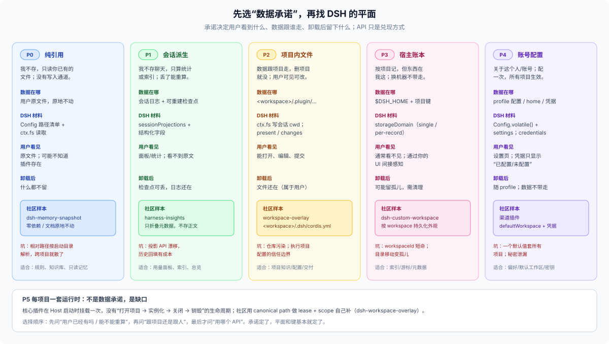

# Answer 26 · 插件作者的数据决策：先选一个“数据承诺”，再找 DSH 的平面

## 一分钟结论

上一版我是从 DSH 的架构往里讲：四个平面、三个作用域、五种权威。那套词是对的，但它不是插件作者脑子里的第一个问题。作者真正先决定的是：

> **“用户装了我之后，我承诺记住什么？他到哪里找？删了/换机器/升级之后还算不算数？”**

这叫**数据承诺（data promise）**。承诺一旦选定，DSH 的平面、作用域、API 基本就自动确定了；反过来先挑 API，最后一定会出现“数据放哪都不对”的感觉。

社区里能观察到的五种承诺，正好覆盖你说的“两块”：

| 承诺 | 一句话 | 数据在哪 | 典型社区做法 |
|---|---|---|---|
| **P0 纯引用** | 我不存，只读你已有的文件 | 用户的文件原地 | `dsh-memory-snapshot`：路径清单注入，无数据库 |
| **P1 会话派生** | 我不存聊天，只算统计/索引 | 会话日志 + 可重建检查点 | `harness-insights`：只折叠结构化元数据 |
| **P2 项目内文件** | 数据跟项目走，删项目就没 | `<workspace>/…` | `dsh-workspace-overlay`：`<workspace>/.dsh/cordis.yml` |
| **P3 宿主账本** | 我按项目记，但东西在我这 | `$DSH_HOME` + 项目键 | `dsh-custom-workspace`：按 workspace 持久化外观 |
| **P4 账号配置** | 配一次，所有项目生效 | profile 配置 / home / 凭据 | 渠道插件：`defaultWorkspace` + 凭据 |

（P5“每项目一套运行时”不是数据承诺，社区用 `workspaceCordis` 自己补，见 06 篇。）

**你说的“两块”——用户的东西 vs 跟用户相关的东西——不是两种存储，而是两种承诺。** 用户的东西通常是 P0/P2（内容，留在用户那）；跟用户相关的通常是 P3/P4（状态，留在你这里）。如果你把两者都塞进一个 home 数据库，就会出现“用户找不到自己的文件、换机器又丢账本”的双输。



## 先站到作者的位置：六个问题

按作者真实的设计顺序问，而不是按 DSH 的架构问：

1. **用户第一次装我，要配置什么？** 能不能零配置？数据从哪来？
2. **我承诺记住什么？** 什么都不记 / 记路径 / 记统计 / 记项目文件 / 记账号设置。
3. **用户在哪里看见、编辑、带走、删掉它？** 在项目里？在设置里？根本看不见？
4. **他有 30 个项目时，我怎么知道是哪个？** 键是什么？项目移动了怎么办？
5. **升级、卸载、数据坏了怎么办？** 迁移谁写？失败是静默还是报错？
6. **他凭什么信任我？** 我会不会偷偷复制他的文件、上传内容、把密钥写进日志？

这六问的答案，就是你的“数据承诺”。DSH 的四个平面是**实现承诺的材料**，不是承诺本身。

## 五种承诺与 DSH 的配合

### P0 纯引用：不拥有数据，是最强的信任策略

**承诺**：你的文档原地不动，我只在读的时候引用；没有数据库、没有写入通道。

**DSH 配合**：

- `Config` 存路径清单（可多个、可目录）；
- 装配时用 `ctx.fs` 读，按字节预算截断；
- 不建 domain、不写会话日志（除非把注入内容记进 trajectory，供审计）。

**社区样本**：`dsh-memory-snapshot` 的 README 明确写“零依赖：无数据库、无服务、无写入通道，文档原地不动”；它把路径列进 `files`，每次会话装配提示词时重读，并提醒**跨工作区要用绝对路径或 `~`**，因为相对路径按启动目录解析会变成“每个工作区各找各的”。（外部资料，未独立验证）

**代价**：你无法保证文件存在/格式正确；用户改文件你就变；跨工作区靠配置而不是自动发现；没有写入就无法“学习”。

**适合**：规则、知识库、已有 markdown、只读记忆。

### P1 会话派生：只存可重建的东西

**承诺**：我不存你的聊天内容；统计/索引是从会话日志算出来的，丢了能重算。

**DSH 配合**：

- `ctx.sessionProjections.register()` 做纯同步 fold，`stateSchema` 校验持久检查点；
- 聚合多会话时只读结构化字段（usage、provider/model、tool name），不读消息正文；
- 检查点是派生，坏了可以 `invalidRecords: 'backup-and-skip'` 或直接重建。

**社区样本**：`harness-insights` 声明只折叠 `assistant/message.usage`、provider/model、`tool/call.name` 与时间戳，不请求会话历史、不存消息内容、不上传；升级后从日志重建本地派生检查点。（外部资料，未独立验证）

**代价**：依赖投影 API 的稳定性；历史回填有成本；用户删了会话，你的统计就得跟着变。

**适合**：用量面板、审计索引、项目总览。

### P2 项目内文件：让数据跟项目走

**承诺**：数据在项目里，删项目就没；用户能看见、能编辑、能提交；换机器跟着仓库走。

**DSH 配合**：

- `ctx.fs` 写 `<session.cwd>/…`（会话 cwd 是这次工作的根，不一定是 git 根）；
- 目录约定（`.your-plugin/` 或 `.dsh/`）与 `.gitignore` 由你决定；
- 交付用 `present`；用户 review 用 `workspace/changes`。

**社区样本**：`dsh-workspace-overlay` 把每个 workspace 的 Cordis 配置放在 `<workspace>/.dsh/cordis.yml`，作为**输入**读取、热重载、永不写回；它明确说这是“workspace 级 composition”，因为核心没有每项目一套插件实例。（外部资料，未独立验证）

**代价**：污染仓库；用户手改到坏；多用户/多分支冲突；如果文件会被执行（如 `.dsh/cordis.yml`），信任边界必须写清楚。

**适合**：项目知识、项目配置、用户要带走的东西。

### P3 宿主账本：按项目记，但东西在你家

**承诺**：我跨会话记得这个项目，但数据在本机、不在你的仓库；换机器不带走。

**DSH 配合**：

- `ctx.storageDomain` 的域（`single` 或 `per-record`），键 = 规范化路径或路径哈希；
- 记录里带 `lastSeenAt`，读到已不存在的路径时标记/清理；
- **不要用 `workspaceId` 当长期键**：删除重加会换 uuid（FAQ 25）。

**社区样本**：`dsh-custom-workspace` 把每个 workspace 的外观设置持久化在 `$DSH_HOME/settings.yaml`，并通过自定义 `/custom-workspace` RPC 暴露（作者说 DSH 不向第三方开放通用 settings namespace）。（外部资料，未独立验证；该写法基于旧 settings 文件，当前 settings 已迁到 profile patch）

**代价**：孤儿记录；目录移动后键失效；换 home 就没了；`domain/changed` 不跨进程。

**适合**：索引、游标、缓存、用户不需要编辑的元数据。

### P4 账号配置：一次配置，所有项目生效

**承诺**：这是关于“这个人/这个账号”的，不是关于某个项目的；配一次，全项目共用。

**DSH 配合**：

- `Config` 的 `.volatile()` 字段 → settings 表单 → profile 的 `cordis.patch.yml`；
- 凭据只存 `CredentialRef`，每次操作 `resolve`；
- 跨项目经验可以放 home 域或 `$DSH_HOME/skills`、`~/.agents`（跨工具共享）。

**社区样本**：渠道插件把平台凭据放在本地 profile 或环境变量，把 `defaultWorkspace` 作为账号级配置；`dshbase` 的安装统计把随机实例 ID 放在 `$DSH_HOME/.dsh-1024store/`，明确不上传路径/会话/用户名。（外部资料，未独立验证）

**代价**：一个默认值套所有项目；秘密泄漏风险；多账号要自己设计切换。

**适合**：偏好、默认工作区、API key、账号级开关。

## 承诺 → 平面 → API 的对照

| 承诺 | 平面 | 作用域 | 主要 API | 用户能看见 | 卸载后 |
|---|---|---|---|---|---|
| P0 纯引用 | 内容（只读） | 用户给的路径 | `Config` + `ctx.fs` | 原文件 | 原文件不动 |
| P1 会话派生 | 派生 + 历史 | session（可聚合到 workspace） | `sessionProjections` | 间接 | 检查点可丢 |
| P2 项目内文件 | 内容 | workspace | `ctx.fs` + `present` | 是 | 跟项目 |
| P3 宿主账本 | 状态 | workspace 键（存 home） | `storageDomain` | 否 | 留孤儿，需清理 |
| P4 账号配置 | 状态 + 凭据 | home | `Config` / `credentials` | 设置页 | 随 profile |

## 社区给的三条“配合”经验

1. **能不存就不存**（P0）。社区里最轻、最容易装的记忆插件，卖点恰恰是“没有数据库、没有写入通道、文档原地不动”。对插件作者，少一个存储面就少一套迁移、清理、备份、隐私问题。
2. **存就存成“可重建”**（P1）。insights 只存派生检查点，从不存消息内容；升级时从日志重建。用户删了会话，统计跟着变，这是诚实的行为。
3. **项目级的东西要么进项目，要么带路径键**（P2/P3）。社区插件在核心没有“每项目一套实例”的情况下，自己用 `.dsh/cordis.yml` 或按 workspace 的设置解决了；代价是孤儿、信任边界和版本兼容，必须自己承担。

社区里还有四种手法，值得单独看：

| 手法 | 做法 | 样本 |
|---|---|---|
| **位置做成配置** | 同一插件，`storage: home`（敏感、机内）或 `storage: workspace`（团队、随代码） | dsh-workspace-memories |
| **journal 权威 + 渲染派生** | `memory.jsonl` 追加写是权威，`MEMORY.md` 只是渲染；锁内备份、崩溃只落后不丢 | dsh-project-context |
| **用 git 做同步** | 记忆推到代码仓库的专属分支或独立记忆仓库，冲突三选一 | dsh-memory-evolve |
| **SQLite + 不可信召回** | 本地图谱库 + FTS/向量；召回进提示词时标成“不可信参考” | dsh-graphmemory |

完整的九个维度（放哪、介质、权威、切法、可见性、同步、并发、迁移、信任）和十二种可抄手法，见 [06 篇](./06-community-patterns.md)。

## 你应该怎么选：五个问题

```text
1. 用户已经有这份数据了吗？        是 → P0（引用它）
2. 能从会话/文件重新算吗？          是 → P1（派生）
3. 必须跟项目一起走/被用户看见吗？  是 → P2（项目内文件）
4. 要跨会话记住、但用户不必编辑吗？ 是 → P3（home + 项目键）
5. 是关于这个人/账号的吗？          是 → P4（配置/凭据）
6. 需要每个项目一套进程/连接吗？    是 → 看 06 篇的 workspace scope（P5）
```

注意顺序：**先问“用户有没有/能不能重算”，再问“存哪”。** 大多数“数据放哪”的痛苦，来自跳过前两问直接建表。

## 反模式（作者视角）

- **承诺过度**：说“帮你记住一切”，结果存了聊天正文、换机器丢、删项目留孤儿。用户不会区分“内容”和“状态”，只会觉得“不可靠”。
- **把用户文件复制进 home**：用户在原文件里改了，你还在推荐旧内容；这是 P0 装成 P3。
- **把项目数据塞进账号配置**：30 个项目共用一份设置，或者把项目路径写死进 profile。
- **用 `workspaceId` 当长期键**：删一次工作区，账本全失联。
- **升级时静默重建**：用户的数据看起来“还在”，其实语义已经变了；宁可 fail loud + 迁移。
- **卸载留垃圾**：没有清理说明；至少要在 README 写清楚数据在哪、怎么删。

## 快问快答

| 问题 | 短答 |
|---|---|
| 我的插件一定要有数据吗？ | 不一定。P0 往往是最好的第一版。 |
| 用户的东西能不能存进我的域？ | 只能存引用/哈希/索引，不能存副本当真相。 |
| 项目级数据放 home 还是项目里？ | 用户要看见/带走 → 项目；纯账本 → home + 路径键。 |
| 能不能按 workspace 建 domain？ | 不能；domain 名静态，项目级靠记录键。 |
| 换 `DSH_HOME` 会带走什么？ | 带走 home 状态；不带走项目文件。 |
| 社区插件能直接抄吗？ | 抄模式，不抄 API；它们各自钉在不同 RC 版本，未独立验证。 |
| 升级 schema 怎么办？ | 自己迁移；domain 不自动迁移，single 版本不符直接拒绝。 |
| 怎么让用户信任？ | 少存、说清楚存哪、提供删除/导出、秘密不进数据。 |

## 证据与边界

- DSH 机制：`docs/subsystems/storage.md`、`session-projection.md`、`filesystem.md`、`settings.md`、`credentials.md`、`attachment.md`、`deliverables.md`、`spill.md`、`workspace.md`。
- 社区样本：[dsh-memory-snapshot](https://github.com/yzx4036/dsh-memory-snapshot)、[dsh-workspace-memories](https://github.com/lengfengng-tech/dsh-workspace-memories)、[dsh-memory-evolve](https://github.com/csyangwen/dsh-memory-evolve)、[dsh-graphmemory](https://github.com/meyaomiao/dsh-graphmemory)、[dsh-project-context](https://github.com/P02-1010751281/dsh-project-context)、[dsh-workspace-overlay](https://github.com/TTTPOB/dsh-workspace-overlay)、[dsh-custom-workspace](https://github.com/JeremyGuo/dsh-custom-workspace)、[harness-insights](https://github.com/mapan0424/deepseek-harness-plugins/tree/main/packages/harness-insights)、[dshbase](https://dshbase.com/)。
- 社区材料是**外部、未独立验证**的作者声明；它们钉在 `0.1.x`/`0.2.x` 的不同 RC 上，不能当 DSH 的 API 合同。
- “哪种承诺更好”是产品判断，不是 DSH 强制；同一插件可以组合 P0+P2（引用 + 项目内缓存）。
