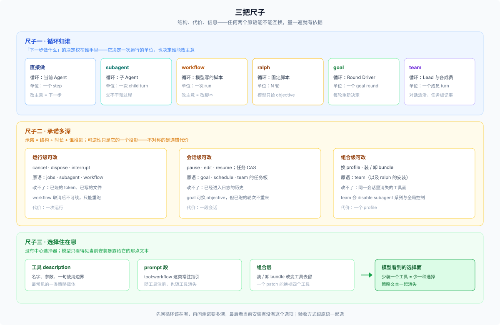

# 00 · 三把尺子：循环归谁、承诺多深、选择住在哪

## 为什么需要一篇共用框架

按场景写最容易出的事故，是每一篇各自发明一套理由，读到最后发现两篇的判据互相打架。所以五个岔口里，01–04 共用三把尺子：**任何两个原语能不能互换，用这三把尺子量一遍就有判断依据**；场景篇只负责说明「在这个岔口上，哪把尺子的哪一格起作用」。05 在时间平面上，看的是「谁在等」，不在这三把尺子的路径上。

三把尺子分别是：**循环归谁**（结构）、**承诺多深**（代价）、**选择住在哪**（信息）。

先说清楚：这三把尺子是本篇的分析词，不是 DSH 的术语。DSH 的源码里没有叫「承诺」的类型，也没有「循环归属」这个字段；它们只是把源码里散落的取舍整理成可比较的三条轴。凡本篇说「承诺深」，都可还原为具体的可逆层级与工具面变化。

这套框架不声称四件事：它不是 DSH 的官方分类；不是一条能排所有原语的能力总序；不预测某个模型在某个选择面下一定怎么选；也不穷举组合（下面给一个评估方法与几种常见叠法）。

反过来，怎么判断一个新原语能不能放进这张图？问三个问题：它的循环在谁手里？它预先固定了什么、哪一层能改？模型怎么知道有它？三个都能答，它就能放进这三条轴；答不上来，说明它不属于这三条轴，别硬塞。

已知两处排序不干净，也记在这里：`jobs` 与 `subagent` 固定的是不同东西（一个异步、一个谁干），放在同一把尺子上只能比「总体深浅」；`workflow` 与 `goal` 一个固定结构、一个固定时长，谁更深取决于你看哪一轴。这不是漏洞，是框架的边界。

## 尺子一 · 循环归谁

「编排」听起来是在画图，实际是在决定：**「下一步做什么」这个判断交给谁。**

| 原语 | 循环在谁手里 | 一次运行的单位 | 记忆在哪 | 谁决定下一步 |
|---|---|---|---|---|
| 直接做 | 当前 Agent | 一个 step | 当前会话 | 模型 |
| `subagent` | 子 Agent | 一个 child 的 turn | child 自己的会话 | 子 Agent |
| `workflow` | 模型写的脚本 | 一次 run | 脚本变量 + workspace（child 各自有会话） | 脚本（代码） |
| `ralph` | 固定脚本 | 一次 run 的 N 轮 | workspace + 有界报告 | 固定脚本 |
| `goal` | Goal Round Driver | 一个 goal round | 当前会话（持久） | driver + 模型 |
| `team` | Lead 与各成员各自的循环 | 一个成员的一个 turn | Lead 日志 + 各自会话 | Lead / 成员 |

这张表一次解释三个常见困惑：

- **为什么 workflow 里没有「队友」。** 循环在脚本手里，child 只是被脚本按顺序或并发拉起来的执行单元；它们之间没有协作身份，也没有消息通道，结果只能经脚本变量汇合。所以 workflow 能做「扇出」，做不了「协作」。
- **为什么 team 的协调里没有「脚本」。** 循环在 Lead 和成员手里，Lead 用对话派活、用任务板记录状态。任务板是协调数据，不是执行计划——所以依赖解开不会自动开工。注意这只说 Team 自己的协调方式；会话里仍然可以另调 workflow 做批量扇出（见 [04](./04-persistent-team.md) 末尾）。
- **为什么 goal 里没有「图」。** 循环在 driver 手里，它每一轮重新问「现在该做什么」。目标就是那句 objective，图从未被写下来。

循环的位置还决定「谁能改主意」：循环在脚本里，改主意要改脚本（重跑）；循环在 Lead 手里，改主意是一次对话；循环在模型自己手里，改主意是下一步。

`jobs` 与 `schedule` 不在这张表里：它们改变的是「什么时候发生」，不是「循环归谁」，放在 [05](./05-async-and-clock.md) 的时间平面里讲。

## 尺子二 · 承诺多深

承诺 = 开始之前就固定下来的东西——结构、时间跨度、以及谁来推进。固定的越多，中途能改的越少。

| 原语 | 预先固定了什么 | 运行级（停、改当前） | 会话级（跨轮改） | 组合级（换实现或工具面） |
|---|---|---|---|---|
| 直接做 | 不固定 | — | — | — |
| `jobs` | 只固定「异步」 | `job_kill` | — | — |
| `subagent` | 谁来干 + 一段 prompt | `interrupt` / `send_message` | 冷恢复 | — |
| `workflow` | 整批怎么组织 | `cancel`（不可续） | — | 换引擎 |
| `goal` | 目标 + 轮预算 + 自动续跑 | cancel 只停当前轮 | `pause` / `edit` / `resume` / `complete` | — |
| `ralph` | 循环本身 | 只能取消 | — | 装 / 卸 |
| `team` | 协作结构 + 成员身份 | `interrupt` 成员 | 任务图、成员（≤上限） | 改 profile |

**三个可逆层级**比「哪个更强」有用得多：

| 层 | 能改什么 | 改不了什么 |
|---|---|---|
| 运行级 | cancel、dispose、interrupt | 已经烧掉的 token、已经写下的文件 |
| 会话级 | goal 的 pause/edit/resume；任务的 CAS 变更 | 已经进入日志的历史 |
| 组合级 | 换 profile、装或卸 bundle | 同一会话里已经消失的工具面 |

**可逆性不对称，是选错代价不同的主要原因。** 选错 workflow，代价是一次运行——取消、重跑、换写法。选错 team，代价是一次组合替换：`subagent`/`subagent_fork` 与全局控制面会从模型视野里消失（[agent-team-profile 的 patch](../../packages/experimental/agent-team-profile/cordis.patch.yml):5-14），要退回去得改 profile。这个不对称决定了默认策略：**能浅就浅**。

量级也在提醒同一件事。workflow 一次运行默认最多 1000 个 child、单次 `parallel`/`pipeline` 4096 项、并发默认取 `min(16, CPU−2)`（[workflow-ptc config](../../packages/workflow/workflow-ptc/src/index.ts):108-110 与 `:142-144`）；Team 默认 16 个成员（profile 钉 8）、256 个任务（[agent-team defaults](../../packages/experimental/agent-team/src/index.ts):42-43）。它们不是同一类工具的两个档位，而是两种规模完全不同的组织方式。

## 尺子三 · 选择住在哪

前两把尺子描述「选项长什么样」，第三把描述「模型怎么知道有这些选项」。

DSH 没有中心选择器：没有一份全局的「任务类型 → 原语」映射表，也没有把任务类型映射到原语的调度组件。容量层面的 FIFO 槽位、job registry、并发上限都在，但它们只决定「能同时跑多少」，不决定「该用哪个原语」。相反，**每个工具把使用边界写在自己的 description 和它注册的 prompt 段里**。仓库里把这叫 master convention：使用策略随工具插件走，不放进部署 persona（[tool-workflow 的注释与 prompt 段](../../packages/workflow/tool-workflow/src/index.ts):329）。

后果有三个，都是可观察的：

1. **选择面 ≈ 安装面。** 少装一个工具行，模型就少看见一种选择；它看不到还有别的做法。反过来，装上一个 bundle，可能同时改变三四个工具的去留。
2. **同一个模型在不同 profile 下面对的选择面不同。** 讨论「模型选得对不对」之前，先看它当时看得见什么——选项不同，行为就可能不同。
3. **策略文本会跟着工具一起消失。** disable 掉 workflow 行，`tool:workflow` 那段「ONLY when…」也一起没了，不会留下指向不存在工具的孤儿规则。

严格说，preset 与 scoped 注册也会改变可见工具；本篇把安装面当作主要变量，因为它最常见、也最容易被忽略。

模型在决策点实际看到的东西主要是两类：工具 schema（名字、参数、description）和注册在它作用域里的 prompt 段。它看不到全局进度、看不到别的会话、也看不到「你本可以选另一个」。这既是限制，也是这套设计成立的前提：**选择必须由持有上下文的那一层来做，因为只有它知道现在到底在发生什么。**

## 三把尺子一起用

开始判断前有两条前置规则：

1. **用户显式点名了吗，而且当前安装有这个选项吗？** 两个都成立，就先按点名的方式做——workflow 与 ralph 的官方边界都把「用户显式要求」写成第一条件，启发式让位于用户意图；没有这个选项就说明，不要假装。
2. **没点名（或点名了但不可用）时，这件事需要模型判断吗？** 确定性的活（改名、跑测试、解析 JSON、批量替换）用 `bash` / `run_code` / 脚本更快更稳；需要判断（读代码、权衡方案、写东西）才进入下面的岔口。

进入岔口后，面对一件活，按代价从浅到深问：

1. **循环应该在哪？** 谁需要根据中间结果改主意，循环就该在谁手里。（尺子一）
2. **需要多深的承诺？** 运行级能解决就不要升到会话级，会话级能解决就不要动组合。（尺子二）
3. **当前安装有没有这个选项？** 没有就是没有，不要假设「理论上可以」。（尺子三）
4. **验收跟不跟得上？** 选原语的同时就把「怎么算完成」定下来；完成通知、任务状态、worker 自报都不是正确性证明。

第四问不是第四把尺子：前三问用三把尺子，第四问是一条横切的验收纪律——它不改变选哪个，只决定选了之后怎么算完成。

`todo` 与 `plan` 不在四问里：它们解决「怎么记」，不解决「谁来干」，属于计划面；本篇只把它们当作「直接做」的辅助，不单独占一个岔口。

这四问是**评估顺序**，不是路由：它们决定你用哪把尺子，落到哪个岔口取决于任务的形状（路由表在 [answer](./answer.md)）。第五个岔口（谁在等）在时间平面上：它不改变循环归谁，只改变「什么时候发生」，单独放在 [05](./05-async-and-clock.md)。

答案也**不是互斥的**：一个 goal 里可以调 workflow，一个 team 会话里也可以跑 workflow；它们是叠加的层级，不是一棵必须走到叶子的树。

## 组合：原语可以叠

选出来的原语可以叠。几种常见叠法：

| 组合 | 谁持循环 | 典型用法 |
|---|---|---|
| `goal` + `workflow` | driver 持外层，脚本持内层 | 跨轮目标，每轮里用 workflow 做一次批量审计 |
| `team` + `workflow` | Lead 或成员持外层，脚本持内层 | Lead 用 workflow 做一次 40 文件扇出 |
| `workflow` + `jobs` | 脚本持外层，job 平面持时间 | `run_in_background: true` |
| `schedule` + 任意 | 时钟唤醒，模型再选 | 到点提醒后，由会话里的模型决定用哪个原语 |
| `goal` + `jobs` | driver 持外层，job 平面持时间 | 每一轮把长任务后台化，轮末再收 |

评估任意组合，走三步：

1. **分层。** 找出外层循环与内层循环，写清谁持哪一层（例如 goal 持轮次、workflow 持批内并发）。
2. **加承诺。** 把两层各自固定的结构、时长、退出方式相加；可逆性按**最不可逆**的那一层算，不是按最外层。
3. **查边界。** 深度、配额、权限是否仍然成立：workflow 不检查深度、Team 只有 Lead 能拉人、job 归属启动它的 agent。

一条规则：**叠加不改变各自的循环归属**。外层不能替内层做决定——goal 不会替 workflow 选并发，Lead 不会替成员决定用什么工具。组合只叠加循环，不减少判断。代价也沿同一组轴相加，不会互相抵消：goal 的目标漂移风险加 workflow 的不可恢复，是两个风险；叠在一起也不会让任何一层的承诺变浅。

反直觉的结论：**原语之间没有单一能力序。** workflow 的宽度（1000 个 child）和 team 的持续性（8–16 个成员、跨重启）不可比；承诺也不是一条单轴——结构、时长、退出方式各自可比。但对这五个岔口来说，「总体承诺从浅到深」仍是一个有用的排序：默认停在能完成工作的最浅一层，只在出现明确信号时才往下走一格。
