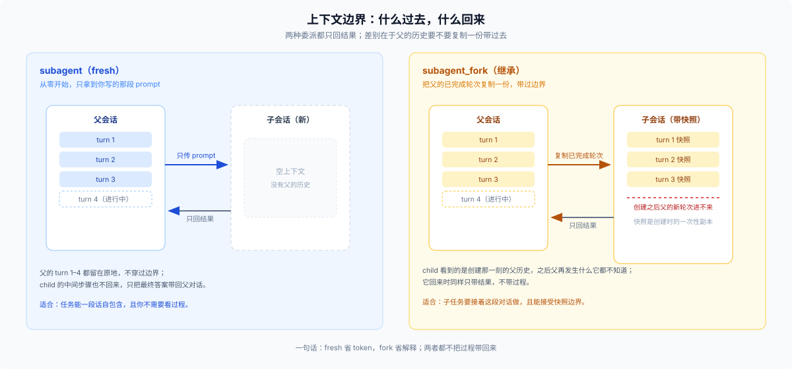

# 01 · 一件事，要不要交出去

## 场景

你手上有一件能说清楚、但做起来会吃掉大量上下文的工作：读十几个文件、跑几轮搜索、最后给一个结论。你不需要看它中间怎么做的，只需要结果。

## 触发信号

- 要读的文件或日志超过你能舒服地留在上下文里的量
- 产物是一段结论、一份清单、一次分析，不是一串需要你逐步拍板的编辑
- 你已经能把它写成一段自包含的说明

反过来，出现这些就不该交：需要你边看边改、需要它频繁回来问你、或者你自己都还没想清楚要什么。

## 候选

1. **自己做**——上下文全占，但没有转述损耗。
2. **`subagent`**（fresh）——子代理从零开始，只拿到你写的 prompt。
3. **`subagent_fork`**——子代理继承父的已完成轮次，适合「接着这段对话往下做」。

外部 provider（Codex、Claude Code、ACP、DSH SDK）是同一条委派轴上的另一种后端：它们一律不接受后续消息，能力集也与本地 spawn/fork 不同，但「要不要交出去」的判断不变，本篇不展开。

委派还有一条常被忽略的理由：provider 支持时，child 可以用独立的 preset 与模型——贵活给强模型，杂活给便宜模型，而父对话只留结果。

## 判据

1. **能不能一段话自包含。** 不能，就先自己探索到能写清为止；派出去只会换来一次答非所问。判断标准很土：把 prompt 给一个不在场的人看，他能不能直接开工。
2. **结果要不要回到当前对话。** 要，就委派并把结果带回来；不要、只是要它跑完，那属于后台平面，见 [05](./05-async-and-clock.md)。
3. **需不需要这段对话的历史。** 需要 → `subagent_fork`；不需要 → `subagent`，省 token，也不把无关上下文和它的约束一起带过去。
4. **深度预算够不够。** 委派深度默认 `maxDepth=1`（[subagent config](../../packages/subagent/subagent/src/index.ts):196），子代理不能再通过 `subagent` 派子代理；workflow 不走这个上限（见 [07](./07-why-this-shape.md)）。如果你的方案依赖「它自己再找几个帮手」，先改方案。

## 官方边界

> Delegate a self-contained task to a subagent (a separate agent that works in its own context) to offload focused, independent work — research, a scoped implementation, an analysis — so it does not consume this conversation's context. The subagent returns its result, not its intermediate steps. — [`packages/subagent/tool-subagent/src/index.ts:129`](../../packages/subagent/tool-subagent/src/index.ts)

> Delegate a task to a subagent that inherits this conversation: a child agent seeded with all completed turns so far (it does not see the current in-flight turn). — [同文件:117](../../packages/subagent/tool-subagent/src/index.ts)

workflow 那边还有一句反向边界，正好说明「一两个」是分水岭：

> For one or two delegations, prefer plain subagent calls. — [`packages/workflow/tool-workflow/src/index.ts:329`](../../packages/workflow/tool-workflow/src/index.ts)

## 代价

| 轴 | 自己做 | `subagent` | `subagent_fork` |
|---|---|---|---|
| 上下文 | 全占 | 省掉中间过程 | 省，但继承前缀（更贵） |
| 时间 | 串行 | 可并行 | 可并行 |
| 持久 | 无 | child 会话 | child 会话 + 父历史快照 |
| 组合 | — | 需要 `spawn` provider | 需要 `fork` provider |
| 验收 | 自己看 | 要它回传证据 | 同左，且它知道背景 |

一个容易被忽略的点：委派调用**不等待结果**，它返回 `started subagent <childId>`，结果通过完成通知回来（[tool-subagent README](../../packages/subagent/tool-subagent/README.md)）。所以「派出去」和「拿到结果」之间，你仍然可以做别的事——这也是它和 workflow 在前台行为上的差别之一。

## 反例与失败形态

- **三行改动派出去。** 协调成本大于收益；你写 prompt 的时间比改代码长。
- **需要边看边改的任务派出去。** 你没有中间反馈，回来时方向已经偏了，而它已经烧完一轮 token。
- **fork 用在「只想让它知道一个结论」。** 整段历史带过去，既贵，又把无关的约束塞进了它的判断。
- **失败长什么样**：答非所问（prompt 不自包含）；结果无法验收（没要求证据）；child 停在中途（没给完成标准）；父以为它是同步的（其实是通知制）；以为 child 一定能续（冷恢复需要持久会话，临时 child 销毁后不可恢复）。

## 最小可用的委派 prompt

四要素，缺一个就会在结果里体现出来：

| 要素 | 写什么 |
|---|---|
| 目标 | 一句话说清要产出什么 |
| 输入 | 读哪些文件/目录，边界在哪 |
| 验收 | 怎么算完成；什么情况要报失败而不是硬做 |
| 回传 | 要结论、要清单、要 diff、还是要有出处的证据 |

## 出口

- 要派的不止一两个、而且同构 → [02](./02-fan-out-shape.md)
- 这件事要跨很多轮，而不是一次委派 → [03](./03-cross-turn-and-fresh.md)
