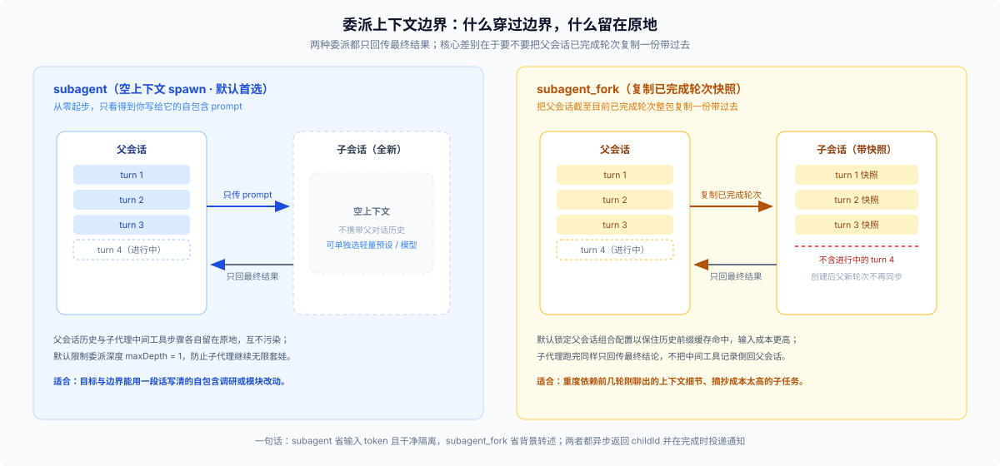
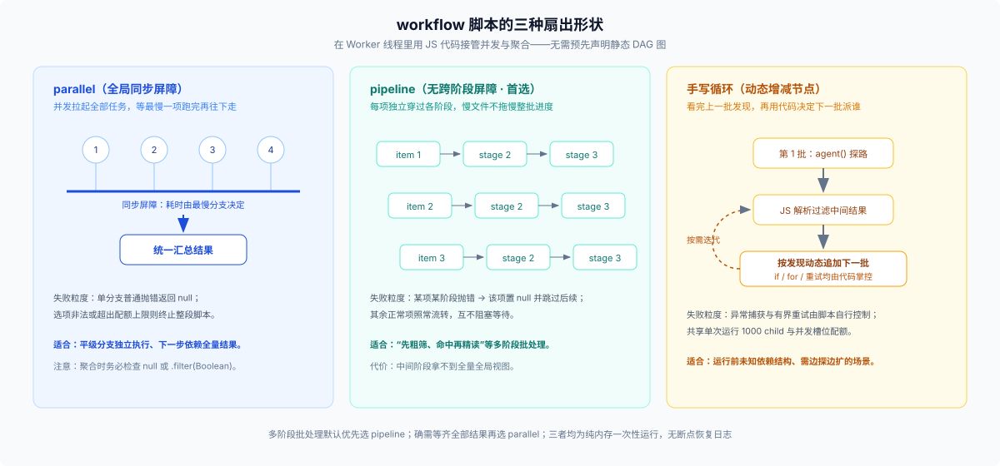

# 01 · 单轮拆分细账：`PTC` 代码模式、`subagent` 委派与 `workflow` 批量扇出

在单个目标回合里，一旦发现“顺着一条线硬做下去会把主会话塞爆，或者太慢”，你面前其实摆着三级台阶：**留在当前 Agent 里用代码消化中间数据（`bash` / `PTC` `run_code`）→ 拆一两个独立子任务给 `subagent` / `subagent_fork` → 写一段 `workflow` 脚本把几十项同构工作并发扇出去**。

把这三级台阶的边界踩准，单轮内 90% 的编排困惑就解开了。

---

## 一、什么时候根本不该派子代理？（`bash` 与 `PTC` `run_code`）

派子代理有启动开销和转述损耗。下面两类场景留在当前这一个 Agent 里反而又快又省：

1. **纯确定性操作直接走 `bash` / `pwsh`**：跑单测、全文批量替换、正则提取日志、校验 JSON 格式——这些活根本不需要大模型判断，直接调一条命令几秒钟完事。
2. **需要连续调十几次工具、但中间筛选不需要大模型推理 → 用 `PTC` 代码模式（`run_code`）**：
   假设你要先搜出 30 个配置文件、逐一读取并挑出包含特定过时字段的那 3 个。在默认的原生工具模式（`native`）下，30 次 `read` 的原始内容会原封不动堆进对话历史；而在启动会话前切到 `PTC` 预设（由 [`dsh-agent-tool-presentation`](https://github.com/deepseek-ai/deepseek-harness/blob/master/packages/core/agent-tool-presentation/README.md) 声明 `mode: ptc`，底层交由 [`dsh-ptc-runtime-node`](https://github.com/deepseek-ai/deepseek-harness/blob/master/packages/ptc-runtime/ptc-runtime-node/README.md) 执行）后，模型手里只有一个 `run_code` 入口和一套自动生成的工具 SDK：

```js
// PTC 模式下在同一个 Agent 内循环调工具，中间大文本留在沙箱内存，只把过滤结果带回主对话
const hits = []
for (const path of await fsSearch.glob({ pattern: 'packages/**/package.json' })) {
  const file = await fs.read({ path })
  if (file.content.includes('"legacyField"')) hits.push(path)
}
return { count: hits.length, hits }
```

看清 `PTC` `run_code` 和后面 `workflow` 的核心区别：**`PTC` 全程没有创建任何新的大模型上下文**，循环里调的是普通宿主工具；而 `workflow` 循环里调 `agent()` 拉起的是一个个真正消耗推理 token 的独立子 Agent。也正因为两者都让模型写 JS 脚本调运行时，内置的 [`ptc.patch.yml`](https://github.com/deepseek-ai/deepseek-harness/blob/master/packages/bundle/web-app/presets/ptc.patch.yml) 默认把 `tool-workflow` 关掉了，免得模型在两个脚本入口之间犯晕（但仍保留了 `subagent` 供需要独立推理时调用）。

---

## 二、一两个独立推理任务：`subagent` vs `subagent_fork`

当某项子工作**确实需要大模型边读边想**（比如通读十几个源码文件梳理调用链、独立完成一个边界清晰的模块改动），而且你**只关心最终结论、不需要盯着它每一步怎么试错**时，就该派 [`tool-subagent`](https://github.com/deepseek-ai/deepseek-harness/blob/master/packages/subagent/tool-subagent/README.md) 了。反过来，如果是三行小改动，或者需要你边看结果边改主意的探索，派出去只会白烧转述成本。



`subagent`（底层走 `spawn`）与 `subagent_fork`（底层走 `fork`）怎么二选一，连同委派机制的硬边界，看准四点：

1. **要不要复制父对话历史**：
   - **`subagent`（默认首选）**：子代理从干净的空上下文起步，只看得到你写给它的那段 `prompt`。既省输入 token，又不会把主对话里无关的历史约束混进去干扰判断。
   - **`subagent_fork`**：把父会话**截至目前所有已完成轮次**复制一份快照塞给子代理（注意：**当前正在进行的这一轮不包括在内**，派出去之后父会话新发生的事子代理也看不见）。只在“子任务重度依赖前几轮刚聊出来的上下文细节，重新摘抄一遍太费劲”时才用。
2. **能不能给子代理单独换预设或小模型**：
   进程内 `spawn` 出来的 `subagent` 支持单独指定轻量或专用子预设（child preset），在工具行开启 `modelSelectionSettings` 时还能按需切模型（比如主会话统筹，派快模型去做资料搜集）；而 `subagent_fork` 绑定父会话的组合配置，默认不开放模型切换，以保住父历史前缀的缓存命中。
3. **异步非阻塞回交，以及本地与外部后端的控制差异**：
   调用 `subagent` 不会卡在原地傻等，而是立刻返回 `started subagent <childId>`，父模型可以接着干手头别的事；子代理跑完后由运行时自动把最终输出拼成通知塞回父会话（详见 [`docs/subsystems/subagent.md`](https://github.com/deepseek-ai/deepseek-harness/blob/master/docs/subsystems/subagent.md)）。若中途想干预，本地进程内子代理支持 `send_message` 追问、`interrupt_agent` 仅停掉当前轮次（后续仍可恢复）；但通过 `ctx.subagents` 接入的外部 CLI 代理（Codex、Claude Code、ACP、DSH SDK）不支持追问消息，一旦 `interrupt_agent` 就是直接销毁实例，无法续跑。
4. **默认只给 1 层委派深度（防无限套娃）**：
   [`dsh-subagent`](https://github.com/deepseek-ai/deepseek-harness/blob/master/packages/subagent/subagent/README.md) 默认 `maxDepth = 1`——被派出去的子代理不能再调 `subagent` 往下招帮手。如果你的拆解方案指望“子代理自己再拆三层”，在第 1 层就会撞上限报错。

### 派活不翻车的最小四要素模板

很多时候觉得“子代理笨、答非所问”，病根其实是派活时的 `prompt` 没做到自包含（拿给一个刚进门的同事看能不能直接动手）。每次调 `subagent` 至少写齐四格：

| 要素 | 该写清什么 | 漏写会出现什么后果 |
|---|---|---|
| **目标** | 一句话钉死要产出的结论或修改 | 子代理自己猜范围，越改越宽 |
| **输入与边界** | 重点看哪些目录/文件，哪些区域严禁触碰 | 满仓库乱搜烧光上下文，或误改无关文件 |
| **完成与报停标准** | 满足什么条件算做完；遇到什么阻碍直接报错停手而非硬凑 | 撞墙后瞎编兜底方案，或者卡在半路提前交卷 |
| **回传格式** | 要精简结论、带文件路径行号的证据清单，还是要变更摘要 | 只回一句“已检查完毕，一切正常”，父会话根本没法验真 |

---

## 三、五个以上同构扇出：`workflow` 脚本与三种并发形状

当同一个动作要铺开到一批彼此独立的对象上——比如**审查 40 个文件、把一套新接口迁移到几十处调用点、从五个对立视角交叉核查同一份方案**——挨个手调 `subagent` 会让父对话陷入繁琐的逐条收发循环。这时就轮到 [`tool-workflow`](https://github.com/deepseek-ai/deepseek-harness/blob/master/packages/workflow/tool-workflow/README.md) 上场了（官方提示词明确划界：只有**用户显式点名**或**大规模多代理独立扇出**时才用它；一两个委派直接调 `subagent`）。

模型现写一段 JS 编排脚本，交给 [`dsh-workflow-ptc`](https://github.com/deepseek-ai/deepseek-harness/blob/master/packages/workflow/workflow-ptc/README.md) 在独立 Worker 线程中运行，用代码接管并发和结果聚合。脚本内共有三种扇出写法：



| 写法 | 执行语义 | 最适合什么场景 | 失败粒度与注意事项 |
|---|---|---|---|
| **`pipeline(items, ...stages)`** | 每个元素独立依次穿过各阶段，**阶段之间没有全局同步屏障** | “先粗筛、命中再精读、最后提炼”等多阶段批处理（**多阶段默认首选**） | 某一项在某阶段抛错时，仅该项变为 `null` 并跳过后续阶段；单个慢文件不会拖住整批进度 |
| **`parallel(thunks)`** | 并发拉起全部任务，**设全局屏障等最慢的一项跑完**再往下走 | 各分支完全平级，且下一步计算确实依赖拿到全部返回结果 | 单分支普通抛错变为 `null`；选项非法或超配额等致命错误会直接终止整个脚本 |
| **手写 `for` 循环 + `agent()`** | 原生 JS 控制流，看完上一批结果再决定下一批拉起谁 | 依赖关系在运行前未知，需要根据中间发现动态增减后续检查点 | 异常与重试完全由脚本代码自行捕获控制 |

```js
// 多阶段批处理优先用 pipeline：每个文件独立过筛与精读，互不等慢项，最后记得过滤 null
const findings = await pipeline(
  targetFiles,
  file => agent(`快速检查 ${file} 是否涉及权限变更，涉及返回 KEEP，否则返回 SKIP`),
  (verdict, file) => verdict?.includes('KEEP')
    ? agent(`深入审计 ${file} 的权限边界并列出风险行号`, { phase: 'audit' })
    : null,
)
return { auditedCount: findings.filter(Boolean).length, findings: findings.filter(Boolean) }
```

### 用 `workflow` 前必须算清的配额与四笔代价

- **默认容量充裕，专为宽扇出设计**：单次运行累计最多拉起 `maxTotalAgents = 1000` 个子代理，单次 `parallel` / `pipeline` 最多传入 `maxItemsPerCall = 4096` 项，并发度默认按 `min(16, CPU - 2)` 以 FIFO 槽位排队，且不设硬性总超时（仅响应调用方取消信号）。
- **代价 1：黑盒运行，父对话看不见中间过程**。子代理跑完不会给父模型发通知，所有中间文本都在脚本内部消化，父对话最终只拿到 `return` 出来的那份返回值——方向要是写偏了，只能取消整批重跑。
- **代价 2：子代理之间完全隔离，不能互相商量**。它们只能各自跑完把字符串交回脚本变量；如果两个角色需要你来我往对齐接口，得看下一篇的 `agent-team`。
- **代价 3：漏写 `.filter(Boolean)` 会造成静默丢项**。`parallel` 和 `pipeline` 里单个子代理执行失败会返回 `null` 而不炸毁整批脚本；聚合结果时如果不显式检查或过滤 `null`，很容易把“挂了三分之一”误当成“全部审查通过”。
- **代价 4：纯内存一次性运行，不支持断点续跑，也没有“保存工作流定义”**。[`dsh-workflow`](https://github.com/deepseek-ai/deepseek-harness/blob/master/packages/workflow/workflow/README.md) 没有持久化执行日志（journal），进程重启即作废；想复用某套编排套路，只能把脚本模板写进 Skill 让模型下次照着生成，不能注册成静态工作流 ID。
