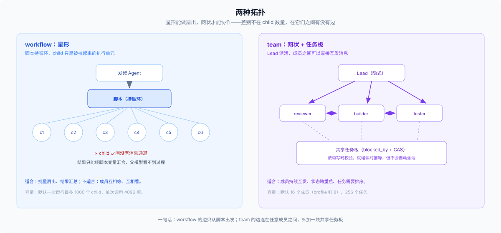
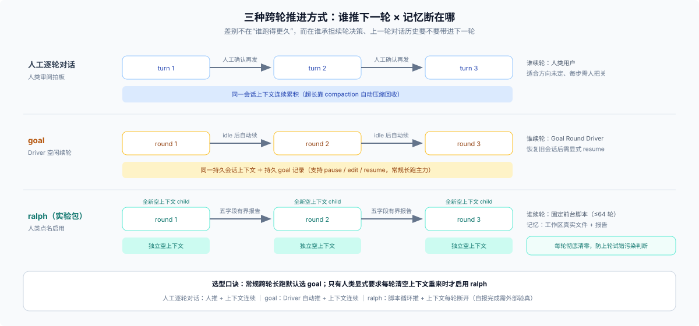
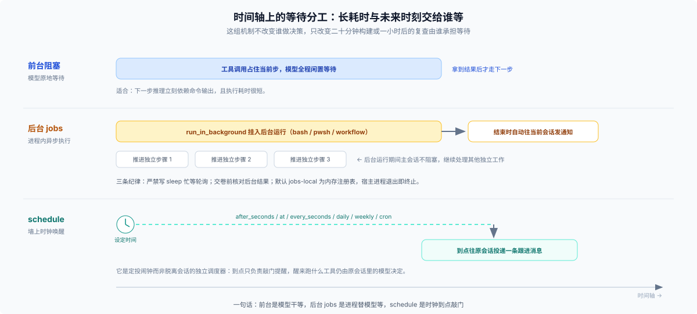

# 02 · 多轮协作与时间轴：`agent-team`、`goal` / `ralph`、`jobs` / `schedule`，以及为什么不做成静态 DAG

当任务不再是“当前这一轮派几个子任务收结果”，而是需要**多个角色边改边对表**，或者需要**跨多轮、跨二十分钟构建、甚至跨天持续推进**时，选型维度就从“单次拆分”切到了协作拓扑与时间轴。

---

## 一、什么时候对等协作的 `agent-team` 才优于父子委派与 `workflow`？

把 40 个独立文件散出去审计是**批量扇出**，用上一篇的 `workflow` 最顺手；但如果你的场景是“`builder` 改接口、`tester` 同步补用例、`reviewer` 盯边界，三个人要在同一个工作目录里来回发消息商量、按前置依赖认领任务，而且万一中途重启还得接着干”，星形单向汇总的 `workflow` 就无能为力了——这正是实验包 [`agent-team`](https://github.com/deepseek-ai/deepseek-harness/blob/master/packages/experimental/agent-team/README.md) 要解决的问题。

决定启用 `agent-team` 之前，先把它的挂载代价和六条运行铁律看明白：

### 1. 启动前挂载 Bundle，换掉普通 `subagent` 工具面（但可与 `workflow` 共存）
`agent-team` 不是运行中模型自己变出来的工具，需要人在启动前通过 Profile 或插件管理器挂载 [`@deepseek-ai/dsh-experimental-agent-team-profile`](https://github.com/deepseek-ai/deepseek-harness/blob/master/packages/experimental/agent-team-profile/cordis.patch.yml)。这份配置会**显式禁用 `tool-subagent`、`tool-subagent-fork`、`tool-subagent-control` 和 `tool-subagent-list-agents`**，把单点委派彻底替换成团队协作工具面。不过它并没有动 `workflow`——团队里的 Lead 或任意成员依然可以在自己回合里调 `workflow` 做一次大规模批量扇出。

### 2. 上手必知的六条硬边界（防空等与踩踏）
- **根会话天然就是隐式 Lead，且强依赖持久会话存储**：不需要先调什么“创建团队”接口，普通根会话的 `SessionId` 直接作为 `TeamId`；如果没有开启持久会话存储（durable session storage），团队功能不会激活。
- **名册与任务板随 Lead 日志持久化，点对点消息归各自收件箱**：包默认上限为 `16` 名成员（官方 profile 钉为 `8` 名）、`256` 个任务。Lead 的会话日志只记录成员名册（`team/member`）与任务状态（`team/task`）；任意两名成员互发的消息直接落入接收方自己的会话收件箱，不再重复写入团队日志。
- **前置依赖解开（`ready`）绝不会自动唤醒负责人开工！** 共享任务板在写入时做无环校验和 `expectedRevision` 乐观锁（CAS）冲突检查，读取时自动推导出未阻塞的 `ready` 任务；但 [`tool-agent-team`](https://github.com/deepseek-ai/deepseek-harness/blob/master/packages/experimental/tool-agent-team/src/index.ts) 立下了死规矩：`Task readiness never starts an owner`。依赖解开只代表“现在允许认领了”，要让空闲队友动起来，Lead 必须显式发消息派活，且最终交卷前必须等齐所有必选队友。
- **`wait_agent` 只负责旁观，不负责叫醒**：如果当前没有任何队友处于运行中或启动中，`wait_agent` 会立刻返回无进展；叫醒处于空闲态的队友必须先调 `send_message`。
- **`writeScopes` 只是告警提示，不是底层文件锁**：任务板上声明的写文件范围能帮队友发现重叠，但挡不住两个人同时开 `bash`、跑格式化工具或代码生成器覆盖同一个文件——物理目录划分仍需由 Lead 在派工时切清。
- **只有 Lead 能拉人与中断**：队友之间可以平级互发消息、认领和更新任务，但只有 Lead 能调 `spawn_teammate` 招新人或中断成员，防止团队层级失控。

---

## 二、时间轴上的两道分水岭：跨轮续跑（`goal` / `ralph`）与异步等待（`jobs` / `schedule`）

### 1. 一轮干不完怎么往下推：人工继续 vs `goal` vs `ralph`

| 方式 | 谁负责推下一轮 | 上下文与记忆怎么传 | 适用场景与关键限制 |
|---|---|---|---|
| **人工发“继续”** | 人类用户 | 同一会话连续累积 | 方向还没定死、每跑完一步都需要人看一眼再拍板 |
| **`goal`**（[`tool-goal`](https://github.com/deepseek-ai/deepseek-harness/blob/master/packages/goal/tool-goal/README.md)） | [`goal-round-driver`](https://github.com/deepseek-ai/deepseek-harness/blob/master/packages/goal/goal-round-driver/README.md) 在会话空闲后自动续轮 | 同一会话持续累积（超长靠 `compaction` 压缩）+ 持久化的 `goal` 记录 | **常规跨轮长跑主力**（哪怕用户没说“goal”这个词，只要请求本身是多轮长线目标即可启用，单轮短活禁用）。支持 `pause` / `edit` / `resume`；注意**恢复旧会话（resume）或 fork 后活跃 `goal` 默认暂停自动续轮**，需显式 `resume` 才会继续；自动续轮里至少启动满 `3` 轮（`roundsStarted >= 3`）执行器才允许报 `blocked` |
| **`ralph`**（实验包 [`tool-ralph`](https://github.com/deepseek-ai/deepseek-harness/blob/master/packages/experimental/tool-ralph/README.md)） | 固定前台脚本循环（默认最多 `256` 轮，[`ralph-bundle`](https://github.com/deepseek-ai/deepseek-harness/blob/master/packages/experimental/ralph-bundle/cordis.patch.yml) 钉为 `64` 轮） | **每轮上下文彻底清零**，每次拉起全新空上下文 child，仅靠工作区文件 + 五字段有界报告接力 | **仅当人类用户显式点名要求 Ralph 或每轮全新上下文迭代时才用**。适合上一轮大量试错日志反而会干扰下一轮判断的任务；注意其完成与阻塞均为子代理自报，没有独立外部裁判 |

### 2. 长耗时命令或未来时刻谁来等：前台 vs 后台 `jobs` vs `schedule`

这组工具不改变“谁来做决定”，只改变**等待成本落在谁头上**：

- **立刻要用结果 → 前台阻塞调用**：老老实实等工具返回再走下一步。
- **跑一次构建/测试要二十分钟，同时手头还有别的独立步骤可做 → 挂后台 `jobs`**：
  由 `bash`、`pwsh` 或 `workflow` 的 `run_in_background` 发起后台作业，通过 [`tool-jobs`](https://github.com/deepseek-ai/deepseek-harness/blob/master/packages/jobs/tool-jobs/README.md) 查看输出、等待或终止。守住三条纪律：① **严禁写 `sleep` 或死循环轮询**——跑完系统会自动在当前会话发通知；② **收尾前记得核对结果**，别漏收后台报错就提前交卷；③ **认清归属与寿命**——后台作业只对启动它的那个 Agent 可见，且默认 [`jobs-local`](https://github.com/deepseek-ai/deepseek-harness/blob/master/packages/jobs/jobs-local/README.md) 是进程内内存注册表，宿主进程一关作业就随之结束（重启后只剩会话日志里的历史事件）。
- **按墙上时钟触发（“一小时后复查”“每天九点巡检”）→ 用 `schedule`**：
  [`tool-schedule`](https://github.com/deepseek-ai/deepseek-harness/blob/master/packages/schedule/tool-schedule/README.md) 每次接收单一时间条件（`after_seconds`、`at`、`every_seconds`、`daily`、`weekly` 或 `cron`），到点只做一件事：**往原会话投递一条跟进消息**（详见 [`docs/subsystems/schedule.md`](https://github.com/deepseek-ai/deepseek-harness/blob/master/docs/subsystems/schedule.md)）。它是定投闹钟，不是脱离会话独立干活的后台调度器。

---

## 三、为什么 DSH 故意做成动态 JS `workflow` + 对话派工，而不做静态 YAML/JSON DAG 引擎？

熟悉传统工作流框架的人初看 DSH，常会疑惑：“既然有了任务依赖图和并发池，为什么不干脆配一份静态 YAML/JSON DAG，由中心调度器按拓扑入度自动派单、自动重试？”对照 [`docs/subsystems/workflow.md`](https://github.com/deepseek-ai/deepseek-harness/blob/master/docs/subsystems/workflow.md) 与 [`docs/subsystems/agent-team.md`](https://github.com/deepseek-ai/deepseek-harness/blob/master/docs/subsystems/agent-team.md)，这是 DSH 刻意为之的四项架构取舍：

1. **真实研发任务里，“做一半发现要改图”才是常态**
   审查到第 10 个文件才发现两个子系统暗中耦合，迁移跑了一半才撞见绕过抽象层的特例——静态 YAML/JSON DAG 逼你在没看清全貌前先把整张图画死，一旦遇到意外要么推翻重画，要么在节点里塞满回调模型的逃逸口。直接让图灵完备的 JS 脚本（`workflow`）或实时对话（`agent-team` / `goal`）握着控制流，`if/else`、分批试探、按结果动态追加下一批节点本来就是最自然的代码与对话表达。
2. **确定性代码只守不变量，派工与重规划留给看得见上下文的那一层**
   DSH 把工作流拆成了职责分明的两半：**机械能算准的不变量归引擎硬卡**（写入时校验依赖无环与 CAS 版本号、读取时推导 `ready` 就绪态、状态变更时卡准入权限）；**需要权衡利弊的概率判断归模型或脚本**（现在先派谁最划算、某个分支挂了该重试还是换思路）。不设中心自动派单器，就永远不会出现“调度器在没有上下文的情况下机械盲派烧光预算”。
3. **用水平“宽扇出”换掉失控的垂直“深层套娃”**
   多层嵌套子代理（父派子、子派孙、孙派曾孙）会让权限审批、token 消耗归属、中途取消和结果验真变得极难追踪。因此 DSH 在垂直方向踩死刹车——`subagent` 工具默认限制 `maxDepth = 1`，`agent-team` 只许 Lead 拉人（注：`workflow` 的 `agent()` 启动子代理时不设 `maxDepth` 拦截闸，但分支深度仍按 `parent + 1` 累加计数，且脚本内不提供嵌套 `workflow()` 钩子）；与此同时在水平方向放开到单次运行 `1000` 个子代理、单次调用 `4096` 项的宽扇出，每个子任务的输入输出边界都扁平清晰。
4. **编排策略随工具插件同装同卸，绝不留孤儿规则**
   没有全局路由表意味着每个编排工具都把自己的适用边界写在自带描述和提示词段落里。当你切到 `Minimal` 预设或用 `agent-team-profile` 禁用掉 `subagent` 时，教模型“何时调 `subagent`”的提示词也随之彻底消失，上下文干干净净。
