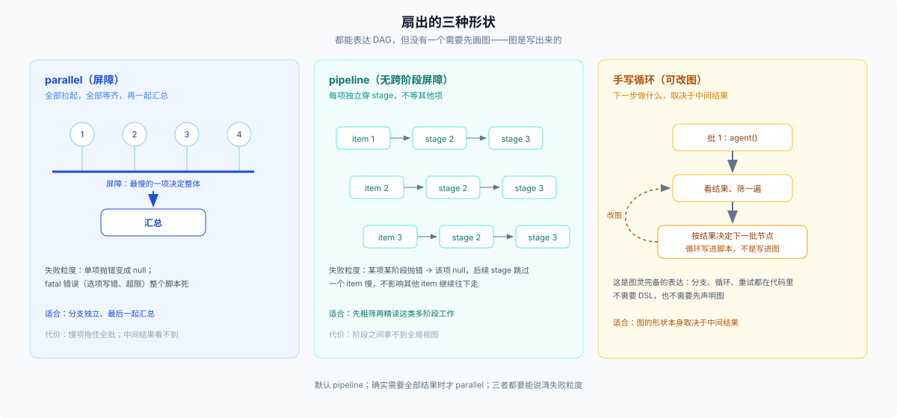

# 02 · 一把还是一批：多次委派、workflow，与扇出的三种形状

## 场景

同一个动作要在几十个对象上重复——四十个文件都要审、一个 API 迁移要铺到所有调用点、同一份材料要从五个角度各读一遍、对一组结论做对抗验证。每项彼此独立，最后要一个汇总结果。

## 触发信号

- 对象数量 ≥ 5（经验阈值，不是官方数字），且同构（同一段 prompt 换个参数就能用）
- 每项都能独立完成，不需要看别的项的结果
- 你要的是一个汇总值或一张表，不是几十条散落的回复

## 候选

1. **逐个调 `subagent`**——模型自己循环，一次一个。
2. **`workflow`**——模型写一段脚本，脚本持有循环与并发。
3. **先 [01](./01-delegate-or-not.md) 的委派，再人工汇总**——两三项时够用。

## 判据

1. **数量。** 一两个 → `subagent`（官方明说）；五个以上、同构 → workflow 开始占优。分水岭不是绝对的，但「为两个委派写一个脚本」几乎总是亏。**如果用户显式点名要 workflow，规模判据让位**——官方第一条件就是「用户显式要求」。
2. **结果要不要在脚本内聚合。** 要分组、去重、按条件重试、把上一阶段结果喂给下一阶段 prompt → workflow；只是收集 → 两者都行。
3. **要不要阶段。** 有「先粗筛再精读」这种流水线 → `pipeline()`；每项独立走完全程、最后一起汇总 → `parallel()`。
4. **child 之间要不要通信。** 要 → 两者都不行，去 [04](./04-persistent-team.md)。workflow 的 child 之间没有消息通道，结果只能经脚本变量汇合。

## 官方边界

> Run a JavaScript workflow script that orchestrates subagents at scale. Use this for work that fans out across many independent pieces — an audit over many files, a migration, multi-angle research, adversarial verification of findings — where you write the orchestration as a script instead of delegating turn by turn. — [`packages/workflow/tool-workflow/src/index.ts:158`](../../packages/workflow/tool-workflow/src/index.ts)

> Use the workflow tool ONLY when the user explicitly asks for a workflow or for large multi-agent orchestration... For one or two delegations, prefer plain subagent calls. — [同文件:329](../../packages/workflow/tool-workflow/src/index.ts)

注意第二句的两个限定：**用户显式要求**、**大规模**。官方给的不是「什么时候都行」，是「没有这两个信号就别用」。

## 扇出内部的三种形状



| 形状 | 语义 | 什么时候用 | 失败粒度 |
|---|---|---|---|
| `parallel(thunks)` | 并发跑，全部等齐（屏障） | 各分支独立、最后一起汇总 | 单个 thunk 抛错 → 该项 `null`；fatal 错误 → 整个脚本死 |
| `pipeline(items, ...stages)` | 每项独立穿 stage，stage 之间无屏障 | 多阶段、每项可独立完成 | 某项某阶段抛错 → 该项 `null` 并跳过后续 stage |
| 手写 `for` + `agent()` | 你控制什么时候发起下一批 | 要根据中间结果决定下一批节点 | 自己处理 |

```js
// 每项独立走完两阶段，不等其他项——多阶段工作优先用这个
const results = await pipeline(files,
  f => agent(`粗筛 ${f}`),                                   // 返回文本
  (screen, f) => screen?.includes('KEEP') ? agent(`精读 ${f}`, { phase: 'read' }) : null,
)
return { kept: results.filter(Boolean).length }
```

`parallel` 是屏障，只在「下一步真的需要所有结果」时用；`pipeline` 没有跨阶段屏障，长任务不会被最慢的那一项拖住。`parallel`/`pipeline` 覆盖常见的扇出-汇聚与线性阶段；**任意依赖要自己写控制流**（通常就是手写循环）；但三者都不需要你先画图——图是写出来的，不是画出来的。

## 容量与代价

| 项 | 默认 | 含义 |
|---|---|---|
| `maxTotalAgents` | 1000 | 单次运行累计 child 上限（跑飞回退） |
| `maxItemsPerCall` | 4096 | 单次 `parallel`/`pipeline` 的项数 |
| `maxConcurrentAgents` | 0 → `min(16, CPU−2)` | FIFO 槽位，不是优先级队列 |
| 整体超时 | 无 | 只有调用方的 abort 信号 |

来源：[workflow-ptc config](../../packages/workflow/workflow-ptc/src/index.ts):108-110 与 `:142-144`、[workflow-ptc README](../../packages/workflow/workflow-ptc/README.md)。

代价集中在四处：**父对话只拿到最终结果**（中间过程你看不见，也无法中途纠偏）；**child 的完成不会通知父模型**（结果只在脚本内消化）；**运行不可恢复**（没有 journal，进程一重启就是重跑）；**没有保存的 workflow 定义**——每次运行都是模型现写脚本；复用只能把脚本留在会话或 skill 里让模型重写，不能注册成一个可调用的 workflow（[workflow README](../../packages/workflow/workflow/README.md):127-128）。

## 反例与失败形态

- **三个文件用 workflow。** schema 与启动成本高于收益；官方那句「一两个用 subagent」就是冲这个来的。
- **让 child 互相看结果。** workflow 没有这个通道；用脚本变量拼出来的「共享状态」只是单向汇总。
- **不写 `filter(Boolean)`。** 失败的 child 变成 `null`，汇总时静默丢项，看起来成功了。
- **失败长什么样**：token 爆（并发过高、每项 prompt 重复带大段背景）；一个 child 失败但整批看起来成功；父模型拿不到过程，错了只能整批重跑；用了 `parallel` 导致慢项拖住全批。

## 出口

- 需要持久协作、成员互发消息、任务板 → [04](./04-persistent-team.md)
- 这件事本身要跨轮，不是一次扇出 → [03](./03-cross-turn-and-fresh.md)
