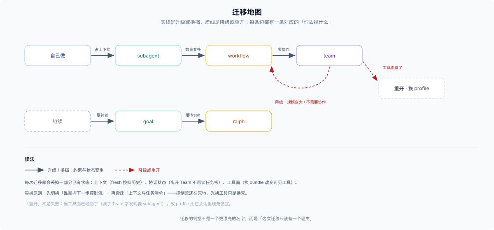

# 03 · 跑偏排障与平滑换挡：典型症状对照表、升级路线与源码入口

编排选型选错时，系统很少直接抛红字异常；绝大多数时候，它表现为**上下文飞速膨胀、主会话傻等、token 账单失控、多个子任务互相踩改同一份文件，或者“表面全绿交卷、打开一看漏了一半”**。

下面把实战中最常撞见的十种症状、背后的机制原因和换挡路径摊开对照。

---

## 一、十种典型跑偏症状速查表

| 你观察到的症状 | 大概率踩了什么坑 | 底层机制原因 | 对症换挡办法 |
|---|---|---|---|
| **主对话迅速臃肿，还没开始改代码就频繁触发压缩** | 把几十次搜索/读文件或独立调研硬塞在主会话里做 | 原生工具模式下每次工具原始输出都完整进入当前对话历史 | 纯数据筛选切 `PTC` 预设用 `run_code` 消化；需独立推理的调研拆给 [`subagent`](./01-subagent-vs-workflow-vs-ptc.md) |
| **主会话卡死二十分钟干等构建，或反复调 `sleep` 查进度** | 长耗时命令走了前台阻塞，或违背纪律手工轮询 | 前台调用会占住当前步；`sleep` 忙等白烧轮次且容易重复发起同一任务 | 发起时开 `run_in_background` 挂入后台 `jobs`，推进其他独立工作，等完成通知回来再收尾 |
| **多个子任务互相覆盖代码，格式化后文件乱成一团** | 并行子任务未切清物理写边界，或把 `writeScopes` 当成锁 | 底层共享同一工作区文件系统；`agent-team` 的 `writeScopes` 只是重叠告警，拦不住 `bash` 或代码生成器并发写 | 派活前按互不重叠的目录/文件切分职责；耦合紧密的改动改为“并行只读出方案 → 主会话单点落盘” |
| **把 `workflow` 当持久 DAG 跑长任务，重启全丢或分支间没法通信** | 误以为 `workflow` 支持断点恢复和子代理互发消息 | `workflow-ptc` 在内存 Worker 线程一次性运行，无持久化 journal，子代理间也无消息通道 | 跨重启长线推进改用 [`goal`](./02-agent-team-goal-and-time-axis.md)；多角色双向协商改在启动前挂 `agent-team-profile` |
| **`agent-team` 任务板挂满 `pending` / `ready` 没人动，`wait_agent` 秒退** | 以为前置依赖完成后会自动派单，或拿 `wait_agent` 当唤醒器 | 引擎只推导 `ready` 状态，**绝不自动启动负责人**；`wait_agent` 也只观察运行中成员，不唤醒空闲成员 | Lead 查完 `team_task_list` 后必须显式调 `send_message` 通知对应队友认领开工 |
| **`workflow` 脚本顺利返回，复查却静默漏掉好几个文件** | 汇总时漏判 `null` 失败项 | `parallel` / `pipeline` 中单个子代理报错会返回 `null` 而非中断整批运行 | 脚本里显式统计并处理 `null` 项（有界重试或上报失败清单），聚合有效结果时加 `.filter(Boolean)` |
| **Token 消耗暴涨，每个子任务都在重读大段无关历史** | 随手滥用 `subagent_fork`，或在 `workflow` 每项里塞满长背景 | `fork` 会把父会话已完成轮次整包复制给子代理；宽扇出时每多带 2 KB 背景都会乘以并发项数 | 改用空上下文 `subagent` 只传提炼后的短背景；多阶段批处理改用 `pipeline` 先低成本粗筛再精读 |
| **恢复旧会话（resume）或 fork 之后，原本的 `goal` 不再自动续跑了** | 误以为 `goal` 挂掉了 | 为防止恢复历史会话时冷不防自动开跑改坏现场，resume / fork 后的活跃 `goal` 默认解除自动续轮 | 确认工作区状态无误后，显式调一次 `goal` 的 `resume` 操作即可重新激活 |
| **`goal` 一轮接一轮往下跑，方向却越跑越偏** | `objective` 写得太宽泛，或前几轮试错噪音带偏了后续判断 | 驱动器每轮靠 `objective` 锚定方向；同会话历史一路累积会放大早期偏差 | 调 `pause` + `edit` 把目标改成可机械验证的具体判据；若需每轮彻底清空上下文重来，由人点名改用 `ralph` |
| **收到完成通知 / 状态变 `completed`，一跑测试全是红灯** | 把“运行结束或子代理自报完成”当成了业务正确 | 通知送达、任务标完成、`ralph` 自报 `complete` 都只代表流程走到终态；且底层默认**不自动重试失败项** | 派活时定死验收命令，收回结果后由父会话或脚本亲自跑一遍单测、类型检查或 `git diff` 验真 |

---

## 二、半路任务变大了怎么换挡？（升级路线与状态损耗）

很多任务刚上手时看起来很小，做到一半才发现规模或协作复杂度翻了倍。换挡并不丢人，关键是**每次只因一个明确瓶颈换挡，并清楚知道这一步会丢掉什么已有状态**：

| 换挡方向 | 从哪 → 到哪 | 什么时候该换 | 换挡时你会丢掉什么 / 付出什么代价 |
|---|---|---|---|
| **首次拆出上下文** | 自己做 → `subagent` | 接下来要翻十几个文件，留在主对话太挤 | 需花精力写一段自包含 `prompt`；父会话看不到子代理中间试错过程 |
| **单点扩成批处理** | `subagent` → `workflow` | 同类检查从 1–2 个文件涨到几十个文件 | 之前单个子代理的上下文不复用；需现写聚合脚本，且单次运行不可断点恢复 |
| **单向扇出升为对等团队** | `workflow` → `agent-team` | 子任务不再彼此独立，需要几个角色持续互发消息、跨重启共享任务板 | **必须切换 Profile 挂载 Bundle**；普通 `subagent` 工具面随之消失，需把脚本逻辑重组成团队任务板与对话派工 |
| **团队降回批处理** | `agent-team` → `workflow` | 协作定型后发现只是几百个文件的机械铺开，8–16 人团队不够快也没必要 | 团队成员名册与任务板留在日志里不再驱动当前批处理，改由单次脚本接管并发 |
| **手动推升为自动长跑** | 人工继续 → `goal` → `ralph` | 人工盯轮太累（升 `goal`）；或同会话历史噪音太大且人要求每轮清空（升 `ralph`） | 升 `goal` 需承担目标写歪自动跑偏的风险；切 `ralph` 则每轮彻底丢弃对话记忆，只靠工作区文件与五字段报告接续 |
| **果断重开会话 / 切 Profile** | 当前错配环境 → 新会话 | 启动前挂了 `agent-team-profile` 才发现其实只想调普通 `subagent`，或上下文已严重污染 | 放弃当前会话的连续对话流（旧会话仍在历史里可查），换回干净匹配的工具面往往比在原地别扭硬绕省心得多 |

### 实战走查：一次审计任务的三级演进

假设你一开始只想“派个子代理检查 8 个接口文件的鉴权漏没漏”：

1. **起步选 `subagent`**：写清四要素派出去，几分钟拿回清单，主对话干干净净。
2. **第一次换挡（数量膨胀 → `workflow`）**：排查发现全仓其实有 60 个路由文件都要过一遍，且要先筛出未挂中间件的文件再精读。直接停掉手工逐个派发，改写一段 10 行 `workflow` `pipeline()` 脚本并发跑完 60 个文件，最后 `.filter(Boolean)` 汇总风险表。
3. **第二次权衡（要不要升 `agent-team`？）**：拿到风险表后需要把修复和补测交叉核对。注意——如果只是“先统一改完，再跑一轮独立复核”，在 `workflow` 里写前后两个阶段就够了，**根本不需要动 Profile 上 `agent-team`**；只有当后端改造、前端联调与测试修复三方必须边改边沟通接口细节、持续好几个回合时，才值得切到 `agent-team` 建任务板协同。

---

## 三、源码与子系统文档入口

想进一步核对某个工具的参数定义、默认配额或系统提示词原文，可直接查阅以下主干路径：

| 领域 | 子系统总览文档 | 核心实现与配置包 |
|---|---|---|
| **PTC 代码模式** | [`docs/subsystems/ptc-runtime.md`](https://github.com/deepseek-ai/deepseek-harness/blob/master/docs/subsystems/ptc-runtime.md) | [`agent-tool-presentation`](https://github.com/deepseek-ai/deepseek-harness/blob/master/packages/core/agent-tool-presentation/README.md) · [`ptc-runtime`](https://github.com/deepseek-ai/deepseek-harness/blob/master/packages/ptc-runtime/ptc-runtime/README.md) · [`ptc-runtime-node`](https://github.com/deepseek-ai/deepseek-harness/blob/master/packages/ptc-runtime/ptc-runtime-node/README.md) · [`ptc.patch.yml`](https://github.com/deepseek-ai/deepseek-harness/blob/master/packages/bundle/web-app/presets/ptc.patch.yml) |
| **子代理委派** | [`docs/subsystems/subagent.md`](https://github.com/deepseek-ai/deepseek-harness/blob/master/docs/subsystems/subagent.md) | [`subagent`](https://github.com/deepseek-ai/deepseek-harness/blob/master/packages/subagent/subagent/README.md) · [`tool-subagent`](https://github.com/deepseek-ai/deepseek-harness/blob/master/packages/subagent/tool-subagent/README.md) · [`tool-subagent-control`](https://github.com/deepseek-ai/deepseek-harness/blob/master/packages/subagent/tool-subagent-control/README.md) |
| **脚本工作流** | [`docs/subsystems/workflow.md`](https://github.com/deepseek-ai/deepseek-harness/blob/master/docs/subsystems/workflow.md) | [`workflow`](https://github.com/deepseek-ai/deepseek-harness/blob/master/packages/workflow/workflow/README.md) · [`workflow-ptc`](https://github.com/deepseek-ai/deepseek-harness/blob/master/packages/workflow/workflow-ptc/README.md) · [`tool-workflow`](https://github.com/deepseek-ai/deepseek-harness/blob/master/packages/workflow/tool-workflow/README.md) |
| **对等团队与 Ralph** | [`docs/subsystems/agent-team.md`](https://github.com/deepseek-ai/deepseek-harness/blob/master/docs/subsystems/agent-team.md) | [`agent-team`](https://github.com/deepseek-ai/deepseek-harness/blob/master/packages/experimental/agent-team/README.md) · [`tool-agent-team`](https://github.com/deepseek-ai/deepseek-harness/blob/master/packages/experimental/tool-agent-team/README.md) · [`agent-team-profile`](https://github.com/deepseek-ai/deepseek-harness/blob/master/packages/experimental/agent-team-profile/cordis.patch.yml) · [`tool-ralph`](https://github.com/deepseek-ai/deepseek-harness/blob/master/packages/experimental/tool-ralph/README.md) · [`ralph-bundle`](https://github.com/deepseek-ai/deepseek-harness/blob/master/packages/experimental/ralph-bundle/cordis.patch.yml) |
| **跨轮目标与等待时间** | [`docs/subsystems/goal.md`](https://github.com/deepseek-ai/deepseek-harness/blob/master/docs/subsystems/goal.md) · [`jobs.md`](https://github.com/deepseek-ai/deepseek-harness/blob/master/docs/subsystems/jobs.md) · [`schedule.md`](https://github.com/deepseek-ai/deepseek-harness/blob/master/docs/subsystems/schedule.md) | [`tool-goal`](https://github.com/deepseek-ai/deepseek-harness/blob/master/packages/goal/tool-goal/README.md) · [`goal-round-driver`](https://github.com/deepseek-ai/deepseek-harness/blob/master/packages/goal/goal-round-driver/README.md) · [`tool-jobs`](https://github.com/deepseek-ai/deepseek-harness/blob/master/packages/jobs/tool-jobs/README.md) · [`jobs-local`](https://github.com/deepseek-ai/deepseek-harness/blob/master/packages/jobs/jobs-local/README.md) · [`tool-schedule`](https://github.com/deepseek-ai/deepseek-harness/blob/master/packages/schedule/tool-schedule/README.md) |

> 核验状态见 [核验基线登记](../00-baseline.md)。
