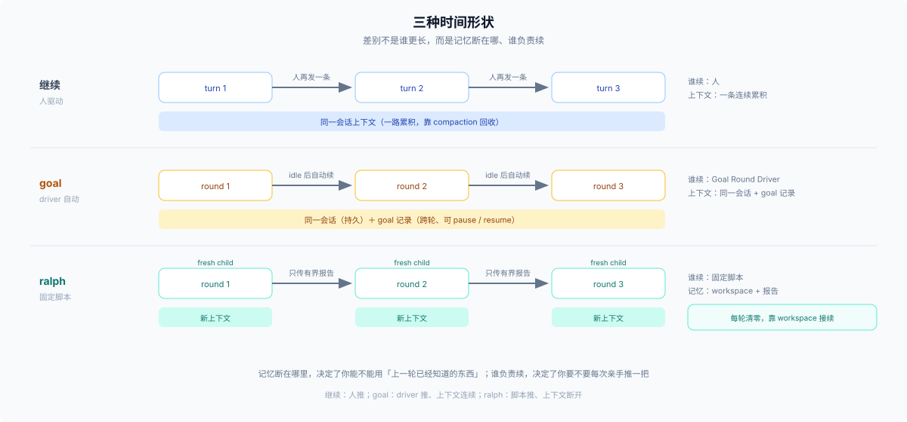

# 03 · 这一轮结束了吗：继续、goal，还是 ralph

## 场景

活干了一轮，还剩不少，而且你大概知道下一轮该干什么——但不想每次都靠人再发一句「继续」。或者反过来：你希望每一轮都从干净上下文开始，不让上一轮的探索污染下一轮的判断。

## 触发信号

- 目标能用一句话钉住，且几轮之内不会变
- 一轮做不完，但每轮都有可验证的进展
- 你希望它自己接着跑（goal），或者你希望每轮都是全新的判断（ralph）

## 候选

1. **继续**——人再发一条，或者模型在当前轮里接着做。最轻，也最容易被忘记。
2. **`goal`**——同会话跨轮，driver 在 idle 后自动开下一轮；目标持久、可 pause/resume。
3. **`ralph`**——固定脚本的前台循环，每轮一个全新 child，只传有界结构化报告。

## 判据

1. **目标是否稳定。** 会变 → 先 plan 或先探索；goal 在模型眼前的主要锚点就是那句 objective，写歪了后面全歪。
2. **要不要 fresh 上下文。** 要（上一轮的探索已经变成噪音）→ ralph；不要 → goal，同会话的连续性在这里是资产。
3. **验收归谁。** 人看结果 / 模型自己判断 → goal；只有 worker 自报 → 那是 ralph 的已知代价，不是 bug。
4. **是否允许自动续跑。** goal 会在空闲时自己开下一轮；ralph 是一次前台调用，跑完才返回。

## 官方边界

> Use it when the direct human request is a long-running objective, even if the user did not say "goal"; not for single-turn work. — [`packages/goal/tool-goal/src/index.ts:53`](../../packages/goal/tool-goal/src/index.ts)

> Use only when the direct human explicitly asks for Ralph or fresh-agent iteration. — [`packages/experimental/tool-ralph/src/index.ts:178`](../../packages/experimental/tool-ralph/src/index.ts)

> Completion and blockers are worker reports, not independent evaluation. — [同文件:408](../../packages/experimental/tool-ralph/src/index.ts)

这三句合起来给出了一条少见但很清楚的官方分工：**普通长跑归 goal，fresh 迭代归 ralph，而 ralph 必须由人点名。**

## 代价

| 轴 | 继续 | `goal` | `ralph` |
|---|---|---|---|
| 上下文 | 累积 | 累积，靠 compaction 回收 | 每轮清零 |
| 记忆 | 会话 | 会话 + goal 记录 | workspace + 五字段报告 |
| 自动性 | 无 | driver 续轮 | 固定脚本循环 |
| 终止 | 人判断 | complete / blocked / 轮上限 | complete / blocked / 预算 |
| 主要风险 | 忘了继续 | 目标漂移、上下文腐化 | 自报完成、轮次烧完 |

两个数字值得记住：goal 的 `blocked` 默认门槛是**同一个阻塞条件连续 3 轮**（[tool-goal:39](../../packages/goal/tool-goal/src/index.ts)），一次失败不等于 blocked；ralph 的轮上限工具默认 256，optional bundle 把它钉到 64（[ralph-bundle patch](../../packages/experimental/ralph-bundle/cordis.patch.yml)）。

## 反例与失败形态

- **单轮任务开 goal。** 它会在你答完之后自己再开一轮，浪费 token，还可能把已经收尾的东西改坏。
- **长跑用 workflow。** 没有 journal，进程一重启全丢；这是「用错持久性」最典型的一种。
- **用 ralph 做需要上下文连续的工作。** 每轮都要重新探索，成本高，结论也接不上。
- **恢复会话后发现 goal 不动了。** resume / fork 之后 active goal 是 disarmed 的，需要显式 `resume` 才会继续；这不是坏了（goal 的 guidance 明说）。
- **失败长什么样**：目标漂移（objective 太模糊，每轮都在重新解释它）；轮次烧完但没完成（没有验收标准）；ralph 报 complete 但产物不对（自报不是验证）；goal 连续多轮撞同一面墙却没人叫停。

## 出口

- 需要的是「定时」而不是「连续」→ [05](./05-async-and-clock.md)
- 需要多个角色持续协作，而不是一个会话往前推 → [04](./04-persistent-team.md)
