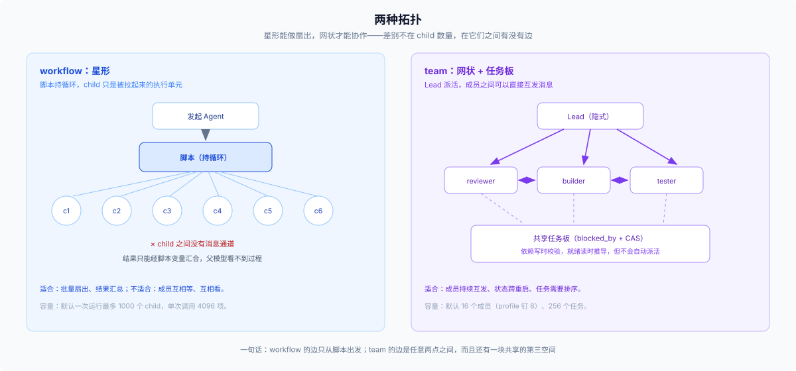

# 04 · 要不要有人一直在场：workflow 加人，还是 Agent Team

## 场景

两个以上角色要在同一个工作目录里持续改同一块东西：互相等、互相看、共享一张任务清单，而且这件事会跨很多轮、可能跨重启。这和「把四十个文件扇出去」是两种不同的问题。

## 触发信号

- 成员之间需要**互发消息**，而不是只跟父级汇报
- 协调状态需要**跨崩溃**（重启之后任务板还在、谁在做什么还查得到）
- 工作持续很久，且分工会在过程中变化
- 你愿意为此换掉当前的委派工具面

## 候选

1. **workflow + 人**——脚本负责扇出，人负责协调与裁决。
2. **Agent Team**——Lead 加具名队友，共享任务板与邮箱，状态持久。
3. **[02](./02-fan-out-shape.md) 的批量扇出**——如果其实只是「多」，不是「协作」。

## 判据

1. **成员之间要不要持续通信。** 要 → Team；只是父收集结果 → workflow。这是最硬的一条分界。
2. **协调状态要不要持久。** 要 → Team（roster、任务、邮箱都是 durable）；一次性 → workflow。
3. **规模。** 几十个对象的批量 → workflow（默认最多 1000 个 child）；几个角色的协作 → Team（默认 16 成员，profile 钉 8）。
4. **接不接受组合替换。** Team bundle 会 disable `tool-subagent`、`tool-subagent-fork`、`tool-subagent-control` 与 `tool-subagent-list-agents`（[agent-team-profile patch](../../packages/experimental/agent-team-profile/cordis.patch.yml):3-14）。接受不了，就别用。启用方式是装一个 bundle（`@deepseek-ai/dsh-experimental-agent-team-profile`，走 profile 或 Web 插件管理器）。

## 官方边界

> Task readiness never starts an owner. — [`packages/experimental/tool-agent-team/src/index.ts:41`](../../packages/experimental/tool-agent-team/src/index.ts)

> The Lead must wait for required teammates before giving the final answer. — 同文件:41

> Any member can send to another member or the Lead. — [`packages/experimental/agent-team/README.md`](../../packages/experimental/agent-team/README.md)

第一句是这套机制里最容易被误解的地方：依赖解开只是「就绪」，不会把 owner 叫起来；派发仍然要 Lead 发消息。这也正是它和「中心调度器」的分界线——**引擎推导就绪，但不替你派工。**

## 机制要点（只列影响决策的）

- 每个普通 runtime root 都是**隐式 Lead**，`TeamId` 就是它的 `SessionId`；没有「创建团队」这一步。
- **需要 durable session storage**：没有持久会话，Team 不激活——roster 与任务靠 Lead 日志重放，消息由各自目标会话持有。
- 任务板是 **CAS**：每次变更带 `expectedRevision`，过期就拒绝；依赖必须无环（写时校验），就绪是读时推导。
- `writeScopes` 只是**告警**，不是锁；Bash、格式化工具、代码生成器都不受版本守卫保护。
- `wait_agent` **只观察、不唤醒**；要叫醒 inactive 的成员，先 `send_message`。
- 只有 Lead 能 `spawn_teammate` / `interrupt`；队友不能再拉队友，但可以给任意成员发消息、用任务板。

## 代价

| 轴 | workflow + 人 | Agent Team |
|---|---|---|
| 上下文 | 父只看最终值 | 每个成员都有自己的会话；policy 与 9 个 schema 常驻 |
| 时间 | 一次运行 | 持续，可跨重启 |
| 持久 | 无 | Lead 日志 + 投影；消息存目标会话 |
| 组合 | 不影响其他工具 | 换掉委派工具面 |
| 验收 | 脚本返回值 | 任务状态 + 人复核 |
| 成熟度 | 一等能力 | experimental，无稳定性承诺 |

## 反例与失败形态

- **一次性审计开 Team。** 组合代价远大于收益；你要的是扇出，不是协作。
- **用 Team 做四十个文件的批量。** 成员上限 8–16，而且没有脚本级聚合；这类活 workflow 更合适。
- **以为依赖解开就会自动开工。** 不会，`team_task_list` 里 `ready` 只是可 claim。
- **失败长什么样**：等死（没有 running/provisioning 的成员，`wait_agent` 立刻 `noProgress`）；任务板空转（任务都停在 pending，没人 claim）；写域冲突（告警不是锁，两个人同时跑 Bash 没人拦得住）；Lead 先给答案（没等齐 required 队友）。

## 一个容易被忽略的组合事实

Team 与 workflow **可以共存**：bundle 禁的是 `subagent` 系列工具，workflow 保留 base 的 `spawn` provider，所以 Team 会话里的成员仍然可以用 workflow 做批量 fresh 扇出（[patch](../../packages/experimental/agent-team-profile/cordis.patch.yml) 只 disable 了 subagent 系列，没有动 workflow 行；workflow 启动 child 时也不经过 subagent 的深度上限）。真正互斥的是 **Team 与普通 subagent 委派**，不是 Team 与 workflow。

## 出口

- 其实只是批量、不是协作 → [02](./02-fan-out-shape.md)
- 单人长跑、不需要队友 → [03](./03-cross-turn-and-fresh.md)
