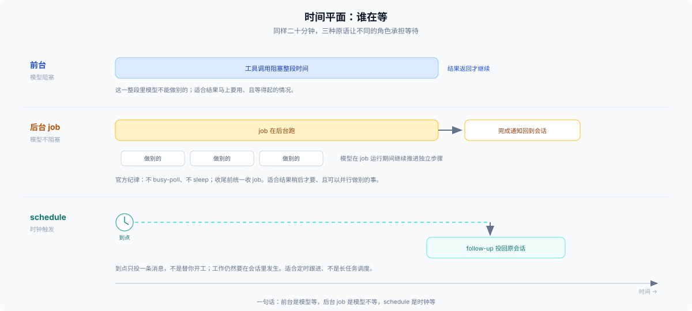

# 05 · 谁在等：前台、后台 job，还是 schedule

## 场景

有件事要跑二十分钟：CI、一个长构建、一次批量下载。你不想干等，但也不想它跑完之后你忘了收。或者触发源根本不是「现在」，而是「每天九点」「一小时后」。

## 触发信号

- 等待时间远大于你下一步能做的事
- 或者：这件事应该在某个时刻发生，而不是在某个回合发生

## 候选

1. **前台等**——工具调用阻塞到结束。
2. **后台 job**——由 `bash` / `pwsh` 或 workflow 的 `run_in_background` 发起，统一登记为 job；用 `jobs` 工具读、等、kill，完成时会通知。
3. **`schedule`**——定时把一条消息投回原会话。

## 判据

先说清平面：**`jobs` 是后台作业的观察与控制面；真正开工的是 producer（`bash`、`pwsh`、workflow）。**

1. **谁在等。** 模型必须拿到结果才能继续 → 前台；可以先做别的 → 后台 job。
2. **触发源。** 模型发起 → 后台 job（producer 是 `bash` / `pwsh` / workflow）；时钟 → `schedule`；外部事件 → webhook（本篇不覆盖）。
3. **结果何时需要。** 现在 → 前台；稍后或收尾时 → 后台 job，完成通知会把它带回来。

## 官方边界

> Track every background job id you start. You are notified in-session when a job finishes — do not busy-poll or sleep on one; keep working on independent steps and do not duplicate a running job's work. — [`packages/jobs/tool-jobs/src/index.ts:254`](../../packages/jobs/tool-jobs/src/index.ts)

> Supply exactly one timing parameter: after_seconds, at, every_seconds, daily, weekly, or cron. — [`packages/schedule/tool-schedule/src/index.ts:185`](../../packages/schedule/tool-schedule/src/index.ts)

## 代价

| 轴 | 前台 | 后台 job | `schedule` |
|---|---|---|---|
| 阻塞 | 是 | 否 | 否 |
| 结果形态 | 工具结果 | 状态 + 有界输出 ring | 一条 follow-up 消息 |
| 触发 | 现在 | 现在 | 时钟 |
| 归属 | 当前 turn | 启动它的 agent | 原会话 |
| 取消 | 无（只能等） | `job_kill` | 删除提醒 |

两个归属事实值得记住：jobs 属于启动它的 agent，别的 agent 看不到；schedule 的到期消息回到**原会话**，不是广播（[jobs README](../../packages/jobs/README.md)、[schedule 子系统](../../docs/subsystems/schedule.md)）。

## 反例与失败形态

- **sleep / busy-poll 等结果。** 官方明确禁止；除了烧 token，还会让你重复做已经开始的工作。
- **用 schedule 做长任务。** 它是提醒，不是调度器：到点只是投一条消息，工作仍然要在会话里发生。
- **后台化之后再也没收。** 收尾前忘了 `job_output`，job 泄漏，最后答案缺一块。
- **失败长什么样**：同一个 job 被启动两次；完成通知到了但可能被 compaction 遮蔽，模型以为还在跑；schedule 的提醒落在一个已经结束的会话里。

## 出口

- 到点之后要它自己接着推进，而不是只提醒一句 → [03](./03-cross-turn-and-fresh.md)
