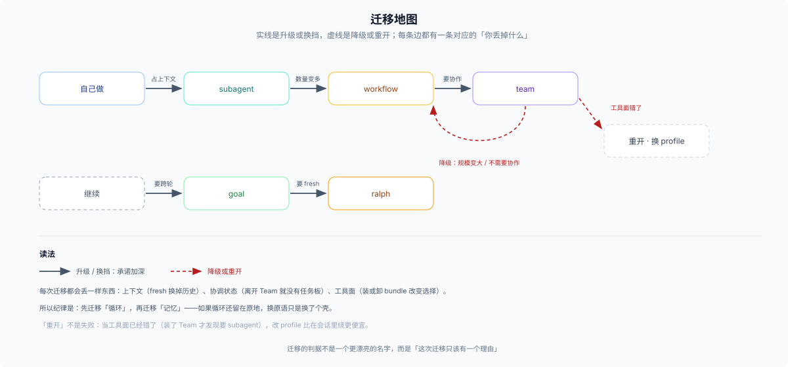

# 06 · 跑歪了：症状、机制、迁移

## 一句话

选错很少表现为报错。它通常表现为慢、贵、乱，或者「看起来完成了但不对」——而这几件事都不会自己举手。

## 症状表

| 症状 | 很可能选错了 | 机制解释 | 先去 |
|---|---|---|---|
| 父对话越来越长，被中间结果淹没 | 该委派却自己做 | 上下文没有隔离 | [01](./01-delegate-or-not.md) |
| 任务板上一堆 pending，没人开工 | 用了 Team 但没派活 | 就绪不启动 owner | [04](./04-persistent-team.md) |
| 一轮轮跑，目标越来越偏 | goal 的 objective 太模糊 | objective 是主要锚点 | [03](./03-cross-turn-and-fresh.md) |
| 恢复会话后 goal 不动了 | 不知道 goal 被 disarm | resume / fork 后需要显式 resume | [03](./03-cross-turn-and-fresh.md) |
| token 烧得很快 | 扇出过大 / 每个 child 都带大段背景 | 每个 child 独立上下文 | [02](./02-fan-out-shape.md) |
| 崩溃后全部重来 | 用了无持久原语 | workflow 没有 journal | [03](./03-cross-turn-and-fresh.md) |
| 工具不见了 | 装了 Team bundle | 组合替换掉了 subagent 工具面 | [04](./04-persistent-team.md) |
| 完成通知到了，但结果是错的 | 把 worker 自报当验收 | 完成 ≠ 正确 | [03](./03-cross-turn-and-fresh.md) |

最后一行值得单独说：DSH 里「完成」至少有四种意思——工具结果返回、任务状态变成 completed、job 进入终态、worker 报告 complete。四种都不是业务正确性的证明。选原语的时候如果没同时定验收，后面一定会在这里付账。

## 迁移路径

| 路径 | 从 → 到 | 触发信号 | 代价 |
|---|---|---|---|
| 首次委派 | 自己做 → `subagent` | 会占太多上下文 | 写一份自包含 prompt |
| 同层升级 | `subagent` → `workflow` | 数量从一两个变成几十个 | 写脚本；父失去中间过程 |
| 同层降级 | 后台 workflow → 前台 | 结果其实马上要用 | 阻塞当前轮 |
| 跨轮换挡 | 继续 → `goal` | 需要自动续跑 | 目标漂移风险 |
| 跨轮换挡 | `goal` → `ralph` | 需要每轮 fresh 上下文 | 上下文每轮清零 |
| 跨层升级 | workflow + 人 → Team | 需要成员互发、状态持久 | 组合替换；实验性 |
| 跨层降级 | Team → workflow | 规模变大或不需要协作 | 失去任务板与邮箱的使用面 |
| 重开 | 换 profile / 新会话 | 工具面或上下文已不可救 | 放弃当前会话的连续上下文（旧会话仍可恢复） |

「重开」不是失败，是最后一条合法路径：当工具面已经错了（比如装了 Team 才发现要 subagent），改 profile 比在会话里绕更便宜。

## 迁移时丢什么

- **上下文**：fresh 换掉历史；fork 保留的是创建时快照，父之后发生的事进不去。
- **协调状态**：离开 Team 后新的协作面不再读任务板与邮箱（记录仍留在 Lead 日志里）；离开 goal 就没有自动续轮（轮次记录仍在日志里）。反过来，从一个子代理或脚本迁到 Team，之前的委派上下文不会自动变成 Lead 的对话——除非那个成员本来就是 fork。
- **工具面**：装或卸 bundle 会改变模型能看见的选择，而且这种改变发生在组合层，不在当前会话里。

## 一句纪律

**先迁移「循环」，再迁移「记忆」。** 如果循环还留在原地，换原语只是换了个壳：脚本持循环时你换成 team，脚本的编排逻辑并不会自动变成 Lead 的对话策略，问题会以另一种形式重现。

## 一个走查

从「派一个子代理审 10 个文件」开始，半路发现其实是 40 个、而且结果要交叉比对：

1. 数量变了 → 迁到 [02](./02-fan-out-shape.md)：写 workflow，`pipeline` 逐项跑，父只拿汇总。**丢**：之前那个子代理的上下文（除非 fork 过）。
2. 交叉比对要求 child 之间看见彼此 → workflow 做不到。要么在脚本里做两阶段（先全收集，再用结果拼第二轮 prompt），要么迁到 [04](./04-persistent-team.md)。
3. 迁到 Team 的代价：之前的脚本结果要重新落成任务；组合替换后 `subagent` 工具消失；还要接受 experimental 的不稳定性。

这条走查的重点不是「最后应该选 Team」，而是：**每次迁移都只该有一个理由**，并且要能说出这次迁移丢了什么。
