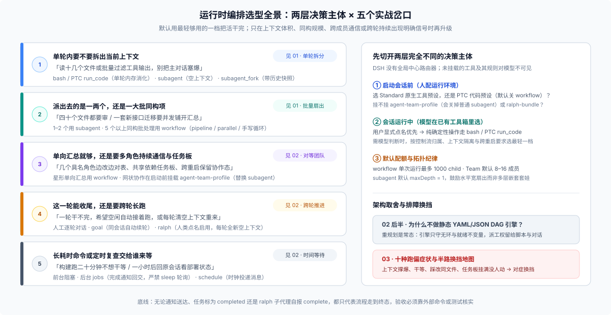

# Answer 27 · 运行时编排选型：先分清两层决策主体，再查一张表走对五个岔口

## 一句话结论

别把 DSH 里的编排机制看成同一排平铺按钮。动手选之前，必须先切开**两层完全不同的决策主体**：

1. **启动会话前（人配运行环境）**
   你选的是 `Standard` 原生工具预设还是 `PTC` 代码预设（见 [FAQ 03](../03_preset-modes-specialty/answer.md)）？有没有挂载实验性的 [`agent-team-profile`](https://github.com/deepseek-ai/deepseek-harness/blob/master/packages/experimental/agent-team-profile/cordis.patch.yml)（一旦挂上会直接关闭普通 `subagent` 系列工具）或 [`ralph-bundle`](https://github.com/deepseek-ai/deepseek-harness/blob/master/packages/experimental/ralph-bundle/cordis.patch.yml)？**DSH 没有全局中心路由器**——每个工具把“什么时候用我”写在自己的描述和提示词段落里，没装上的工具连同它的策略规则对模型完全不可见。
2. **会话运行中（模型在已有工具箱里选）**
   第一优先级永远是**用户显式点名**（`workflow` 与 `ralph` 都将用户点名列为首要触发条件）；没点名时，纯确定性的活（跑测试、批量改名、解析 JSON）直接走 `bash` 或 `PTC` `run_code`，根本不用派生新 Agent；需要模型判断的工作，遵循**“默认用最轻够用的一档把活干完”**，只在上下文体积、同构并发量、跨成员通信或跨轮持续推进出现明确信号时再升级。

---

## 一、场景选型速查表

下面按“谁握着下一步控制权、上下文隔不隔离、适合什么任务形态与量级、断电重启后剩什么”把全部候选摊在一张表里：

| 机制 / 工具 | 谁掌握控制流 | 上下文隔离 vs 共享 | 任务形态与默认容量 | 持久性与中途干预 |
|---|---|---|---|---|
| **直接调原生工具 / `bash`** | 当前 Agent 模型 | 全塞在当前会话 | 需边看边改的单线工作、确定性脚本命令 | 随当前会话日志持久化；随时下一步改主意 |
| **`PTC` `run_code`**（[`agent-tool-presentation`](https://github.com/deepseek-ai/deepseek-harness/blob/master/packages/core/agent-tool-presentation/README.md)，启动前选预设） | 当前模型写的单段代码循环 | **不开新 LLM 上下文**；工具中间输出留在沙箱内存，只把最终汇总带回主会话 | 同一会话内连续调十几次工具做过滤、拼接、统计（注：PTC 预设默认关闭 `workflow`） | 代码运行态在内存，返回结果写会话日志 |
| **`subagent` / `subagent_fork`**（[`tool-subagent`](https://github.com/deepseek-ai/deepseek-harness/blob/master/packages/subagent/tool-subagent/README.md)） | 子 Agent 自己的循环 | `subagent` 从零空上下文起步；`fork` 复制父已完成轮次快照；两者都**只回传最终结果** | **1–2 个**自包含独立调研或改动；默认委派深度 `maxDepth = 1` | 调用立即返回 `childId`，后台跑完发通知；本地子代理支持 `interrupt_agent`、`send_message` 与冷恢复，外部 CLI 代理仅支持一次性中断销毁 |
| **`workflow` JS 脚本**（[`tool-workflow`](https://github.com/deepseek-ai/deepseek-harness/blob/master/packages/workflow/tool-workflow/README.md)） | 模型现写的 Worker 线程脚本 | 每个 `agent()` 子代理独立空上下文，**子代理间无消息通道**，经脚本变量单向汇总 | **5 个乃至几十上百个**同构批处理扇出；单次运行最多 `1000` 个 child，单次 `parallel`/`pipeline` 最多 `4096` 项，并发默认 `min(16, CPU-2)` | **内存运行、无断点日志（journal）**，进程重启或 `cancel` 后只能整批重跑（持久工作流缺口见 [FAQ 08](../08_plugin-seam-maturity/answer.md)） |
| **`agent-team`**（实验包 [`agent-team`](https://github.com/deepseek-ai/deepseek-harness/blob/master/packages/experimental/agent-team/README.md)，启动前挂 Bundle） | 隐式 Lead 与各具名队友各自的循环 | 每名队友有独立持久会话；**任意成员可互发消息**，共享一张带无环依赖与 CAS 校验的任务板 | 几个具名角色在同一工作区长期协同、互相等结果；包默认最多 `16` 成员（profile 钉为 `8`）、`256` 个任务 | 成员名册与任务板记入 Lead 会话日志，跨重启保留；消息跟目标成员会话存储；换掉普通 `subagent` 工具面，但**可与 `workflow` 共存** |
| **`goal` vs `ralph`**（[`tool-goal`](https://github.com/deepseek-ai/deepseek-harness/blob/master/packages/goal/tool-goal/README.md) / 实验包 [`tool-ralph`](https://github.com/deepseek-ai/deepseek-harness/blob/master/packages/experimental/tool-ralph/README.md)） | `goal`：Round Driver 空闲续轮；`ralph`：固定脚本前台循环 | `goal` 全程累积同一会话上下文（靠压缩回收）；`ralph` 每轮起全新空上下文 child，只传有界五字段报告 | 一轮干不完的长线目标；普通长跑归 `goal`，**仅当人类显式要求每轮清空上下文迭代**才用 `ralph`（bundle 钉死最多 `64` 轮） | `goal` 记录持久，支持 `pause` / `edit` / `resume`（会话恢复后需手动 `resume` 唤醒）；`ralph` 是一次性前台调用，只能取消 |
| **后台 `jobs` / 定时 `schedule`**（[`tool-jobs`](https://github.com/deepseek-ai/deepseek-harness/blob/master/packages/jobs/tool-jobs/README.md) / [`tool-schedule`](https://github.com/deepseek-ai/deepseek-harness/blob/master/packages/schedule/tool-schedule/README.md)） | 不改变谁做决策，只改变**谁承担等待或何时唤醒** | 归属启动它的 Agent 或原会话 | `jobs`：把长耗时 `bash`/`pwsh`/`workflow` 挂后台并行干别的；`schedule`：按延迟、定点或 cron 往原会话投递一条跟进消息 | `jobs-local` 是进程内注册表，宿主退出即终止；`schedule` 到点只投消息提醒，工作仍在原会话里执行 |

---

## 二、五个实战决策岔口（人话速判）

碰到具体任务时，顺着下面五个问题从上往下对号入座即可：

1. **岔口 1：单轮里要不要拆出当前上下文？**
   - 只是嫌连续调十几次搜索/读文件把主对话塞满，中间逻辑纯靠代码就能筛完 → 用 `PTC` 模式的 `run_code` 在本轮内循环消化；
   - 需要另一套大模型推理去啃十几个文件、最后只给你一份结论 → 写成自包含说明派给 `subagent`（省 token，还能给本地 `spawn` 单独指定轻量 preset 或模型）；
   - 子任务非得看懂前面几轮聊了什么才干得下去 → 派 `subagent_fork`（复制已完成轮次快照，代价更贵）。
2. **岔口 2：派出去的是一两个，还是一大批同构项？**
   - 只有一两个子任务时，直接调 `subagent` 最划算（官方提示词明写 `For one or two delegations, prefer plain subagent calls`）；
   - 当同一套检查或迁移要铺开到 **5 个甚至几十个独立文件**，且需要分组、去重或分阶段推进时，写一段 `workflow` JS 脚本（多阶段优先用无跨阶段屏障的 `pipeline()`，确需全部等齐再用 `parallel()`）。
3. **岔口 3：只是单向汇总，还是要多个角色边改边沟通？**
   - `workflow` 里的子代理是星形放射结构，彼此完全看不见对方；
   - 只有当你需要 `reviewer`、`builder`、`tester` 等几个具名角色**互相发消息对表、共享任务板认领任务、且重启后协作状态不丢**时，才在启动会话前挂载 `agent-team-profile`。
4. **岔口 4：这一轮干得完吗，跨轮要不要保留记忆？**
   - 能一句话钉死长线目标、且希望空闲时自动接着上一轮上下文往下推 → 开 `goal`；
   - 如果上一轮的试错过程反而会污染下一轮判断，且**用户明确点名要每轮干净重来** → 用实验性的 `ralph`，靠工作区真实文件和结构化报告接力。
5. **岔口 5：二十分钟的长命令或定时复查，让谁来等？**
   - 下一步立刻依赖命令结果 → 前台阻塞等；
   - 命令要跑很久而手头还有别的独立步骤可推进 → 用 `run_in_background` 挂成后台 `jobs`，等系统发完成通知再收尾（严禁 `sleep` 忙等轮询）；
   - 需要“一小时后看一眼部署状态”或“每天九点巡检” → 用 `schedule` 定时往原会话投递唤醒消息。

---

## 三、正交叠用法与三条最易踩坑的底线

不同维度的机制并不是非此即彼的单选题，完全可以分层叠用：

| 常见叠法 | 内外层分工 | 典型实战场景 |
|---|---|---|
| **`goal` + `workflow`** | `goal` 管跨轮续跑，`workflow` 管单轮内并发 | 多轮大重构：每轮用 `workflow` 并发扫描 40 个文件，修完一批再自动进下一轮 |
| **`agent-team` + `workflow`** | 团队管角色协同，`workflow` 管批量体力活 | Lead 或某个队友在自己回合里调 `workflow` 做一次大规模文件筛查（两者不互斥） |
| **`goal` / 主会话 + `jobs`** | 主循环继续推进，`jobs` 承担长耗时等待 | 把 20 分钟的构建或后台 `workflow` 挂出去，同时继续改文档，收到通知后再验收 |
| **`schedule` + 任意机制** | 时钟负责到点敲门，模型醒来再选工具 | 定时往原会话投一条跟进消息，唤醒后再由模型决定跑 `bash` 还是派 `subagent` |

无论单用还是叠用，都要守住三条硬底线：

1. **“跑完了”绝不等于“做对了”，且底层默认不自动重试**
   无论是 `subagent` 完成通知、`agent-team` 任务标为 `completed`、`jobs` 进入终态，还是 `ralph` 子代理自报 `complete`，都只说明一次执行走到了终点，不提供任何业务正确性保证；同时 `subagent`、`workflow`、`jobs` 失败都只结算一次，重试逻辑必须由上层脚本或父代理显式控制。
2. **依赖解开不会自动拉起执行者**
   不管在 `workflow` 还是 `agent-team` 里，DSH 都没有后台自动派单的 DAG 调度器。任务板上的前置依赖完成后，任务只会变成可认领的 `ready` 状态，**绝不会自动唤醒负责人开工**；叫醒空闲队友必须靠显式 `send_message`（`wait_agent` 也只负责观察，不会唤醒任何人）。
3. **叠用时的回退代价按最重的那一层算**
   取消一次 `workflow` 只损失当前这批内存运行；但一旦挂上了 `agent-team-profile` 想退回普通 `subagent`，就必须改 Profile 重开会话。

---

## 继续阅读

| 你想深入看哪一块 | 去哪篇看 |
|---|---|
| 单轮拆分细账：`PTC` `run_code` vs `subagent` / `subagent_fork` 上下文边界、`workflow` 三种扇出写法与最小委派模板 | [`01-subagent-vs-workflow-vs-ptc.md`](./01-subagent-vs-workflow-vs-ptc.md) |
| 多轮与协作细账：`agent-team` 任务板机制、`goal` / `ralph` / `jobs` / `schedule` 时间分工，以及为什么不做成静态 DAG 引擎 | [`02-agent-team-goal-and-time-axis.md`](./02-agent-team-goal-and-time-axis.md) |
| 排障与换挡手册：10 种选错症状对照表、半路升级/降级路线图（每次丢什么）与全套源码文档入口 | [`03-anti-patterns-and-migration.md`](./03-anti-patterns-and-migration.md) |
| `Standard`、`PTC`、`Minimal`、`Creator` 四种内置预设模式的完整差异 | [FAQ 03 · 预设模式专长与取舍](../03_preset-modes-specialty/answer.md) |

> 核验状态见 [核验基线登记](../00-baseline.md)。
