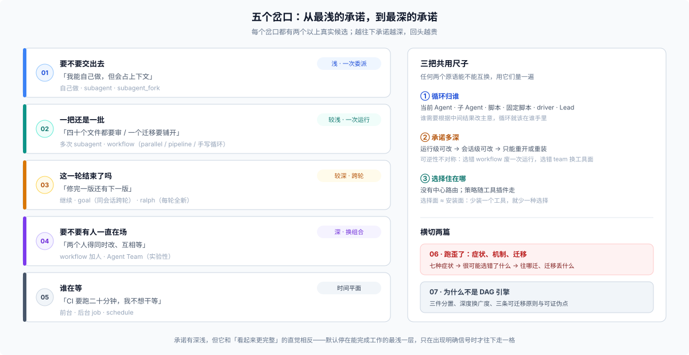

# 答案 27 · 五个岔口、三把尺子、一张诊断表

## 一分钟版

**「用 workflow 还是 Agent Team」不是能力选择题。** 它拆成两个不同维度的判断：**循环归谁**（谁持有「下一步做什么」的决定权），和**承诺多深**（你愿意为这件事预先固定多少东西：结构、时长、谁来推进）。DAG 是把「下一步做什么」全部预先写进图的极端形态——循环仍然存在，只是被图钉死了；DSH 把这条轴反过来，默认让循环留在代码或对话里，所以它的原语是承诺等级，不是拓扑类型。

**五个岔口**：要不要交出去（[01](./01-delegate-or-not.md)）、一把还是一批（[02](./02-fan-out-shape.md)）、这一轮结束了吗（[03](./03-cross-turn-and-fresh.md)）、要不要有人一直在场（[04](./04-persistent-team.md)）、谁在等（[05](./05-async-and-clock.md)，时间平面）。每个岔口都有两个以上真实候选，而选错的代价不对称——这才是它值得单独判断、而不是查表的原因。

三把尺子是词汇，四问是评估顺序，五个岔口是任务形状——外加一条前置规则：用户显式点名优先。它们不是四套并列的分类，而是同一件事的几个视角。

**DSH 没有中心选择器。** 每个工具把「什么时候用我」写在自己的 description 和 prompt 段里，所以**选择面 ≈ 安装面**：少装一个工具，模型就少一种选择，策略文本也一起消失。由此得到默认策略：用最浅的承诺把活干完，并认清哪几级不可逆。

这组数字说明它们不是替代品：workflow 一次运行默认最多 1000 个 child、单次 `parallel`/`pipeline` 最多 4096 项；Team 默认 16 个成员（profile 钉 8）、256 个任务；而委派深度默认只有 1 层。**它们是不同量级的东西，只是都能「把活分出去」。**

如果这件事其实是确定性的（跑测试、批量改名、解析日志），先别进岔口：直接用 `bash` / `run_code`。下面的路由表只处理需要模型判断的工作。

## 岔口路由表

| 你现在的信号 | 去 |
|---|---|
| 「用户已经点名要 workflow / Team / ralph」 | 先看 [00 的前置规则](./00-frame.md)，再进对应篇 |
| 「这个我能自己做，但会占上下文」 | [01](./01-delegate-or-not.md) |
| 「四十个文件都要审 / 一个迁移要铺开」 | [02](./02-fan-out-shape.md) |
| 「修完一版还有下一版」 | [03](./03-cross-turn-and-fresh.md) |
| 「两个人得同时改、互相等」 | [04](./04-persistent-team.md) |
| 「CI 要跑二十分钟，我不想干等」 | [05](./05-async-and-clock.md) |
| 「它好像选错了」 | [06](./06-diagnosis-and-migration.md) |
| 「为什么不是 DAG 引擎」 | [07](./07-why-this-shape.md) |

## 目录里都有什么

| 文件 | 回答什么 |
|---|---|
| [`question.md`](./question.md) | 问题怎么冒出来的、范围、与既有材料的分工 |
| `answer.md` | 本页：一页图、一分钟版、路由表、阅读顺序、如何加一篇 |
| [`00-frame.md`](./00-frame.md) | 三把尺子、前置规则与常见叠法；含这套框架不声称什么 |
| [`01`](./01-delegate-or-not.md) | 一件事要不要交出去：自己做 / `subagent` / `subagent_fork` |
| [`02`](./02-fan-out-shape.md) | 一把还是一批：多次委派 / `workflow` / 三种扇出形状 |
| [`03`](./03-cross-turn-and-fresh.md) | 跨轮：继续 / `goal` / `ralph` |
| [`04`](./04-persistent-team.md) | 持续协作：workflow 加人 / Agent Team |
| [`05`](./05-async-and-clock.md) | 谁在等：前台 / 后台 job（`jobs` 是控制面）/ `schedule` |
| [`06`](./06-diagnosis-and-migration.md) | 症状、机制、迁移路径与每次迁移丢什么 |
| [`07`](./07-why-this-shape.md) | 为什么不是 DAG 引擎、这套思路新在哪、可证伪点 |
| [`reference.md`](./reference.md) | 全部出处与核验状态 |
| `figures/*.svg` | 八张图（概念示意，不按比例），由对应页面嵌入：总览、三把尺子、上下文边界、扇出形状、时间形状、拓扑、时间平面、迁移地图 |

## 按什么顺序读

线性读：00 → 01 → 02 → 03 → 04 → 05 → 06 → 07。00 建立词汇，01–05 是五个决策点（05 在时间平面上），06 是出问题时翻的，07 是回头看为什么。

只想知道「这次选哪个」：读 00 的三把尺子、前置规则与四问、本页路由表、对应那一篇。06 留着跑歪了再看。

## 如何加一篇

这篇 FAQ 按场景组织，新增场景不动主干：

1. 在本页路由表加一行「信号 → 新篇」。
2. 新篇按七格写：场景（含触发信号）/ 候选 / 判据 / 官方边界 / 代价 / 反例与失败 / 出口。
3. 在 [`reference.md`](./reference.md) 按章登记出处与核验状态。
4. 跑 `node _faq_on_digested/verify.mjs`。

七格是骨架。可以在「候选」之后插一节操作件（prompt 模板、代码骨架、机制要点），但「判据」「代价」「反例与失败」「出口」四格不能省。需要新词汇时改 [`00-frame.md`](./00-frame.md)，不要在场景篇里另造一套——这是这套组织方式不退化成分散经验集的前提。

## 术语速查

| 词 | 白话 |
|---|---|
| **循环** | 「下一步做什么」的决定权在谁手里 |
| **承诺** | 开始之前就固定下来的东西：结构、时长、谁来推进；越深越难改 |
| **选择面** | 当前组合暴露给模型的工具与策略文本的总和，主要来自安装面 |
| **岔口** | 一个有两个以上真实候选、且选错有可观察后果的决策点 |
| **扇出** | 一次启动多个 child 并汇总结果；形状有三种，见 02 |
| **fresh / fork** | 子代理不继承 / 继承父的已完成轮次 |
