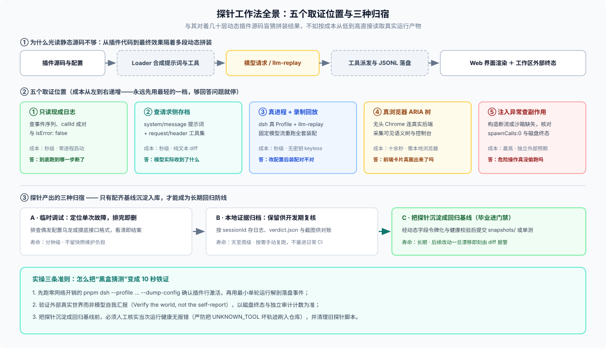
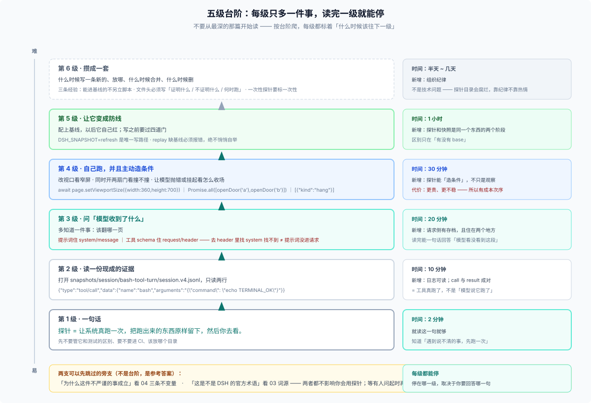

# 28/00 · 从最简单的开始：五级台阶

> 这一篇是入口。**不要从 01 顺着读** —— 按台阶爬，每一级只比上一级多一件事。每一级都标注：**它占了什么新东西**、**读完你能做什么**、**什么时候该往下一级走**。
>
> 全篇标题叫「五级台阶」：**第 1–5 级是主线，第 6 级可选**（组织纪律，跟具体技术无关）。下文出现「五级台阶」时都指第 1–5 级。
>
> 每一级的正文都很短。真正的细节在后面的编号篇里，**但你现在不需要它们**。

## 先看这一张图（30 秒）

如果只记一样东西，记这张：**一条你看不见的请求链，五个可以下钩的地方**。



看图的顺序：

1. **上半排**：你写的东西要经过六段才变成「模型看到的」和「你看到的」。**中间三段你从外面看不见** —— 这就是探针要解决的问题。
2. **中间排**：五个钩子，从左到右成本递增。**永远先问最左边那个够不够。**
3. **下半排**：同一次运行留下的记录只有三种归宿；只有最右边那种（配了基线）才会在以后救你。

## 再看这张：你要爬的台阶



> 从这一级开始会出现一个词：**毕业**。它的意思只有一个——**给一本探针配上基线，让它以后自己红**；配了基线的探针不再叫探针，搬进快照 / 期望目录（[05 的三档](./05-kinds.md) 有完整定义）。出门前先把它记住，后面就不再解释。

两个图配着看：**一页图告诉你什么可以问，台阶告诉你从哪问起。**

---

## 第 1 级 · 一句话（2 分钟）

**探针 = 让系统真跑一次，把跑出来的东西原样留下来，然后你去看。**

就这么多。先不要管它和测试的区别、要不要进 CI、该放哪个目录。

一个具体的画面：你怀疑「模型没看到我加的提示词」。探针的做法不是去读代码、不是去猜，而是**跑一次，把会话日志打开，翻到那一行看**。

```sh
# 跑一次（这里用回放模型，不需要 key）
pnpm dsh --profile headless --patch <回放补丁> "probe"

# 然后去看这次留下来什么
ls $DSH_HOME/sessions/*/session-*/     # 一次运行 = 一个目录 = 一份 .jsonl
```

**这一级占到的东西**：探针不是玄学，是「跑一次 + 留证据」。

**读完能做什么**：知道遇到说不清的事时，第一个动作是「跑一次再说」，而不是盯着代码想。

**什么时候往下一级**：你想知道"那份日志里到底该看哪一行"。

---

## 第 2 级 · 读一份现成的证据（10 分钟）

不用自己跑。仓库里已经有跑出来的东西。

打开主仓的这个文件：

```sh
snapshots/session/bash-tool-turn/session.v4.jsonl
```

24 行。**一行一个事件**，从头到尾就是一次完整的对话。只挑其中两行看：

```json
{"type":"tool/call","data":{"name":"bash","arguments":"{\"command\": \"echo TERMINAL_OK\"}"}}

{"type":"tool/result","data":{"message":{"content":[{"type":"text","text":"TERMINAL_OK\n"}],"isError":false}}}
```

**读懂这两行，你就已经会读一半的探针了**：

- 工具**真被调用了**（不是模型说它调了）；
- 命令**真跑成功了**（`isError: false`，输出是 `TERMINAL_OK`）；
- 两行是**一对**（`callId` 相同）——所以能靠"成对"发现中途死掉的运行。

**这一级占到的东西**：日志是可读的，不用工具也能读；一份日志能回答「到底发生了什么」。

**读完能做什么**：拿到任何一次会话，都能自己判断「这轮跑完了没有、工具成功没有」。

**什么时候往下一级**：你想问的是"模型**收到**了什么"，而不只是"发生了什么"。

> 细节：[07 实例一](./07-worked-examples.md) 把这条日志的 24 行全列出来了。

---

## 第 3 级 · 问「模型收到了什么」（20 分钟）

这一级多一个动作：**知道该翻哪一页**。

同一个场景目录 `snapshots/web/minimal-preset/` 里，除了日志还有两个文件：

```text
system-prompt.expected.md      You are a helpful software engineer assistant.
tool-schemas.expected.json     bash / read_image / working_directory
```

**这两个文件就是这次运行里，模型收到的东西。** 它们之所以单独存在，是因为 DSH 有一条规矩：

> 任何到达模型请求的东西，都必须能从会话日志重建。

而这里有一个**必须记住的坑**（也是这一级唯一的新知识）：

| 你想知道 | 该看哪个 |
|---|---|
| 提示词进请求了吗 | `system/message` 那一行（→ `system-prompt.expected.md`） |
| 工具集合对吗 | `request/header` 里（→ `tool-schemas.expected.json`） |

**去 `request/header` 里找 system，找不到，不代表提示词没进请求。** 这两个东西天生住在不同地方。

**这一级占到的东西**：请求侧有一份可离线检查的存档；两个东西住在两个地方。

**读完能做什么**：能一句话回答"模型到底看没看到这段提示词"。

**什么时候往下一级**：某个问题**根本不在日志里**——比如"页面看起来对吗"、"两个人同时动手会怎样"。

> 细节：[07 实例二](./07-worked-examples.md)。

---

## 第 4 级 · 自己跑一次，并且主动造条件（30 分钟）

前面三级都是"读"。这一级的动作是：**起一个真东西，并且推动它到平常不会出现的状态**。

三个具体动作，各一句话：

```js
// ① 改视口，看窄屏下那个按钮还在不在（真浏览器）
await page.setViewportSize({ width: 360, height: 700 })

// ② 同时开两扇门，看它们会不会撞（真并发）
const [a, b] = await Promise.all([openDoor('cfo'), openDoor('coo')])

// ③ 让模型"抛错"或"挂起"，看系统怎么收场（override 脚本）
[{ "kind": "hang", "readyFile": ".dsh-snapshot-stream-ready" }]
```

跑完你会得到**新的证据**，而不是日志里已有的证据。比如窄屏下 DOM 里多出一个 `Show more` 按钮，或者工作区里出现一份 `{"confineCalls":1,"spawnCalls":0}`。

**这一级占到的东西**：探针可以**创造条件**。它不只观察，它还能把系统逼到一个你平时碰不到的状态。

**读完能做什么**：遇到"只有特定条件下才出问题"的事，知道怎么把那个条件造出来。

**代价（这一级必须知道）**：越主动造条件，成本越高、越不稳定。所以有一个次序——**能读日志解决的，不要起进程；能起进程解决的，不要开浏览器。**

> 细节：[07 实例三、四](./07-worked-examples.md)，以及 [05 分类](./05-kinds.md)。
>
> **想知道这一级到底为谁而设**：这一级就是“探索式测试”的主场。探针不是测试的一种，是**探索的一种**——判据在现场形成、主动造条件、探索本身即产物，三条定义特征全对上了。看 [09 探针与探索式测试](./09-exploratory-testing.md)，那里把六步探索循环和四个观测接口对上了。

---

## 第 5 级 · 让它变成防线（1 小时）

到这一级，你已经有了一条好用的探针。**但它每次都要你来跑、你来读。** 那它永远只是一次调试。

这一级做的事情是：**给它配一份基线，让它以后自己红。**

```sh
# 确认这次的状态是对的，然后写成基线（注意：这是唯一的写路径）
DSH_SNAPSHOT=refresh pnpm run test:web

# 以后就跑比对，漂了就红
pnpm run test:web
```

写之前有四道门（[详情](./07-worked-examples.md)），其中最重要的是：**replay 模式下缺基线必须报错，绝不能悄悄自己生成一份新的**。因为把错状态写成基线，比没有基线更糟——之后每次比对都会以它为基准通过。

**这一级占到的东西**：探针和快照是**同一个东西的两个阶段**。区别只在"有没有 baseline"。

**读完能做什么**：知道什么时候该毕业、怎么毕业、什么时候**不该**毕业（一次性的排查不需要基线）。

> 细节：写入前的四道门就画在 [07 的目录形状图](./07-worked-examples.md) 里；想让它变成不会腐的基线机制，继续看 [FAQ 21](../21_recorded-session-snapshots/answer.md)。

---

## 第 6 级 · 攒成一套（半天到几天）

最后一级不是技术，是**组织**：什么时候写一条新的、放哪、什么时候合并、什么时候删。

三条经验，来自四个插件仓的实地校准（[08](./08-real-repos.md)）：

1. **能进基线的不另立脚本**——有了场景、有了门禁、有人审，就别再加一条探针。
2. **每条探针的文件头必须回答三句**：它证明什么、不证明什么、什么时候该跑。
3. **一次性的探针要标"一次性"**——服务某条已归档的验收行，保留供复跑，但不进任何命令清单。

**这一级占到的东西**：探针目录会腐烂，靠的是纪律而不是热情。

---

## 现在，按你的问题选入口

| 你的状态 | 从哪进 |
|---|---|
| 只想搞懂这个词 | 停下，第 1 级就够了 |
| 手上有个说不清的现象 | 第 2 级（先看有没有现成日志） |
| 要判断"模型看没看到" | 第 3 级 |
| 问题只有特定条件才出 | 第 4 级 |
| 想让它别再犯 | 第 5 级 |
| 要在团队里推广 | 第 6 级 |
| 想搞懂"为什么这一切成立" | [04 背后的原理](./04-principles.md)（**可以先跳过**） |
| 想搞懂"它是 DSH 的术语吗" | [03 词源](./03-why-the-word.md)（**可以先跳过**） |
| 想知道"它跟探索式测试什么关系" | [09 探索式测试](./09-exploratory-testing.md)（第 4 级读完再进） |
| 想知道"探完之后能不能沉淀成回归测试" | [11 沉淀五层资产](./11-what-probes-deposit.md)（第 5 级读完再进） |

后面 01–11 是**查询手册**，不是读物。遇到具体问题时再翻。想一眼看全两者关系，看 [answer.md](./answer.md) 的索引。
