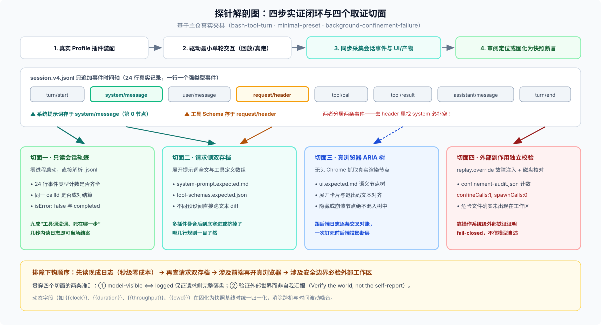

# 01 · 四个真实探针走查：戳了哪儿、回来什么、省掉了什么猜测

> **阅读提示**：DSH 主仓只保留“毕业”进门禁后的 [`snapshots/`](https://github.com/deepseek-ai/deepseek-harness/tree/master/snapshots) 场景，不提交临时调试脚本；但这些场景目录里的**会话事件轨迹、请求侧 sidecar、浏览器可访问性树和工作区校验文件**，跟你在插件开发期打探针捞回来的原始证据一模一样。下面四个实例全部取自主仓现成文件，你可以边读边在本地打开核对。



每次排障都按成本从低到高顺着问四句：**有现成日志能直接读吗 → 是发给模型的提示词/工具不对吗 → 是浏览器渲染出来的界面不对吗 → 是文件或子进程副作用不对吗？** 下面按这四个切面逐一拆开，每个实例都走固定的四步：**① 戳了哪儿 → ② 拿回来什么 → ③ 为什么是这个结果 → ④ 省掉了什么猜测**。

---

## 实例一 · 只读会话日志：零启动成本查清“到底跑到哪一步”

### ① 戳了哪儿

**不启动任何进程，不消耗一分钱 API 配额。** 直接打开主仓的 [`snapshots/session/bash-tool-turn/session.v4.jsonl`](https://github.com/deepseek-ai/deepseek-harness/blob/master/snapshots/session/bash-tool-turn/session.v4.jsonl)（如果排查你自己本机刚跑完的实时会话，则是对 `$DSH_HOME/sessions/<project>/session-<uuid>/session.v4.jsonl.zstd` 执行 `zstd -dc` 解压读取）。

### ② 拿回来什么

整份文件一共 **24 行**，一行就是一个带类型的 JSON 事件。把长流式分片折叠后，核心骨架一清二楚：

```json
{"type":"session","version":4,"id":"{{session:1}}","cwd":"{{cwd}}","delegationDepth":0}
{"type":"permission/preset","data":{"preset":"danger-full-access"}}
{"type":"sandbox/mode","data":{"mode":"danger-full-access"}}
{"type":"approval/policy","data":{"policy":"never"}}
{"type":"turn/start","data":{"turn":1}}
{"type":"step/start","data":{"turn":1,"step":1}}
{"type":"system/message","data":{"turn":1,"step":1,"message":{"role":"system","content":[{"type":"text","text":"{{system}}"}],"source":{"kind":"system-prompt"}},"surfaceOp":"append"}}
{"type":"user/message","data":{"content":[{"type":"text","text":"Use the bash tool to run exactly: echo TERMINAL_OK. Then reply with the single word DONE and stop."}],"source":{"kind":"user"},"role":"user"}}
{"type":"request/header","data":{"header":{"config":{"provider":"deepseek-official","model":"deepseek-v4-flash"},"tools":"{{tools}}"},"reason":"initial"}}
{"type":"tool/call","data":{"turn":1,"step":1,"callId":"call_00_fkbBRJsUrGKd1pWVc4Gn8233","name":"bash","arguments":"{\"command\": \"echo TERMINAL_OK\", ...}"}}
{"type":"job/registered","data":{"jobId":"{{id:1}}","kind":"bash","label":"echo TERMINAL_OK"}}
{"type":"job/settled","data":{"jobId":"{{id:1}}","status":"completed","detail":"exit code: 0"}}
{"type":"tool/result","data":{"turn":1,"step":1,"message":{"role":"tool","toolCallId":"call_00_fkbBRJsUrGKd1pWVc4Gn8233","content":[{"type":"text","text":"TERMINAL_OK\n"}],"isError":false}}}
{"type":"step/end","data":{"turn":1,"step":1}}
{"type":"step/start","data":{"turn":1,"step":2}}
{"type":"assistant/message","data":{"turn":1,"step":2,"message":{"role":"assistant","content":[{"type":"text","text":"DONE"}]}}}
{"type":"step/end","data":{"turn":1,"step":2}}
{"type":"turn/end","data":{"turn":1,"reason":{"kind":"completed"}}}
```

### ③ 为什么是这个结果

[`docs/subsystems/session.md`](https://github.com/deepseek-ai/deepseek-harness/blob/master/docs/subsystems/session.md) 第一段就定下了规矩：DSH 的 `Session` 是一份**只追加（append-only）的强类型事件日志**，也是整场对话唯一的事实源；发给大模型的消息历史是从这份日志实时派生出来的，绝不另外偷存一份私有内存状态。

### ④ 省掉了什么猜测

哪怕不写复杂脚本，光扫一眼事件序列就能当场拍死四类常见扯皮：

- **模型是真调了工具，还是嘴上说自己调了？** 看有没有 `tool/call` 以及后台任务的 `job/registered` → `job/settled`。
- **命令是跑成功了、报错了，还是半路卡死了？** 看同一个 `callId` 下 `tool/call` 和 `tool/result` 有没有成对出现，以及 `isError` 是不是 `false`。
- **这一轮正常收尾了吗？** 看末尾有没有 `turn/end` 且 `reason.kind` 为 `"completed"`。

九成“我怀疑某个工具没触发 / 会话卡住了”的疑问，在这一层花几秒钟读完事件统计就能结案，根本用不着开浏览器或重跑模型。

---

## 实例二 · 解剖请求侧存档：把“多插件装配猜谜”变成纯文本 diff

### ① 戳了哪儿

打开 [`snapshots/web/minimal-preset/`](https://github.com/deepseek-ai/deepseek-harness/tree/master/snapshots/web/minimal-preset) 目录。它的 [`snapshot.yml`](https://github.com/deepseek-ai/deepseek-harness/blob/master/snapshots/web/minimal-preset/snapshot.yml) 里写了 `header: { class: web-minimal, pin: true }`，让快照套件把日志里被占位符替换掉的“系统提示词”和“工具定义”单独展开成两个直观文件：

```text
snapshots/web/minimal-preset/
├── session.v4.jsonl              # 会话事件轨迹（内含 {{system}} 与 {{tools}} 归一化占位符）
├── system-prompt.expected.md     # 拼装渲染后的完整系统提示词
├── tool-schemas.expected.json    # 汇总给模型的完整工具 JSON Schema 数组
└── ui.expected.md                # 真浏览器渲染出的界面可访问性树（见实例三）
```

### ② 拿回来什么

- [`system-prompt.expected.md`](https://github.com/deepseek-ai/deepseek-harness/blob/master/snapshots/web/minimal-preset/system-prompt.expected.md) 全文只有干净的一行：
  ```text
  You are a helpful software engineer assistant.
  ```
- [`tool-schemas.expected.json`](https://github.com/deepseek-ai/deepseek-harness/blob/master/snapshots/web/minimal-preset/tool-schemas.expected.json) 里则是极简模式下仅保留的 3 个工具（`bash`、`read_image`、`working_directory`）及其精确参数定义。

再看主仓 [`packages/test-support/session-snapshot/src/suite.ts`](https://github.com/deepseek-ai/deepseek-harness/blob/master/packages/test-support/session-snapshot/src/suite.ts) 是怎么从原始日志里提取这两样东西的：

```ts
// 1. 系统提示词从 system/message 事件里抽
export function normalizedSystemPrompts(rawLog: string, ctx: NormalizeContext): string[] {
  return parseJsonlRecords(normalizeSessionLog(rawLog, ctx))
    .flatMap((record) => {
      const prompt = systemPromptOf(record)
      return prompt === undefined ? [] : [prompt]
    })
}

// 2. 工具 Schema 数组从 request/header 事件里抽
const schemaSets = normalizedToolSchemas(log.content, ctx)

// 3. 专门断言：首个 request/header 之前必须先有 system/message
export function systemPromptPrecedesRequests(rawLog: string): boolean {
  const types = parseJsonlRecords(rawLog).map(record => record.type)
  const firstHeader = types.indexOf('request/header')
  const firstPrompt = types.indexOf('system/message')
  return firstHeader < 0 || (firstPrompt >= 0 && firstPrompt < firstHeader)
}
```

### ③ 为什么是这个结果

这是 DSH 会话模型里非常关键的一处分离设计（见 [`docs/subsystems/session.md`](https://github.com/deepseek-ai/deepseek-harness/blob/master/docs/subsystems/session.md)）：

- **`request/header`** 记录的是请求信封（`EpochHeader`：模型提供商与参数配置 + **当前轮组装完成的工具 Schema 列表**）；
- **渲染后的系统提示词不在 `request/header` 里**，而是作为对话表面第 0 号节点写进了 **`system/message`** 事件。

自己写探针脚本查日志时如果不知道这条规矩，跑去 `request/header` 里翻 `system` 字段，百分之百会得出“我的提示词插件没生效！”的乌龙结论。

### ④ 省掉了什么猜测

一旦把这两份请求侧产物抽成纯文本，哪怕几十个插件叠在一起，**“开启某个插件到底往模型请求里塞了什么、挤掉了什么”就变成了一条肉眼可见的 `diff` 命令**。比如直接对比主仓默认 Web 模式（[`fresh-round-trip`](https://github.com/deepseek-ai/deepseek-harness/blob/master/snapshots/web/fresh-round-trip/system-prompt.expected.md)，35 行）和开启 PTC 代码编排模式（[`optional-string-editor`](https://github.com/deepseek-ai/deepseek-harness/blob/master/snapshots/web/optional-string-editor/system-prompt.expected.md)，953 行）的系统提示词：

```sh
diff -u snapshots/web/fresh-round-trip/system-prompt.expected.md \
        snapshots/web/optional-string-editor/system-prompt.expected.md
```

一眼就能看到 PTC 模式不仅在开头插入了“`run_code` 是唯一可直接调用的工具”，撤掉了独立的 `workflow` 提示段，还在末尾追加了九百多行供 `run_code` 内部调用的 TypeScript SDK 类型声明——半句源码都不用猜。

---

## 实例三 · 抓取真浏览器 ARIA 树：同时核对“后台干了什么”与“人眼看见了什么”

### ① 戳了哪儿

有些问题光看会话日志发现不了——比如日志里明明有 `tool/result`，但前端卡片样式写坏了、窄屏下按钮被挤没了，或者前端状态机漏处理了某个事件。这时打开同一个场景下的 [`snapshots/web/minimal-preset/ui.expected.md`](https://github.com/deepseek-ai/deepseek-harness/blob/master/snapshots/web/minimal-preset/ui.expected.md)。

它是启动无头真浏览器连上真实 Web 服务跑完回合后，由 [`apps/web/tests/scaffold.ts`](https://github.com/deepseek-ai/deepseek-harness/blob/master/apps/web/tests/scaffold.ts) 里的 `captureStableAria` 采集下来的**真实可访问性树（ARIA tree）**（本地自动化启动 Web 时若涉及目录选择，按仓库惯例加 `--patch apps/web/tests/pin-browse-picker.overlay.yml` 切到页内选择器）。

### ② 拿回来什么

整份 `ui.expected.md` 共 **31 行**，把页面上真正渲染出来的导航栏、工具卡片、回复正文和底栏状态完整列了出来：

```yaml
- banner:
  - navigation "Session hierarchy": Use the bash tool to
  - text: Minimal mode
  - button "More actions"
  - button "Open right sidebar"
  - tablist:
    - tab "Chat" [selected]
    - tab "Trajectory"
  - button "More conversation views"
- text: "Use the bash tool to run exactly: printf 'MINIMAL_BASH_CARD_OK\\n'. Then reply exactly MINIMAL_PRESET_REQUEST_OK and stop. {{clock}}"
- button "Copy"
- status: Completed
- button "Completed in {{duration}}" [expanded]
- button "Ran commands" [expanded]
- button "Bash printf 'MINIMAL_BASH_CARD_OK\\n'" [expanded]
- text: "IN { \"command\": \"printf 'MINIMAL_BASH_CARD_OK\\\\n'\" } OUT MINIMAL_BASH_CARD_OK [Command finished with exit code 0]"
- button "Inspect"
- paragraph: MINIMAL_PRESET_REQUEST_OK
- button "Copy"
- button "Good response"
- button "Bad response"
- button "Branch into a new conversation"
- text: {{clock}}
- textbox "Message or run a task, / commands, @ files or sessions"
- button "Add files or run commands"
- 'button "Access mode, current: Workspace Write"': Workspace Write
- button "Select model, current DeepSeek-V4-Flash": DeepSeek-V4-Flash
- button "Send message" [disabled]
- button "1 turns 2 steps · {{throughput}} tok/s": 1 turns 2 steps{{throughput}} tok/s
- button "28 tok · Cache hit 0%": 28 tokCache hit 0%
- button "0% of context used": 0%
```

> 注：像 `{{clock}}`、`{{duration}}`、`{{throughput}}` 这类每次运行都会变的时间与吞吐字段，均已被自动替换为固定占位符，保证跨机器回放时文本完全一致。

### ③ 为什么是这个结果

ARIA 可访问性树只收录**浏览器真正渲染并暴露给用户的可见语义节点**（被 `display: none` 或条件分支隐藏的元素不会混进来）；同时 DSH Web 客户端严格从会话事件投影界面，因此日志里的每一条事件都能跟这棵树逐行对上账：

| 会话日志里的后端事实 | 浏览器 ARIA 树里长出来的前端元素 |
|---|---|
| `web-minimal` 预设挂载 | 顶栏显示 `- text: Minimal mode` |
| `tool/call` 执行 `printf 'MINIMAL_BASH_CARD_OK\n'` | 展开卡片 `- button "Bash printf 'MINIMAL_BASH_CARD_OK\\n'" [expanded]` |
| `tool/result` 退出码 `0` 与标准输出 | 卡片正文 `OUT MINIMAL_BASH_CARD_OK [Command finished with exit code 0]` |
| 第 2 步 `assistant/message` 回复正文 | `- paragraph: MINIMAL_PRESET_REQUEST_OK` |
| 1 个 Turn 内走完 2 个 Step 并 `turn/end` | `- status: Completed` 与底栏 `1 turns 2 steps` |

### ④ 省掉了什么猜测

纯后端单测看不到前端组件有没有把数据吞掉，纯肉眼看截图又没法放进 Git 逐行比对（[`postmortem 0003`](https://github.com/deepseek-ai/deepseek-harness/blob/master/docs/postmortem/0003-web-agent-gui-feedback-loop.md) 就记录过 Agent 只起裸前端构建、没连真后端而误判 UI 正常的教训）。抓取真实全栈装配下的 ARIA 树，一次就把**前后端联调断层**和**视觉结构回归**全钉死了。

---

## 实例四 · 故障注入与工作区独立取证：证明“危险动作真的没发生”

### ① 戳了哪儿

最难验证的逻辑往往不是“正常路径输出了 A”，而是**“异常条件下，某件危险的事绝对没有偷跑”**。打开 [`snapshots/session/background-confinement-failure/`](https://github.com/deepseek-ai/deepseek-harness/tree/master/snapshots/session/background-confinement-failure)：这是一个专门验证“请求 `read-only` 沙箱但宿主机没有可用沙箱后端时，后台命令必须被死死拦住”的场景。

它的 [`snapshot.yml`](https://github.com/deepseek-ai/deepseek-harness/blob/master/snapshots/session/background-confinement-failure/snapshot.yml) 同时打开了两个开关：
- `replay: { override: true }`：通过 [`replay.override.json`](https://github.com/deepseek-ai/deepseek-harness/blob/master/snapshots/session/background-confinement-failure/replay.override.json) 注入脚本，驱动“模型”强行发起一条带 `run_in_background: true` 的写文件命令 `printf SHOULD_NOT_RUN > unexpected-command.txt`；
- `workspace: { final: true }`：要求跑完后把真实工作区目录跟独立的 [`workspace.expected/`](https://github.com/deepseek-ai/deepseek-harness/tree/master/snapshots/session/background-confinement-failure/workspace.expected) 做全量核对。

### ② 拿回来什么

跑完之后拿到两份互相印证的硬证据：

1. **会话日志里的 `tool/result`** 明确记录了拒绝原因：
   ```text
   [status: failed, sandbox mode "read-only" is requested but no sandbox backend is usable on this host; refusing to run the command unconfined. ...]
   ```
2. **工作区里的独立审计文件 [`workspace.expected/confinement-audit.json`](https://github.com/deepseek-ai/deepseek-harness/blob/master/snapshots/session/background-confinement-failure/workspace.expected/confinement-audit.json)** 全文只有一行：
   ```json
   {"confineCalls":1,"spawnCalls":0}
   ```
   并且整个工作区最终文件树里，**根本不存在 `unexpected-command.txt`**。

### ③ 为什么是这个结果

[`docs/subsystems/sandbox.md`](https://github.com/deepseek-ai/deepseek-harness/blob/master/docs/subsystems/sandbox.md) 规定沙箱封装必须 **fail-closed（失败即拒绝）**：找不到可用的强隔离后端（Linux 的 bubblewrap/Landlock 或 macOS 的 `sandbox-exec`）时直接报错终止，严禁静默降级为无保护裸跑。同时，`workspace.expected/` 是由编写者独立维护的外部预期状态，`record` 和 `refresh` 命令**永远不会自动覆盖改写它**（[`snapshots/AGENTS.md`](https://github.com/deepseek-ai/deepseek-harness/blob/master/snapshots/AGENTS.md)）。

### ④ 省掉了什么猜测

[`docs/testing.md`](https://github.com/deepseek-ai/deepseek-harness/blob/master/docs/testing.md) 有一条核心准则：**验证真实世界，别信模型的自我汇报（Verify the world, not the self-report）**：

- 光看模型回复“好的，我没有执行该命令”不可信——模型可能产生幻觉；
- 光看日志里没报错也不够——万一后台子进程已经脱离管控把文件写进磁盘了呢？
- **`confineCalls: 1`（确实走到了沙箱拦截点）+ `spawnCalls: 0`（连操作系统子进程都没拉起来）+ 工作区无残留文件**，三条外部铁证咬合在一起，才真正把“没偷跑”证得滴水不漏。

---

## 小结：四个探针切面一表速查

| 切面 | 观察对象 | 拿到什么证据 | 典型排障问题 | 成本与前提 |
|---|---|---|---|---|
| **1. 只读轨迹** | `session.v4.jsonl`（或解压 `.zstd`） | 事件序列、成对 `callId`、`isError` | 工具调没调？会话跑完没？死在哪一步？ | **最低**（零进程启动，秒级） |
| **2. 请求侧存档** | `system/message` + `request/header` | 完整系统提示词文本 + 工具 Schema 数组 | 插件注入的提示词或工具到底进请求没有？ | **低**（单轮回放或读现成日志） |
| **3. 浏览器渲染** | 真浏览器采集的 ARIA 树 + 控制台 | 可见语义节点树（如 `ui.expected.md`） | 后端有事件，前端卡片/按钮真画出来了吗？ | **中**（需启动无头浏览器与归一化） |
| **4. 外部副作用** | 故障注入脚本 + 真实工作区文件/计数 | `confinement-audit.json` 与目录终态 | 并发争抢、断流或提权被拒时，外部状态干净吗？ | **高**（需构造边界条件与独立校验） |

看懂了主仓现成材料里的这四个切面，下一步就是：**轮到你自己排查新插件问题时，怎么动手写一条干净不骗人的最小探针？什么时候该把它固化进测试套件？** 继续看 [`02-how-it-works-and-boundaries.md`](./02-how-it-works-and-boundaries.md)。
