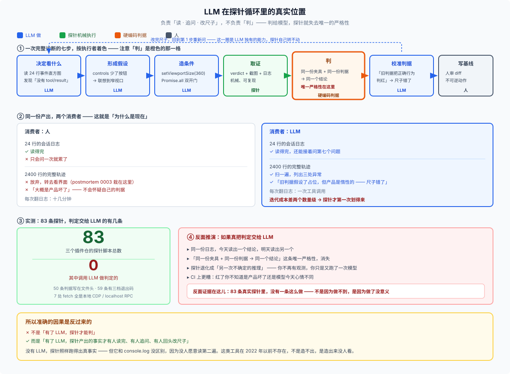
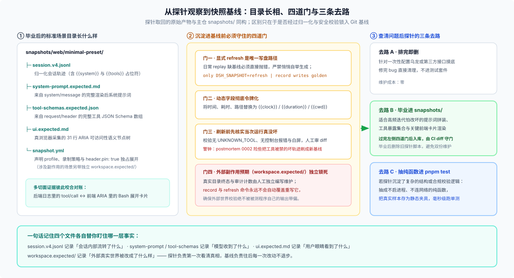

# 02 · 探针怎么写、什么时候“毕业”、有哪些事它证不了？

看完 [`01-four-real-probes.md`](./01-four-real-probes.md) 的四个真实切面后，这篇把背后的工程逻辑收拢清楚：**为什么这套办法在 DSH 里站得住脚、自己写最小探针要守哪几条规矩、怎么跟 Coding Agent 配合，以及它和正式回归测试的边界划在哪。**

---

## 一、支撑探针可信的三条 DSH 不变量（以及别认错同名函数）

探针之所以不是“碰运气式手工乱试”，是因为 DSH 底座保证了**同一份回放输入 + 同一条判定逻辑 = 永远给出同一个结论**：

1. **`model-visible ⟺ logged`（模型可见即落盘）**：无论是多插件拼出来的系统提示词（记在 `system/message`），还是动态汇总的工具 Schema 与模型参数（记在 `request/header`），全都作为一等公民写进会话日志。主仓甚至专门否决过“给会话日志删减瘦身”的提议，就是为了保住 100% 离线可重建性。
2. **日志格式公开且带单调版本号（`session.v4.jsonl`）**：运行时磁盘文件只是在 `.jsonl` 外面包了一层标准 `zstd` 压缩（`$DSH_HOME/sessions/<project>/session-<uuid>/session.v*.jsonl.zstd`）。外部诊断脚本直接 `zstd -dc` 解压就能逐行流式分析，完全不需要往业务包里塞调试开关。
3. **`@deepseek-ai/dsh-llm-replay` + `replay.override.json` 把外部不确定性关在门外**：常规路径用录制好的模型流替代在线 API；遇到日志本身表达不了的网络异常（如连接前报错、流式传一半断掉、请求无限挂起、触发自动重试），直接用 `replay.override.json` 精确注入故障（见 [`llm-replay` README](https://github.com/deepseek-ai/deepseek-harness/blob/master/packages/test-support/llm-replay/README.md)）。

### 顺手辨析：主仓代码里搜到的 `probe` 分别是什么？

由于 `probe` 在计算机工程里本来就是通用词（类似健康检查 `liveness probe` 或内核 `kprobe`），你在 DSH 主仓搜这个词会撞见两类完全不同的东西，别混为一谈：

- **产品运行时环境自检（不是本文讲的开发探针）**：比如启动或装包时并发测公共 npm 源延迟的 `ctx.pluginRegistryProbe`、Linux 下扫 `PATH` 看有没有装 `zenity`/`kdialog` 的 [`directory-picker-auto/src/probe.ts`](https://github.com/deepseek-ai/deepseek-harness/blob/master/packages/host/directory-picker-auto/src/probe.ts)、沙箱可用性探测 `landlock --probe`，以及用 `process.kill(pid, 0)` 探子进程死活。它们是产品代码自己跑的自动分支判断。
- **开发期诊断与取证入口（与本文同族）**：比如不发任何模型请求、直接打印最终 Profile 装配树的 `dsh --profile <name> --dump-config`，跨进程测 SSH 握手协议的 [`scripts/ssh-helper/probe.ts`](https://github.com/deepseek-ai/deepseek-harness/blob/master/scripts/ssh-helper/probe.ts)，以及打印 Windows 原生结构体偏移量的 [`abi-probe.cpp`](https://github.com/deepseek-ai/deepseek-harness/blob/master/packages/subprocess/win32-process/verify/abi-probe.cpp)。

---

## 二、动手写一条最小探针：六条防自欺铁律

自己给插件写诊断探针时，最怕的不是报错，而是**“探针脚本看着全绿退出，其实压根没测到你想测的东西”**。下面六条是从真实踩坑事故里提炼出来的实操规矩：

1. **先走零成本入口，别上来就开真浏览器烧真模型**
   排查装配问题先跑 `dsh --profile ... --dump-config` 看插件行有没有激活；再跑单轮回放看 `system/message` 和 `request/header`；确认后端事件全对、只有界面不对时，最后才拉起无头浏览器。
2. **测常驻提示词时，必须封死“模型调工具现查”这条旁路**
   如果你想验证某段上下文有没有默认注入首轮系统提示词，千万别只问模型“当前配置是什么”——聪明的模型发现提示词里没有，会顺手调 `read` 或 `bash` 工具去查文件再答对，让你误以为提示词注入成功了！正确探法是在单轮指令里写死：**“禁止调用任何工具；只根据你眼前已有的上下文回答，没看到就直说没看到。”**
3. **写 `--patch` 替身补丁时，严防“静默回退到真模型”**
   用 `--patch` 把真模型替换成回放桩或替换某个 Runner 时，如果目标条目 `id` 拼错、或者漏关了自带的冲突条目，加载器可能只打一行 `entry not found` 提示，随后由原装在线模型照常把话接过去——表面看运行成功，其实替身根本没挂上。动跑前务必先用 `--dump-config` 或检查日志里的 `request/header` 确认挂载生效。
4. **退出码严格分三档，绝不把“缺环境”当成“通过”**
   特别是让自动化脚本或 Coding Agent 调探针时，退出码就是机器合同：
   - `0`：前置环境正常，且观测结果符合预期；
   - `1`：前置环境正常，观测结果**不符合判据**（实打实抓到了问题）；
   - `2`（`BLOCKED`）：本机没装 Chrome、没配 `DEEPSEEK_API_KEY`、缺 `zstd` 或目标服务没起来——**环境未就绪必须显式非零退出，绝对不能静默跳过返回 `0`**。
5. **并行环境下按目录差分或 `sessionId` 拿日志，别用 `ls -t` 猜“最新一个”**
   当你同时开着 Web 窗口或跑着后台任务时，`ls -t $DSH_HOME/sessions/...` 极易扫到隔壁会话的日志。稳妥做法是运行前快照一次目录列表、运行后做集合差集，或者直接从输出 JSON 里读取本次生成的 `sessionId`；输出截图与 `verdict.json` 时也做到每次覆盖清理旧失败图，防止上次遗留的 `failed.png` 躺在绿跑旁边误导人。
6. **先亲手把被测条件改坏一次，确认探针真能报红**
   一条从未报红过的探针，和一段空跑的废代码在外观上没有任何区别。写完后故意删掉一行注入或改小视口宽度，亲眼看它退出 `1` 并留下准确证据，再恢复现场。若准备长期保留该脚本，在文件头用三行注释写清：**它证明什么、不证明什么、改了哪块代码时该跑它**。

---

## 三、和 Coding Agent 怎么配合？——让它读日志改尺子，别让它当裁判

上千行的会话 JSONL 和一长串 ARIA 节点树，人肉眼翻两遍就眼花了，但喂给 Coding Agent 却是它的拿手好戏。不过人机分工有一条绝对不能跨过去的红线：

- **该交给 Agent 干的四件事**：① 扫完几千行事件日志快速揪出哪一步断了（比如少了 `tool/result`）；② 根据缺失现象提出假设并写出构造条件（如 `page.setViewportSize({ width: 360, height: 700 })` 或 `Promise.all` 并发争抢）；③ 帮人发现“探针自己的旧判据写错了，把合法的延迟加载误判成了失败”；④ 按统一规范编写和整理探针脚本。
- **绝不能交给 Agent 干的两件事**：① **不能在探针里调大模型判断“这次运行算 Pass 还是 Fail”**——一旦裁决靠模型推理，同一份日志跑两次可能给出相反结论，探针就彻底沦为玄学（对外部多个插件仓 83 个真实探针脚本的盘点里，调 LLM 做判定的比例也是严格的 **0**）；② **不能让 Agent 不经人工审阅 diff 就直接覆盖测试基线**。

---

## 四、探针跑完怎么收尾：扔掉、留档，还是“毕业”进门禁？

探针查清真相之后，按问题的复发概率有三条完全不同的去路：

1. **一次性疑难杂症 → 当场结案或只留本地证据目录，不进测试套件**
   只是为了确认某个第三方 API 返回格式或排查一次偶发配置乌龙，看清事实修好代码就够了，没必要为一次性问题背上长期维护快照的包袱。
2. **稳定的请求拼装或界面契约 → 过完“四道门”后毕业为录制快照（`snapshots/`）**
   如果某块提示词拼装、工具暴露列表或关键 UI 卡片以后每次发版都怕改坏（比如同一个地方第三次靠手工打探针抓回归），就该给它配一份提交进 Git 的期望基线（详见 [FAQ 21](../21_recorded-session-snapshots/answer.md)）。如上图中间一列所示，转正前必须守住四道门：
   - **唯一写路径**：只有显式执行 `DSH_SNAPSHOT=refresh`（或录制命令）才允许写基线；日常回放缺基线必须直接报错，严禁悄悄自举生成一份新基线；
   - **抹平动态字段**：时间戳、耗时、工作目录路径、随机 ID 必须归一化为 `{{clock}}`、`{{cwd}}` 等固定令牌，否则 CI 天天误报红灯；
   - **先人工确认这趟运行真没坏，再刷新基线**：[`postmortem 0002`](https://github.com/deepseek-ai/deepseek-harness/blob/master/docs/postmortem/0002-js-expression-disabled-filesystem-tools.md) 踩过一个经典大坑——7 个文件系统场景因配置表达式失误导致工具被禁用、日志里全是 `UNKNOWN_TOOL` 报错，但因为回放本身是确定性的，跑刷新时差点把“工具全挂了的坏轨迹”当成新标准答案存进仓库！所以刷新前必须配独立于转录文本的语义检查，并人工过目 diff；
   - **外部副作用单独锁死**：像 `workspace.expected/` 这种验证真实文件结果的目录必须独立维护，不能让刷新脚本顺手覆盖。
3. **复杂的文本/结构校验逻辑 → 抽成纯函数进常规单测（`pnpm test`）**
   如果你的探针里写了一段精巧的解析或合规检查逻辑（例如检查输出 JSON 结构或文档引用完整性），**正确沉淀方式是把这段判定逻辑抽成不启进程、不连网络的纯函数，再把探针捞回来的真实输出存成静态测试样本喂给单测**——这样 `pnpm test` 毫秒级就能跑完你的判据测试，同时把慢速的真模型/真浏览器驱动脚本留在门禁之外按需手动触发。而且一旦某条验证已经进了正式快照或单测，就删掉旧探针脚本，避免同一件事维护两份代码。

---

## 五、能力上限：哪五件事靠探针也证明不了？

把边界摊在明面上，才能避免拿探针当万能挡箭牌：

1. **没毕业的探针证明不了“明天不会坏”**：没有基线和 CI 自动比对，它只对刚刚跑过的那一次负责。
2. **回放探针证明不了真模型的遵从度与推理质量**：回放流证明“菜按菜单端上桌了”，至于真模型吃不吃、会不会无视某句软提示词，只能靠带密钥的真模型 `test:e2e` 验证。
3. **探不到没写进日志且没落盘的纯内存瞬态**：如果某个插件内部缓存泄漏但既不影响请求头、也不写日志和磁盘，常规会话探针看不到它，得上专门的性能基准（`.perf.ts`）或内存剖析工具。
4. **机器退出码 `0` 证明不了产品交互设计合理**：探针能准确告诉你“360px 窄屏下右侧按钮消失了”，但“窄屏下这个按钮究竟该收进更多菜单还是保留在外面”，属于产品与人的需求决策，机器替不了。
5. **日志里的文字自述证明不了外部世界真改对了**：只要涉及写文件、起沙箱、改外部状态，永远以真实文件系统与独立计数为准，不拿模型回复或拼出来的提示文本当最终凭据。
