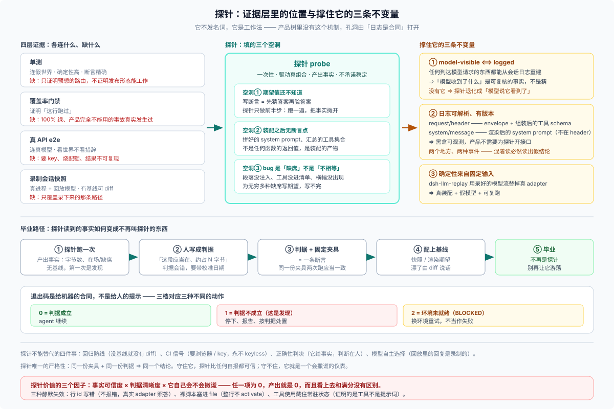

# 28/02 · 和测试的分工：四种证据各买到什么

> **查询手册，不是读物。** 如果你现在只是想知道「为什么不叫它测试」，[00 第 1 级](./00-ladder.md) 那段就够了；本篇是给需要在评审里论证分工的人。
>
> 本篇的对照表是本篇的说法，不是 DSH 的分层。DSH 自己的测试分层（unit / coverage / e2e / expected / snapshot / web）定义在 [`docs/testing.md`](../../docs/testing.md)，下表把它们与探针放在一起只是为了让「谁答哪个问题」一眼可见。

## 先看一张分工表

| 证据 | 连什么 | 确定性 | 断言 | 缺陷 |
|---|---|---|---|---|
| **单测**（`pnpm run test`） | 假的世界：假时钟、假 adapter、`new` 出来的服务 | 高 | 精确 | 只证明「这次调用链按我预想的路由走」，不证明发布形态能工作 |
| **覆盖率门禁**（`test:coverage`） | 同单测 | 高 | 行级 | 证明「这行跑过」，不证明「这行为对」。100% 绿、产品完全不能用的事故在仓库里发生过 |
| **真 API e2e**（`test:e2e`） | 真模型、真网络 | 低（无 key 自跳，回复不确定） | 粗（看世界，不看措辞） | 需要 key、耗配额、结果不可复现 |
| **录制会话快照**（`test:snapshot`） | 真进程 + 回放模型流 | 高 | 有基线、可 diff | 需要前置搭建；只覆盖录下来的那条路径；维护成本随场景数线性增长 |
| **探针** | 真的组合（进程 / 浏览器 / 真或回放的模型） | 低 | 无基线，产出**事实** | 不进 CI、不防回归、要人读 |

前三行的定义都在主仓里：核心那句判据是「**覆盖率证明『行跑过』，不证明『按发布形态工作』**」（[`docs/testing.md`](../../docs/testing.md) 的 Tiers 一节）。这也是探针存在的第一层理由——**有些事实，测试这个词本身就不承诺**。

## 探针补的是哪三个空洞

### 空洞一：断言要能写下来，才轮得到测试

测试的形态是「给定 X，期望 Y」。但坐在 bug 现场时，你往往**还不知道 Y 应该是什么**——你只知道「它现在不对」。这时写断言等于先猜答案再验答案。探针允许你只做前半步：**跑一遍，把原始事实摊开**。

插件仓的探针文件头几乎都带着这段结构，指名道姓地写「为什么猎它」「判据（某日期校准版 v2）」「退出码 0/1/2 分别是什么意思」——因为**判据本身是探针的产物之一**。判据定下来之后，它才可能变成测试。

### 空洞二：装配之后的系统没有单一断言点

DSH 上跑起来的是「几十个插件按 cordis.yml 装配出来的进程」。系统提示词由多段注入拼成，工具集合由 registry 汇总，会话日志按 step 追加。这时「改的这一段到底进没进请求」不是任何一个函数的返回值——它是**装配的产物**。

判据句在主仓里写得很直白：**只有真装备才能钉住组装后的提示词与工具集合**。而更快、更便宜的看装配的办法不是录一条基线，是**跑一次，把日志拆开量一遍**。插件仓的 session 探针干的就是这件事：跑一个 one-shot，只让模型「从已经摆在眼前的东西里回答，不许调工具」，然后逐段量 system prompt 的字节数。如果模型诚实地说「我没有看到」，那是一次**发现**，不是一次失败。

### 空洞三：有些结论是「不存在」，而不是「不相等」

一类最难的 bug 是**缺席**：面板没挂上、段落没注入、工具没进清单、横幅没出现。断言「东西在」很容易，「东西不在」在测试里几乎无法穷举——你没法为无穷多种缺席写期望。

探针的形态天然适合这件事：它把**当前有什么**完整打印出来，缺席就表现为「该有的那份不在」。插件仓有探针把这一句写进文件头：因为「没有横幅」也要能被机器看见，所以它先等一个 ready token，等不到就非零退出、不再照拍——照拍出来的空图无法区分「确实没有横幅」与「页面根本没加载」。

## 反过来：探针不能替代什么

四条边界，越界就会把探针用坏：

| 探针不给你的 | 为什么 | 该用什么 |
|---|---|---|
| **回归防线** | 没有基线就没有 diff，今天绿不证明明天不坏 | 录制会话快照或渲染期望 |
| **CI 信号** | 需要浏览器 / key / 真模型，永不 keyless | 单测 + `test:snapshot` |
| **正确性判决** | 它给事实，判断在人；同一份日志两个人可能读出两个结论 | 先把判据写下来，再谈判决 |
| **模型自主选择的证据** | 回放车道里的回复是**录制的**，不是模型选的 | 真模型 e2e |

最后一条很容易踩：用 keyless 回放跑出来的探针，能证明「请求侧长什么样」，**不能**证明「模型在看到这个请求后会怎么做」。外仓的探针文件头专门写了一行：固定的回放回复不代表模型自主选择。

## 一个真实的分工例子

同一次改动「给会话注入一段新上下文」，四条证据各自负责一段：

1. **单测**：注入函数本身拼出的字符串对不对（假输入，精确断言）。
2. **探针**：真跑一个 one-shot，量这段在 system prompt 里占多少字节、有没有被后面的段挤掉（真装配，产出事实）。
3. **快照**：把这次运行的 `request/header` 与会话日志固化，以后改动了漂没漂由 diff 说话（有基线，防回归）。
4. **真 API e2e**：真模型拿到这段上下文之后，行为有没有按预期改变（真模型，验证语义）。

四条都不能省，也不能互相顶替。**探针在这条链里是唯一回答「此刻真装配出来的是什么」的那一环。**
