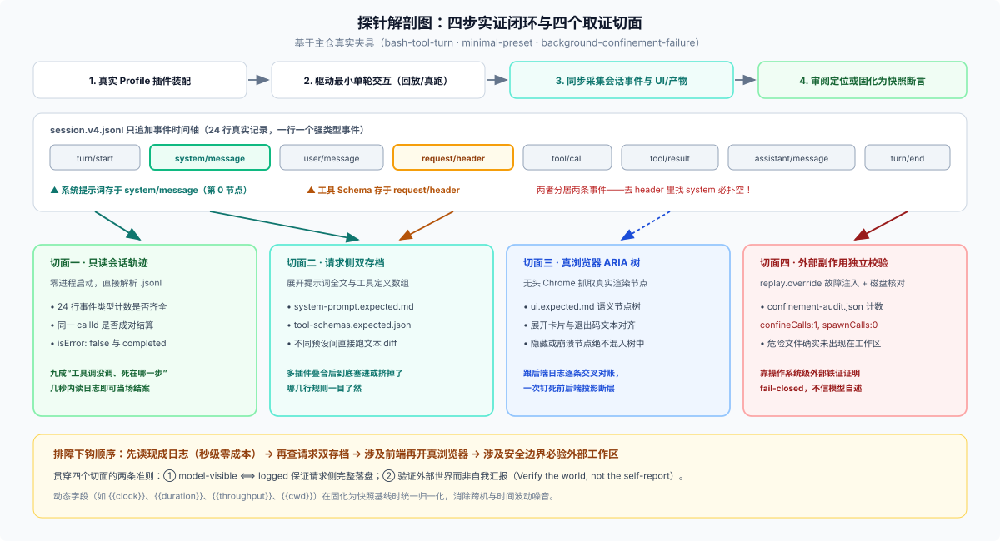
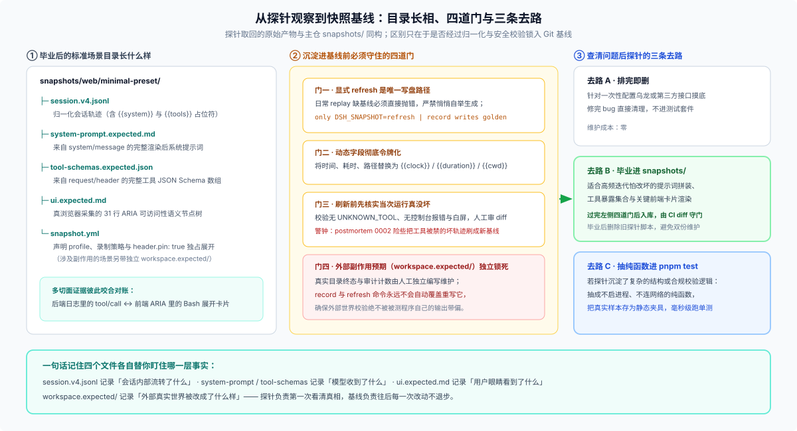

# 28/07 · 四个实例：探针上去到底戳了什么、回来什么、为什么是那个结果

> 这篇只用**主仓 DSH 自己的原生材料**：`snapshots/` 里已提交的真实夹具、`dsh-session-snapshot` 的真实读取函数、`apps/web/tests/` 的真实渲染快照。每一条你都能在仓库里打开核对。
>
> **读之前先爬完 [00 的第 3–4 级](./00-ladder.md)**。没有那两级垫底，这一篇会显得只是在看四份日志。
>
> 五段固定结构：**① 戳了哪儿 → ② 回来的原始材料 → ③ 结果 → ④ 为什么是这个结果 → ⑤ 这份结果买到了什么**。
> 本目录的两张图分别对应本文的两端：[anatomy-of-a-probe.svg](./figures/anatomy-of-a-probe.svg) 是日志时间线上被打的四个点，[scenario-directory.svg](./figures/scenario-directory.svg) 是一个场景目录与四道毕业门。证据层的全景在 [02](./02-probe-vs-tests.md)。



## 先看目录形状：所有 native 证据都长成这一副样子

不管探针戳的是什么，最后都会收敛到同一套目录形状。图里以 `snapshots/web/minimal-preset/` 为例：一份轨迹 + 三个 sidecar + 一份契约；右侧是写入基线前的四道门，和产出的三种归宿。



四份文件各自回答一句不同的话，**这才是这套目录存在的理由**：

| 文件 | 回答哪句话 | 来自哪个原生事件 |
|---|---|---|
| `session.v4.jsonl` | 系统内部发生了什么 | 完整轨迹，一行一个类型化事件 |
| `system-prompt.expected.md` | 模型收到的提示词是什么 | `system/message`（surface 节点 0） |
| `tool-schemas.expected.json` | 模型能调哪些工具、签名如何 | `request/header` → `header.tools` |
| `ui.expected.md` | 人眼看到了什么 | 真浏览器渲染出的可访问性树 |
| `workspace.expected/` | 世界被改成了什么样 | 独立 oracle，不随录制变化 |

## 前置：为什么非得"戳"一下

因为 DSH 里最要紧的那几样东西，**没有任何函数的返回值能告诉你**：

| 你想知道 | 它是什么 | 为什么读代码读不出来 |
|---|---|---|
| 模型这一次请求里装了什么 | 装配产物 | 系统提示词是多个插件各自注入后拼成的 **surface 节点 0**；工具集合是 registry 汇总的 schema 数组 |
| 这个页面此刻长什么样 | 渲染产物 | 同一份 DOM 在不同宿主、视口、连接态下完全不同 |
| 这条流程真走通没有 | 跨进程结果 | 经过 HTTP、WebSocket、子进程、模型调用；断在哪一环，代码都是对的 |

而 DSH 之所以允许你戳得这么轻松，是因为一条硬规则：

> **model-visible ⟺ logged**：任何到达模型请求的东西，都必须能从会话日志重建。

这条规则本来是给持久化用的（恢复、fork、SDK 投影），副作用是**请求侧永远有一份可离线解析的存档**。探针不需要被测对象配合，只要会后处理这个文件。

---

## 实例一 · 只读探针：一份日志里到底有什么

### ① 戳了哪儿

**什么都没启动。** 直接读主仓已提交的夹具 `snapshots/session/bash-tool-turn/session.v4.jsonl`——这是 `profile: headless`、`recording: authored` 的一条完整回合。

### ② 回来的原始材料

24 行，一行一个类型化事件。**原文**（省掉 `data` 里的长字段）：

```text
{"type":"session",            "version":4, "id":"{{session:1}}", "cwd":"{{cwd}}", "delegationDepth":0}
{"type":"permission/preset",  "data":{"preset":"danger-full-access"}}
{"type":"sandbox/mode",       "data":{"mode":"danger-full-access"}}
{"type":"approval/policy",    "data":{"policy":"never"}}
{"type":"agent/inbox/spliced","data":{"target":"next-turn","start":0,"inserted":[{"content":[{"type":"text","text":"Use the bash tool to run exactly: echo TERMINAL_OK. Then reply with the single word DONE and stop."}],"source":{"kind":"user"},"role":"user","id":"{{message:1}}"}]}}
{"type":"turn/start",         "data":{"turn":1}}
{"type":"agent/inbox/spliced","data":{"target":"next-turn","start":0,"removedCount":1,"inserted":[]}}
{"type":"step/start",         "data":{"turn":1,"step":1}}
{"type":"system/message",     "data":{"turn":1,"step":1,"message":{"role":"system","content":[{"type":"text","text":"{{system}}"}],"source":{"kind":"system-prompt"},"id":"{{message:2}}"},"surfaceOp":"append"}
{"type":"user/message",       "data":{"content":[{"type":"text","text":"Use the bash tool to run exactly: echo TERMINAL_OK. …"}],"source":{"kind":"user"},"role":"user","id":"{{message:3}}"}}
{"type":"user/message",       "data":{"content":[{"type":"text","text":"Current runtime context. …  Current working directory: \"{{cwd}}\"."}],"source":{"kind":"runtime-context", …}}
{"type":"request/header",     "data":{"header":{"config":{"provider":"deepseek-official","model":"deepseek-v4-flash"},"tools":"{{tools}}"},"reason":"initial"}}
{"type":"request/context",    "data":{ … provider/model/capacity … }}
{"type":"session/title",      "data":{ … }}
{"type":"assistant/message",  "data":{"turn":1,"step":1,"message":{"role":"assistant","content":[{"type":"tool-call","id":"…","name":"bash","arguments":"{\"command\": \"echo TERMINAL_OK\", …}"}]},"stream":[…]}}
{"type":"tool/call",          "data":{"turn":1,"step":1,"callId":"call_00_fkbBRJsUrGKd1pWVc4Gn8233","name":"bash","arguments":"{\"command\": \"echo TERMINAL_OK\", \"description\": \"Echo TERMINAL_OK to verify terminal access\", \"justification\": \" \\t\\n \"}"}}
{"type":"job/registered",     "data":{ … jobId … }}
{"type":"job/settled",        "data":{ … jobId … }}
{"type":"tool/result",        "data":{"turn":1,"step":1,"message":{"role":"tool","source":{"kind":"tool","callId":"call_00_fkb…"},"toolCallId":"call_00_fkb…","content":[{"type":"text","text":"TERMINAL_OK\n"}],"isError":false,"id":"{{message:5}}"},"meta":{"cwd":"{{cwd}}"},"sourceEventSeqs":[14],"surfaceOp":"append"}}
{"type":"step/end",           "data":{"turn":1,"step":1}}
{"type":"step/start",         "data":{"turn":1,"step":2}}
{"type":"assistant/message",  "data":{"turn":1,"step":2,"message":{"role":"assistant","content":[{"type":"text","text":"DONE"}]}}}
{"type":"step/end",           "data":{"turn":1,"step":2}}
{"type":"turn/end",           "data":{"turn":1,"reason":…}}
```

### ③ 结果

`turnEnded: true`；`tool/call` 与 `tool/result` **成对**，`isError: false`，`content` 是 `TERMINAL_OK\n`；两个 step：step 1 调工具，step 2 收尾输出 `DONE`。

### ④ 为什么是这个结果

因为这份日志**不是摘要，是完整轨迹**。DSH 的会话定义就在这里：

> A `Session` is an **append-only log** of typed `SessionEvent`s — the single source of truth for an agent's whole interaction history. The LLM message history is *derived* from the log, never stored separately.

所以「数一数」就能得到确定答案——**没有任何一步需要去猜**。

### ⑤ 这份结果买到了什么

- `tool/call` 与 `tool/result` 数量相等？→ 有没有中途死掉。
- `tool/result.message.isError` 是 `false`？→ 命令真跑成功了，不是「模型说它跑了」。
- step 数量与 `turn/end` 在不在？→ 这一轮收口了没有。
- 类型直方图异常的那一类立刻显形。

**这是最便宜的一档，也是你永远应该先试的那一档**：这一档能在几秒内结束掉大部分「我怀疑它没跑到」的疑问，不用起浏览器、不用烧模型。

---

## 实例二 · 请求侧：提示词和工具，到底以什么形态进了请求

### ① 戳了哪儿

同一份日志，但这次读的是**请求侧存证**——主仓把这三样东西各自切成了独立的 sidecar，这本身就是最直白的答案：

```text
snapshots/web/minimal-preset/
├── session.v4.jsonl              ← 会话轨迹（里面是令牌化的引用）
├── system-prompt.expected.md     ← 渲染后的系统提示词全文
├── tool-schemas.expected.json    ← 组装后的工具 schema 数组
└── ui.expected.md                ← 渲染出来的界面（实例三）
```

`snapshot.yml` 声明了它的身份：

```yaml
version: 1
scenario: minimal-preset
profile: web
composition: web-minimal
recording: authored
header:
  class: web-minimal
  pin: true          # ← 这个场景独占拥有上述 prompt / schema sidecar
```

### ② 回来的原始材料

**系统提示词 sidecar** 全文只有一行：

```text
You are a helpful software engineer assistant.
```

**工具 schema sidecar** 是 3 个工具（`bash` / `read_image` / `working_directory`），第一个长这样：

```json
{
  "name": "bash",
  "description": "Run commands in a bash shell\n* When invoking this tool, the contents of the \"command\" parameter does NOT need to be XML-escaped.\n* Network access depends on the task environment. Prefer configured mirrors/proxies when they are available.\n* State is persistent across command calls and discussions with the user.\n* To inspect a particular line range of a file, e.g. lines 10-25, try 'sed -n 10,25p /path/to/the/file'.\n* Please avoid commands that may produce a very large amount of output.\n* Please run long lived commands in the background, e.g. 'sleep 10 &' or start a server in the background.",
  "parameters": {
    "type": "object",
    "properties": {
      "command": { "type": "string", "description": "The bash command to run. Relative path is preferred in the command." }
    },
    "required": ["command"]
  }
}
```

而日志里对应的两行是**令牌化**的：

```json
{"type":"system/message","data":{"turn":1,"step":1,"message":{"role":"system","content":[{"type":"text","text":"{{system}}"}],"source":{"kind":"system-prompt"},"id":"{{message:2}}"},"surfaceOp":"append"}}
{"type":"request/header","data":{"header":{"config":{"provider":"deepseek-official","model":"deepseek-v4-flash"},"tools":"{{tools}}"},"reason":"initial"}}
```

### ③ 结果

主仓的读取函数把两者**分开取**，而这是理解整套机制的关键：

```ts
// packages/test-support/session-snapshot/src/suite.ts
export function normalizedSystemPrompts(rawLog, ctx): string[] {
  return parseJsonlRecords(normalizeSessionLog(rawLog, ctx))
    .flatMap((record) => { const p = systemPromptOf(record); return p === undefined ? [] : [p] })
}
export function normalizedToolSchemas(rawLog, ctx): unknown[][] {
  return toolSchemasFrom(normalizedHeaders(rawLog, ctx))   // ← 从 request/header 里取
}
```

还有一个**成文断言**，专门钉住这两者的先后关系：

```ts
/** Whether every model request in a session JSONL is preceded by its system prompt */
export function systemPromptPrecedesRequests(rawLog: string): boolean {
  const types = parseJsonlRecords(rawLog).map(record => record.type)
  const firstHeader = types.indexOf('request/header')
  const firstPrompt = types.indexOf('system/message')
  return firstHeader < 0 || (firstPrompt >= 0 && firstPrompt < firstHeader)
}
```

### ④ 为什么是这个结果

**因为系统提示词不在请求头里。** 这不是实现细节，是明确的设计决定：

> The rendered system prompt is not part of the header: it is derived history — the `system/message` event at surface node 0 and any later in-history system node.

而 `request/header` 装的是另一件事：

> The request envelope — the `EpochHeader` (call config + markers for adapter-supplied defaults + **assembled tool schemas**) — is logged session state, so every conversation request is a pure function of the log.

两条合起来推出一个后果，这是**探针工作法里最容易踩的一脚**：

| 你心里问的那句话 | 该读哪 | 读了会怎样 |
|---|---|---|
| 提示词进请求了吗 | `system/message`（节点 0） | 在 = 进了 |
| 工具集合对吗 | `request/header.header.tools` | 数组内容就是答案 |
| 去 `request/header` 找 system | —— | **找不到 ≠ 没进请求**，会得出相反的错误结论 |

### ⑤ 这份结果买到了什么

一个可以直接对比的画面。同一个仓库里，两份场景的系统提示词**并排一 diff，差异就是那次装配改了什么**：

```sh
diff snapshots/web/fresh-round-trip/system-prompt.expected.md \
     snapshots/web/optional-string-editor/system-prompt.expected.md
```

```diff
  4a5,6
> `run_code` is the only tool you can call directly — a tool call naming any other tool fails.
> Reach every tool the SDK declares below from inside the program.
  27,28d28
< Use the workflow tool ONLY when the user explicitly asks for a workflow …
  29a30,935
> ## Writing code for run_code
> …（这段是生成给 run_code 用的 SDK 声明，占全文大部分）
```

**一份 4 行 vs 一份 953 行**，差在哪、为什么差（`web-default` vs `web-ptc-string-editor`），一目了然。这就是"请求侧存证"的价值：**它把一个装配问题变成了一个文本 diff 问题。**

---

## 实例三 · 渲染侧：界面真的做了那件事吗

### ① 戳了哪儿

同一场景目录下的 `ui.expected.md`。这份文件是**真浏览器渲染出来的可访问性树**，由 `apps/web/tests/scaffold.ts` 的 `captureStableAria` 采集、`compareOrRefreshGolden` 写入：

```ts
export async function compareOrRefreshGolden(goldenPath, actual, mode) {
  const payload = `${actual}\n`
  if (mode === 'refresh') { await writeFile(goldenPath, payload); return }
  if (!existsSync(goldenPath)) throw new Error(`missing golden ${goldenPath} — run DSH_SNAPSHOT=refresh …`)
  expect(payload).toBe(await readFile(goldenPath, 'utf8'))
}
```

注意 `refresh` 是**唯一**的写入路径：replay 模式下缺基线会**报错并给出修复命令**，而不是悄悄自举一份新的。

### ② 回来的原始材料

`snapshots/web/minimal-preset/ui.expected.md` **全文**（31 行，这是含令牌的规范化形态）：

```text
- banner:
  - navigation "Session hierarchy": Use the bash tool to
  - text: Minimal mode
  - button "More actions"
  - button "Open right sidebar"
  - tablist:
    - tab "Chat" [selected]
    - tab "Trajectory"
  - button "More conversation views"
- text: "Use the bash tool to run exactly: printf 'MINIMAL_BASH_CARD_OK\\n'. Then reply exactly MINIMAL_PRESET_REQUEST_OK and stop. {{clock}}"
- button "Copy"
- status: Completed
- button "Completed in {{duration}}" [expanded]
- button "Ran commands" [expanded]
- button "Bash printf 'MINIMAL_BASH_CARD_OK\\n'" [expanded]
- text: "IN { \"command\": \"printf 'MINIMAL_BASH_CARD_OK\\\\n'\" } OUT MINIMAL_BASH_CARD_OK [Command finished with exit code 0]"
- button "Inspect"
- paragraph: MINIMAL_PRESET_REQUEST_OK
- button "Copy"
- button "Good response"
- button "Bad response"
- button "Branch into a new conversation"
- text: {{clock}}
- textbox "Message or run a task, / commands, @ files or sessions"
- button "Add files or run commands"
- 'button "Access mode, current: Workspace Write"': Workspace Write
- button "Select model, current: DeepSeek-V4-Flash": DeepSeek-V4-Flash
- button "Send message" [disabled]
- button "1 turns 2 steps · {{throughput}} tok/s": 1 turns 2 steps{{throughput}} tok/s
- button "28 tok · Cache hit 0%": 28 tokCache hit 0%
```

### ③ 结果

把这份界面快照和**同一目录下的会话日志**并排读，两边是**一一对应**的：

| 日志里的事件（实例二） | 界面上长出来的东西 |
|---|---|
| 用户消息 `Use the bash tool to run exactly: printf …` | `- text: "Use the bash tool to run exactly: printf …"` |
| `tool/call` `bash {"command":"printf 'MINIMAL_BASH_CARD_OK\\n'"}` | `- button "Bash printf 'MINIMAL_BASH_CARD_OK\\n'" [expanded]` |
| `tool/result` `MINIMAL_BASH_CARD_OK\n[Command finished with exit code 0]` | `- text: "IN { … } OUT MINIMAL_BASH_CARD_OK [Command finished with exit code 0]"` |
| `assistant/message` step 2 文本 `MINIMAL_PRESET_REQUEST_OK` | `- paragraph: MINIMAL_PRESET_REQUEST_OK` |
| `turn/end` | `- status: Completed` + `- button "1 turns 2 steps"` |

### ④ 为什么是这个结果

因为这份界面来自**真渲染的可访问性树**，不是源码里的条件分支：

- 按钮只有在**真的被渲染出来**时才会出现在这棵树里——CSS 藏起来的东西在这棵树里是**缺席**的；
- 而它又和日志**对得上**，因为 DSH 的客户端是「从会话事件投影出界面」的：日志里有那几个事件，界面才长出那几行。

**这才是探针在这里的独特价值**：它让你同时看到「系统内部发生了什么」和「人眼看到了什么」，并验证这两者一致。单测只看前者，截图只看后者。

### ⑤ 这份结果买到了什么

1. **界面与日志的一致性**：`1 turns 2 steps` 和日志里两个 `step/start` 对得上；`status: Completed` 和 `turn/end` 对得上。
2. **可 diff 的回归面**：这份 31 行文本进 git，改坏了就是一次 `expect(payload).toBe(golden)` 失败，失败信息就是逐行 diff。
3. **代价也一目了然**：`{{clock}}` / `{{duration}}` / `{{throughput}}` 这些是**必须**被令牌化的——不稳定字段进基线，会让基线天天红。这正是主仓规范那句「Committed sessions are normalization fixed points」。

---

## 实例四 · 副作用：那个"不该发生的事"，凭什么断定它没发生

这是最能说明「探针为什么要戳真实世界」的一个实例，因为**证据本身是一个"不存在"**。

### ① 戳了哪儿

`snapshots/session/background-confinement-failure/`——一个专门验证**后台任务不会被无沙箱放行**的场景。它的 `snapshot.yml` 声明了两件关键的事：

```yaml
scenario: background-confinement-failure
profile: headless
permission: read-only      # ← 请求只读
workspace:
  final: true              # ← 整个工作区最终态是一条独立 oracle
replay:
  override: true           # ← 用 override sidecar 注入模型脚本
```

### ② 回来的原始材料

**材料 A：模型脚本（override sidecar）**。它让"模型"尝试开一个后台任务去写文件：

```json
{ "kind": "chunks", "chunks": [
  { "type": "block-end", "block": {
      "type": "tool-call", "id": "async-confinement-start", "name": "bash",
      "arguments": "{\"command\":\"printf SHOULD_NOT_RUN > unexpected-command.txt\",\"run_in_background\":true}" } } ] }
```

**材料 B：会话日志里的工具结果**（真跑出来的）：

```text
{"type":"tool/result","data":{… "content":[{"type":"text","text":"(no new output)\n[status: failed, sandbox mode \"read-only\" is requested but no sandbox backend is usable on this host; refusing to run the command unconfined. Install bubblewrap or run a Landlock-enforcing kernel (Linux), ensure sandbox-exec is usable (macOS), or ensure …"}] …}}
```

**材料 C：独立的工作区 oracle**——`workspace.expected/confinement-audit.json` 全文只有一行：

```json
{"confineCalls":1,"spawnCalls":0}
```

### ③ 结果

三件事同时成立：

1. `confineCalls: 1` —— 沙箱**探了一次**（说明真的尝试过）；
2. `spawnCalls: 0` —— 但**从未真正 spawn 进程**（拒绝执行，不是执行后补救）；
3. 工作区最终态里**没有** `unexpected-command.txt`。

### ④ 为什么是这个结果

因为 DSH 的沙箱采用 **fail closed**：

> `confine` must return enforcing argv or fail closed at wrap or runner-execution time; silent unconfined passthrough is forbidden.

这台机器没有可用的沙箱后端（bubblewrap / Landlock / sandbox-exec），于是它**拒绝运行**，而不是"降级成不受限地跑"。

### ⑤ 这份结果买到了什么

**它证明了一件"不存在"的事，并且证明得可复核。** 注意这个证据的结构多么讲究：

| 你可能想用的证据 | 为什么不够 |
|---|---|
| 模型回复"我没有执行" | 自报，可能撒谎 |
| 日志里没有 `tool/call` | 只能证明模型没调工具，不能证明调了之后没跑 |
| **`spawnCalls: 0` + 文件不存在** | ✅ 两条独立事实交叉：**没 spawn 进程**且**没产出文件** |

这就是主仓规范那句「模型散文和工具结果文本不能证明外部效果」的含义：**要证明外部效果，必须有一个工作区 oracle**。`workspace.expected/` 就是那个 oracle——它由场景独立维护，`record` 和 `refresh` **从不重写它**。

---

## 四个实例并排

| | 实例一 只读 | 实例二 请求侧 | 实例三 渲染侧 | 实例四 副作用 |
|---|---|---|---|---|
| 戳了哪儿 | 已有日志 | 同一份日志的请求侧 sidecar | 真渲染的可访问性树 | 工作区 oracle + override |
| 回来的东西 | 24 行事件 | 提示词全文 + 工具 schema 数组 | 31 行 ARIA 树 | `{"confineCalls":1,"spawnCalls":0}` |
| 结果怎么读 | 数类型、看成对 | 读全文 / 做 diff | 与日志逐条对照 | 两个计数 + 文件不存在 |
| 为什么可信 | 日志是完整轨迹不是摘要 | 提示词与 header 分家、各有 sidecar | 树只收录真渲染出来的东西 | 采信外部证据不采信自述 |
| 买到什么 | 要不要往上走一级 | 装配问题变成文本 diff | 界面与日志一致性 + 回归面 | 证明"不该发生的事没发生" |
| 代价 | 只能看已发生的事 | 需要夹具被规范化维护 | 要真浏览器、要令牌化不稳定字段 | 要独立维护一条 oracle |

---

## 一条贯穿的判断链

```text
"说不清" ──► 有现成日志吗？ ──有──► 实例一（只读，几秒）
                │没有
                ▼
         "请求侧的事吗？" ──是──► 实例二（读 sidecar / 起进程回放）
                │不是
                ▼
         "界面上看得见吗？" ──是──► 实例三（起真浏览器取 ARIA 树）
                │不是
                ▼
         "要证明外部效果吗？" ──是──► 实例四（工作区 oracle）
```

每一级问同一句话：**"线接到这里，够不够回答我这一句？"** 够了就停。

## 附：结果去哪了——三种归宿

| 归宿 | 长什么样 | 寿命 | 本实例对应 |
|---|---|---|---|
| **当场判断** | 只在这次输出里 | 分钟 | 实例一：数完就下结论 |
| **证据目录** | 固定路径 + verdict | 天到月 | 排版/调试过程的中间产物 |
| **毕业成基线** | 提交进仓，由 diff 说话 | 长期 | 实例二/三/四：sidecar 与 oracle 都在 git 里 |

第二到第三之间那道门才是重点：

> **探针买第一次的真相，基线买之后的防回归。**
> 不毕业的探针永远只是一次调试；太早毕业会把错误状态钉成"正确"——所以写入前必须有门（`readyState` 必须完成、控制台必须干净、页面不许是空白、replay 模式下缺基线必须报错而不是自举）。
