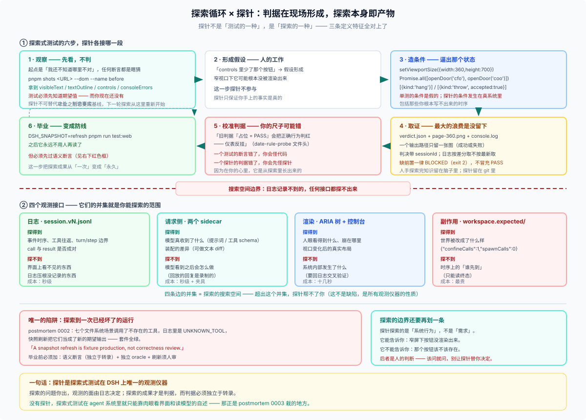
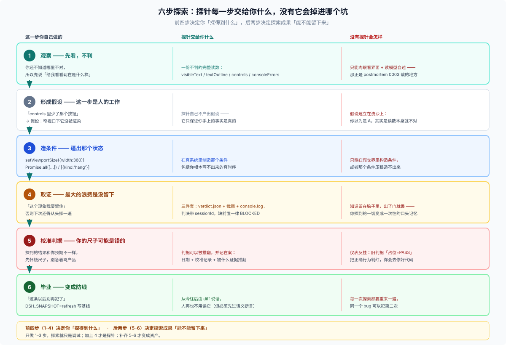

# 28/09 · 探针与探索式测试：唯一能留下东西的探索

> 一句话：**探针是探索式测试在 DSH 上唯一的观测仪器。** 探索的问题你出，观测的面由日志决定；探索的成果才是判据，而判据必须独立于转录。
>
> 这一篇回答「为什么第 4 级值得爬」——它在五级台阶里是「主动造条件」那一级。没爬过 [00](./00-ladder.md) 的话，先回去爬第 4 级；这一篇假设你已经知道什么是探针。



## 一、先对齐定义：探索式测试的特征是什么

探索式测试（exploratory testing）不是「随手乱点」，它的定义特征是三条：

| 特征 | 含义 |
|---|---|
| **判据在现场形成** | 你事先不知道正确答案，是**在执行过程中**学到它该是什么 |
| **主动构造条件** | 为了逼出某个状态，你会刻意制造边界：改窗口、并发、断网、注入失败 |
| **探索本身是产物** | 你的笔记、截图、日志就是成果，而不只是"最后那个 bug" |

对照一下就会发现，**这三条正是探针的形状**，而不是测试的形状：

| 特征 | 单元测试 | 探针 |
|---|---|---|
| 判据在现场形成 | ❌ 必须先写断言 | ✅ 先跑，看完再决定判什么 |
| 主动构造条件 | ⚠️ 只能在假世界里造 | ✅ 在真系统里造（改视口 / 真并发 / 注入挂起） |
| 探索本身是产物 | ❌ 断言过了就没了 | ✅ 证据目录 + `verdict.json` + 截图 + 日志 |

**所以探针不是"测试的一种"，它是"探索的一种"。** 这是本篇最核心的一句。

## 二、探索循环的六步，探针各接哪一段



下面逐步展开。图里右侧那一列「没有探针会怎样」，是每一步真正的立论理由。

### 步骤 1 · 观察：先看，不判

探索的起点是「**我还不知道哪里不对**」。这时任何断言都是瞎猜。

探针在这里做的是**制造事实**：

```sh
pnpm shots '<URL>' --dom --name before     # 先拍，不比对
```

拿到的是 `visibleText`、`textOutline`、`controls`、`consoleErrors`——你读它，不是机器判它。

**这一步探针不可替代**：测试必须在执行前知道期望值，而你现在还没有。

### 步骤 2 · 形成假设：从事实里读出"哪里可疑"

看到 `controls` 列表里少了某个按钮，或者 `consoleErrors` 里多了一条 —— 假设形成了：「窄视口下这个按钮可能没被渲染出来」。

**注意：这一步是人的工作，探针不参与。** 探针只保证你手上的事实是真的。

### 步骤 3 · 造条件：逼出那个状态

这是探索式测试和普通测试分道扬镳的地方 —— 你要**主动制造**那个条件：

```js
await page.setViewportSize({ width: 360, height: 700 })      // 窄视口
const [a, b] = await Promise.all([openDoor('cfo'), openDoor('coo')])  // 真并发
[{ kind: 'hang', readyFile: '.dsh-snapshot-stream-ready' }]   // 让模型挂起
[{ kind: 'throw', message: 'simulated provider error (HTTP 401)', code: 'AUTH' }]  // 注入失败
```

**这一步探针不可替代**：单测里的"条件"是你自己构造的假时钟、假 adapter；探针里的条件发生在**真系统**里，包括那些你写不出来的时序。

### 步骤 4 · 取证：把这一刻留下来

探索式测试最大的浪费是「**探到了但没留下**」。探针天生带产物：

```text
proof/
├── verdict.json          ← 结构化判决
├── page-360.png          ← 人眼看
└── console.log           ← 为什么崩
```

**证据的三条硬规矩**（来自实测事故）：

- 一个输出路径**只留一张图**（成功的或失败的，绝不并存 —— 否则陈旧的 `*.failed.png` 会一直躺在绿跑旁边）；
- 探针判决里带 `sessionId`，日志按**差分取**不按「最新」取（并行会话下 `ls -t` 会指到别人的对话）；
- 缺前置一律 `BLOCKED`（exit 2），**不冒充 PASS**。

### 步骤 5 · 校准判据：你的判据可能是错的

这是探索式测试最容易被跳过、也最值钱的一步。

真实案例（`date-rule-probe.mjs` 的文件头）：

> 判据（2026-09-30 随日期通道翻新；**旧判据「占位 = PASS」会把正确行为判红 —— 仪表反挂**）

第一版判据是错的。你不是在"验证产品"，你是在**边探边修尺子**：

- 探到产品的真实行为之后，才知道"正确"长什么样；
- 于是判据要带**日期 + 校准记录 + 被什么证据推翻**；
- 校准之后才谈得上"这条探针能红了"。

**这一步反过来证明探针是探索工具**：一个测试的断言写错了，你会怪代码；一个探针的判据写错了，你会先怪探针 —— 因为你知道它是从探索里长出来的。

### 步骤 6 · 毕业：把探索成果变成防线

探索完、判据校准完之后，**配一份基线**，它就永远不用人再读了：

```sh
DSH_SNAPSHOT=refresh pnpm run test:web     # 唯一的写路径
```

**这一步是探针比人工探索强的地方**：人手探索完，知识留在脑子里；探针探索完，知识留在 git 里。

## 三、四个观测接口，各自能探到什么

探索式测试的产出受限于**你能观测到什么**。探针的四个接口对应四个不同的可观测面：

> **别把这里的「四」和别处的「四」看成一回事。** 本目录有三套四分法，切的是不同维度：
>
> | 四分法 | 切的是 | 在哪 |
> |---|---|---|
> | 四类探针（装配 / 渲染 / 行为 / 机制） | 按**它连的是什么** | [05](./05-kinds.md) |
> | 四个实例（日志 / 请求侧 / 渲染 / 副作用） | 按**它戳到哪一层证据** | [07](./07-worked-examples.md) |
> | 四个接口（同左） | 按**探索它能看到什么** | 本节 |
>
> 后两者恰好重合，因为「能戳到哪」和「能看到什么」本就是一回事；第一套是正交的——一个装配探针同时能戳日志和请求侧。

| 接口 | 探到什么 | 探不到什么 |
|---|---|---|
| **日志**（`session.vN.jsonl`） | 事件时序、工具往返、turn 边界 | 界面上看不见的东西、日志不记录的东西 |
| **请求侧**（`system/message` + `request/header`） | 模型真收到什么 | 模型看到之后会怎么做（回放回复是录制的） |
| **渲染**（ARIA 树 + 控制台） | 人眼看得到什么、崩在哪里 | 系统内部发生了什么（要回日志交叉验证） |
| **副作用**（工作区 oracle） | 世界被改成了什么样 | 时序上"谁先到"（只能读终态） |

**这四条边界的并集，就是探索的搜索空间。** 超出这个并集的东西，探针帮不了你 —— 这不是探针的缺陷，是任何观测仪器的固有性质。

## 四、唯一必须守住的限制：日志是你的搜索空间

DSH 有一条硬规则：

> **model-visible ⟺ logged**：任何到达模型请求的东西，都必须能从会话日志重建。

这条规则让你能戳得这么轻松，同时也**框住了你能探索的范围**：

```text
你能探到的  =  日志记录到的
你探不到的  =  日志没记录的（哪怕代码里确实发生了）
```

所以探索式探针的第一步永远是**枚举事件类型直方图**：

```sh
zstd -dc <session.v4.jsonl.zstd> | python3 -c "…Counter(event['type'])…"
```

那一步不是在数结果，**是在勘探可观测面的边界** —— 先搞清楚"这里有什么可看"，再决定要问什么。

## 五、唯一的陷阱：探索到一次坏运行

这是 postmortem 0002 用真实事故换来的教训：

> The snapshot framework treated any deterministic transcript as valid behavior.
> A snapshot refresh is fixture production, not correctness review.

翻译成探索的语言：**如果你的探索恰好探到了一次已经坏了的运行（比如调用了不存在的工具，日志里是 `UNKNOWN_TOOL`），刷新会把这个 bug 固化成"正确"**——之后每次比对都会以它为基准通过。

所以毕业之前必须加一步：

| 门 | 做什么 |
|---|---|
| **语义断言** | 有一条**独立于转录**的检查（文件真写了吗？命令真跑了吗？计数对不对？） |
| **独立 oracle** | 学主仓的 `workspace.expected/`：提交一份终态树，且**录制流程不许改写它** |
| **刷新须人审** | `--refresh` 打印 drift 再写，diff 必须过目 |

主仓为此专门加了 `UNKNOWN_TOOL` 守卫；**插件仓必须自己写这一层**，因为对你来说"语义上不可能"长什么样只有你知道。

## 六、结论：三句话

1. **探针不是"测试的一种"，是"探索的一种"。** 判据在现场形成、主动造条件、探索本身即产物 —— 三条全是探索式测试的定义特征，一条都不是单元测试的。
2. **它能探多远，由日志记录多远。** 观测面决定搜索空间；先枚举事件类型，再决定问什么。
3. **探索成果才是判据，而判据必须独立于转录。** 否则你只是把一次坏运行固化成"正确"。

> 补一句边界：探针探索的是**系统行为**，不是**需求**。它能告诉你"窄屏下按钮没渲染出来"，不能告诉你"那个按钮该不该存在" —— 后者是人的判断，需要的时候用 `ask_user_question`。

## 相关

- [00 五级台阶](./00-ladder.md) 第 4 级「主动造条件」是本篇的操作版
- [07 四个实例](./07-worked-examples.md) 给出四个接口的完整读数
- [06 八条判据](./06-how-to-write-one.md) 里「证明自己会红」「判据可推翻」两节对应本篇步骤 5
- [FAQ 21/04](../21_recorded-session-snapshots/04-what-its-worth.md) 讲透了「变更探测器 ≠ 正确性 oracle」这个上限
