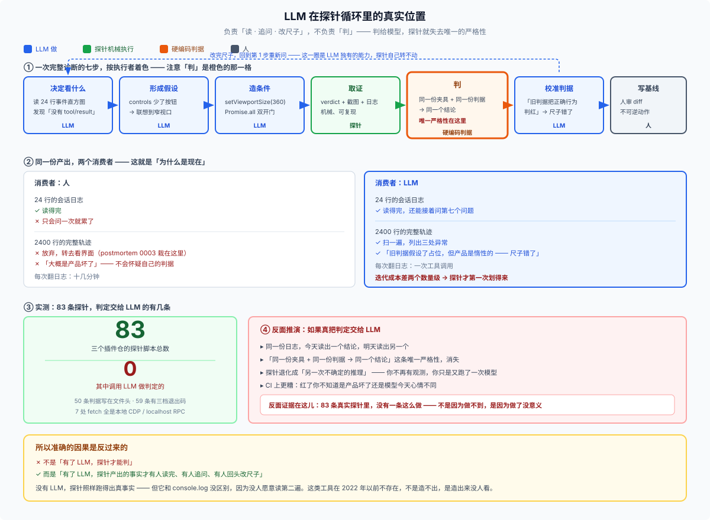

# 28/10 · 探针为什么在 DSH 里才有意义：LLM 在中间，但它不负责判

> 一句话：**探针把系统变成「LLM 可读的事实」，LLM 再把探针从「一份证据」变成「一场会追问的对话」。但判定不给 LLM——判给 LLM，探针就失去它唯一的严格性。**
>
> 这一篇回答的是一个常被说反的因果关系：不是「有了 LLM，探针才能判」，而是「有了 LLM，探针才有人读得完」。



看图先看那条横带：**七步里只有「判」是橙色的**，而「写基线」那一格连 LLM 都不给，归人。LLM 的蓝色占了四格，但那四格全都不是判定。

## 先拆一个很自然的错误推论

「探完了之后让 LLM 判断问题存不存在」——这个想法在直觉上很顺，但它是错的，而且是**可实测地错**。

三个插件仓共 **83 条探针**，我逐条扫过它们的判定逻辑：

| 事实 | 读数 |
|---|---|
| 探针脚本总数 | 83 |
| 其中调用 LLM 做判定的 | **0** |
| 有一条机器可读的硬判据 | 50（判据写在文件头） |
| 有 `BLOCKED` / exit 2 三档退出码 | 59 |

没有任何一条探针问模型「你觉得这算 bug 吗」。`date-rule-probe.mjs` 的判定是：

```js
// 判据（2026-09-30 随日期通道翻新；旧判据「占位=PASS」会把正确行为判红——仪表反挂）
```

`claim-race-probe.mjs` 检查的是 DOM 的第一行；`workspace.expected/confinement-audit.json` 全文只有 `{"confineCalls":1,"spawnCalls":0}`。这些都是**硬编码的、可复现的**判定。

**为什么必须这样**：探针唯一的严格性是「同一份夹具 + 同一份判据 → 同一个结论」。判定一旦交给模型，这条就断了——你会得到另一次不确定的推理，而不是一次可复核的观测。

## 那 LLM 到底在哪儿起作用

把一次完整的诊断拆成七步，责任是这样分的：

| 步骤 | 谁做 | 为什么 |
|---|---|---|
| **决定看什么** | **LLM** | 读 24 行事件直方图，发现「没有 `tool/result`」 |
| **形成假设** | **LLM** | 看到 `controls` 少了按钮，联想到窄视口 |
| **造条件** | **LLM** | 写 `setViewportSize(360)`、`Promise.all` 双开门 |
| **取证** | 探针（机械） | 可复现，不经模型 |
| **判** | **硬编码判据** | 必须可复现 |
| **校准判据** | **LLM** | 发现「旧判据把正确行为判红」—— 仪表反挂 |
| **毕业写基线** | 人 + LLM | 过四道门，人审 diff |

你的直觉指对了地方，只是位置偏了一格：**LLM 不在「判」那一栏，它在「读、追问、改尺子」三栏。**

## 真正的原因：人读不完，LLM 读得完

这才是探针在 agent 时代突然变重要的原因。同一个探针，消费者不同，价值完全不同：

| | 人做消费者 | LLM 做 LLM 消费者 |
|---|---|---|
| 一份 24 行日志 | 读得完，但**只会问一次** | 读得完，还能**接着问第七个问题** |
| 一份 2400 行轨迹 | **放弃**，转去看界面 | 扫一遍，列出三处异常 |
| 校正判据 | 「大概是产品坏了」 | 「旧判据假设了占位，但产品是惰性的——尺子错了」 |
| 迭代成本 | 每次翻日志 = 十几分钟 | 每次翻日志 = 一次工具调用 |

所以准确的说法是：

> **探针不是「因为 LLM 能判」才有意义，而是「因为 LLM 能读完、能追问，探针产出的事实才有人消化」。**

没有 LLM，探针照样能跑、照样产出真事实——但它和 `console.log` 没什么区别，因为没人愿意读第二遍。**这正是这一类工具在 2022 年以前不存在的原因**：不是造不出探针，是造出来没人看。

## 一条反过来的证据

你可以在自己的目录里验证这个因果方向。翻 [05-kinds](./05-kinds.md) 那张表：

| 读的人 | 探针应当长什么样 |
|---|---|
| **人**（现场判断） | 打屏幕文本、截图、逐相位 verdict |
| **agent**（自动化交接） | 判据写在文件头，退出码语义严格，证据落固定目录 |

同一个探针，**为 agent 设计时会明显更严格**：`BLOCKED`（exit 2）不是为了让人看到一行红字，而是因为「**agent 读不到『这次运气不好』，它只读得到『绿』**」。所以环境未就绪必须显式失败，不能默默放行。

这条纪律整个存在的理由，就是消费者换成了 LLM。

## 边界：哪些事永远不该交给 LLM

| 不该交给 LLM | 理由 |
|---|---|
| **判定「这次是 pass 还是 fail」** | 失去可复现性；同一份 log 两次读出两个结论 |
| **决定基线写不写** | 写入是不可逆动作，必须由人审 diff |
| **「世界到底变没变」** | 有独立 oracle 就读 oracle（`confinement-audit.json`），别问模型 |
| **替代真实模型行为** | 回放车道证明请求侧长什么样，不证明模型会怎么做 |

反过来，**该交给 LLM 的**：

| 该交给 LLM | 理由 |
|---|---|
| 从原始事实里**提出假设** | 人会漏，模型不会嫌 2400 行太长 |
| **决定下一个探针该问什么** | 这是探索循环的核心动作，见 [09](./09-exploratory-testing.md) |
| **怀疑自己的判据** | 仪表反挂只有回头重读时才发现 |
| **写探针、改探针** | 83 条探针的形态高度一致，正因为它们大多是模型写的 |

## 结论

1. **探针的判定从来不给 LLM。** 83 条实测，0 条这么做；判给模型等于放弃可复现性。
2. **LLM 的价值在读、在追问、在改尺子。** 它让一份 2400 行的轨迹从「没人看」变成「有人能问出第七个问题」。
3. **所以探针在 DSH 里才成立**：不是 DSH 给了探针机制（它没给），是 DSH 让 agent 成为探针产出的**第一个消费者**——`model-visible ⟺ logged` 保证了事实可重建，agent 保证事实有人读。

> 一句话收束：**探针负责让系统变得可读，LLM 负责让它变得值得追问。两件事缺一，这件事就回到 2022 年以前——工具还在，没人用。**

## 相关

- [09 探索式测试](./09-exploratory-testing.md)：六步循环里，LLM 实际接的是第 1、2、3、5 步
- [05 分类](./05-kinds.md)：按「谁来读它」分两类，就是这一篇的起点
- [06 八条判据](./06-how-to-write-one.md)：判据要写成一句话、允许被推翻、能证明自己会红
- [reference.md](./reference.md) 第六、七节
