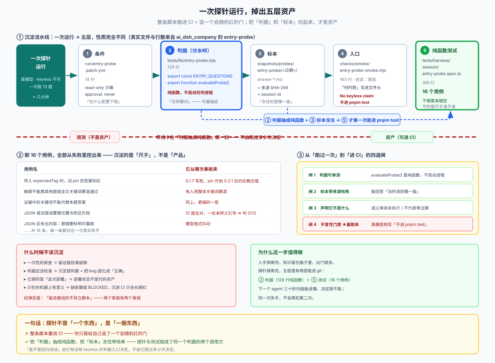

# 28/11 · 探针查完之后沉淀什么：一次运行掉出的五层资产

> 一句话：**探针跑一次，会同时沉淀出五种性质完全不同的东西**——条件、判据、标本、入口、纯函数测试。把它们分开看，才知道哪一层已经变成资产、哪一层还只是观测。
>
> 这一篇回答「探针能不能沉淀成回归测试」——**能，但不是整体搬过去，是拆开搬。** 主案例是 `ai_dsh_company` 的 `entry-probe`，它五层全占。



## 先给结论：探针不是「一个东西」，是「一捆东西」

大多数人把探针当成一个脚本。实际上一条活得够久的探针，跑着跑着会长出五层：

| 层 | 是什么 | 在这条链里 |
|---|---|---|
| **① 条件** | 在什么配置下跑 | `run/entry-probe.patch.yml`（14 行） |
| **② 判据** | 怎样算对（**可从探针抽走**） | `tools/lib/entry-probe.mjs`（129 行） |
| **③ 标本** | 一次真实产出的归档 | `snapshots/probes/entry-probe/<日期>/answer-*.md` |
| **④ 入口** | 常驻、有状态、有「何时跑」 | `checks/smoke/entry-probe-smoke.mjs`（163 行） |
| **⑤ 纯函数测试** | 不需要真模型的判据单测 | `tests/harness/session/entry-probe.spec.ts`（189 行，16 个用例） |

**关键在三、五之间**：③ 是**标本**（冻住的事实），⑤ 是**判据的单测化**（把 `evaluateEntryProbe` 变成纯函数后，可以喂构造输入）。两者合起来，才让"探针"第一次能进 `pnpm test`。

## ② 判据抽走，是分水岭

`tools/lib/entry-probe.mjs` 里那一行是关键：

```js
export const ENTRY_QUESTIONS = [
  { id: 'Q1', ask: '现在可开工的任务从哪里取…', expect: [/RFC|磨活|polish|用户指令/, /Note|implemented|台账/] },
```

探针用它判断**真模型的答卷**，单测用它判断**构造的答卷**：

```ts
expect(evaluateEntryProbe(JSON.stringify(good()), readSource, { expectedTag }).failures).toEqual([])
```

**判据从脚本里被抽出来、变成纯函数的那一刻，探针和测试就不再是两个东西了。** 探针变成了这个纯函数的一个调用方，测试变成了另一个。

判断一条探针成熟没有，一个很硬的标准就是：**它的判据能不能不启动任何进程就单测。** 能，就说明判据已经独立于执行环境了。

## ③ 标本怎么冻：归档 + 来源哈希

沉淀成资产不是把日志拷一份。看真实归档的头部：

```text
# 入口链探针归档 · 2026-10-27T16:42:18.896Z
> 验证范围：standard preset、开发仓库 cwd、coding 指令基线；逐题 JSON / 关键词 / 来源原文。
> 机器结果：13/13；失败项 0。**语义审阅：未执行，不代表零过期或零矛盾。**

session: session-6fa806cb-0083-4e6c-bbfe-5a1cfae20ad1

## 来源 SHA-256（本次读到的版本）
- AGENTS.md：33ca9cb5…
- docs/index.md：2a8f33e6…
```

三件事值得抄：

1. **哈希锁住"当时读到的是哪一版"**——否则半年后你没法判断是判据过期还是文档过期；
2. **"语义审阅：未执行"是必写的免责**——机器层过了不等于语义对；
3. **session id**——任何时候都能回到原始轨迹。

## ⑤ 16 个用例，全是失败挖出来的

这是我认为最能说明"沉淀是活的"的一点。翻 `entry-probe.spec.ts` 的用例名，几乎每一条都对应一次真实事故：

| 用例 | 它从哪来 |
|---|---|
| `传入 expectedTag 时，旧 pin 的答案判红` | `0.1.7` 写死后 pin 升到 `0.2.1`，答卷仍在教旧值 |
| `缺题不能靠其他题或全文关键词蒙混通过` | 有人用整体关键词蒙混 |
| `证据中的关键词不能代替本题答案` | 同上，更细一层 |
| `JSON 语法错误要报位置与附近片段` | 首跑 12 题全对，只因一处未转义双引号整份判 0/12，人得手工二分 |
| `JSON 后多出内容：判失败但报错要标明可重跑` | 模型格式抖动 |

**沉淀下来的不是"验证产品对不对"，是"验证尺子准不准"。** 这 16 条守的是判据本身，不是产品行为。

## 一个必须理解的界限：它自己都不承认是回归测试

`entry-probe-smoke.mjs` 第二行到第六行：

```js
// 状态：常驻
// 何时跑：入口链/执行链文档（AGENTS.md / docs/index.md / dev-loop / _backlog）改动后；真模型认证档
// Machine checks validate per-question routing/evidence, not semantic correctness.
// No keyless regression claim: true-model certification, 不进 pnpm test.
```

**`不进 pnpm test`。** 它常驻、它有归档、它有判据单测——但它明确声明自己不是回归门禁。

所以你说的"探针天生就是动态测试资产"要修正一下：

> **探针天生是「资产坯子」，不是资产。** 它同时产出了资产的原料（判据、标本、条件），但**"是不是回归测试"由它有没有 keyless 的判据入口决定，不由它跑过多少次决定。**

## 沉淀的四道闸

从"探针跑过一次"到"进 CI"，中间要过四道：

| 闸 | 判据 | 谁守 |
|---|---|---|
| **判据可单测** | `evaluateProbe()` 是纯函数，不启动进程 | 开发者 |
| **标本带来源哈希** | 能回答"当时读到哪一版" | 归档脚本 |
| **声明它的边界** | 写清「不证明什么」（语义 / 过期 / 矛盾） | README + 归档头部 |
| **不冒充门禁** | 真模型档写 `不进 pnpm test` | smoke 文件头 |

第 4 道闸最容易漏，也最致命——一旦一段真模型探针混进 keyless 门禁，CI 会开始随机红，然后所有人开始关掉它。

## 反过来：什么时候不该沉淀

| 情况 | 为什么不该 |
|---|---|
| **一次性的排查** | 留证据目录就够，配基线是负担 |
| **判据还没校准** | 沉淀一个错判据 = 把 bug 固化成"正确"（[09](./09-exploratory-testing.md) 的陷阱） |
| **它探的是"这次部署"** | 部署状态不是代码资产 |
| **它只在你的机器上有意义** | 缺前置就 `BLOCKED` 的，沉进 CI 只会变成长期红 |

插件仓的组织纪律里那条「**能进基线的不另立脚本**」（[08](./08-real-repos.md)）说的就是这件事的反面：**同一条事实不要同时住在探针和快照里**，两个家就会有两个真相。

## 结论

1. **探针不是一个东西，是一捆东西。** 条件、判据、标本、入口、单测，五种性质不同，命运也不同。
2. **判据抽成纯函数，是它变成资产的分水岭。** 抽得出来，探针和测试就是同一个判据的两个调用方。
3. **沉淀的是尺子，不是产品。** 那 16 个用例守的全是判据自身的准确度。
4. **"是不是回归测试"由 keyless 入口决定，不由跑的次数决定。** `entry-probe` 常驻、有归档、有单测，仍明写 `不进 pnpm test`。

> 一句话收束：**探针跑完会掉出五样东西——把其中的"判据"和"标本"捡起来，它就成了测试资产；把整条脚本塞进 CI，你只是给自己造了一个会随机红的门。**

## 相关

- [05 分类](./05-kinds.md)：按「跟基线的距离」分三档，本页是它的展开
- [07 实例](./07-worked-examples.md)：一个场景目录的四道毕业门长什么样
- [09 探索式测试](./09-exploratory-testing.md)：毕业之前必须先过语义断言
- [10 LLM 在中间](./10-probe-and-llm.md)：为什么判据不能交给模型（那会让沉淀失去可复现性）
- [reference.md](./reference.md) 第八节
