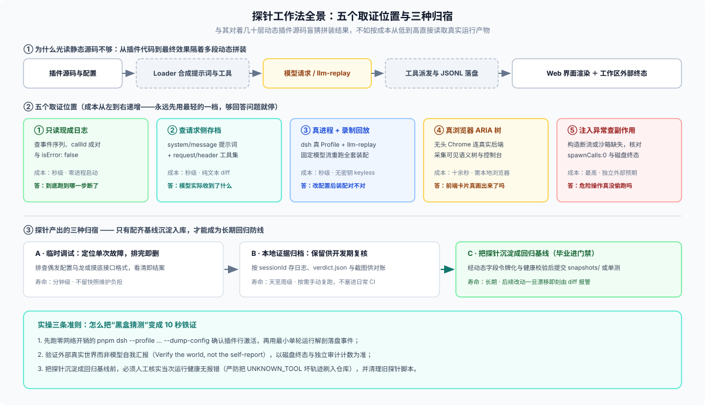
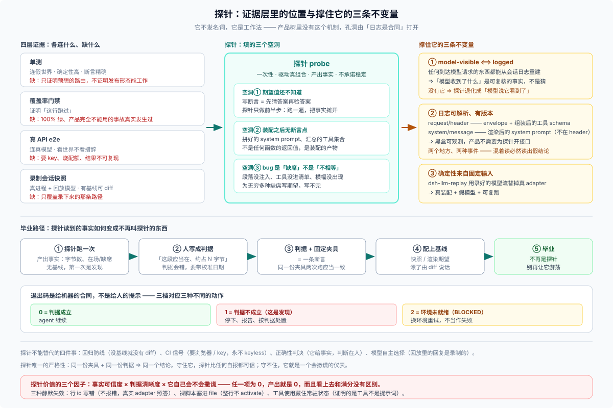

# Answer 28 · “探针”不是 DSH 内置子系统，而是靠会话日志拿铁证的排障工作法

## 一句话结论

先把最容易搞混的名词掰清楚：

1. **“探针（Probe）”不是 DSH 的官方术语，也不是内置框架**：DSH 既没有叫 `probe` 的公共扩展点，也没有 `pnpm run probe` 命令。你在主仓代码里搜到的 `probe`（如测 npm 源响应速度的 `ctx.pluginRegistryProbe`、检查系统弹窗命令的 `PATH` 探测、沙箱与子进程存活自检），全都是局部的**运行时环境自检函数**。
2. **大家在插件开发与研究里说的“打探针”，是一套围绕 DSH 会话日志长出来的实证工作法**：DSH 跑起来是几十个插件按 Profile / Bundle 动态拼装的结果。与其盯着源码盲猜“十层插件叠完之后模型到底收到了什么提示词、挂上了哪些工具、前端到底画出了什么”，不如构造一个最小真实输入跑一把（或用回放跑一把），直接解剖落盘的会话事件（`system/message`、`request/header`、`tool/result`）、浏览器可访问性树和工作区产物拿铁证。

想直接看 4 个用主仓真实文件一步步拆开的探针实例，可直接跳读 [`01-four-real-probes.md`](./01-four-real-probes.md)。

---

## 一、一张图看懂：为什么要打探针？往哪儿下钩？

在普通单体应用里，调一个函数看返回值就能定位大半问题；但在 DSH 里，从你写的插件代码到“模型实际收到的请求”和“用户看到的界面”，中间隔着配置层叠、多插件注入、工具注册汇总和事件投影。光读静态代码或跑 `new` 出来的单测，根本看不到拼装后的全貌。



实操时，探针按**成本从低到高**在五个位置取证——**永远先用最便宜的一档，够回答问题就停**：

1. **只读现成会话日志（零启动成本，秒级）**：直接解压 `.jsonl.zstd`（或读仓库 `.jsonl` 夹具），数事件类型、`tool/call` 与 `tool/result` 是否成对、`isError` 是否为 `false`，先确认“到底跑到哪一步断了”。
2. **查请求侧存档（秒级）**：核对模型收到的完整上下文。这里有一个**新手必踩的头号大坑**：**渲染后的系统提示词和工具定义住在两条不同的事件里**——系统提示词在 `system/message`（surface 节点 0），组装后的工具 schema 数组在 `request/header`（[`docs/subsystems/session.md`](https://github.com/deepseek-ai/deepseek-harness/blob/master/docs/subsystems/session.md)）。去 `request/header` 里找 `system` 找不到，绝不代表提示词没发出去。
3. **起真进程 + 录制回放（无密钥，秒级）**：用 `dsh` 拉起真实 Profile 装配，挂上 `@deepseek-ai/dsh-llm-replay` 喂固定模型流，专门排查“改了配置或插件后，拼出来的请求头对不对”。
4. **起真浏览器抓可访问性树（十几秒，需 Chrome）**：采集真实渲染后的 ARIA 树与控制台日志，跟会话事件逐行对账，排查窄屏折叠或前端卡片漏渲染。
5. **注入异常并查工作区外部状态（最重）**：主动构造并发或故障（如沙箱不可用、流挂起），检查真实磁盘文件与独立审计计数，确认“不该执行的危险操作真的没发生”。

### 最小实战画面：不猜源码，10 秒拿一次铁证

比如你刚写了一个插件往系统提示词里塞了新规则，怀疑它没生效，探针工作法只需要在终端敲两步：

```sh
# 1. 先零请求看一眼插件行到底激活没有
pnpm dsh --profile headless --patch ./my-plugin.patch.yml --dump-config

# 2. 跑一轮最小单次指令（禁止调工具，只看首包上下文），直接解压落盘日志验货
pnpm dsh --profile headless --patch ./my-plugin.patch.yml \
  "不要调用任何工具；如果系统提示词里有 MY_RULE_MARKER 就原样复述，没有就回答 NONE"
zstd -dc "$DSH_HOME"/sessions/*/session-*/session.v4.jsonl.zstd | grep -E '"system/message"|"request/header"'
```

不用改一行框架源码、也不用挂抓包代理，磁盘上的事件记录当场就能告诉你答案。

---

## 二、为什么这套打法在 DSH 里格外顺手？

在很多黑盒 Agent 框架里想看清实际发给模型的请求，得自己挂代理抓包或改源码打 `console.log`。DSH 不用这么折腾，靠的是主仓严守的**三条底层不变量**：



1. **真实装配可独立拉起与局部替换**：从零网络开销打印装配树的 `dsh --profile ... --dump-config`，到用 `--patch` 只替换单个插件槽位，开发期无需搭整套外围服务就能跑起与生产一致的插件组合。
2. **`model-visible ⟺ logged` 且日志格式带版本、可离线解析**：根 [`AGENTS.md`](https://github.com/deepseek-ai/deepseek-harness/blob/master/AGENTS.md) 规定，凡是进入模型请求的内容都必须能从磁盘 `.jsonl` 会话日志完整重建。日志本身就是公开结构化存档，外部脚本直接读文件就能验货，无需业务代码配合留后门。
3. **`@deepseek-ai/dsh-llm-replay` 把模型回复变成固定输入**：这是一个公开发布的普通插件（见 [`llm-replay` README](https://github.com/deepseek-ai/deepseek-harness/blob/master/packages/test-support/llm-replay/README.md) 与 [FAQ 29](../29_keyless-meaning-boundaries/answer.md)），替换真实模型适配器后，既保留了 100% 真实的插件装配与会话流转，又消除了网络开销、API 账单与输出随机性。

### 它和单测、录制快照、真 API 测试怎么分工？

[`docs/testing.md`](https://github.com/deepseek-ai/deepseek-harness/blob/master/docs/testing.md) 明确提醒过：**100% 单测行覆盖率只证明“这行代码跑过”，不证明“按发布形态拼起来能工作”**（典型事故见 [`postmortem 0001`](https://github.com/deepseek-ai/deepseek-harness/blob/master/docs/postmortem/0001-acp-default-export-drops-inject.md)）。各层证据各管一摊：

| 手段 | 连接的环境 | 回答的核心问题 | 局限性 |
|---|---|---|---|
| **单元测试**（`test`） | 构造的最小依赖 / 假桩 | 单个函数或模块的分支逻辑算对了吗？ | 抓不住多插件漏注入、`cordis.yml` 装配错位 |
| **探针（Probe）** | 真实装配进程（回放或真模型） | **此刻真实跑出来的请求、界面、状态到底长什么样？** | 无预设基线，不自动防回归，需人或脚本判读 |
| **录制会话快照**（`test:snapshot`） | 真实装配进程 + 固定回放流 | 和上次提交的标准基线相比，请求或界面**漂移了吗**？ | 只覆盖已录制路径；需维护归一化基线 |
| **真 API e2e**（`test:e2e`） | 真实装配进程 + 真实在线模型 | 真模型看到这套提示词和工具后，**实际会怎么选**？ | 需 API Key、花钱、耗时且每次措辞不完全固定 |

一句话看懂关系：**探针负责填“还不知道标准答案长什么样”“要验多插件拼装结果”“要排查某样东西缺席”这三个测试盲区；一旦探清事实并配上固定期望基线（如主仓的 `snapshots/`），它就“毕业”成了回归快照（见 [FAQ 21](../21_recorded-session-snapshots/answer.md)），不再叫探针。**

---

## 三、四条诚实边界（别把探针用歪了）

1. **探针不是 CI 门禁，真模型探针绝不塞进 `pnpm test`**：没配基线的探针只能帮你看清当下；如果把依赖真模型或本地浏览器的探针脚本直接塞进日常单测套件，只会造出一个随机报红、最后被全员麻木关掉的噪音源。
2. **回放探针证不了“模型智商”**：用 `llm-replay` 跑探针只能证明**发给模型的提示词和工具 schema 没装错**，里面的模型回复是事先录死的，不能证明真模型遇到这句提示词一定会乖乖照做。
3. **Coding Agent 负责读日志和改探针，绝不负责做 Pass/Fail 裁判**：让 Agent 帮你通读两千行 `.jsonl` 找异常、写浏览器视口构造脚本非常提效；但“通没通过”必须写成确定性代码判据，交给大模型拍脑袋判对错就会彻底失去可复现性。
4. **警惕“静默假绿”**：`--patch` 写错目标条目 `id` 时可能只打一行警告而让原配置照跑；机器没装 Chrome 时如果脚本直接跳过检查返回 `0`，看起来全绿其实什么都没测。规范做法是环境缺失统一报 `BLOCKED`（如退出码 `2`），与正常通过（`0`）和抓到问题（`1`）严格区分。

---

## 继续阅读

| 你想了解什么 | 去哪篇看 |
|---|---|
| 打开主仓现成的 4 份真实夹具与代码，亲眼看探针戳哪儿、拿回什么、省掉什么猜测 | [`01-four-real-probes.md`](./01-four-real-probes.md) |
| 自己动手设计最小探针的六条铁律、Agent 协作边界、毕业四道门与能力上限 | [`02-how-it-works-and-boundaries.md`](./02-how-it-works-and-boundaries.md) |
| 主仓源码路径、同名运行时 `probe` 清单、三篇事故复盘与外部插件仓实践附记 | [`reference.md`](./reference.md) |

> 核验状态见 [核验基线登记](../00-baseline.md)。
