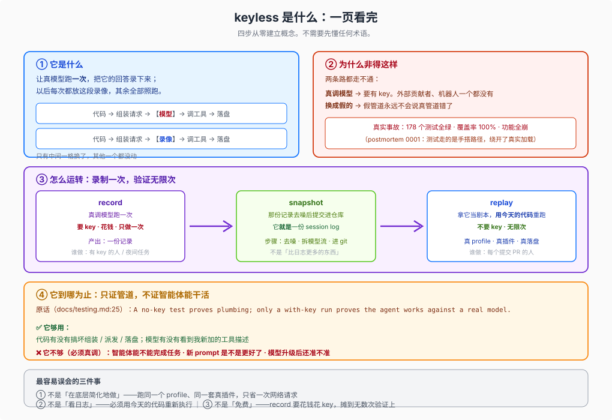

# `keyless`：五分钟看懂这是什么



## 一句话

**`keyless` 是一种让测试在没有模型 API key 的情况下，依然跑真代码、拿到真证据的做法。**

做法本身很朴素：**让真模型跑一次，把它的回答录下来；以后每次都放这段录像，其余全部照跑。**

## 它长什么样

想象你要验证新写的一个工具能不能用。真跑一次是这样的：

```text
你的代码 ──→ 组装请求 ──→ 【真模型】──→ 说「调用这个工具」──→ 工具执行 ──→ 结果落盘
                            ↑
                       这一步要 API key，要花钱，每次回答还不一样
```

`keyless` 做的事，就是把中间那一格换掉：

```text
你的代码 ──→ 组装请求 ──→ 【录像】──→ 说「调用这个工具」──→ 工具执行 ──→ 结果落盘
                            ↑
                       换掉了。其他一个都没动
```

**唯一换掉的是「模型说了什么」。** 你的代码、工具的注册、请求的组装、工具的派发、结果写进磁盘——全部还是真的，真的跑，真的执行。

所以这不是「简化版测试」，也不是「模拟」。这是**用固定的模型回答，真跑一遍完整流程**。

## 为什么非得这样

因为另外两条路都走不通：

**路一：每次都真调模型。**
内容最真，但**要有 API key**。公司的 CI 可以有，开源贡献者、外部提交的 PR、自动机器人都没有。对他们来说这套测试等于不存在——而恰恰是这些人的代码最需要被验。

**路二：把模型换成假的（mock）。**
谁都能跑了，但测的是你手搭的假管道。**假管道自己不会出错，所以它永远不会告诉你真管道错了。**

这不是理论。DSH 有过一次真实事故（`docs/postmortem/0001`）：一个功能发出去完全不能用，而当时**178 个单元测试全绿、行覆盖率 100%**。原因是每个测试都用手搭的路径挂载插件，那条路径绕开了它实际怎么加载。假管道一路顺畅，真管道一步就崩。

一边是真但跑不了，一边是能跑但不真。`keyless` 是第三条路。

## 它靠三样东西运转

| 东西 | 是什么 |
|---|---|
| **record** | 真调模型跑一次，把结果录下来。**要 key，但只需要一次** |
| **snapshot** | 录下来的那份记录，去噪后提交进仓库。它**就是**一份 session log |
| **replay** | 拿 snapshot 当剧本，用今天的代码把整件事重跑一遍，比对结果 |

一句话：**录制一次，验证无限次。**

## 它到哪为止

这条必须记住，否则会用错：

> **`keyless` 只证明「管道没坏」，不证明「智能体能干活」。**

原话在 `docs/testing.md:25`：**"A no-key test proves plumbing; only a with-key run proves the agent works against a real model."**

具体来说：

| 你想知道 | `keyless` 够吗 |
|---|---|
| 我改的代码有没有搞坏组装、派发、落盘？ | ✅ 够 |
| 模型有没有看到我新加的工具描述？ | ✅ 够（`request/header` 就是断言点） |
| 智能体对着真模型能不能完成这个任务？ | ❌ **不够，必须真调** |
| 我新写的提示词效果是不是更好了？ | ❌ 录像判断不了「更好」，只能判断「没变」 |
| 模型升级之后还准不准？ | ❌ **录像会过期，且过期时不报警** |

最后一条最危险：模型升级了、能力变了，录像照放，**依然全绿**。因为录像里躺着的是旧模型当时的话。

## 怎么读这一组

按你卡在哪选入口：

| 你现在的情况 | 读哪篇 |
|---|---|
| 完全没概念，想知道「这到底是什么鬼东西」 | 就是本页，再看 [01](./01-what-it-is.md) |
| 想弄明白「为什么非得搞这么个东西」 | [02 它解决什么问题](./02-why-it-exists.md) |
| 以为它是「读日志」「静态检查」 | [03 replay 到底在做什么](./03-how-replay-works.md) |
| 要判断某条测试算不算 keyless、它证明了什么 | [04 边界与判据](./04-boundaries.md) |
| 只想查词、查命令 | [05 速查](./05-cheatsheet.md) |

## 最容易误会的三件事

先摆在这里，后面各篇展开：

1. **它不是「在底层简化地做」**——它跑的是同一个 profile、同一套真插件，只省掉一次网络请求。
2. **它不是「看日志」**——它必须跑，用今天的代码重新执行一遍。
3. **它不等于「免费」**——`record` 要花钱花 key，只是那一笔投入摊到了无数次验证上。
