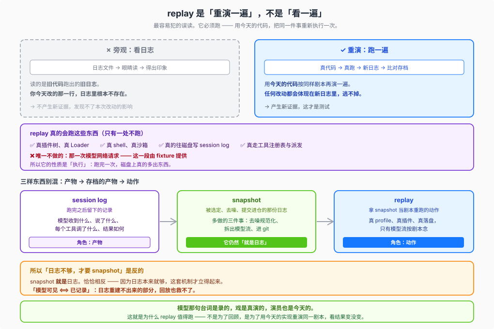

# 01 · 录制回放是怎么跑起来的：真跑全套代码，不是读录像字幕

听到“快照回放（snapshot replay）”，最容易产生的误会是以为它在做静态文件比对——“把上次存下来的日志读出来看一眼”。如果真是静态读旧日志，那你今天改坏了一行工具派发逻辑或插件注入声明，旧日志里根本没有今天的新代码，读一万遍也抓不住 bug。

DSH 的录制会话回放走的完全是另一条路：**除了“模型返回了什么流式内容”这一步按历史剧本念台词，其余整套进程、配置加载、工具执行与日志落盘，全部用当前工作区的真实代码重演一遍。**

---

## 一、一次回放里，哪些是真跑的，哪一格是替掉的？

一套标准的顶层快照用例由 [`@deepseek-ai/dsh-session-snapshot`](https://github.com/deepseek-ai/deepseek-harness/blob/master/packages/test-support/session-snapshot/README.md) 驱动，配合 [`@deepseek-ai/dsh-llm-replay`](https://github.com/deepseek-ai/deepseek-harness/blob/master/packages/test-support/llm-replay/README.md) 完成闭环：

- **全套真跑的部分**：
  1. 按发布的真实入口启动对应的 `dsh` profile（覆盖 `headless`、`sdk`、`acp`、`web` 四类协议与宿主面）；
  2. 走真实的 Cordis Loader 解析 `cordis.yml` 与 overlay 补丁，挂载整棵插件树；
  3. 走真实的上下文拼装管线，生成本次运行的系统提示词（`system/message`）与工具定义目录（`request/header`）；
  4. 当回放的模型流发出工具调用指令时，在隔离的临时工作区里**真刀真枪地通过工具注册表派发并执行**（跑 shell、读写临时目录里的文件、创建子智能体等）；
  5. 运行时持久化层照常向本次临时目录写出**完整未删减**的新会话日志，`web` 档还会启动真实 Chromium / WebKit 浏览器比对渲染出的界面与 ARIA 结构。
- **唯一替掉的一格**：
  配置补丁把线上 LLM 适配器替换成了 `dsh-llm-replay`。每当 `agent-loop` 拼好请求准备发往模型时，`llm-replay` 拦截调用，不发起任何外部网络请求，而是从仓库里的录制夹具（fixture）中按顺序取出当年真模型返回的流式块喂回循环——正如其文档所说，*"run the scenario exactly as if the model had produced the recorded output"*。

遇到父智能体派生进程内子智能体的嵌套场景时，目录里会保存父会话 `session[.vN].jsonl` 和连续编号的子会话 `session.<ordinal>[.vN].jsonl`。因为每次重跑生成的实时 Session ID 都是随机的，`llm-replay` 会按**各个实时会话首次发起模型调用的先后顺序**依次认领对应的剧本并独立推进游标；如果代码改动导致多派生了未录制的额外会话或额外请求，回放会立即报错失败。

---

## 二、`snapshot` 不是另造的新格式，它就是去噪后的会话日志

另一个常见颠倒的直觉是：“是不是因为日常会话日志记的东西不够，才专门发明了 `snapshot`？”**因果刚好反过来——正因为 DSH 的日常会话日志本来就足够完备，快照机制才立得起来。**

DSH 在架构上强制执行 `model-visible ⟺ logged`：任何进入模型请求的信息，都必须能从持久化的 JSONL 会话日志里完整重建。因此，`snapshots/` 目录里提交的夹具并不是什么特制的录像带格式，它**本质上就是那次真实运行留下的 `session[.vN].jsonl` 日志**，只不过在入库前由 `normalizeSessionSnapshot` 多做了三步确定性处理：

| 处理步骤 | 具体做了什么 | 解决什么工程问题 |
|---|---|---|
| **1. 抹平动态噪音** | 剥离事件体的 `seq` / `time` 时间戳包络（回放时在内存里重新合成连续序号与确定性时钟），把临时工作区路径统一替换为 `{{cwd}}`，把随机生成的会话与调用 ID 映射为稳定占位符 | 消除机器路径、运行时间与随机 ID 噪音，让同一份快照在 macOS 与 Linux 上可以逐字节稳定比对 |
| **2. 抽离提示词与工具目录 sidecar** | 在声明了 `pinsHeader` 的代表场景中，把日志里的完整系统提示词正文和工具 schema 替换为 `{{system}}` 与 `{{tools}}` 标记，真身单独存进同目录或共享的 `system-prompt.expected.md` 与 `tool-schemas.expected.json` | 避免几十个场景重复提交大段提示词文本，同时让任何改动系统提示词或工具参数定义的代码变更在 PR diff 里一目了然 |
| **3. 严格装载校验** | 回放读取夹具时校验文件名代际与头部版本一致（保留的历史格式夹具在内存中走正式迁移目录），遇到残损或违例夹具直接报错拒绝（`"replay never repairs a refused artifact"`） | 防止测试底座自己静默吞掉格式腐坏；同时保证运行时写出的是完整当前格式日志，结束后再与期望值及可选的 `workspace.expected/` 目录树逐项核对 |

### 日志还原不了的极端网络故障怎么测？（`replay.override.json`）

正常落盘的模型结算事件能够完整重现普通流式回复，但有两类底层传输异常无法单靠持久化结算记录还原：
1. **首个流式块到达前就直接抛错**（pre-2xx 失败，日志里还没有任何流成员）；
2. **连接一直挂起不返回（hang）或等待外部中途取消（cancel）**。

需要验证这类重试与中断恢复逻辑的场景，会在场景目录下额外放一份可选的 `replay.override.json` sidecar：既可以用完整的自定义条目替换默认剧本，也可以通过 `patches` 精确替换第 `N` 次模型调用（例如先注入一次网络抛错，再在下一步衔接重录的成功回复，或写出 `readyFile` 通知外部测试驱动发起确定性取消）。

---

## 三、`record`、`replay`、`refresh` 三档在开发流里怎么配合？

快照套件统一通过环境变量 `DSH_SNAPSHOT` 切换三种工作模式（定义见 [`vitest.snapshot.config.ts`](https://github.com/deepseek-ai/deepseek-harness/blob/master/vitest.snapshot.config.ts) 与 [`dsh-session-snapshot`](https://github.com/deepseek-ai/deepseek-harness/blob/master/packages/test-support/session-snapshot/README.md)）：

| 模式（对应命令） | 调真模型（要 Key）？ | 改写仓库文件？ | 执行方式与在开发流中的角色 |
|---|---|---|---|
| **`replay`**（默认，`pnpm run test:snapshot`） | 否（`keyless`） | 否（纯只读比对） | **日常回归与 CI 守门**：不读 `.env`，各场景在独立临时目录中并发重跑；只要组装请求头、协议流、落盘日志或 `workspace.expected/` 有一处对不上就报红 |
| **`refresh`**（`pnpm run test:snapshot:refresh`） | 否（`keyless`） | **是**（重写 stdout 期望、sidecar 与可比会话快照，不改 `workspace.expected/`） | **模型剧本仍有效时的期望刷新**：比如你调整了提示词措辞、新增了一个不影响旧对话走向的工具描述，或改了协议输出格式，旧的模型回复流照样跑得通——串行重跑一遍把新期望落盘，再人工逐行审阅 `git diff` |
| **`record`**（`pnpm run test:snapshot:record`） | **是**（`with-key`） | **是**（采集全新模型回复流并更新夹具与期望） | **生产新剧本或重录失效轨迹**：新增了快照场景，或者工具改名、交互轮次变化导致旧模型剧本已经接不上时，加载 `.env` 串行调真模型重录一份新资产 |

搞清了录制回放是怎么跑起来的，下一步就是在写测试和审 PR 时拿准分寸：哪些结论能靠它拍胸脯保证，哪些地方哪怕回放全绿也绝对不能信？详见 [`02-boundaries-and-cheatsheet.md`](./02-boundaries-and-cheatsheet.md)。
