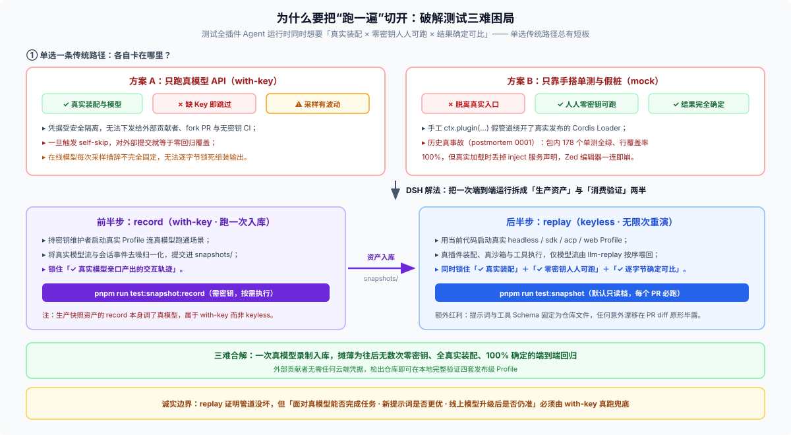

# 02 · 它解决什么问题

上一篇讲了 `keyless` 是什么。这一篇回答更前面的问题：**DSH 为什么非要造这么个东西？**

不搞清楚这一层，很容易把它当成「省钱小技巧」或者「凑合能用的测试方案」，然后用错地方。



## 要同时满足三个要求

DSH 的测试想同时拿到三样，而现实里它们互相排斥：

| 要求 | 具体是什么 | 为什么难 |
|---|---|---|
| **证据要真** | 真插件、真 Loader、真落盘，不能是手搭管道 | 手搭管道证明不了真实加载路径 |
| **人人都能跑** | 开源贡献者、外部 PR、机器人 | **他们拿不到 API key** |
| **结果要稳** | 同样的输入得给同样的判定 | 模型是随机的，两次回答不同 |

## 两条直接的路，各丢一个要求

### 只用真 API

拿到「证据真」和「结果稳」，丢掉「人能跑」。

这是最干净的做法，DSH 的政策也偏向它——`docs/testing.md` 有一节的标题直接就是 *"The with-key policy: inference is cheap here"*，正文第一句：**"We are DeepSeek — do not ration real-API tests."**

但它是**富人的方案**。fork 来的 PR、Dependabot、外部贡献者，全都拿不到 `DEEPSEEK_API_KEY`。对这些人的代码，这套证据等于不存在。

### 只用 mock

拿到「人能跑」和「结果稳」，丢掉「证据真」。

而这一格丢掉的东西，正是最贵的那一格。**假管道自己不会出错，所以它永远不会告诉你真管道错了。**

这不是假想。`docs/postmortem/0001` 记的是真实事故：

> ACP server 在真实编辑器连上的一瞬间就崩。而当时 **178 个单元测试全绿、行覆盖率 100%**。
>
> 原因是每个测试都用手搭的路径挂载插件，那条路径**绕开了它实际怎么加载**。

值得注意的不是那个 bug（一个多余的 `export default` 让 Loader 丢掉了 `inject`），而是**为什么没被测出来**：测的路径和跑的路径不是同一条。覆盖率 100% 一点用没有，因为覆盖的是错的那条路。

## 于是矛盾收成两句

- 手搭管道便宜、能人跑，但**证不了真实加载**
- 真调用能证真实加载，但**只有持 key 的人能跑**

两边都堵死。这就是 `keyless` 要拆的结。

## 它怎么拆

关键动作是**把「跑一遍」切成两半**，然后让每一半归到条件最好的一方去做：

```text
record（花 key，发生一次）              replay（不花 key，发生 N 次）
  真模型参与                              模型流从 fixture 回放
  真 profile 真插件真落盘  ──提交进仓──→  真 profile 真插件真落盘
  产出 fixture                            比对结果
  └─ 只有持 key 的人做                    └─ 每个 PR、每个 contributor 跑
```

三个要求逐个对账：

| 要求 | 谁满足它 | 为什么成立 |
|---|---|---|
| 证据要真 | `record` | 真模型确实跑过那一遍，fixture 就是那一次的真实记录 |
| 人能跑 | `replay` | 不读 `.env`，有 checkout 就能跑 |
| 结果稳 | 回放本身 | 模型流是固定的，天然确定，不需要调温度、不需要重试 |

**真模型的证据一次，无 key 的验证无限次。**

## 它替谁解问题

不是纯理论。下面五类人各自挨着不同的打，而 `keyless` 对每一类的价值不一样：

| 谁 | 他原来的问题 | `keyless` 给了他什么 |
|---|---|---|
| **外部贡献者 / fork PR** | 拿不到 key，关键用例全自跳——等于没跑 | 整套快照可跑。`docs/testing.md:25` 明说 self-skip "is not a cost signal" |
| **CI** | 每个 PR 都花真 API 既贵又慢；模型随机让红绿乱跳 | 零成本、确定性、可并行（四个 profile 各自成面） |
| **插件作者** | 改了 tool schema 或 system prompt，不知道模型实际看到什么 | `request/header` 是断言点，模型可见面被钉住且可 diff |
| **维护者修 bug** | 用户报的问题本地复现不了（模型又不一样了） | 固化那一次的日志，之后无 key 反复重跑 |
| **审 PR 的人** | 看不到「输出到底改没改」的证据 | 快照 diff 直接摊在 PR 里，模型可见变化无处可藏 |

第三和第五是同一件事的两面：**`keyless` 让「模型看见了什么」变成一份可以摆在 review 里讨论的文本**。在此之前它只存在于某次运行的网络请求里。

## 它明确不解的问题

这半句同样重要，它决定了什么时候**必须**去花 key：

| 它不回答 | 为什么 |
|---|---|
| 智能体对着真模型能不能完成任务 | `docs/testing.md:25`：\*"only a with-key run proves the agent works against a real model"\* |
| 新提示词是不是更好了 | 回放只能证明「没变」，证明不了「更好」。要评价效果必须真调 |
| 模型升级后还准不准 | fixture 里躺着的是旧模型的回答。换了模型，replay 依然绿——**它会骗你** |

最后一条最危险：`keyless` 的绿对模型升级**完全不敏感**。模型换了、能力变了、提示词不再灵了，快照照样全绿。**fixture 会过期，而过期时不报警。**

## 一句话总结

**`keyless` 不是省钱工具，是分流器。**

它把「确定性、可重放」的部分从昂贵路径上切下来，让它们可以被无限次、被所有人验证；把「必须由真模型判断」的部分完整留给 `record` 和 with-key e2e。两者是**分工**，不是替代。

## 下一步

- 回放具体怎么跑、为什么它必须跑 → [03 replay 到底在做什么](./03-how-replay-works.md)
- 怎么判断某条测试算不算 keyless → [04 边界与判据](./04-boundaries.md)
