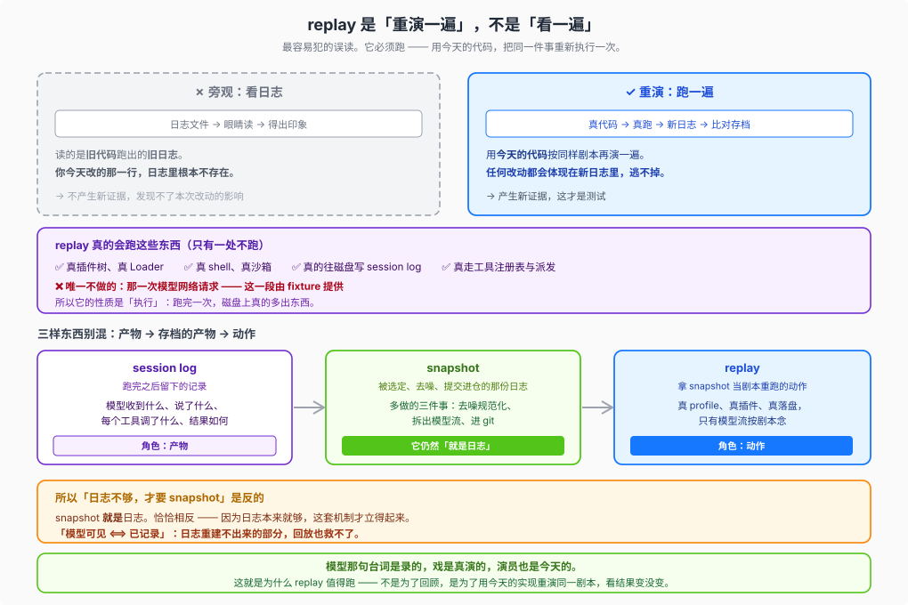

# 03 · replay 到底在做什么

这是三篇里最容易被跳过、也最容易错的一篇。

因为「回放」这个词会让人以为它是**读**——读日志、读文件、看看上次发生了什么。**它不是读，是跑。**

## 它真的会跑

replay 启动的是**完整的 `dsh` profile**：

- 真的插件树、真的 Loader
- 真的 shell、真的沙箱
- 真的往磁盘写 session log
- 真的走工具注册表、工具派发、结果投影

它唯一不做的，是**那一次模型网络请求**——那一段由 fixture 提供。

所以 replay 的性质是**执行**。它会产生新的日志、新的文件、新的进程。跑完一次，磁盘上真的多出东西。

## 为什么必须跑，不能只看

因为**你要验的是你今天改的代码**。

旧日志里跑的是**旧代码**。你看它一万遍，也不会知道今天那一行改动有没有搞坏东西。日志能告诉你「上次发生了什么」，但测试要回答的是「**这次**会发生什么」。

必须用今天的代码重新执行一遍，比对才有对象。

**旁观者 vs 重演者**：

| | 旁观者 | 重演者（replay） |
| --- | --- | --- |
| 做什么 | 看录像，想知道「上次发生了什么」 | 按剧本把戏重演一遍，看「这次演得对不对」 |
| 产生新证据吗 | 不产生 | **产生**（今天代码跑出的结果） |
| 能发现你今天改的那一行吗 | 不能，旧录像里没有它 | **能，任何改动都逃不掉** |

一句话：**模型那句台词是录的，戏是真演的，演员也是今天的。**

## 三样东西别混

这三个词挨得很近，角色却完全不同（00 的环节表只讲了它们的先后，这里讲它们是什么性质）：

|  | 是什么 | 角色 |
| --- | --- | --- |
| **session log** | 跑完之后留下的记录：模型收到什么、说了什么、每个工具调了什么、结果如何 | **产物** |
| **snapshot** | 被选定、规范化、提交进仓库的**那一份** session log | **存档的产物** |
| **replay** | 拿 snapshot 当剧本，把整件事重跑一遍 | **动作** |

链条是：`session log` →（选定+去噪+提交）→ `snapshot` →（重跑）→ `replay`。
>
> 注意最后一步：`replay` 不是 `snapshot` 的下一步产物，而是**拿它当输入的另一个动作**。

## snapshot 就是日志

这一点常被误解成「日志不够，所以要搞 snapshot」。**因果正好相反。**

`snapshot` 不是「比日志更高级的东西」，它就是**同一份东西**，只是多做了三件额外的事：

1. **去噪规范化**——去掉随机 id、时间戳，才能跨机器逐字节比对
2. **拆出模型流**——把 assistant 的流式输出剥离出来，作为 replay 的输入剧本
3. **进 git**——变成可重复、可 review、可长期持有的资产

（session log 本身的定义在 [00](./00-index.md#它怎么运转三个环节不是三个选项)；这里只说它与 snapshot 的关系。）

所以正确的因果是：

> **因为日志本来就够，这套机制才立得起来。**

这正是根 `AGENTS.md` 的不变量 **「模型可见 ⟺ 已记录」** 的意思：任何到达模型请求的东西，都必须能从 session log 重建。

**日志重建不出来的部分，回放也救不了。** 如果某样东西没进日志，snapshot 再多也变不出来。这也是 `replay.override.json` 存在的原因——它专门补那几类日志里重建不出来的失败（pre-2xx 抛、post-2xx 抛、挂起、注入重试）。

## fixture 里装的是什么

一份 fixture 是**某次真实运行产出的持久化 session 的投影**：

- **保留**：header、每个事件的 payload、`request/header`（模型实际收到的 config / tools）
- **省略**：body 的 `seq` / `time` 包络（replay 时重新生成连续序号与确定时间戳）
- **可能 token 化**：`request/header` 里的 `{{system}}` / `{{tools}}` 在 replay 时物化

`llm-replay` README 对此的原话是：*"this plugin does not record"*——**录制不属于回放插件**。它只消费产物。

## 回放期间会发生什么

| phase | 行为 |
| --- | --- |
| **装载** | 读 fixture，校验文件名与 header 一致，用格式目录解码并（内存中）迁移历史输入 |
| **拒绝** | fixture 不合规直接报错。**"replay never repairs a refused artifact"** |
| **运行** | 挂上去顶替真 adapter；每次 `assistant/message` / `assistant/attempt` 把压缩流展开 */
| **写盘** | runtime **照常写完整日志**——被压缩的只是输入 fixture |

注意最后一行：**输入是压缩的，输出是完整的。** 回放跑出来的 session log 和真跑出来的一样完整，这正是它可以拿来比对的前提。

## 为什么这套是「活的」

replay 比对不一致，**不等于**你不能改代码。改动会体现在新跑出的日志里，diff 会告诉你差在哪：

- 差异**是有意的** → 用 `refresh` 更新期望，或 `record` 重录
- 差异**是意外的** → 那就是它抓到的 bug

`refresh` 与 `record` 的存在正说明这是一套活机制。它不是只读快照，是**有明确更新路径的回归基线**。

## 下一步

- 怎么判断某条测试算不算 keyless、它证明了什么 → [04 边界与判据](./04-boundaries.md)
- 查命令和词 → [05 速查](./05-cheatsheet.md)
