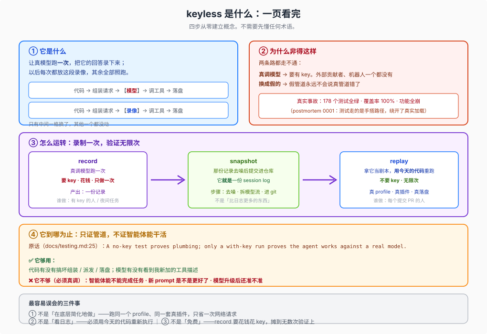
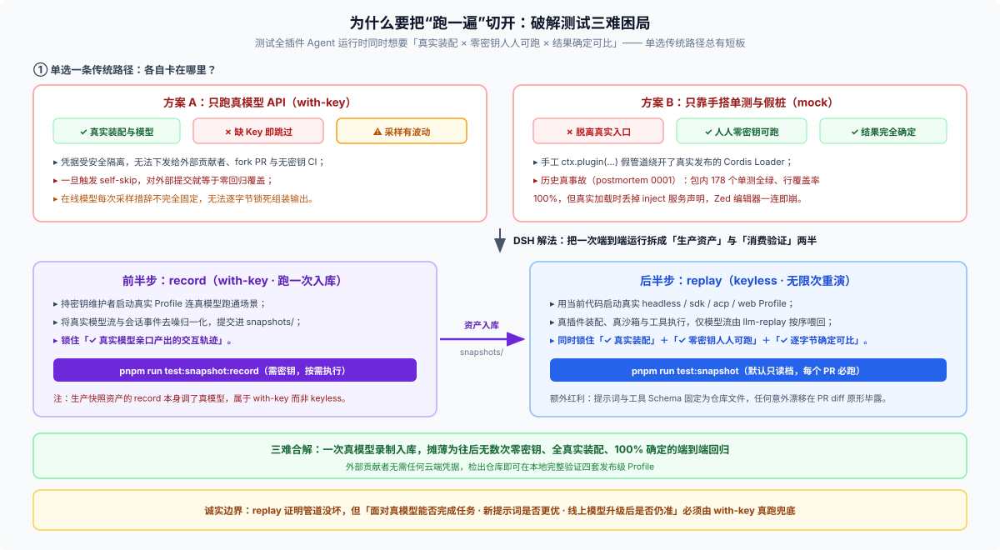

# Answer 29 · `keyless` 只看一条判据：这一遍运行有没有向真实模型服务商发请求

## 一句话结论

在 DSH 里，`keyless`（即 [`docs/testing.md`](https://github.com/deepseek-ai/deepseek-harness/blob/master/docs/testing.md) 里的 `no-key`）既不是“机器上没设环境变量”，也不是某个单一测试命令的专名，而是**衡量单次测试运行性质的唯一判据——这一遍跑下来，有没有向真实的模型（或外部搜索等）服务商发起网络请求**。

- **没有发起真实服务商请求 → 就是 `keyless`**：不管它是回放历史模型录像、连本地假服务端，还是压根没启动模型层；也不管它有没有传假 Key、写没写本地磁盘。
- **发起了真实服务商请求 → 就是 `with-key`**：包括真调线上接口的 `pnpm run test:e2e`，以及生产快照资产的 `pnpm run test:snapshot:record`。两者各司其职，不是新旧替代关系。
- **包含关系别搞反（`replay ⊂ keyless`）**：在所有 `keyless` 测试手段里，DSH 证据最强的主力做法是**录制会话回放（`pnpm run test:snapshot`）**——让真模型跑一次录下回答并入库，之后每次在无密钥环境下驱动整套真实插件、沙箱与工具重跑。

拿一次完整的工具调用回合来看，主力回放模式与真跑之间**只替换了中间那一格**：

```text
真跑（with-key）：
  当前代码 → Loader 装配真插件 → 拼装请求头 → 【真实模型 API】 → 派发执行真工具 → 写入会话日志

回放（keyless replay）：
  当前代码 → Loader 装配真插件 → 拼装请求头 → 【已入库模型流】 → 派发执行真工具 → 写入会话日志
```



---

## 一、顺着这一条判据，解开四个反直觉现象

仓库里看似互相冲突的几处用法，放到“有没有向真实服务商发请求”这把尺子下看其实完全自洽：

1. **环境变量里塞了假 API Key，依然是 `keyless`**
   像 [`apps/web/tests/smoke-real.e2e.ts`](https://github.com/deepseek-ai/deepseek-harness/blob/master/apps/web/tests/smoke-real.e2e.ts) 传入 `DEEPSEEK_API_KEY: 'keyless-web-no-call'`、[`apps/cli/tests/headless-shutdown.e2e.ts`](https://github.com/deepseek-ai/deepseek-harness/blob/master/apps/cli/tests/headless-shutdown.e2e.ts) 传入 `'keyless-shutdown-no-call'`，环境变量明明在，但它们是标准的 `keyless` 用例。原因很实在：部分真实配置链路要求凭据字段非空才能完成初始化；如果不传变量，用例可能触发 `self-skip` 静默跳过，一行断言都没跑。故意塞一个哨兵假值（重点在 `no-call`），既强制进程走完真实启动路径，又保证万一代码误发线上请求会当场鉴权报错——比单纯“不设环境变量”严密得多。

2. **会往磁盘写文件、改写仓库快照，依然是 `keyless`**
   [`vitest.snapshot.config.ts`](https://github.com/deepseek-ai/deepseek-harness/blob/master/vitest.snapshot.config.ts) 只在 `DSH_SNAPSHOT=record` 分支读取根目录 `.env`；默认的 `replay` 和更新基线用的 `refresh` 压根不加载真实密钥。运行 `pnpm run test:snapshot:refresh` 会往磁盘改写标准输出期望、系统提示词与工具 schema sidecar 乃至当前格式的会话快照文件（见 [`dsh-session-snapshot` `src/suite.ts`](https://github.com/deepseek-ai/deepseek-harness/blob/master/packages/test-support/session-snapshot/src/suite.ts)），但它全程只消费已入库的模型流、不发任何外部请求，所以完全符合 `keyless`。`keyless` 不等于只读。

3. **手写 mock 和无模型冒烟也算 `keyless`，但证据强度远不如 `replay`**
   [`packages/test-support/`](https://github.com/deepseek-ai/deepseek-harness/blob/master/packages/test-support/README.md) 下的 `dsh-llm-replay`（回放真模型历史输出）、`dsh-llm-mock-server`（按脚本制造限流、超时、畸形块等故障）、`dsh-remote-mock`（前端测试替掉整个后端 Host）、`dsh-loader-smoke`（只跑真实 Loader 子进程装配、不挂模型），外加 `pnpm run test:expected`，统统不调真模型，因此都算 `keyless`。但只有 `replay` 喂给系统的是真模型亲口说过的历史输出，拿低档 mock 的绿灯去宣称“模型交互已验证”是最常见的误判（五档分级见 [`02-boundaries-and-cheatsheet.md`](./02-boundaries-and-cheatsheet.md)）。

4. **快照回放不是“读静态日志”，而是用今天的代码真跑全套流程；而产出快照的 `record` 本身不是 `keyless`**
   回放启动的是真实的 `dsh` profile、真实插件加载、真实沙箱和真实工具派发，跑完会在临时目录写出全新的完整会话日志与工作区文件，唯一换成剧本的只有模型吐字那一格（机制拆解见 [`01-how-replay-works.md`](./01-how-replay-works.md)）。同时记住：**`keyless` 描述的是消费资产做验证的方式，不是生产资产的方式**——首次录制那份剧本的 `record` 必须调真模型、花真密钥。

---

## 二、为什么非得把“跑一遍”切开？（Postmortem 0001 的三难困局）

测试一个全插件化的 Agent 运行时，工程上同时想要三样东西，但单选任何一条传统路径都会漏掉一角：

| 方案 | 组装路径真吗？ | 无凭据人人能跑吗？ | 结果确定可比吗？ | 现实中卡在哪里 |
|---|---|---|---|---|
| **只跑真模型 API（`with-key`）** | ✅ 真 Loader、真模型 | ❌ 外部 PR 无密钥 | ⚠️ 采样有波动 | 团队内部虽不限推理额度（`"do not ration real-API tests"`），但凭据受安全隔离不能发给 fork PR 与机器人；一旦 `self-skip`，对外部提交就等于零覆盖 |
| **只靠手搭单测与 mock** | ❌ 手工拼假管道 | ✅ 零凭据秒跑 | ✅ 完全确定 | 测试挂载路径与真实发布入口脱节，假管道绿得再漂亮也抓不住真入口崩溃 |
| **`record` 一次 + `replay` 无限次** | ✅ 真 profile、真插件 | ✅ 检出代码即可跑 | ✅ 逐字节可比 | 持密钥者跑一次 `record` 把真模型回答入库，之后每个 PR 用 `replay` 在零密钥下重演全链路 |

第二行的盲区在 DSH 历史上交过真学费（见 [`postmortem 0001`](https://github.com/deepseek-ai/deepseek-harness/blob/master/docs/postmortem/0001-acp-default-export-drops-inject.md)）：`dsh-acp` 末尾多写了一行 `export default apply`，导致真实 Cordis Loader 加载插件时直接丢掉 `inject` 服务声明，Zed 编辑器一连就崩——而当时包内 **178 个单元测试全绿、行覆盖率 100%**，因为单测全是手搭挂载，完美绕开了真实 Loader。



把一次完整运行切成 `record` 与 `replay` 两半，不仅同时保住了真实装配、无凭据可跑和确定性，还顺手解决了一个审查难题：**以前系统提示词和工具 schema 藏在运行时的网络请求里，现在被固定成仓库文件，任何改动都会在 PR diff 里原形毕露**：

- **对外部贡献者与 CI**：无需任何云端凭据，检出仓库即可并发跑完 `headless`、`sdk`、`acp`、`web` 四套真实 profile 的端到端回归；
- **对插件作者与 Reviewer**：改一行工具参数描述或提示词拼装逻辑，不用靠猜就能直接对比发给模型的 `request/header` 到底变没变；
- **对修 Bug 的维护者**：一旦在线上复现出棘手的模型交互缺陷，可以把那次会话日志脱敏固化成快照，之后在无密钥环境下反复断点重跑。

---

## 三、写测试与审 PR 时记住三条底线

1. **别把“没配 Key 也没报错”当成 `keyless` 通过**：如果用例写了 `skipIf(!DEEPSEEK_API_KEY)`，缺密钥时它只是静默跳过，什么都没验；真正断言“绝不发线上请求”的用例，要么挂了 `llm-replay` / mock，要么显式塞了 `*-no-call` 哨兵假值。
2. **凡是改了模型可见输入、协议或用户界面，单测和 mock 抵不了录制快照**：[`docs/testing.md`](https://github.com/deepseek-ai/deepseek-harness/blob/master/docs/testing.md) 硬性规定，非平凡的模型、协议或界面可见变更必须在同一 PR 新增或更新 `keyless` 录制会话场景。
3. **永远别拿 `keyless` 全绿宣称“智能体对真模型能把活干成”**：`"A no-key test proves plumbing; only a with-key run proves the agent works against a real model."` 快照夹具里躺着的是旧模型的历史台词，哪怕线上模型升级后提示词已经失效，快照也不会报警——那一层只能靠 `with-key` 真跑兜底。

---

## 继续阅读

| 你想进一步看什么 | 去哪篇看 |
|---|---|
| `dsh-llm-replay` 底层怎么驱动真实代码重跑？`snapshot` 与日常会话日志是什么关系？`record / replay / refresh` 三档怎么配合？ | [`01-how-replay-works.md`](./01-how-replay-works.md) |
| `keyless` 能证明与不能证明的完整边界表、五档测试证据强度对比、常见误区与 CLI 命令速查 | [`02-boundaries-and-cheatsheet.md`](./02-boundaries-and-cheatsheet.md) |
| 独立插件仓值不值得引入录制会话快照？怎么最小化搭起来？ | [FAQ 21 · 录制会话快照](../21_recorded-session-snapshots/answer.md) |
| 在固化成快照之前，怎么利用会话日志做探索性的排障取证（探针工作法）？ | [FAQ 28 · 探针的用法与来由](../28_probe-usage-and-origin/answer.md) |

> 核验状态见 [核验基线登记](../00-baseline.md)。
