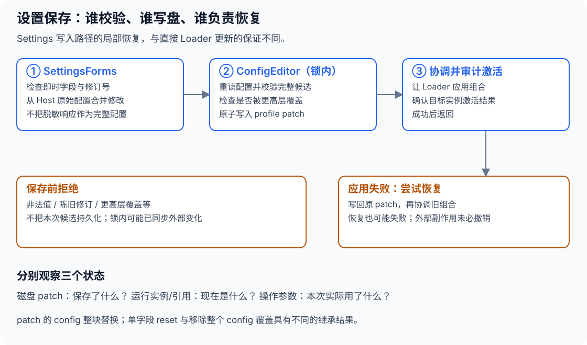

# 02 · DSH 的实际消费链与生命周期

## 先沿一个配置值走完使用链

本篇回答“声明写好之后，谁真正使用它”。以 Shell 超时为例：组合文件提供数字，Loader 加载插件行，Cordis 校验后创建执行器；执行器在新操作开始时读取配置。用户在线修改时，设置服务校验修改、写 profile patch，再由 Loader 更新运行实例。最后，后续操作才用到新值。

如果直接进入本篇，先明确几个对象：profile 是应用选择的一套组合及其用户配置；bundle 可提供基础插件配置；entry 是 Loader 管理的一行插件配置及其对应实例；patch 按 `id` 定位该行并修改它。后文“协调”指重新组合这些配置层，再让 Loader 更新受影响的条目，并检查需要的插件是否激活。

这里有三份需要区分的数据：文件中的原始配置（raw config）、schema 解析后的运行配置、一次操作已经捕获的参数。它们有不同的更新时间，失败时也可能处于不同状态。以超时为例：文件中可以没有 `timeoutMs`；解析后引用的 `.get()` 得到默认值 `120000`；一次命令解析又可以因请求自带超时而采用其他值。检查其中一份不能代替检查另外两份。

下图先标出保存入口的实际职责。Host 指运行 DSH 服务的 Node.js 进程，Client 指浏览器中的 UI；两侧校验服务于不同目的，完整候选仍由 Host 在写入前检查。



## 插件启动：Cordis 通过统一接口调用校验器

Standard Schema 是校验库提供给消费者的统一调用协议，不是另一份配置文件，也不是 JSON Schema。Schemastery 实现它，Cordis 按协议取得解析值或错误；因此框架不必硬编码每个校验库的调用方式。DSH 主要使用 Schemastery，而 Cordis 的基础协议可以接受其他同步实现。

[Cordis 的 resolveConfig](https://github.com/deepseek-ai/deepseek-harness/blob/master/vendor/cordis/src/fiber.ts#L42)会调用 `runtime.Config['~standard'].validate(config)`：没有 Config 时原样返回，有 issues 时生成配置错误，成功时采用 `result.value`。当前明确拒绝异步结果。Schemastery 提供了对应的[Standard Schema 适配](https://github.com/deepseek-ai/deepseek-harness/blob/master/vendor/schemastery/src/index.ts#L290)。

Cordis 用 fiber 管理一次插件挂载的状态和资源。插件通过 `inject` 声明需要的服务；例如 Shell 执行器依赖子进程服务，框架不能在它不可用时正常启动执行器。`apply` 是函数插件的启动入口，服务类则由构造函数启动；`internal/config` hook 是框架在校验前交给已注册处理者加工配置的调用点。首次激活的顺序是：依赖可以满足，经过内部 `internal/config` hook 处理配置，执行校验，然后进入插件 `apply` 或服务构造函数。仍在等待依赖的 PENDING 实例可能尚未校验。服务插件通过类的 `static Config` 提供声明，函数插件通常通过模块的具名导出提供。真实启动入口见[Fiber 激活](https://github.com/deepseek-ai/deepseek-harness/blob/master/vendor/cordis/src/fiber.ts#L641)。

这解释了两种不同支持范围：其他同步 Standard Schema 库可以满足 Cordis 的基础启动校验；DSH 的原生图检查、配置投影与设置服务却进一步依赖 Schemastery 的结构。比如[配置收集器](https://github.com/deepseek-ai/deepseek-harness/blob/master/packages/boot/app-boot/src/config-schema/collect.ts#L200)会把非原生 Schemastery Config 标为 unsupported。不能只说“换库完全等价”，也不能说“Cordis 强制只能用 Schemastery”。

## 即时配置：声明、更新和读取是三个动作

`.volatile()` 让字段的解析结果成为带 `.get()` 的引用，而非直接的数字或字符串。满足即时更新条件时，Loader 保留已有实例和引用，只替换引用中的值，消费者便可继续持有该引用。这里“稳定”指同一活跃实例的更新过程；独立调用两次 `Config(raw)` 不会自动共享引用。

```javascript
const Config = Schema.object({
  retries: Schema.number().default(3).volatile(),
})
const config = Config({})
config.retries.get() // 3
```

库解析该字段时创建引用；引用中的对象、数组值是脱离输入且递归冻结的普通数据快照。它拒绝函数、类实例和循环引用等值，见[引用创建](https://github.com/deepseek-ai/deepseek-harness/blob/master/vendor/schemastery/src/index.ts#L480)和[快照实现](https://github.com/deepseek-ai/deepseek-harness/blob/master/vendor/cosmokit/src/volatile.ts#L18)。

Loader 在活跃实例、上下文未变、只改变 config 等条件成立时，比较普通字段，解析并校验候选；普通有效值仍相同才提交到已有引用，并按变化路径通知所属实例。无效候选保留运行中的旧引用值；普通字段变化、依赖更换等仍可能进入正常更新和重挂流程，见[Entry 更新实现](https://github.com/deepseek-ai/deepseek-harness/blob/master/vendor/loader/src/config/entry.ts#L141)。

普通配置修改可能需要重挂：旧实例释放它拥有的监听、服务和其他 effects，新实例再按新配置启动。依赖更换、代码替换也有自己的生命周期；即时更新是满足条件时保留实例的特定路径，不是绕开所有重挂。

因此，业务需要明确每个字段的读取时点；按操作生效的字段在操作开始时读取 `.get()`，需要一致快照时在该操作内捕获所需值。操作 A 若已经捕获旧超时，更新引用不自动改变 A；操作 B 在更新后读取，才能使用新超时。这是消费者应设计的时间语义，不是 `.volatile()` 自动改写全部进行中任务。不能永久缓存启动时读到的普通值，也不能把通知理解为框架已等待业务资源重新配置完毕。

还有一个重要限制：字段必须处于固定对象路径，或将整个容器作为一个即时值。“固定对象路径”例如 `limits.timeoutMs`，各级字段名由声明确定；数组元素会增加、删除或移动，不满足这个条件。可以把整个数组声明成一个即时值，更新时替换其快照，但不能因此在每个数组元素内部随意放置独立即时引用。不能在数组、字典、union/intersect 等动态分支内部随意分散引用，也不能在一个即时值里嵌套另一个即时值。声明校验见[volatile 路径检查](https://github.com/deepseek-ai/deepseek-harness/blob/master/vendor/schemastery/src/index.ts#L488)。

## Shell 例子：确实接到了消费者

Shell 能展示从页面控件到实际请求参数的连接，而不只停留在 schema 有一个标记。

| 环节 | 源码中的实际行为 |
|---|---|
| 声明 | [LocalBashExecutor.Config](https://github.com/deepseek-ai/deepseek-harness/blob/master/packages/shell/bash-local/src/index.ts#L100) 定义超时、输出大小等即时字段 |
| 页面 | [ShellCard](https://github.com/deepseek-ai/deepseek-harness/blob/master/packages/client/ui-settings-shell/src/client/ShellCard.tsx#L25) 手写数值控件；[控制器](https://github.com/deepseek-ai/deepseek-harness/blob/master/packages/client/ui-settings-shell/src/client/shell-card-controller.ts#L44)选择编辑字段 |
| Host 接收修改 | [SettingsForms](https://github.com/deepseek-ai/deepseek-harness/blob/master/packages/settings/settings/src/index.ts#L377) 限制可写路径、检查修订号、从原始配置合并 |
| 校验与保存 | [ConfigEditor](https://github.com/deepseek-ai/deepseek-harness/blob/master/packages/boot/config-editor/src/index.ts#L87) 校验完整候选，写 profile patch，再协调运行配置 |
| 更新运行值 | [Loader Entry](https://github.com/deepseek-ai/deepseek-harness/blob/master/vendor/loader/src/config/entry.ts#L159) 更新原有引用 |
| 业务使用 | [LocalBashExecutor.resolve](https://github.com/deepseek-ai/deepseek-harness/blob/master/packages/shell/bash-local/src/index.ts#L120) 读取 `.get()`，解析下一个请求的超时和输出预算 |

执行器还做正数、有限值、计时器范围等业务检查，见[可执行配置验证](https://github.com/deepseek-ai/deepseek-harness/blob/master/packages/shell/bash-local/src/index.ts#L66)。这再次说明：schema 覆盖了哪些规则，要看实际声明，不能假设它已证明整个业务可运行。

## 设置数据与页面：有共用基础设施，控件仍由产品拥有

当前设置服务直接从活跃插件的 Config 提取字段，持久化落到 profile patch。它不是另外维护一份与 Config 独立的设置字段定义。下面的“有效值”是当前运行实例采用的值；“继承值”来自移除该 entry 用户配置覆盖后仍存在的基础配置；“用户值”是 profile 覆盖层保存的部分。三者不同，页面才能区分当前结果、默认来源和用户修改。

修订号（revision）用于发现“我读完页面后配置又被别人改过”的情况。客户端提交它读取时的修订号，Host 对照当前值；不相同就拒绝陈旧写入，让调用者重新读取，而不是静默覆盖别人的修改。秘密脱敏则意味着页面看见的对象可能缺少真实秘密值，因此修改应由 Host 从原始配置合并，不能拿脱敏对象整体替换原配置。

保存还有一个会影响后续升级的实际语义：patch 的 `config` 整块替换该 entry 的配置，不是字段级合并。编辑一个字段也可能把当时的普通字段和其他即时字段写入覆盖层，固定它们的继承结果；以后 bundle 修改这些默认值，不会穿过这份覆盖。单字段 reset 恢复当前继承值，整个 entry reset 才移除其配置覆盖。依据见[配置所有权决定](https://github.com/deepseek-ai/deepseek-harness/blob/master/.agents/notes/implemented/architecture/2026-09-19-profile-owned-live-configuration.md#L15)。因此“保存有效”与“继续继承未来默认值”是两个不同承诺。

[volatileForm](https://github.com/deepseek-ai/deepseek-harness/blob/master/packages/settings/settings/src/schema.ts#L19)沿对象路径保留即时字段，去掉供表单使用时不需要的引用标记，并处理 secret 默认值。[describe](https://github.com/deepseek-ai/deepseek-harness/blob/master/packages/settings/settings/src/index.ts#L302)输出原生 schema、有效值、继承值、用户值和修订号；远程响应由[settings-controller](https://github.com/deepseek-ai/deepseek-harness/blob/master/packages/api/settings-controller/src/index.ts#L97)要求脱敏。

Client 的 [SettingsSchemaService](https://github.com/deepseek-ai/deepseek-harness/blob/master/packages/client/ui-settings/src/client/schema.ts#L45)通过 `new Schema(serialized)` 重建，再调用 schema 校验草稿。页面显示什么控件，则由产品组件决定；[插件页面配置清单](https://github.com/deepseek-ai/deepseek-harness/blob/master/packages/client/ui-plugin-manager/src/client/config-ledger.ts#L40)读取 Slots 注册情况，Shell 页面也是手写字段。

所以更准确的描述是：DSH 复用了 schema 传输、读取、草稿校验和修改基础设施，产品拥有具体页面。当前查到的生产路径不足以支持“任何 Config 都自动生成完整表单”或“没有自定义页面就自动提供 JSON 编辑器”的结论。Host 里虽有 `autoGenerate` 字段，不能仅凭它的名称推断生产 Client 已实现相应渲染。

## 不同入口失败时，保住的状态不同

前面出现的“失败保留旧值”需要限定对象。下面说明主仓已定义的行为，不能合并成一个全局回滚承诺。

| 入口与失败 | 运行状态 | raw 配置或磁盘 |
|---|---|---|
| Loader 尝试即时更新，候选校验失败 | 旧引用中的值保留 | 新 raw config 可留在 entry；不表示文件编辑被撤回 |
| 普通 Loader 更新后，新插件激活失败 | 可留下失败实例或部分应用的树 | Loader 不自动恢复整棵旧配置树 |
| Settings 保存前校验失败，或写入会被高层遮蔽 | 不提交这次设置修改 | 拒绝持久化该候选 |
| Settings 写 patch 后应用失败 | ConfigEditor 尝试恢复旧 patch 并重新协调 | 这是该写入操作的局部恢复；恢复本身仍可能失败 |

依据是[volatile 更新决定](https://github.com/deepseek-ai/deepseek-harness/blob/master/.agents/notes/implemented/architecture/2026-09-18-volatile-config-references.md#L31)、[非事务 Loader 决定](https://github.com/deepseek-ai/deepseek-harness/blob/master/.agents/notes/implemented/simplification/2026-09-09-nontransactional-loader.md#L15)与[ConfigEditor 写入实现](https://github.com/deepseek-ai/deepseek-harness/blob/master/packages/boot/config-editor/src/index.ts#L87)。这也解释了为什么只等待加载结束，不足以证明所有插件成功激活；具体应用还需检查它依赖的实例与服务。

## 三种常被混淆的输出

同一套配置声明可以参与不同产物，但三条路径并不等价。“原生图”指 Schemastery 节点及其引用关系；序列化时以 `uid` 标识节点，用 `refs` 保存引用表。“投影”指读取这些声明并转换成另一个表示，不保证保留全部执行语义。理解这些区别，才能判断工具展示的究竟是什么。

| 输出 | 怎样得到 | 用途与限制 |
|---|---|---|
| Schemastery 原生序列化 | `schema.toJSON()` 产生 `uid/refs` 图 | Client 可重建原生节点；不是标准 JSON Schema，也不能保证恢复任意回调闭包 |
| JSON Schema 投影 | DSH 遍历原生节点，转换可表达的输入约束 | 供配置检查和 Inspect；带局限与完整性诊断，不执行任意转换来假装等价 |
| 配置文档目录 | 静态分析入口、Config 类型、JSDoc 和 schema 表达式 | 展示部署配置并检查字段遗漏、新鲜度；不是从 `toJSON()` 直接渲染全部文档 |

第一条的实现见[toJSON](https://github.com/deepseek-ai/deepseek-harness/blob/master/vendor/schemastery/src/index.ts#L311)。第二条见[配置投影器](https://github.com/deepseek-ai/deepseek-harness/blob/master/packages/boot/app-boot/src/config-schema/projector.ts#L143)：它尽量描述输入接受条件，遇到转换、自定义类型、正则或 JavaScript 字符串长度等无法精确表达的行为时记录局限；输出完整性由[document](https://github.com/deepseek-ai/deepseek-harness/blob/master/packages/boot/app-boot/src/config-schema/document.ts#L155)声明。第三条见[目录生成器](https://github.com/deepseek-ai/deepseek-harness/blob/master/scripts/gen-config-catalog.ts#L1)。

JSON Schema 中 `default` 是注解，不等于执行 Schemastery 的默认值填充；union 的“第一个成功分支”也不能直接换成“恰好一个成功分支”的 `oneOf`。

## dump 与 Inspect 能证明什么

dump 指把组合配置或声明导出为可查看的文本；Inspect 是 DSH 为 Agent 提供的只读运行时查询能力。这几种查看方式回答不同问题。下面提到的 `!!js` 是 YAML 中标记 JavaScript 配置表达式的语法，Loader 会在允许的位置求值；“lazy builder”则是按需生成 schema 的回调。以下是源码行为说明，不是建议向正在使用的 profile 执行修改。

- [配置 dump](https://github.com/deepseek-ai/deepseek-harness/blob/master/apps/cli/src/dump-config.ts#L1)组合并打印配置树，不启动插件、不求值 `!!js`，不能证明插件 Config 已通过验证。
- [schema dump](https://github.com/deepseek-ai/deepseek-harness/blob/master/apps/cli/src/dump-config-schema.ts#L15)收集并投影声明，不执行插件启动、原生转换回调或配置表达式。导入模块、读取 Config、执行 lazy builder 仍可能执行可信 JavaScript，不能称为绝无副作用的纯数据扫描。
- [live config Inspect](https://github.com/deepseek-ai/deepseek-harness/blob/master/packages/extensions/tool-cordis/src/config.ts#L84)检查当前 Loader 实例的声明，并使用相同投影器。其观察范围与不挂载插件的声明收集不同，也不靠读取当前秘密配置值来解释规则。

这些工具改善可发现性，实际依赖、表达式结果和业务启动检查仍需要运行时验证。

## 其他 schema 系统的分工

DSH 没有把所有数据协议塞进 Schemastery。应按数据的来源、消费者和执行位置识别使用哪种规则。

| 数据 | 当前机制 | 依据 |
|---|---|---|
| 插件启动 Config | 主要是 Schemastery，经 Standard Schema 接入 Cordis | [resolveConfig](https://github.com/deepseek-ai/deepseek-harness/blob/master/vendor/cordis/src/fiber.ts#L42) |
| 模型工具参数与输出 | 工具 JSON Schema 及其支持子集；`defineTool` 负责参数校验 | [defineTool](https://github.com/deepseek-ai/deepseek-harness/blob/master/packages/core/tools/src/schema.ts#L547) |
| Host/Client 远程调用 | Typert 生成和注册协议，使用 Zod 等运行时 schema | [Typert 组](https://github.com/deepseek-ai/deepseek-harness/blob/master/packages/typert/README.zh.md#L10) |
| 存储业务记录 | 例如 storage-domain 明确使用 Zod | [DomainSpec](https://github.com/deepseek-ai/deepseek-harness/blob/master/packages/storage/storage-domain/src/spec.ts#L1) |
| Session 持久化类型演进 | 声明类型目录、规范化指纹、变更确认和兼容性检查 | [持久化目录说明](https://github.com/deepseek-ai/deepseek-harness/blob/master/docs/persistence-catalog.md#L14) |

这些系统可以在同一插件里并存：插件的部署参数用 Schemastery，工具调用参数用 JSON Schema，持久化记录用 Zod。它们共同服务可靠性，但没有因此变成同一种 schema。

> 核验状态见[核验基线登记](../00-baseline.md)。
