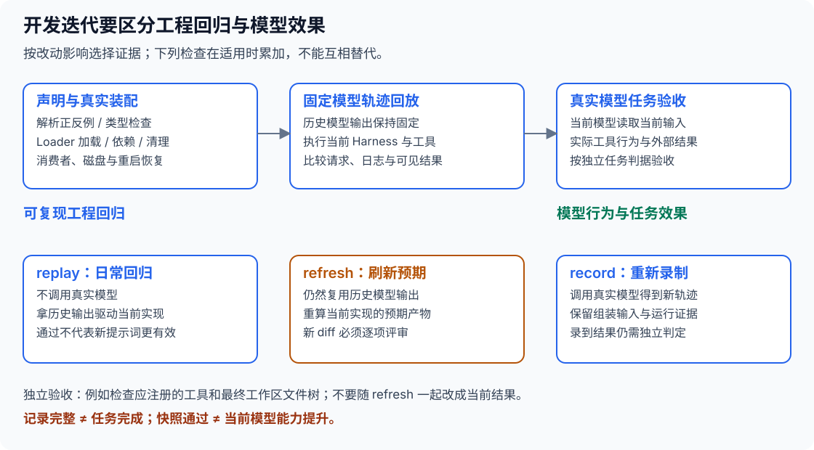

# 03 · 主仓怎样把质量要求变成可检查的事实

## 研究范围：配置质量的证据链

本文面向理解 AI Agent、但不熟悉 DSH 内部术语的工程师，说明主仓如何检查配置声明、配置加载、运行时更新、持久化和模型可见结果之间的一致性。Schemastery 是 DSH 使用的配置 schema 库；schema 描述字段及其解析规则，但通过 schema 不等于真实组合已加载，也不等于消费者使用了预期值。

检查选择应从改动会影响的行为开始。单元测试适合隔离解析和局部算法；真实组合测试检查实际入口、依赖注入和生命周期；构建产物测试检查用户实际运行的编译文件；录制会话检查组装后的模型输入和确定性流程；独立效果断言检查磁盘或工作区的最终状态。证据不能互相代替，也不能因为一项检查通过就推断其他层正确。

本页中的“执行检查”指仓库脚本或测试实际运行时会拒绝某类回归；“评审规范”指贡献者仍须查看 diff、判断预期是否正确的要求。可执行检查减少特定错误，但不替人判断新行为是否符合需求。[本地验证流程](https://github.com/deepseek-ai/deepseek-harness/blob/master/.agents/skills/dsh-pre-push-checks/SKILL.md#L27)按变更风险选择命令；本文说明如何匹配证据，不声称下列测试在本次编辑中已运行。

这里几个名称都指具体对象：Loader 是把组合文件中的插件行装载起来的组件；fiber 是 Cordis 跟踪一次插件挂载的状态与资源对象；profile 是应用组合及其配置；revision 是设置响应携带、用于检测陈旧写入的修订号；sidecar 是录制会话旁单独保存的提示词或工具 schema 配套文件。下图把工程回归和真实模型验收放在一起，便于后文选择检查。

## 先看一个测试为什么会漏掉问题

假设你修改了 Shell 的默认超时。在测试里直接创建执行器，再检查 `resolve()` 返回的超时，可以证明这段业务计算正确。但测试作者已经替它提供了配置和依赖，所以它不能回答“组合文件有没有选中这份实现”“Loader 是否发现 Config”“设置保存后是否仍是这个实例”。真实组合测试把这些步骤也交给产品实际使用的加载过程。

再往后，如果该改动影响模型收到的工具说明，配置测试仍然不够：需要比较实际组装的工具声明。若声称模型因此更会选超时，则还要让当前模型运行任务，并检查实际结果。下面每一层检查都是在前一层无法观察的位置补证据；选择它们的理由是要兑现哪项行为，而不是测试名称听起来更全面。

## 一、配置来源和声明检查分别能证明什么

配置正确不仅取决于字段值是否合法，也取决于谁负责提供该值。例如凭据和服务端点可能由适配器、凭据服务或环境快照解析；在组合文件中直接拼入环境值会绕过这些职责。

[配置来源检查](https://github.com/deepseek-ai/deepseek-harness/blob/master/scripts/verify-config-source-ownership.ts#L12)扫描列出的应用 YAML、bundle patch、preset patch 和 Python 运行时配置，并用逐行正则拒绝 `apiKey`、`baseURL`、`apiKeyEnv`、`authToken`、`headers` 的普通单行 `!!js` 内联形式。检查接入 [doc-sync](https://github.com/deepseek-ai/deepseek-harness/blob/master/scripts/run-gates.ts#L849)。对应[测试](https://github.com/deepseek-ai/deepseek-harness/blob/master/scripts/verify-config-source-ownership.spec.ts#L13)只证明一个 bundle patch 中的内联端点会被拒绝；它不是完整 YAML 解析器，也不能证明所有凭据来源均正确。

配置目录生成器检查的是另一种漂移。[生成器](https://github.com/deepseek-ai/deepseek-harness/blob/master/scripts/gen-config-catalog.ts#L502)从可静态识别的 Schemastery 表达式收集字段路径，并同 Config 类型声明核对；[测试](https://github.com/deepseek-ai/deepseek-harness/blob/master/scripts/gen-config-catalog.spec.ts#L73)加入类型中缺失的 schema 字段，断言生成失败。`verify-config-catalog` 的 `--check` 路径由 [doc-sync](https://github.com/deepseek-ai/deepseek-harness/blob/master/scripts/run-gates.ts#L834)调用，比较生成目录和已提交文件，不会替作者修正文档。

该生成器的类型比对是字段路径存在性检查，不比较字段的可空性、默认值、数值范围或转换结果；[lookupPath](https://github.com/deepseek-ai/deepseek-harness/blob/master/scripts/gen-config-catalog.ts#L399)对无法解析的结构会返回 `unknown`。因此，目录新鲜和字段存在仍须由类型检查、解析实现测试及行为测试补足。

## 二、从 schema 单测到真实组合

“真实组合”是指通过产品使用的组合配置与 Loader 装载插件，而不是测试手动构造插件对象并直接调用 `apply`。真实入口能覆盖模块导出解包、依赖等待、配置解析和插件激活；直接 mock 或手工挂载适合验证孤立规则，但绕过的部分没有被验证。

[ACP 事故复盘](https://github.com/deepseek-ai/deepseek-harness/blob/master/docs/postmortem/0001-acp-default-export-drops-inject.md#L89)记录了完整单测和 100% 行覆盖仍未发现的问题：手工挂载绕过 Loader，插件多出的默认导出使 Loader 丢弃具名 `inject`；另一个顶层服务读取测试也未复现真实插件 fiber 中的依赖拓扑。之后增加的真实 Loader 子进程测试才经过实际装载路径。行覆盖率证明代码行被执行，不证明功能按产品方式工作。

后文的 Group 是把多行插件组织在一起的组合容器，Include 用于加载另一个配置文件；测试它们是为了确认多层配置仍经过正确更新入口。`boot` 指启动这套组合的操作，`inject` 是插件声明依赖服务的字段。

测试配置更新时，可按以下层次定位证据：

| 证据 | 适合回答的问题 | 不能单独证明的事 |
|---|---|---|
| [volatile schema 测试](https://github.com/deepseek-ai/deepseek-harness/blob/master/scripts/volatile-config.spec.ts#L9) | 默认值、必填字段、解析类型、序列化重建、快照复制和非法声明是否按预期工作 | Loader 是否消费配置、插件是否重载或真实消费者是否更新 |
| [Loader 更新测试](https://github.com/deepseek-ai/deepseek-harness/blob/master/scripts/loader-volatile-update.spec.ts#L42) | 创建 Loader 条目后，即时字段更新是否维持对象引用、按路径通知，普通字段变化是否走重载 | 产品命令、发布文件解析或模型最终输入是否正确 |
| [Group/Include 组合测试](https://github.com/deepseek-ai/deepseek-harness/blob/master/scripts/loader-volatile-update.spec.ts#L420) | 经 `boot` 和 profile patch 更新真实子树时，父子 fiber 是否维持身份，以及混合变更是否触发重载 | 已编译安装入口是否可运行 |
| 产品可见插件的真实组合测试 | 测试用 `cordis.yml` 是否经 Loader 和 app/process 启动，外部服务 mock 之外的真实行为是否可见 | 发布产物路径是否正确，除非显式以构建产物启动 |

这里先区分两种运行方式：测试可以直接运行仓库的 TypeScript 源文件，也可以启动构建后供用户安装运行的 JavaScript 文件。前者反馈快；后者还会经过包声明的真实入口。`exports` 是包向外声明的模块入口，`bin` 是命令行入口，smoke（冒烟测试）则指从实际入口做一次小规模启动和行为检查。

仓库 Vitest 将工作区包名导入（例如 `@deepseek-ai/dsh-shell`）通过 `tsconfig.base.json` 的 `paths` 映射到 `src`；静态测试通常验证源码平面，而不会从 package exports 装入 `lib/`。[测试解析配置](https://github.com/deepseek-ai/deepseek-harness/blob/master/vitest.config.ts#L17)避免旧构建输出引入第二份模块单例，但这意味着源码通过不等于发布产物通过。构建产物测试显式从 `lib` 入口以纯 Node 启动，使包解析遵循真实 `exports`；例如 [loader-smoke 启动器](https://github.com/deepseek-ai/deepseek-harness/blob/master/packages/test-support/loader-smoke/src/index.ts#L31)区分 `src`/tsx 与 `lib`/Node 两种模式。[测试政策](https://github.com/deepseek-ai/deepseek-harness/blob/master/docs/testing.md#L37)要求对 bin、非 index 运行入口及跨 bundle 单例等发布路径加构建产物 smoke。改动发布入口或模块解析时，仅跑源码单测证据不足。

## 三、更新、失败和并发时检查可观察状态

即时配置更新不仅要检查新值，也要检查同一更新中各引用何时可见、无效候选如何处理、其他条目能否独立提交，以及普通字段是否触发原生命周期。

[Loader 更新测试](https://github.com/deepseek-ai/deepseek-harness/blob/master/scripts/loader-volatile-update.spec.ts#L56)断言多个字段更新后只发一次局部通知，观察者看到的字段已同时提交；重复相同值不重复通知，另一个实例不受影响。[失败和混合更新用例](https://github.com/deepseek-ai/deepseek-harness/blob/master/scripts/loader-volatile-update.spec.ts#L85)检查无效候选不改旧运行引用，而普通字段变化会释放旧实例并创建新实例。[多条目失败用例](https://github.com/deepseek-ai/deepseek-harness/blob/master/scripts/loader-volatile-update.spec.ts#L473)进一步表明失败条目的运行值引用保留，但 raw config 候选仍已更新，健康条目可以继续提交。因此它不是整个配置树的原子事务，也不是磁盘回滚保证。

真实设置流程还有持久化和并发承诺。[配置测试夹具](https://github.com/deepseek-ai/deepseek-harness/blob/master/packages/settings/settings/tests/configuration-fixture.ts#L15)建立临时 profile、真实 bundle patch、Loader、ConfigEditor、Settings 和默认模型消费者。[主用例](https://github.com/deepseek-ai/deepseek-harness/blob/master/packages/settings/settings/tests/configuration.spec.ts#L9)修改模型后同时检查 fiber 身份、消费者选择、patch 文件内容，并销毁进程内上下文再启动以检查恢复。其他用例检查无效/非即时字段不落盘、较高优先级 home 配置遮蔽时拒绝写入、相同 revision 的并发写只有一个成功、外部改动使旧 revision 失效、秘密字段不因脱敏表单而丢失，以及激活失败后的 patch 恢复。

这些测试是执行行为断言；评审时仍应确认故障发生点、恢复对象和并发范围。实现通过锁内重读、revision/覆盖检查、原子写入及应用协调处理失败，[ConfigEditor](https://github.com/deepseek-ai/deepseek-harness/blob/master/packages/boot/config-editor/src/index.ts#L87)在重新协调失败时恢复文件并重协调旧 patch。[Settings 写入路径](https://github.com/deepseek-ai/deepseek-harness/blob/master/packages/settings/settings/src/index.ts#L377)限制可变字段并保留普通字段。测试不构成进程崩溃、恢复写入本身失败或任意外部副作用的完整事务保证。

### 怎样让测试本身可信

配置更新涉及异步加载、通知与持久化，测试需要知道自己到底等到了什么。[观察等待的决定记录](https://github.com/deepseek-ai/deepseek-harness/blob/master/.agents/notes/implemented/testing/2026-09-27-observation-waits-on-observed-state.md)提供了一个具体反例：测试从开始算 100 ms 后读取运行记录，但真正要观察的操作前面还有查询、失败恢复和再次启动。繁忙机器上，这个时刻甚至早于目标操作开始。解决方式是从目标操作交接时开始有界等待，并让被观察的操作保持进行，直到读取完成；没有放宽原来的行为断言。

把这个判断用于配置测试：保存接口返回后检查磁盘，Loader 更新完成后检查实例与引用，业务操作完成后检查它实际采用的参数。“等 100 ms”只说明时间经过了；正确的等待条件应是文件出现、所属操作完成或指定状态达到，超时只负责让永远未发生的变化明确失败。具体同步方式由被测对象决定，不能把文件存在一律当作激活完成。

并发也应被主动安排。比如要验证同一修订号的写入只能有一个成功，需让两次写入带着同一个旧修订号进入，而非先等第一次完成，再取新修订号发第二次。现有 [Settings 用例](https://github.com/deepseek-ai/deepseek-harness/blob/master/packages/settings/settings/tests/configuration.spec.ts#L48)这样提交两个候选，并分别统计成功与拒绝。若要验证“操作 A 进行中更新，操作 B 使用新值”，可用测试控制的 Promise 暂停 A，确认更新发生在暂停期间，再启动 B；这是建议的验收安排，不是声称该文件已覆盖所有操作 A/B 场景。

[测试可靠性 Skill](https://github.com/deepseek-ai/deepseek-harness/blob/master/.agents/skills/dsh-ci-test-reliability/SKILL.md)还要求临时目录、端口和子进程各有拥有者：测试失败后仍要清理，清理需要等到工作真正结束。原仓 [Loader 测试](https://github.com/deepseek-ai/deepseek-harness/blob/master/scripts/loader-volatile-update.spec.ts#L16)为上下文注册释放动作，设置夹具使用临时 profile。这些安排降低不同测试相互污染的可能；“在自己电脑单独运行一次通过”不能替代对实际并发资源的检查。

最后检查反例是否真的会失败。对新加的静态检查，临时放入它声称拒绝的配置，应观察到对应失败；对修复的加载问题，测试必须经过原先出错的入口。单纯增加通过的样例，还不能说明测试能拦住目标回归。这是 Skill 给出的开发要求，具体检查器的拒绝能力仍要由它自己的反例测试和执行结果支持。

## 四、按改动影响选择证据

下表是检查选择指南，不是仓库新增的自动验收规则。一个 PR 可以涉及多行；选择能覆盖实际风险的最小组合，并在评审中检查变更影响是否漏项。

| 改动 | 执行检查 | 评审还须判断 |
|---|---|---|
| schema 默认值、required、转换或空值解析 | 对应 Schemastery 解析测试；必要时类型检查 | 是否覆盖成功与失败输入，静态类型是否表达实际解析结果 |
| `cordis.yml`、bundle/preset patch、凭据或来源优先级 | `verify-cordis-config`、`verify-config-source-ownership` 及目标 Loader 组合测试 | 实际被求值的字段和层级、优先级遮蔽、凭据是否走其指定提供方 |
| 即时配置、依赖、更新通知或实例生命周期 | Loader 更新及 Group/Include 测试；有配置 UI 时加 Settings 流程测试 | 引用身份、提交/通知先后、失败时保留的具体状态、重载和清理 |
| 配置写入或恢复、revision、并发修改 | Settings 集成测试及磁盘断言；必要时重启恢复 | 文件、内存运行值、raw config 和消费者状态是否分别有正确保证 |
| package exports、bin、子进程或运行时入口 | 真实 Loader smoke；受影响的 `lib` 入口在构建后以纯 Node 测试 | 源码映射是否掩盖了 exports、遗漏的构建依赖或第二份单例 |
| 配置改变提示词、工具 schema、消息或请求头 | keyless session snapshot replay，检查日志和 prompt/schema sidecar | 预期输入是否真的正确，而非仅接受新生成的输出；记录的用户输入是否可重建 |
| Agent 写入/删除工作区或其他外部状态 | session replay 加 `workspace.expected/` 或独立外部状态断言 | 效果是否由文件/状态重新读取证明，而非只读模型自述或工具返回文本 |
| 文档中 Schema/API 操作、命令或配置示例 | 运行文档中的操作；`test:docs`、`doc-sync` 等与文档类型相符的检查 | 链接有效、新鲜度通过不代表语义正确；示例是否对当前实现实际成立 |

命令名和覆盖范围以根目录 [AGENTS.md](https://github.com/deepseek-ai/deepseek-harness/blob/master/AGENTS.md) 与 [测试政策](https://github.com/deepseek-ai/deepseek-harness/blob/master/docs/testing.md) 为准。不要把一般 PR 的完整套件设为默认；按影响运行聚焦测试，并按仓库要求在声明完成前运行必要构建检查。报告必须只列实际执行的命令和观察到的结果。

## 五、模型可见输入、日志与录制

模型可见输入包括请求消息、系统提示词和工具 schema 等实际发送给模型的内容。DSH 在构造请求时从 Session 派生消息，并记录请求头及相关上下文；[请求构造实现](https://github.com/deepseek-ai/deepseek-harness/blob/master/packages/core/agent-loop/src/agent.ts#L615)把解析后的模型配置、工具列表和派生消息组装成冻结请求。仓库规则要求凡进入模型请求的输入，都能从 Session 日志重建。因此配置改动若改变 prompt、工具列表或请求头，不能只断言 Config 对象，应检查对应的 Session 事件和录制场景。

Snapshot 是可重复回放的会话测试，不是屏幕截图。[测试支持 README](https://github.com/deepseek-ai/deepseek-harness/blob/master/packages/test-support/session-snapshot/README.md#L81)区分三种操作：`replay` 使用已有记录运行当前实现并比较预期；`refresh` 使用已有模型轨迹重新计算当前实现输出；`record` 调用真实模型生成新轨迹。Session 是持久会话日志，JSONL 是每行一个 JSON 记录的文件格式。录制场景保存日志；其中选定的代表场景负责固定完整提示词和工具 schema，称为 pin，这些内容放在单独的配套文件（sidecar）中，避免每个场景重复保存。归一化则按规则处理路径、时钟和身份等易变值，便于比较，同时仍须保留要检查的行为差异。快照能检查组装输入和确定性流程是否变化，但自动生成一个新 expected 文件不证明变化正确。

任何 snapshot 的 JSONL、prompt、schema、协议或 UI diff 都须人工审阅。刷新工具 schema 时，应核对它是否符合配置设计；刷新输出时，应识别错误工具结果、空响应或意外失败，而不是仅因 diff 可接受就更新基线。必要的语义检查应独立于被刷新的预期，例如拒绝 `UNKNOWN_TOOL` 结果。

回放和独立效果验收是两类证据。比如任务要求生成一个文件，模型说“已写好”、工具返回“成功”、日志可回放，都不能代替重新读取文件并检查内容。若 Agent 修改工作区，负责该快照场景的维护者（snapshot owner）需要提交完整预期文件树 `workspace.expected/`；record 和 refresh 不会改写这个期望目录。适配器捕获最终文件树后与其比较，[比较实现](https://github.com/deepseek-ai/deepseek-harness/blob/master/packages/test-support/session-snapshot/src/suite.ts#L1593)。这能防止模型文字或工具返回值冒充实际文件效果；只验证最终树仍不能证明任意网络或外部系统副作用，后者需由拥有该资源的独立测试检查。

回放使用固定的模型输出，因此能证明当前配置被消费、工具调用与日志流程可重现，不能证明当前真实模型更擅长完成任务。若变更主张改善任务效果，应另做真实模型运行和独立任务验收。不要把 keyless 回放称为真实模型质量评测，也不要让 record/refresh 替代对新输入和输出的评审。更多边界见 [FAQ 29](../29_keyless-meaning-boundaries/answer.md)。

## 六、从事故中建立独立守卫

[文件系统工具事故复盘](https://github.com/deepseek-ai/deepseek-harness/blob/master/docs/postmortem/0002-js-expression-disabled-filesystem-tools.md#L7)展示了配置加载与语义验收之间的缺口：当时 `disabled` 表达式所在配置位置未按作者预期插值，文件系统工具因此没有注册；刷新快照又把 `UNKNOWN_TOOL` 失败结果收为新预期。历史事故之后加入配置检查和未知工具结果拒绝机制。该记录描述的是当时事故及修复，不能据此泛化当前 `!!js` 支持范围；当前配置语法和字段位置应以 [Cordis 配置说明](https://github.com/deepseek-ai/deepseek-harness/blob/master/docs/cordis-primer.md#loader-configuration)及其执行检查为准。

长期机制应针对事故类别设置独立失败条件：schema 字段漂移由目录检查捕获；真实装配失败由 Loader 测试捕获；错误工具结果由 snapshot guard 拒绝；外部效果由 workspace 或资源断言检查。一个机制无法替代另一机制，因为它们观察的状态不同。静态检查通过、快照可重放、磁盘写入成功都不是功能语义的总证明。

本研究另外记录了 Schemastery 教程与实现之间的局部差异，包括 `required()` 与默认值的交互，以及教程中 `.check()` API 的可用性；细节见[解析语义](./01-schema-and-validation.md)和[研究记录](./research.md)。这属于文档事实核验，不是本次测试已运行的结果。涉及 API 操作的文档应对照源码和测试，执行其声称的操作；链接检查或目录新鲜检查不能验证 API 语义。

## 七、延伸阅读

本文聚焦现有检查如何产生证据；配置来源、生命周期和开发纪律背后的取舍见[配置开发实践](./05-practical-design-disciplines.md)。测试分层、真实入口、并发资源归属和 snapshot 场景要求见[测试政策](https://github.com/deepseek-ai/deepseek-harness/blob/master/docs/testing.md)。

> 核验状态见[核验基线登记](../00-baseline.md)。
