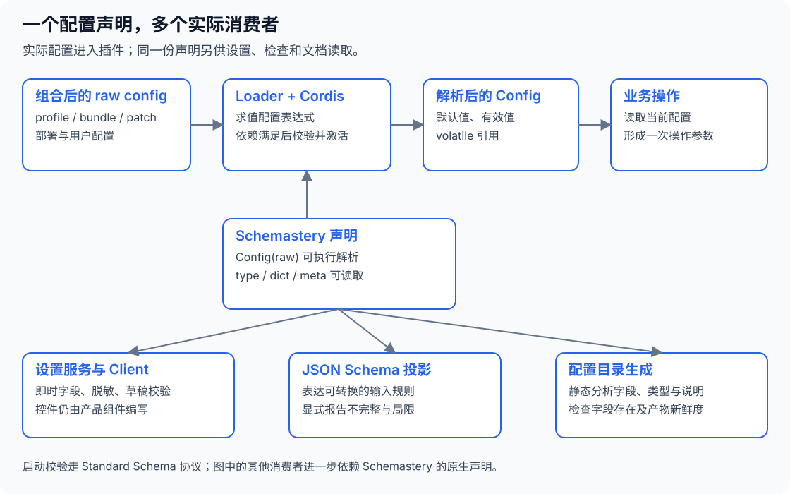
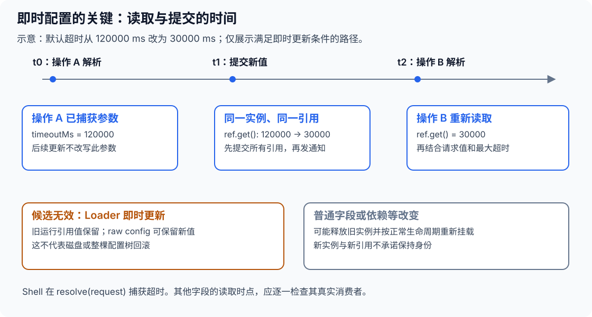
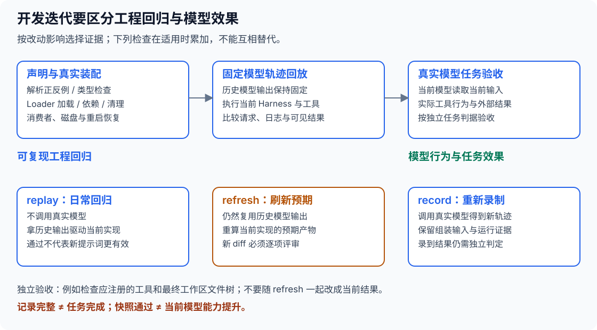

# Answer 30 · Schemastery：从插件配置到开发质量

## 先回答它是什么

**Schemastery 是 DSH 用来声明和解析插件配置的运行时 schema 库。** 它检查实际输入、补默认值，并保留可供设置服务、配置检查工具读取的声明信息。对熟悉 Agent 工具开发的人，可以先把它放在“部署和运行参数”这一层：它管理 Shell 的默认超时等插件参数；模型每次调用 Shell 时提交的参数，走的是另一套工具 JSON Schema。

DSH 的特点在于，大量行为由插件组合得到。因此一个配置改动是否正确，除了字段能否解析，还涉及插件有没有被加载、依赖是否满足、运行中的消费者何时读到新值、保存后能否恢复，以及最终给模型的工具和提示词有没有变化。**Schema 是这条链上的一环；开发质量要验证整条实际使用路径。**

本文面向熟悉 AI Agent/Harness、但对 DSH 本身生疏的开发者。先解释配置、插件实例和工具调用的关系，再用 Shell 超时串起机制，最后说明开发迭代如何选证据。TypeScript 片段会解释类型与运行值的区别；精确解析规则和源码调查留在分篇。首次阅读可以先看本页与图示，遇到具体开发问题时再查分篇，无需先记住内部实现名。

## 阅读地图

| 你要解决的问题 | 从这里读 |
|---|---|
| 先建立整体认识 | 本页：配置声明、运行消费、开发质量 |
| 写对 required、default、转换和组合 | [01 · 解析语义](./01-schema-and-validation.md) |
| 查启动、即时更新、设置保存与失败状态 | [02 · 实际消费链](./02-dsh-consumers-and-lifecycle.md) |
| 为一次改动选择检查、理解回放与真实验收 | [03 · 主仓质量实践](./03-repo-quality-practices.md) |
| 决定配置归属、动态字段和维护方式 | [05 · 开发纪律](./05-practical-design-disciplines.md) |
| 核对质量体系的较强说法 | [04 · 质量说法附录](./04-assessing-quality-claims.md) |

## 一、先把 DSH 名称翻译成具体工作

在 DSH 中，工具、模型接入、设置页面等能力都通过插件参与应用。一份插件代码要被组合配置选中，配置得到解析、依赖得到满足，才会成为工作的实例。“挂载”就是把插件加入运行环境并交给框架管理，“激活”则是它真正开始执行启动逻辑。因而“仓库有这个包”“配置里有这一行”“这个能力现在可用”是三个需要分别确认的事实。

Cordis 管理这些实例，Loader 负责从组合配置把它们装载起来。业务代码可以通过服务取得其他插件提供的能力；例如 Shell 执行器依赖负责子进程的服务，并非每个插件都是一个模型可调用工具。理解本专题只需要认识下面这些对象；其余实现名会在用到时解释。

| 原生名称 | 本文中具体指什么 |
|---|---|
| Cordis | 管理插件依赖、激活与资源释放的运行框架 |
| 插件实例 | 一次挂载；同一个插件实现可以用不同配置挂载多次 |
| Loader / entry | Loader 读取组合配置并挂载插件；entry 是它管理的一行，`id` 用于定位这行 |
| profile | 一套选定的应用组合及其用户配置；决定这次应用加载哪些能力及其参数 |
| bundle | 可以安装并给组合提供插件配置的包；profile 可以采用它提供的配置，不等于某个运行实例 |
| patch / overlay | 对基础组合的修改；patch 用 `id` 定位行，指定 `config` 时整块替换配置 |
| Config | 插件声明的配置类型和运行时校验器，常见为同名接口与常量 |
| volatile | 可即时更新的配置引用；插件通过 `.get()` 读取当前值 |
| 重挂 / effects | 重挂会释放旧实例再启动新实例；effects 是实例拥有、随释放清理的注册、监听和资源 |
| Session / 录制会话 | Session 是持久会话日志；录制会话保留一次运行轨迹，供当前实现回放比较 |

Loader 的启动与配置组合见原仓 [Cordis 教程](https://github.com/deepseek-ai/deepseek-harness/blob/master/docs/cordis-tutorial/index.md)和[组合与更新说明](https://github.com/deepseek-ai/deepseek-harness/blob/master/docs/cordis-tutorial/06-composition-and-hmr.md)。下图区分实际数据、运行时处理和声明的其他消费者；箭头不表示它们拥有相同的验证能力。



## 二、同名 Config 为什么有两份

[JSON 存储插件](https://github.com/deepseek-ai/deepseek-harness/blob/master/packages/storage/storage-json/src/index.ts#L22)使用下面的声明方式：

```typescript
import Schema from '@deepseek-ai/schemastery'

export interface Config {
  root: string
}

export const Config: Schema<Config> = Schema.object({
  root: Schema.string().required(),
})
```

读这个例子时先区分三样东西：用户填的 `{ root: '/some/path' }` 是配置值；`root: string` 是源码中的类型要求；`Schema.string().required()` 是实际运行时检查输入的规则。存储插件最终使用解析得到的 `root`，并不会在运行时读取 TypeScript 接口。

接口 `Config` 供 TypeScript 检查源码，编译后擦除；常量 `Config` 留在运行时，负责检查来自 YAML 等外部输入的实际值。同名合法，因为它们分别处于类型空间和值空间。默认导入取名为 `z` 也很常见，是否使用 Zod 要看包名。

Schemastery 实例是带 `type`、`dict`、`list`、`meta` 等描述的可调用函数对象。`Config(raw)` 返回解析结果；其他组件还可以读取它的字段和元数据。DSH 使用的是[随仓维护的版本](https://github.com/deepseek-ai/deepseek-harness/blob/master/vendor/README.md)，具体行为应以这份实现为准。

Cordis 通过 Standard Schema 协议调用校验器。这个协议统一的是“怎样调用并取得值或错误”，并不规定配置文件格式。当前 Cordis 接受同步实现；有错误时不进入正常的插件启动，成功时采用解析结果。它会等待依赖满足后才激活，所以不能把“YAML 已读到”当成“Config 已通过”。依据见 [resolveConfig](https://github.com/deepseek-ai/deepseek-harness/blob/master/vendor/cordis/src/fiber.ts#L42)与[Fiber 激活](https://github.com/deepseek-ai/deepseek-harness/blob/master/vendor/cordis/src/fiber.ts#L641)。Fiber 是 Cordis 跟踪一次挂载状态和资源的内部对象。

## 三、沿一个真实字段看即时更新

[LocalBashExecutor](https://github.com/deepseek-ai/deepseek-harness/blob/master/packages/shell/bash-local/src/index.ts#L100)声明：

```javascript
timeoutMs: z.number().default(120_000).volatile()
```

把这条声明从左到右读：`number()` 检查数字，`default(120_000)` 在缺值时补 120 秒，`volatile()` 让解析结果变为可读取当前值的对象。因此运行代码拿到的不是数字 `120000`，而是需要调用 `.get()` 的引用。“引用身份保持”就是更新前后仍是同一个对象，持有它的插件不必换对象就能读取新值。

输入可以省略该字段，解析时补上默认值并产生引用。执行器在 [resolve(request)](https://github.com/deepseek-ai/deepseek-harness/blob/master/packages/shell/bash-local/src/index.ts#L120) 中读取 `config.timeoutMs.get()`，结合请求自己的超时和最大超时，得到一次执行使用的明确参数。

这比“字段可热更新”更具体：**旧操作已捕获的超时保持原值，后续操作重新读取引用。** 引用更新不会自动改写进行中的命令。下面的数值用于说明时间关系；需要同时满足 Loader 的即时更新条件。



用户从设置页保存时，[SettingsForms](https://github.com/deepseek-ai/deepseek-harness/blob/master/packages/settings/settings/src/index.ts#L377)限制可写路径并检查修订号，[ConfigEditor](https://github.com/deepseek-ai/deepseek-harness/blob/master/packages/boot/config-editor/src/index.ts#L87)校验完整候选、写 profile patch、协调运行配置。在活跃实例、上下文未变、仅配置改变且普通有效值相同等条件成立时，[Loader](https://github.com/deepseek-ai/deepseek-harness/blob/master/vendor/loader/src/config/entry.ts#L141)提交新值到原引用，保持实例身份。

这些条件的含义是：插件已经工作，提供给它的依赖环境没有换掉，而且除即时字段外，插件实际收到的其他参数仍然相同。框架才有理由继续复用旧实例。仅看文件里哪些文字改了还不够，因为配置表达式求值后，其他参数也可能变化。

因此要同时有声明、更新入口、实际读取和保存机制。只增加 `.volatile()`，或者只在启动时读取一次 `.get()`，都不能兑现这条使用链。普通配置或依赖改变仍可能重挂；失败后保住的状态也随入口而异，详见[第二分篇](./02-dsh-consumers-and-lifecycle.md)。

还有一个容易影响升级的行为：patch 的 `config` 整块替换。设置编辑可能把当时继承来的其他字段也写入覆盖层，固定这些值；单字段恢复当前继承值，与移除整个配置覆盖有不同后果。原仓在[配置归属决定](https://github.com/deepseek-ai/deepseek-harness/blob/master/.agents/notes/implemented/architecture/2026-09-19-profile-owned-live-configuration.md)中明确保留了这个代价。

## 四、声明还被谁读取

这里的“消费者”就是读取并使用声明或配置的组件。Host 指运行 DSH 服务的 Node.js 端，Client 指浏览器 UI；设置页把用户修改发给 Host，实际写入和应用由 Host 完成。“投影”指从原始声明中提取或转换出另一种表示，例如只保留可即时编辑的字段，或者转成 JSON Schema；它可能只保留原声明的一部分信息。

一份可读取的 schema 能减少重复描述，但每个消费者仍有自己的职责和限制。

| 消费者 | 读取声明后做什么 | 不能据此推断什么 |
|---|---|---|
| Cordis 启动校验 | 检查实际配置，使用解析结果 | 不保证资源可用或所有业务关系成立 |
| Loader 即时更新 | 对符合条件的候选校验并提交原引用 | 不提供整棵插件树的事务回滚 |
| 设置服务与 Client | 提取可编辑字段、传输声明、校验草稿、脱敏 | 不等于任意 Config 都已有完整自动表单 |
| JSON Schema 投影器 | 把可表达的输入规则转换为机器可读规则，报告局限 | 不等价于执行任意 transform 或自定义解析器 |
| 配置目录生成器 | 静态收集字段、类型和说明，检查遗漏及新鲜度 | 不完整证明接口与 schema 的全部语义相同 |

当前 Shell 设置控件由[产品组件](https://github.com/deepseek-ai/deepseek-harness/blob/master/packages/client/ui-settings-shell/src/client/ShellCard.tsx)编写，通过 Slots（UI 扩展挂载点）接入。Schemastery 的 `toJSON()` 输出原生图，Client 可以重建；标准 JSON Schema 则由 DSH 的专用投影器生成。两者的格式、消费者和表达能力不同。[第二分篇](./02-dsh-consumers-and-lifecycle.md)给出各条源码路径。

## 五、开发迭代：检查对象从字段延伸到交付行为

熟悉传统软件测试的读者可以沿用类型检查、单测、集成测试和端到端测试。DSH 进一步要求关注两个常被漏掉的对象：**声明式插件组合本身，以及实际组装给模型的输入。** 函数写对了但没加载，或 schema 改对了但模型仍收到旧工具声明，都会影响产品。

| 本次修改 | 应回答的问题 | 原仓已有的验证方式 |
|---|---|---|
| 字段类型、默认值、必填或转换 | 真正接受哪些输入，实际输出什么？ | 解析正反例、类型断言、配置目录检查 |
| volatile 或读取位置 | 实例是否保留，下一次操作是否消费新值？ | Loader 更新测试、实例/引用身份断言、真实消费者断言 |
| 设置写入与 reset | 内存、磁盘、继承和重启后是否一致？ | 临时 profile 的真实写入、并发修订、覆盖拒绝、重启恢复 |
| 插件导出、依赖和组合 | 用户入口是否真的挂出了能力？ | 经 Loader 的真实组合测试；发布路径还需要构建产物验证 |
| 工具说明、提示词或请求参数 | 模型实际收到什么，当前流程有无退化？ | Session 派生请求、组装输入配套文件、录制会话回放 |
| 声称改善模型任务表现 | 当前模型是否更好地完成目标？ | 真实模型运行，加独立的任务效果验收 |

读表时，“真实组合”指测试也从组合文件经过 Loader 启动，避免手工调用插件时替它补好生产环境中缺失的接线。“构建产物”指用户安装后实际执行的编译文件，而不只是测试中直接导入的 TypeScript 源码。“独立效果验收”指重新读取文件或外部状态来判断完成情况，例如检查生成文件的内容，而不依据模型说“已完成”。

最值得关注的差异发生在最后两行。无密钥回放固定历史模型输出，执行当前 Harness 和工具，适合发现可复现的工程回归；它不会重新评价当前模型如何理解新提示词。重新录制需要真实模型；刷新则复用旧轨迹重算输出。**无论录制还是刷新，生成出的新预期都需要评审，不能自动成为“正确答案”。**



原仓有两起很有说明力的事故：一次是默认导出让 Loader 丢失依赖声明，[单测没有经过真实加载入口](https://github.com/deepseek-ai/deepseek-harness/blob/master/docs/postmortem/0001-acp-default-export-drops-inject.md)；另一次是工具根本没有注册，刷新却把 `UNKNOWN_TOOL` 接受成新预期，[快照替错误背书](https://github.com/deepseek-ai/deepseek-harness/blob/master/docs/postmortem/0002-js-expression-disabled-filesystem-tools.md)。所以“真实入口”和“独立验收”都必须有，覆盖率或快照通过计数无法替代它们。

测试本身也有质量要求：等待被断言的状态，主动安排更新与业务操作的先后，并在失败后等到资源清理结束。否则“保存后等一会儿再看看”会把机器负载当作功能正确性的条件。对普通字段触发的实例替换，还需检查旧操作能否完成最后的结果写入，不能只看清理回调被调用。

[第三分篇](./03-repo-quality-practices.md)展开检查怎样选择、异步断言怎样可靠、证据能证明到哪里；[第五分篇](./05-practical-design-disciplines.md)把这些要求整理成一次插件配置修改的具体开发步骤。这里没有把传统工程方法废弃，而是把组合、模型输入和外部效果纳入同一轮评审。

## 六、写代码前必须知道的几个解析差异

这些行为来自当前随仓实现，不能照搬 Zod 或 JSON Schema 的直觉。

- 数字声明不自动把 `"5"` 转为 `5`；普通 object 默认保留未知字段，拼错字段名未必报错。
- `required` 优先于 `default`；两者同时设置，缺省和 `null` 仍被拒绝。普通未设必填的标量却可能直接返回缺省或 `null`。
- `union` 按顺序选第一个成功分支；它不是 JSON Schema `oneOf` 的“恰好一个匹配”。
- `transform` 可能执行两次回调并回写输入，失败分支没有统一回滚；转换应保持纯粹。
- 其他同步 Standard Schema 实现能满足 Cordis 启动协议，但不会自动获得 DSH 对 Schemastery 原生图的投影与设置支持。

[第一分篇](./01-schema-and-validation.md)提供精确语义、例子和源码。工具参数、远程协议与持久化类型另有各自的 schema，不因同处一个插件就合并成同一种机制。

## 进一步查证

[研究证据](./research.md)保留解析实验、源码位置与实际执行记录；[历史研究](./history-research.md)记录配置所有权、更新入口和投影策略的取舍。它们用于查证，不是读懂前文的前置条件。完整 Agent preset 的身份、技能与任务效果验证见 [Preset 质量专题](../31_preset-quality/answer.md)。

> 核验状态见[核验基线登记](../00-baseline.md)。
