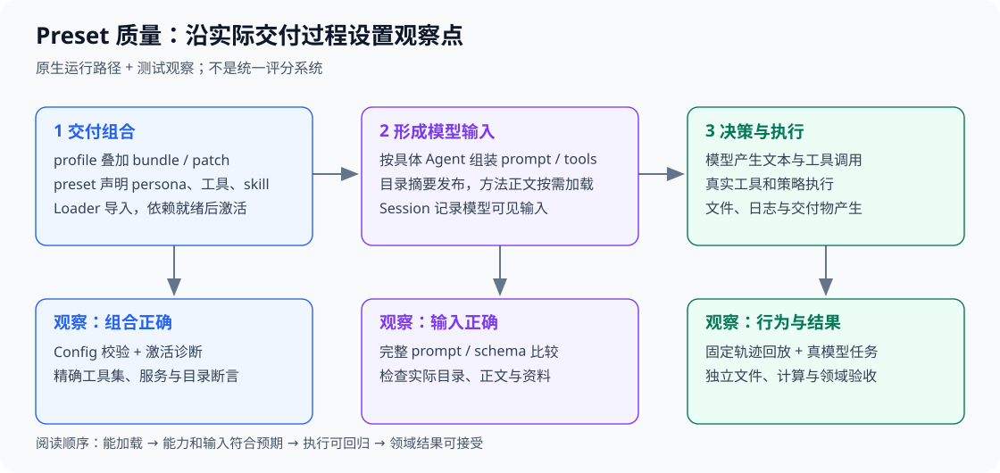

# 01 · Preset 的质量，究竟由哪些部分决定？

## 先确定开发对象

在熟悉的 Agent 系统中，角色通常由系统指引、工具和外部资料共同决定。DSH 把这些能力拆为插件，再用 preset 为某类 Agent 选择一组插件。persona 负责身份指引，只是组合中的一个成员。

因此，开发 preset 既可能改 YAML、角色文字和方法文件，也可能改工具插件、上下文注入代码或执行策略。关键是找到拥有行为的位置。本文先建立这张地图；注册审计、热更新与子会话恢复的完整规则放在[生命周期参考](./06-lifecycle-reference.md)。

## 一、从应用配置到执行中的 Agent

先区分“应用怎样启动”与“某个 Agent 获得什么能力”。DSH 的 Web、headless、SDK 是应用运行配置，称为 profile。一个 profile 叠加若干带代码和配置的 bundle；bundle 中的 patch 插入或修改插件行。Cordis 是加载与管理这些插件的框架，Loader 是读取插件配置并导入模块的组件。

preset 是这些插件行中一种有 ID 的声明，里面再列出供 Agent 使用的子插件。应用加载声明后，Agent 才能选择它；不会因为磁盘上出现一个同名目录就自动发现 preset。[原生架构](https://github.com/deepseek-ai/deepseek-harness/blob/master/docs/architecture.md#profiles-and-bundles)、[preset 声明代码](https://github.com/deepseek-ai/deepseek-harness/blob/master/packages/preset/agent-preset/src/index.ts)。



Agent 是活跃的执行对象，Session 是保存该次交互的日志。下文说“检查当前 Agent”，是因为同一应用里可以同时存在选用不同 preset 的 Agent；宿主的全局工具列表不等于某个 Agent 的实际工具列表。

## 二、直接读内置 standard 的声明

下面摘录原生 [standard 配置](https://github.com/deepseek-ai/deepseek-harness/blob/master/packages/bundle/web-app/presets/standard.patch.yml)的开头，只解释结构。原文件还有工具、技能与其他行；这个截取不能作为完整替换配置。

```yaml
- insert:
    - id: preset-standard
      name: '@deepseek-ai/dsh-agent-preset'
      config:
        id: standard
        order: 1
        plugins:
          - id: persona
            name: '@deepseek-ai/dsh-persona'
            config:
              prefix: You are a coding agent powered by the {{model}} model.
```

这里有两种 ID：`preset-standard` 用于配置修改时找到这一行，`standard` 是 Agent 选择并在会话中记录的身份。`plugins` 是完整子插件列表，`persona` 是其中的一行。`{{model}}` 在提示词渲染时替换，所以文件里的文字仍不是最终请求。

外层声明先校验必填字段，实际子插件还要经过各自配置校验、模块加载和依赖激活。更新完整 `config` 时不会深合并原来的子列表；遗漏某个工具可能让组合正常加载，却静默失去能力。针对已有 preset 内部的定向 patch 另有原生语法，实际编辑应遵循[组合编辑指导](https://github.com/deepseek-ai/deepseek-harness/blob/master/packages/preset/agent-preset/skills/editing-cordis-compositions/SKILL.md)，不能把截断示例当作增量修改。

## 三、角色文字之外，哪些代码共同决定质量？

先按职责理解代码，不必记住所有包名。服务在这里表示供其他插件调用的能力实现；provider 是提供该能力的实现，consumer 是使用它的组件。例如文件方法 provider 负责读取，模型侧 `skill` 工具负责让 Agent 调用。

| 要决定的行为 | 拥有它的部分 | 为什么只改 persona 不够 |
|---|---|---|
| 能用哪些工具和方法 | preset 声明、工具注册、方法 provider | 文字不会自动安装工具或发现目录 |
| 模型收到什么指引 | persona、提示词组装、步骤前的上下文注入 | 后续组装可能遮蔽或补充输入 |
| 方法正文从哪里来 | `skill-filesystem` 等 provider 与 `tool-skill` | 目录摘要、正文读取和模型使用分别发生 |
| 工具真正做什么 | 工具定义、执行流程、能力服务和策略 | 不展示工具与执行器拒绝是两类保障 |
| 行为能否追查和回归 | Agent loop、Session 日志、测试驱动 | 结果要关联实际输入、调用和副作用 |
| 成果是否值得采用 | 独立期望、领域计算与人工验收 | 加载和执行成功不自动说明结论正确 |

DSH 用“按 Agent 生效的注册”让不同 preset 的工具、提示词和方法贡献分别可见，这称为 scope。需要不同服务实例时另用 `isolate`。二者都不能直接解释为操作系统安全隔离。[作用域测试](https://github.com/deepseek-ai/deepseek-harness/blob/master/packages/preset/agent-preset-registry/tests/registry.spec.ts#L17-L35)、[服务放置说明](https://github.com/deepseek-ai/deepseek-harness/blob/master/packages/preset/agent-preset-registry/README.md#L56-L60)。

## 四、用 minimal 理解“最终输入要实测”

原生 [minimal 配置](https://github.com/deepseek-ai/deepseek-harness/blob/master/packages/bundle/web-app/presets/minimal.patch.yml)的 persona 设置 `complete: true`，把给定文字用作完整系统提示词；`includeRuntimeContext: false` 抑制可选运行上下文。工具 schema 和独立注入的上下文仍各有路径，标记为必需的当前工作目录也会保留。

所以完整系统提示词并不等于模型只看到这一段话。原生测试分别检查系统段落、实际工具集和会话中的运行上下文；minimal 的工具集恰为 `bash`、`read_image`、`working_directory`。[组合断言](https://github.com/deepseek-ai/deepseek-harness/blob/master/apps/cli/tests/web-agent-presets.e2e.ts#L347-L373)、[必需上下文断言](https://github.com/deepseek-ai/deepseek-harness/blob/master/apps/web/tests/minimal-preset.snapshot.ts#L81-L92)。

这也是为什么开发时应检查模型真正收到的请求。源文件、已注册插件、已组装段落与最终模型输入是不同观察位置。

## 五、修改以后，先记住两个生效规则

配置组合更新后，新绑定的 Agent 使用当前定义，原进程内已有 Agent 可以继续保留旧组合；验证新配置应使用明确的新会话。同时，磁盘 skill 的正文会在下次加载时重读，已经进入旧会话历史的正文不会自动消失。

因此，“preset 没变”不等于全部输入没变，“重新点一次新建”也不一定排除了空白草稿复用。日常先用干净会话验证新行为，需要验收更新、重启或子会话时，再按[生命周期参考](./06-lifecycle-reference.md)逐项测试。

到这里已经能判断一次行为改动涉及哪些部分。下一篇沿[原生 skill 路径完成一次修改](./02-development-walkthrough.md)，把这张地图用到实际开发步骤中。

> 核验状态见[核验基线登记](../00-baseline.md)。
