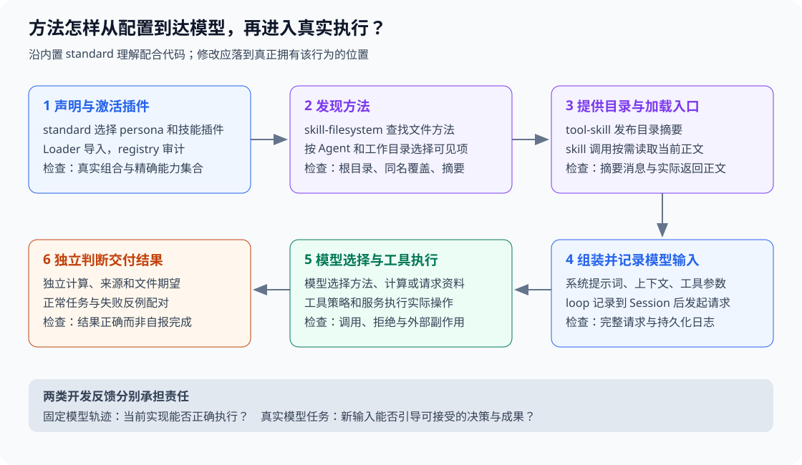

# 02 · 沿原生 Skill 路径，完成一次质量改动

## 这一篇要学会什么？

读完应能判断：一次 preset 行为改动应该改哪里，哪些配合代码要检查，怎样先获得确定性反馈，再判断模型是否真的改进。这里沿内置 `standard` 的技能路径走查；“报价审查缺汇率时应停止计算”只是说明用需求，没有为它发明新 profile、工具或一套未执行的安装方案。

前置知识仅需[第一篇](./01-definition-and-lifecycle.md)中的 preset、persona、skill 与实际能力之别。先把完整改动走一遍，回放格式和构建机制等细节再查[原生验证参考](./05-native-verification-reference.md)。

## 第一步：把“回答不专业”变成一正一反的承诺

假设助手在缺少汇率依据时仍给最终跨币种总价。开发目标同时包括：资料缺失时标记缺口，不编造汇率；资料完整时仍能完成正确计算。否则把所有任务都拒绝，也能满足单独的“不编造”检查。

这一步先固定任务、资料和独立结果判据。计算规则、可接受来源和禁止修改的原件由需求决定，不能从模型此次输出倒推 expected。DSH 的[外部结果断言政策](https://github.com/deepseek-ai/deepseek-harness/blob/master/docs/testing.md#verify-the-world-not-the-self-report)要求重新读取文件或执行命令检查真实效果；“模型说已完成”不能作为完成依据。

此时得到的开发资产是小规模、能区分正确和错误的场景，而不只是新增一句“请认真核对”。领域场景设计详见[行为验收篇](./03-behavior-evaluation.md)。

## 第二步：沿实际输入路径定位，避免改错层

图展示跨多个模型步骤的过程：先看到目录，模型才可能调用 `skill`，正文进入后续请求，再继续执行；不是在首个请求前自动载入全部方法。

内置 [standard 声明](https://github.com/deepseek-ai/deepseek-harness/blob/master/packages/bundle/web-app/presets/standard.patch.yml)同时加载 persona、`skill-filesystem` 和 `tool-skill`。三者各管一件不同的事：身份指引、方法文件发现与读取、向模型提供目录和正文加载入口。完整请求还要经过系统提示词组装与 Agent loop；一个方法文件放在磁盘上，并没有完成这条路径。

| 沿路径检查 | 原生实现做什么 | 发现异常后通常修改哪里 |
|---|---|---|
| preset 子插件确实激活了吗？ | preset 注册中心挂载、审计子插件；工具按 Agent 可见 | 组合声明、依赖、配置或插件注册 |
| 该 Agent 能发现目标方法吗？ | 文件方法提供者按当前 Agent 和工作目录发现，技能服务合并结果 | 方法根、同名覆盖、发现元数据 |
| 模型收到目录摘要了吗？ | `tool-skill` 在步骤开始前，按可见 loader 与摘要变化发布会话上下文 | 工具可见性、description 或目录发布逻辑 |
| 正文何时进入请求？ | `skill` 读取当时的正文并返回；用户显式调用也可注入正文 | 方法正文、加载路径或调用规则 |
| 这次请求究竟看到了什么？ | loop 把组装与注入输入记录到 Session，再派生模型历史 | 检查实际日志，不只检查源文件 |
| 真正的执行限制在哪里？ | 工具与其执行策略处理调用，服务实现执行操作 | 执行器和策略；persona 只负责指引 |

原生出处：[方法读取](https://github.com/deepseek-ai/deepseek-harness/blob/master/packages/skill/skill-filesystem/src/index.ts#L209-L224)、[目录与正文加载](https://github.com/deepseek-ai/deepseek-harness/blob/master/packages/skill/tool-skill/src/index.ts#L128-L253)、[组装规则](https://github.com/deepseek-ai/deepseek-harness/blob/master/packages/core/system-prompt/src/index.ts#L630-L686)、[工具执行流程](https://github.com/deepseek-ai/deepseek-harness/blob/master/docs/tool-execution-pipeline.md)。

对报价例子，先确认正文是否进入日志。没有发现方法就修根和摘要；正文规则不清就修正文；正确规则已到达模型却仍误用，就要测试模型决策。若承诺原件不可写，应把禁止落实到拥有执行权的实现中，并直接测试拒绝。不会因为“都是 preset 的问题”就一律修改 persona。

### 先分配文字与代码的拥有位置

DSH 对模型指引也划分责任：角色职责属于 persona，单工具的语义和选择条件属于工具描述，跨调用习惯由相应插件贡献提示词段落，当前目录等运行事实由拥有该状态的服务提供。这样卸载工具或更换实现时，不必逐个修补角色文字。`standard` 的 `{{model}}` 也取自实际 Agent 路由，避免手写名称后失真。[指引归属的理由](https://github.com/deepseek-ai/deepseek-harness/blob/master/.agents/notes/implemented/architecture/2026-07-05-prompt-variables-and-tool-guidance-ownership.md)、[当前组装实现](https://github.com/deepseek-ai/deepseek-harness/blob/master/packages/core/system-prompt/src/index.ts)。

对应到开发动作：shell 限制变化，修改工具定义和执行实现，并验收最终说明；角色是否应提交审查报告变化，再改 persona 或方法。不要让角色文字承担所有底层工具的同步义务。

配合服务还要看谁在使用它。原生 token meter 统计每个会话的上下文，但结果注册在全进程共享的投影表中，所以服务放在宿主，preset 选择自己的压缩能力。否则，一个角色的上下文显示可能依赖另一个 preset 是否已挂载。原生测试在创建任何 Agent 前读取宿主服务，再检查 minimal 也有计量结果。[服务归属的取舍](https://github.com/deepseek-ai/deepseek-harness/blob/master/.agents/notes/implemented/architecture/2026-08-10-host-plane-ownership-after-presets.md)、[真实组合断言](https://github.com/deepseek-ai/deepseek-harness/blob/master/apps/cli/tests/web-agent-presets.e2e.ts#L253-L277)。这是组合代码质量问题，增加角色指引无法修复。

## 第三步：先固定可确定的输入与能力

有两类原生测试可以借鉴，但它们回答不同问题。

[真实 Web 组合测试](https://github.com/deepseek-ai/deepseek-harness/blob/master/apps/cli/tests/web-agent-presets.e2e.ts#L591-L650)创建临时项目方法，通过实际 Web 配置加载的 `standard` 检查 global 与项目方法共同可见，再通过当前 Agent 的 `skill` 工具读取正文；`minimal` 即使能在服务层读到 global 方法，也没有模型 loader。这个反差能发现“注册表查得到，却没有给模型入口”的错误。

[正文更新测试](https://github.com/deepseek-ai/deepseek-harness/blob/master/packages/skill/tool-skill/tests/tool-skill.spec.ts#L660-L684)则先写 `First body.`，再保持 description 不变、把正文改为 `Second body.`。后续步骤不重复发布目录，但调用 `skill` 必须得到新正文。测试断言目录消息仍只有一份，并确认工具结果包含新正文、不含旧正文。

这揭示了一个对质量迭代很关键的事实：**目录没有变化，不代表模型加载的内容没有变化。** 如果只固定工具 schema 和目录摘要，会漏掉正文变化；需要同时检查实际加载结果。旧会话里已载入的旧正文也不会自动被新文件抹去。

本专题实际执行了上述相关机制测试和定向组合测试，结果见[执行记录](./research-runtime.md#9-本轮补充核验与执行记录)。这些用例是如何验证方法路径的现成范例，不是报价任务已经实现的声明。

## 第四步：把执行回归与新决策验收分别做实

先用已有或编写的模型轨迹固定决策，让当前程序重新执行。原生无 Key 回放保留真实 loop、工具和日志路径，因此可以稳定发现加载正文、调用结果、交接或文件写入的变化；提示词和工具 schema 的完整比较也让输入差异进入评审。[回放参考](./05-native-verification-reference.md#三无-key-回放究竟固定什么重跑什么)解释具体执行与独立工作区断言。

然后对需要新决策的修改运行当前真实模型。报价例子至少跑缺资料与完整资料两个任务，观察模型是否加载合适方法、是否编造依据、能否完成正常任务。评判最终数字、来源和原件是否变化，而不是强制某句回答。若自主选方法正是被测能力，输入里就不能预先给出全部选择答案。

两类反馈之间有一个实际分工：固定轨迹告诉你“在相同决策下，当前程序是否还能正确执行”；真模型告诉你“修改后的输入是否让当前模型作出可接受选择”。提示词改坏时，旧模型调用仍可能执行成功，所以两者需要各自的判据。

## 第五步：审查差异，确认修改真的被选中验证

DSH 要求非平凡模型、协议或用户可见变化在同一 PR 更新 keyless recorded-session 场景。更新录制后要审查 Session、prompt、schema 和交付结果，独立工作区期望不随 record/refresh 自动重写。对于新的重要守卫，还要在隔离夹具引入目标错误，确认检查会失败。[原生要求](https://github.com/deepseek-ai/deepseek-harness/blob/master/docs/testing.md#when-a-snapshot-test-is-required)。

如果只改方法规则，优先验证实际正文和模型正反例；如果改插件、工具注册、服务或加载路径，再扩大到真实组合与相应行为测试。改打包资源、exports 或运行入口，还需构建产物验证。不要仅凭文件是 Markdown 或 YAML 就跳过行为检查，也不必为每次方法改动重跑整个仓库。

完成这次修改时，应能回答三个问题：本次改变了哪类行为？哪项独立观察说明改动有效？相关正常任务和其他消费者是否仍然成立？模型标识、方法与资料版本、场景结果和未测项应随证据保留；[长期迭代篇](./04-long-term-development.md)说明怎样持续维护这些连接。

## 这次走查揭示的 DSH 特点

preset 的开发对象包含插件组合、模型输入、执行策略和结果判据。DSH 用按 Agent 生效的注册控制组合，用可重建请求的日志连接输入与执行，用固定模型流把集成回归变得确定，再用外部结果检查避免自报成功。这些机制使“为什么做错、应该改哪里、改后怎样发现退步”有了可观察的路径；模型是否理解方法、领域判断是否正确仍要由相应任务验收。

> 核验状态见[核验基线登记](../00-baseline.md)。
